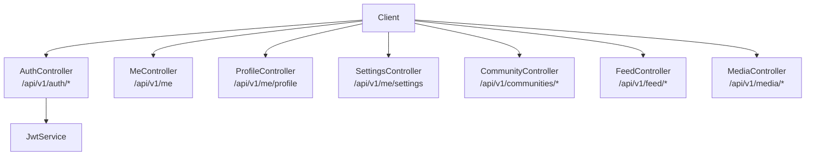
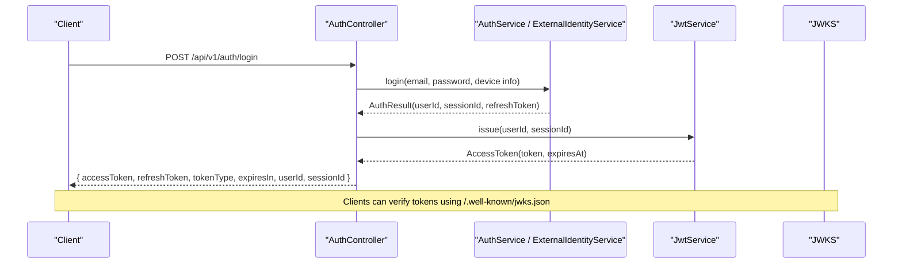
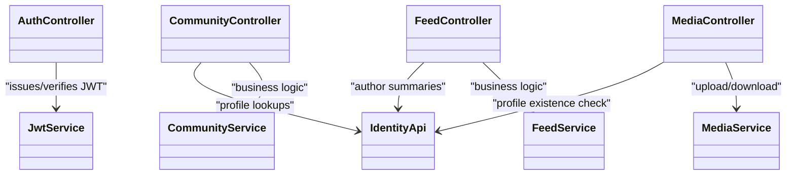

# API Reference

<cite>
**Referenced Files in This Document**
- [auth-api-v1.yaml](file://diasporum-backend/docs/auth-api-v1.yaml)
- [authentication-operations.md](file://diasporum-backend/docs/authentication-operations.md)
- [AuthController.java](file://diasporum-backend/src/main/java/com/diasporum/backend/identity/internal/api/rest/AuthController.java)
- [MeController.java](file://diasporum-backend/src/main/java/com/diasporum/backend/identity/internal/api/rest/MeController.java)
- [ProfileController.java](file://diasporum-backend/src/main/java/com/diasporum/backend/identity/internal/api/rest/ProfileController.java)
- [SettingsController.java](file://diasporum-backend/src/main/java/com/diasporum/backend/identity/internal/api/rest/SettingsController.java)
- [CommunityController.java](file://diasporum-backend/src/main/java/com/diasporum/backend/community/internal/api/rest/CommunityController.java)
- [FeedController.java](file://diasporum-backend/src/main/java/com/diasporum/backend/feed/internal/api/rest/FeedController.java)
- [MediaController.java](file://diasporum-backend/src/main/java/com/diasporum/backend/media/internal/api/rest/MediaController.java)
- [JwtService.java](file://diasporum-backend/src/main/java/com/diasporum/backend/security/JwtService.java)
- [ApiError.java](file://diasporum-backend/src/main/java/com/diasporum/backend/platform/api/error/ApiError.java)
</cite>

## Table of Contents
1. [Introduction](#introduction)
2. [Project Structure](#project-structure)
3. [Core Components](#core-components)
4. [Architecture Overview](#architecture-overview)
5. [Detailed Component Analysis](#detailed-component-analysis)
6. [Dependency Analysis](#dependency-analysis)
7. [Performance Considerations](#performance-considerations)
8. [Troubleshooting Guide](#troubleshooting-guide)
9. [Conclusion](#conclusion)
10. [Appendices](#appendices)

## Introduction
This document provides comprehensive API documentation for the DIASPORUM REST endpoints exposed by the backend service. It covers authentication, user profile and settings, community management, feed/content operations, and media handling. The authentication model uses RS256 JWT access tokens with opaque refresh tokens and database-backed sessions. All error responses follow a standard envelope.

Key concepts:
- Authentication: Bearer JWT (RS256) issued by the backend; refresh token rotation; session revocation.
- Base path: `/api/v1`.
- Error envelope: `{ status, code, message, path, timestamp, fieldErrors }`.
- Public discovery endpoint: `/.well-known/jwks.json`.

**Section sources**
- [auth-api-v1.yaml:1-22](file://diasporum-backend/docs/auth-api-v1.yaml#L1-L22)
- [ApiError.java:1-29](file://diasporum-backend/src/main/java/com/diasporum/backend/platform/api/error/ApiError.java#L1-L29)

## Project Structure
The REST surface is organized by feature modules under `/api/v1`:
- Identity/Auth: `/api/v1/auth/**`
- Profile and Settings: `/api/v1/me/profile`, `/api/v1/me/settings`, `/api/v1/me/privacy-settings`
- Community: `/api/v1/me/communities/**`, `/api/v1/communities/**`
- Feed: `/api/v1/feed/**`
- Media: `/api/v1/media/**`

**Diagram sources**
- [AuthController.java:23-25](file://diasporum-backend/src/main/java/com/diasporum/backend/identity/internal/api/rest/AuthController.java#L23-L25)
- [MeController.java:15-17](file://diasporum-backend/src/main/java/com/diasporum/backend/identity/internal/api/rest/MeController.java#L15-L17)
- [ProfileController.java:31-33](file://diasporum-backend/src/main/java/com/diasporum/backend/identity/internal/api/rest/ProfileController.java#L31-L33)
- [SettingsController.java:22-24](file://diasporum-backend/src/main/java/com/diasporum/backend/identity/internal/api/rest/SettingsController.java#L22-L24)
- [CommunityController.java:28-30](file://diasporum-backend/src/main/java/com/diasporum/backend/community/internal/api/rest/CommunityController.java#L28-L30)
- [FeedController.java:29-31](file://diasporum-backend/src/main/java/com/diasporum/backend/feed/internal/api/rest/FeedController.java#L29-L31)
- [MediaController.java:20-22](file://diasporum-backend/src/main/java/com/diasporum/backend/media/internal/api/rest/MediaController.java#L20-L22)
- [JwtService.java:29-30](file://diasporum-backend/src/main/java/com/diasporum/backend/security/JwtService.java#L29-L30)

**Section sources**
- [AuthController.java:23-25](file://diasporum-backend/src/main/java/com/diasporum/backend/identity/internal/api/rest/AuthController.java#L23-L25)
- [CommunityController.java:28-30](file://diasporum-backend/src/main/java/com/diasporum/backend/community/internal/api/rest/CommunityController.java#L28-L30)
- [FeedController.java:29-31](file://diasporum-backend/src/main/java/com/diasporum/backend/feed/internal/api/rest/FeedController.java#L29-L31)
- [MediaController.java:20-22](file://diasporum-backend/src/main/java/com/diasporum/backend/media/internal/api/rest/MediaController.java#L20-L22)

## Core Components
- Authentication controller exposes registration, login, social sign-in, refresh, logout, email verification, password reset/change, session management, and external identity linking.
- Identity endpoints provide current user info (`/api/v1/me`) and profile/settings management.
- Community endpoints manage memberships, roles, and member visibility.
- Feed endpoints support posts, comments, reactions, saves, views, polls, and help posts.
- Media endpoints implement an initiate-complete-download flow with presigned URLs.

Security and configuration notes:
- Access tokens are RS256 JWTs with configurable issuer, audience, kid, and TTL.
- Refresh tokens are opaque and rotated on use; replaying revoked tokens revokes the family.
- Sessions are device-scoped and stored in the database.
- CORS is configured via environment variables; no wildcard credentials.

**Section sources**
- [auth-api-v1.yaml:9-22](file://diasporum-backend/docs/auth-api-v1.yaml#L9-L22)
- [authentication-operations.md:8-52](file://diasporum-backend/docs/authentication-operations.md#L8-L52)
- [authentication-operations.md:156-164](file://diasporum-backend/docs/authentication-operations.md#L156-L164)
- [JwtService.java:20-28](file://diasporum-backend/src/main/java/com/diasporum/backend/security/JwtService.java#L20-L28)

## Architecture Overview
Authentication flow overview:
- Clients authenticate via password or provider ID tokens.
- Backend issues a signed JWT access token and an opaque refresh token.
- Protected endpoints require a valid Bearer token.
- JWKS is available for clients to verify signatures.

**Diagram sources**
- [AuthController.java:105-110](file://diasporum-backend/src/main/java/com/diasporum/backend/identity/internal/api/rest/AuthController.java#L105-L110)
- [AuthController.java:74-79](file://diasporum-backend/src/main/java/com/diasporum/backend/identity/internal/api/rest/AuthController.java#L74-L79)
- [JwtService.java:108-129](file://diasporum-backend/src/main/java/com/diasporum/backend/security/JwtService.java#L108-L129)
- [auth-api-v1.yaml:36-60](file://diasporum-backend/docs/auth-api-v1.yaml#L36-L60)

## Detailed Component Analysis

### Authentication API (/api/v1/auth)
Endpoints:
- `POST /api/v1/auth/register` — Create account (PENDING_VERIFICATION).
- `POST /api/v1/auth/login` — Password login; returns access + refresh tokens.
- `POST /api/v1/auth/google` — Google ID token login.
- `POST /api/v1/auth/apple` — Apple ID token login.
- `POST /api/v1/auth/refresh` — Rotate refresh token.
- `POST /api/v1/auth/verify-email` — Consume verification token.
- `POST /api/v1/auth/resend-verification` — Resend verification link.
- `POST /api/v1/auth/forgot-password` — Request reset link.
- `POST /api/v1/auth/reset-password` — Reset password (revokes sessions/tokens).
- `GET /api/v1/auth/me` — Current account identity.
- `GET /api/v1/auth/sessions` — List active sessions.
- `DELETE /api/v1/auth/sessions/{sessionId}` — Revoke one session.
- `POST /api/v1/auth/logout` — Revoke current session and refresh tokens.
- `POST /api/v1/auth/logout-all` — Revoke all sessions and refresh tokens.
- `POST /api/v1/auth/change-password` — Change password (revokes all sessions).
- `POST /api/v1/auth/link/google` — Link Google identity.
- `POST /api/v1/auth/link/apple` — Link Apple identity.
- `DELETE /api/v1/auth/link/{externalIdentityId}` — Unlink external identity.

Request/response schemas:
- RegisterRequest: email, password.
- LoginRequest: email, password.
- ExternalLoginRequest: idToken.
- RefreshRequest: refreshToken.
- VerifyEmailRequest: token.
- ResendVerificationRequest: email.
- ForgotPasswordRequest: email.
- ResetPasswordRequest: token, password.
- ChangePasswordRequest: currentPassword, newPassword.
- AuthResponse: accessToken, refreshToken, tokenType, expiresIn, userId, sessionId.
- MeResponse: id, email, accountStatus, emailVerifiedAt.
- SessionView: id, clientType, authMethod, deviceName, createdAt, lastUsedAt.

Authentication requirements:
- Public endpoints: register, login, google, apple, refresh, verify-email, resend-verification, forgot-password, reset-password.
- Bearer JWT required: me, sessions, revoke session, logout, logout-all, change-password, link/unlink providers.

Common status codes:
- 200/201/204 on success.
- 400 validation failures.
- 401 invalid/expired token or invalid credentials.
- 403 account suspended/restricted.
- 409 conflict (e.g., email taken, provider already linked).

Error envelope:
- ApiError: status, code, message, path, timestamp, fieldErrors.

Rate limiting:
- Not implemented at the API layer in the analyzed controllers.

Best practices:
- Store refresh tokens securely; rotate on each refresh.
- Handle 401 by refreshing once; if still unauthorized, prompt re-login.
- Use `/.well-known/jwks.json` to verify access tokens.

**Section sources**
- [auth-api-v1.yaml:61-335](file://diasporum-backend/docs/auth-api-v1.yaml#L61-L335)
- [auth-api-v1.yaml:337-445](file://diasporum-backend/docs/auth-api-v1.yaml#L337-L445)
- [AuthController.java:40-70](file://diasporum-backend/src/main/java/com/diasporum/backend/identity/internal/api/rest/AuthController.java#L40-L70)
- [AuthController.java:96-228](file://diasporum-backend/src/main/java/com/diasporum/backend/identity/internal/api/rest/AuthController.java#L96-L228)
- [ApiError.java:1-29](file://diasporum-backend/src/main/java/com/diasporum/backend/platform/api/error/ApiError.java#L1-L29)

### User Profile and Settings APIs
Endpoints:
- `GET /api/v1/me` — Current user profile summary.
- `GET /api/v1/me/profile` — Full profile details.
- `PATCH /api/v1/me/profile` — Update profile fields (whitelist enforced).
- `GET /api/v1/me/profile/completion` — Profile completion state.
- `GET /api/v1/usernames/availability` — Check username availability.
- `GET /api/v1/countries` — Active countries list.
- `GET /api/v1/me/settings` — User settings.
- `PATCH /api/v1/me/settings` — Update settings (whitelist enforced).
- `GET /api/v1/me/privacy-settings` — Privacy settings.
- `PATCH /api/v1/me/privacy-settings` — Update privacy settings (whitelist enforced).

Authentication:
- Bearer JWT required for all endpoints.

Validation:
- PATCH bodies accept only whitelisted keys; unknown keys return a validation error.

**Section sources**
- [MeController.java:15-33](file://diasporum-backend/src/main/java/com/diasporum/backend/identity/internal/api/rest/MeController.java#L15-L33)
- [ProfileController.java:31-105](file://diasporum-backend/src/main/java/com/diasporum/backend/identity/internal/api/rest/ProfileController.java#L31-L105)
- [SettingsController.java:22-93](file://diasporum-backend/src/main/java/com/diasporum/backend/identity/internal/api/rest/SettingsController.java#L22-L93)

### Community Management APIs
Endpoints:
- `GET /api/v1/me/communities` — My communities.
- `GET /api/v1/me/communities/available` — Available communities for joining.
- `GET /api/v1/me/communities/{communityId}` — My membership in a community.
- `GET /api/v1/me/active-community` — Get active community.
- `PUT /api/v1/me/active-community` — Set active community.
- `GET /api/v1/me/community-preview` — Onboarding preview community.
- `POST /api/v1/me/onboarding/complete` — Complete onboarding (idempotent).
- `POST /api/v1/communities/{communityId}/join` — Join a community.
- `GET /api/v1/communities/{communityId}/membership` — Membership view.
- `DELETE /api/v1/communities/{communityId}/membership` — Leave a community.
- `GET /api/v1/communities/{communityId}/members` — Paginated members list (hidden filtering applied).
- `GET /api/v1/communities/{communityId}/members/{userId}` — Member detail.
- `DELETE /api/v1/communities/{communityId}/members/{userId}` — Remove member (admin).
- `POST /api/v1/communities/{communityId}/members/{userId}/role` — Change role.

Authentication:
- Bearer JWT required.

Pagination and limits:
- Page size defaults and maximums are enforced server-side.

**Section sources**
- [CommunityController.java:28-182](file://diasporum-backend/src/main/java/com/diasporum/backend/community/internal/api/rest/CommunityController.java#L28-L182)

### Feed and Content APIs
Endpoints:
- Posts:
  - `POST /api/v1/feed/posts` — Create post.
  - `GET /api/v1/feed/posts/{postId}` — Get post.
  - `PATCH /api/v1/feed/posts/{postId}` — Update post.
  - `DELETE /api/v1/feed/posts/{postId}` — Delete post.
- Feeds:
  - `GET /api/v1/feed/community?communityId=...&mode=FOR_YOU|...&categoryId=...&cursor=...&size=...` — Community feed.
  - `GET /api/v1/feed/following?cursor=...&size=...` — Following feed.
  - `GET /api/v1/feed/reels/community?communityId=...&cursor=...&size=...` — Reels feed.
- Engagement:
  - `PUT /api/v1/feed/posts/{postId}/reaction` — React.
  - `DELETE /api/v1/feed/posts/{postId}/reaction` — Unreact.
  - `PUT /api/v1/feed/posts/{postId}/save` — Save.
  - `DELETE /api/v1/feed/posts/{postId}/save` — Unsave.
  - `POST /api/v1/feed/views` — Record view.
- Comments:
  - `POST /api/v1/feed/posts/{postId}/comments` — Add comment (optional parent).
  - `GET /api/v1/feed/posts/{postId}/comments?page=...&size=...` — List comments.
  - `PATCH /api/v1/feed/comments/{commentId}` — Update comment.
  - `DELETE /api/v1/feed/comments/{commentId}` — Delete comment.
- Community help:
  - `POST /api/v1/feed/community-help` — Create help post.
  - `PATCH /api/v1/feed/community-help/{postId}/status` — Update help status.
- Author resolution:
  - `GET /api/v1/feed/authors?ids=...` — Batch author summaries.
- Polls:
  - `POST /api/v1/feed/polls` — Create poll.
  - `GET /api/v1/feed/polls/{postId}` — Get poll.
  - `POST /api/v1/feed/polls/options/{optionId}/vote` — Vote or withdraw.

Authentication:
- Bearer JWT required.

Error handling:
- Duplicate vote attempts return conflict.

**Section sources**
- [FeedController.java:29-244](file://diasporum-backend/src/main/java/com/diasporum/backend/feed/internal/api/rest/FeedController.java#L29-L244)

### Media Handling Endpoints
Endpoints:
- `POST /api/v1/media/uploads` — Initiate upload (purpose, mimeType, declaredSizeBytes).
- `POST /api/v1/media/uploads/{assetId}/complete` — Complete upload (declaredSizeBytes optional).
- `DELETE /api/v1/media/uploads/{assetId}` — Cancel pending upload.
- `GET /api/v1/media/{assetId}` — Asset metadata (owner-only).
- `POST /api/v1/media/{assetId}/download-url` — Obtain signed download URL (owner-only).
- `DELETE /api/v1/media/{assetId}` — Delete asset (owner-only).

Authentication:
- Bearer JWT required.

Workflow:
- Client initiates upload, receives assetId and presigned uploadUrl.
- Client uploads directly to storage using presigned URL.
- Client completes upload; backend validates and marks asset READY.
- Owner requests a signed download URL for consumption.

Constraints:
- Purpose and MIME type must be allowed.
- File size limits enforced.
- Ownership checks enforced on read/delete/download-url.

**Section sources**
- [MediaController.java:20-91](file://diasporum-backend/src/main/java/com/diasporum/backend/media/internal/api/rest/MediaController.java#L20-L91)
- [MediaService.java:90-180](file://diasporum-backend/src/main/java/com/diasporum/backend/media/internal/application/MediaService.java#L90-L180)

## Dependency Analysis
High-level dependencies between controllers and services:
- AuthController depends on AuthService, SessionService, JwtService, ExternalIdentityService.
- CommunityController depends on IdentityApi and CommunityService.
- FeedController depends on IdentityApi and FeedService.
- MediaController depends on IdentityApi and MediaService.
- JwtService provides signing, verification, and JWKS generation.

**Diagram sources**
- [AuthController.java:27-38](file://diasporum-backend/src/main/java/com/diasporum/backend/identity/internal/api/rest/AuthController.java#L27-L38)
- [CommunityController.java:35-41](file://diasporum-backend/src/main/java/com/diasporum/backend/community/internal/api/rest/CommunityController.java#L35-L41)
- [FeedController.java:33-39](file://diasporum-backend/src/main/java/com/diasporum/backend/feed/internal/api/rest/FeedController.java#L33-L39)
- [MediaController.java:24-30](file://diasporum-backend/src/main/java/com/diasporum/backend/media/internal/api/rest/MediaController.java#L24-L30)
- [JwtService.java:29-30](file://diasporum-backend/src/main/java/com/diasporum/backend/security/JwtService.java#L29-L30)

**Section sources**
- [AuthController.java:27-38](file://diasporum-backend/src/main/java/com/diasporum/backend/identity/internal/api/rest/AuthController.java#L27-L38)
- [CommunityController.java:35-41](file://diasporum-backend/src/main/java/com/diasporum/backend/community/internal/api/rest/CommunityController.java#L35-L41)
- [FeedController.java:33-39](file://diasporum-backend/src/main/java/com/diasporum/backend/feed/internal/api/rest/FeedController.java#L33-L39)
- [MediaController.java:24-30](file://diasporum-backend/src/main/java/com/diasporum/backend/media/internal/api/rest/MediaController.java#L24-L30)

## Performance Considerations
- Pagination: Community members and feed endpoints use page/size parameters; respect server-side maximums.
- Cursor-based feeds: Feed endpoints support cursor pagination for efficient scrolling.
- Media: Use presigned URLs to offload large file transfers directly to storage; cache signed URLs client-side with expiry awareness.
- Token rotation: Refresh tokens are single-use; avoid concurrent refresh calls to prevent accidental family revocation.

[No sources needed since this section provides general guidance]

## Troubleshooting Guide
Common errors and handling:
- Validation failures: 400 with ApiError including fieldErrors.
- Unauthorized: 401 when access token is missing, invalid, expired, or session revoked.
- Forbidden: 403 when account is suspended/restricted or ownership checks fail.
- Conflict: 409 for duplicate operations (e.g., email taken, provider already linked, vote conflicts).

JWT key configuration:
- Ensure private/public keys are correctly paired; startup fails fast on mismatch.
- For local development, ephemeral keys may be enabled; production requires configured keys.

CORS:
- Configure allowed origins; preflight for unlisted origins returns 403 without CORS headers.

**Section sources**
- [ApiError.java:1-29](file://diasporum-backend/src/main/java/com/diasporum/backend/platform/api/error/ApiError.java#L1-L29)
- [authentication-operations.md:67-82](file://diasporum-backend/docs/authentication-operations.md#L67-L82)
- [authentication-operations.md:156-164](file://diasporum-backend/docs/authentication-operations.md#L156-L164)

## Conclusion
The DIASPORUM API provides a secure, modular REST surface covering authentication, profiles, communities, feed content, and media. Authentication relies on RS256 JWTs with robust refresh token rotation and session management. Consumers should handle token lifecycle carefully, respect pagination and rate considerations, and leverage presigned URLs for media.

[No sources needed since this section summarizes without analyzing specific files]

## Appendices

### Security and Best Practices
- Always send Bearer tokens in the Authorization header.
- Implement refresh-on-401 with backoff; clear local state on logout.
- Validate provider ID tokens on the client side before sending to the backend.
- Cache signed media URLs with conservative expiry.
- Avoid logging sensitive data (tokens, passwords, emails).

**Section sources**
- [auth-api-v1.yaml:337-343](file://diasporum-backend/docs/auth-api-v1.yaml#L337-L343)
- [authentication-operations.md:84-107](file://diasporum-backend/docs/authentication-operations.md#L84-L107)

### Client Implementation Guidelines
- Use the OpenAPI spec for request/response shapes where applicable.
- For mobile/web, integrate JWKS fetching for token verification if needed.
- Respect pagination parameters and cursor semantics.
- For media uploads, implement initiate → upload → complete → download-url flow.

**Section sources**
- [auth-api-v1.yaml:1-22](file://diasporum-backend/docs/auth-api-v1.yaml#L1-L22)
- [MediaController.java:39-91](file://diasporum-backend/src/main/java/com/diasporum/backend/media/internal/api/rest/MediaController.java#L39-L91)