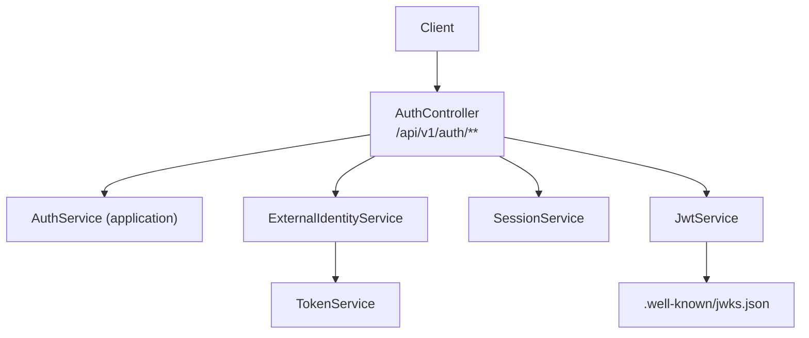
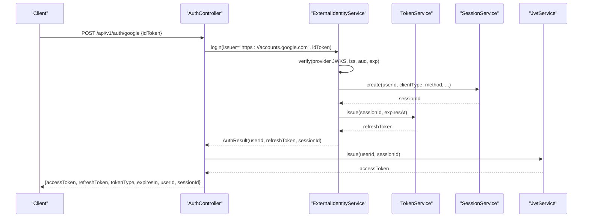
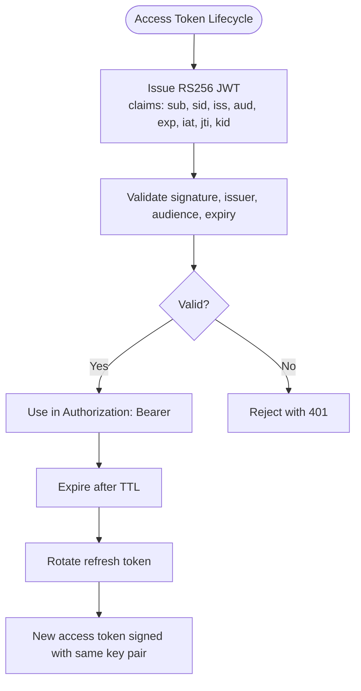
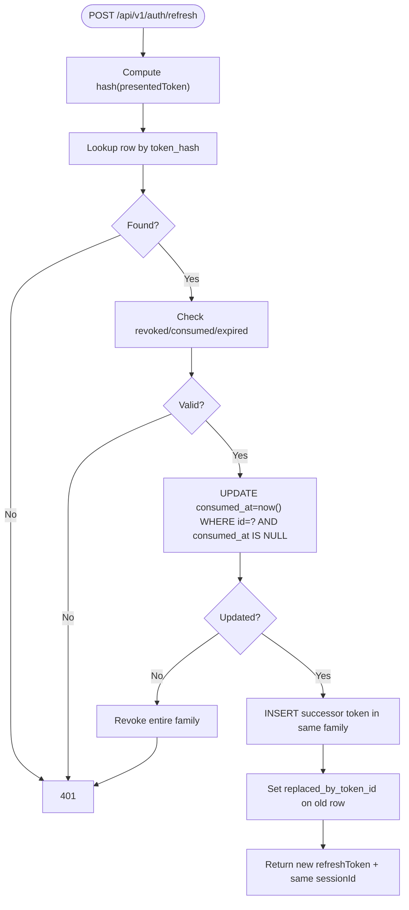
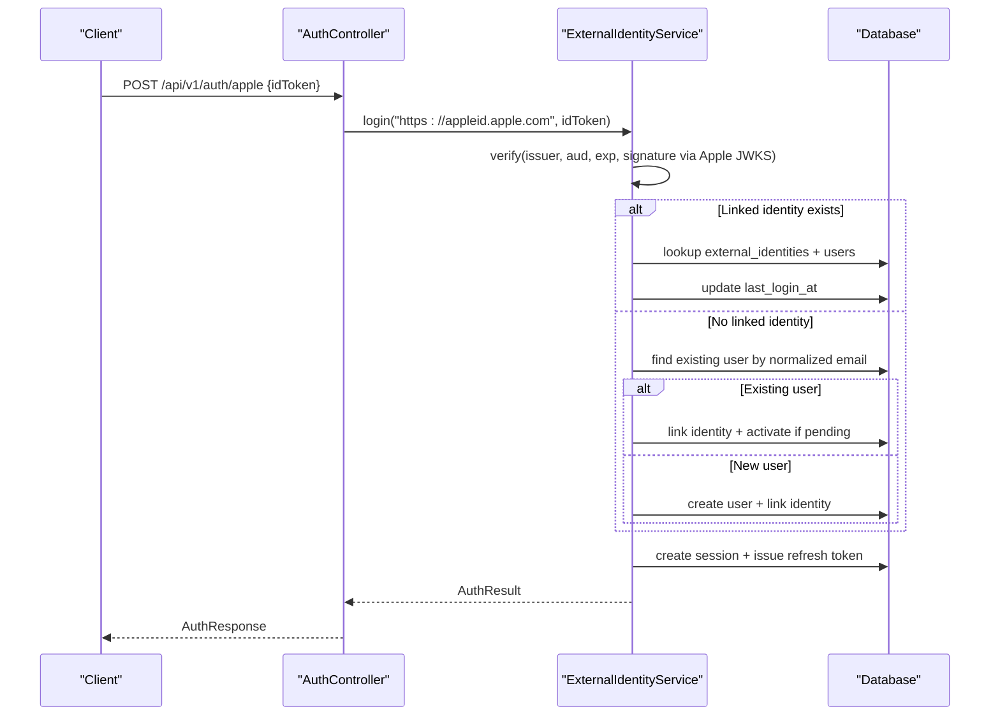
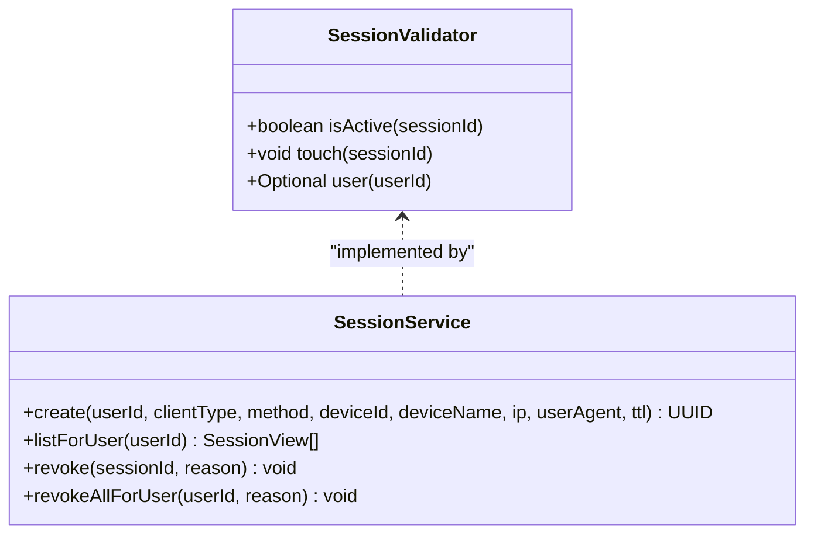
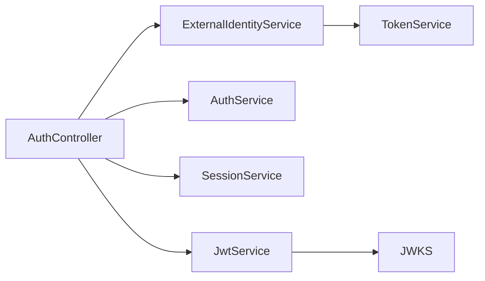

# Authentication API

<cite>
**Referenced Files in This Document**   
- [auth-api-v1.yaml](file://diasporum-backend/docs/auth-api-v1.yaml)
- [authentication-operations.md](file://diasporum-backend/docs/authentication-operations.md)
- [AuthController.java](file://diasporum-backend/src/main/java/com/diasporum/backend/identity/internal/api/rest/AuthController.java)
- [MeController.java](file://diasporum-backend/src/main/java/com/diasporum/backend/identity/internal/api/rest/MeController.java)
- [ExternalIdentityService.java](file://diasporum-backend/src/main/java/com/diasporum/backend/identity/internal/application/ExternalIdentityService.java)
- [JwtService.java](file://diasporum-backend/src/main/java/com/diasporum/backend/security/JwtService.java)
- [SessionValidator.java](file://diasporum-backend/src/main/java/com/diasporum/backend/security/SessionValidator.java)
- [TokenService.java](file://diasporum-backend/src/main/java/com/diasporum/backend/identity/internal/application/TokenService.java)
- [SessionService.java](file://diasporum-backend/src/main/java/com/diasporum/backend/identity/internal/application/SessionService.java)
- [AuthFlowIntegrationTest.java](file://diasporum-backend/src/test/java/com/diasporum/backend/identity/AuthFlowIntegrationTest.java)
</cite>

## Table of Contents
1. [Introduction](#introduction)
2. [Project Structure](#project-structure)
3. [Core Components](#core-components)
4. [Architecture Overview](#architecture-overview)
5. [Detailed Component Analysis](#detailed-component-analysis)
6. [Dependency Analysis](#dependency-analysis)
7. [Performance Considerations](#performance-considerations)
8. [Troubleshooting Guide](#troubleshooting-guide)
9. [Conclusion](#conclusion)
10. [Appendices](#appendices)

## Introduction
This document provides comprehensive API documentation for the Diasporum Authentication API as implemented in the backend codebase and OpenAPI specification. It covers all authentication-related HTTP methods, including registration, password login, Google and Apple social sign-in, token refresh, email verification, password reset, session management, logout, and external identity linking. It also documents the JWT access-token model, opaque refresh-token rotation, session handling, error response shape, configuration, security considerations, and operational guidance.

The API is versioned under `/api/v1` and exposes both unauthenticated public endpoints (registration, login, provider sign-in, token operations) and protected endpoints requiring a Bearer RS256 JWT access token.

**Section sources**
- [auth-api-v1.yaml:1-22](file://diasporum-backend/docs/auth-api-v1.yaml#L1-L22)
- [authentication-operations.md:1-5](file://diasporum-backend/docs/authentication-operations.md#L1-L5)

## Project Structure
Authentication functionality is primarily implemented in the `identity` module with cross-cutting security services in the `security` module:

- REST controllers expose `/api/v1/auth/**`.
- Application services implement business logic for authentication, sessions, tokens, and external identity providers.
- Security services issue and validate RS256 JWTs and provide session validation contracts.
- The OpenAPI contract defines request/response schemas and endpoint behavior.

**Diagram sources**
- [AuthController.java:19-38](file://diasporum-backend/src/main/java/com/diasporum/backend/identity/internal/api/rest/AuthController.java#L19-L38)
- [ExternalIdentityService.java:22-53](file://diasporum-backend/src/main/java/com/diasporum/backend/identity/internal/application/ExternalIdentityService.java#L22-L53)
- [JwtService.java:20-30](file://diasporum-backend/src/main/java/com/diasporum/backend/security/JwtService.java#L20-L30)

**Section sources**
- [AuthController.java:19-38](file://diasporum-backend/src/main/java/com/diasporum/backend/identity/internal/api/rest/AuthController.java#L19-L38)
- [auth-api-v1.yaml:27-34](file://diasporum-backend/docs/auth-api-v1.yaml#L27-L34)

## Core Components
- **AuthController**: Defines all `/api/v1/auth/**` endpoints, request DTOs, and response mapping.
- **ExternalIdentityService**: Verifies Google and Apple ID tokens via their JWKS, resolves or creates accounts, links identities, and creates sessions.
- **JwtService**: Issues and validates RS256 JWT access tokens; publishes the public key via JWKS.
- **TokenService**: Manages opaque refresh tokens, single-use rotation, family revocation, and token lifecycle.
- **SessionService**: Creates, lists, touches, and revokes device-scoped sessions.
- **SessionValidator**: Contract used by the security filter to check active sessions and fetch minimal user info.

Key responsibilities:
- Public flows: register, login, Google/Apple sign-in, refresh, verify-email, resend-verification, forgot-password, reset-password.
- Protected flows: me, sessions, revoke-session, logout, logout-all, change-password, link/unlink providers.

**Section sources**
- [AuthController.java:19-229](file://diasporum-backend/src/main/java/com/diasporum/backend/identity/internal/api/rest/AuthController.java#L19-L229)
- [ExternalIdentityService.java:22-200](file://diasporum-backend/src/main/java/com/diasporum/backend/identity/internal/application/ExternalIdentityService.java#L22-L200)
- [JwtService.java:20-162](file://diasporum-backend/src/main/java/com/diasporum/backend/security/JwtService.java#L20-L162)
- [TokenService.java:43-111](file://diasporum-backend/src/main/java/com/diasporum/backend/identity/internal/application/TokenService.java#L43-L111)
- [SessionService.java:70-92](file://diasporum-backend/src/main/java/com/diasporum/backend/identity/internal/application/SessionService.java#L70-L92)
- [SessionValidator.java:6-24](file://diasporum-backend/src/main/java/com/diasporum/backend/security/SessionValidator.java#L6-L24)

## Architecture Overview
The authentication architecture follows a layered approach:

- Controllers accept requests and map them to application services.
- Application services coordinate persistence, token issuance, and provider verification.
- Security services handle cryptographic operations and session validation.
- The OpenAPI spec serves as the authoritative contract for clients.

**Diagram sources**
- [AuthController.java:112-118](file://diasporum-backend/src/main/java/com/diasporum/backend/identity/internal/api/rest/AuthController.java#L112-L118)
- [ExternalIdentityService.java:61-129](file://diasporum-backend/src/main/java/com/diasporum/backend/identity/internal/application/ExternalIdentityService.java#L61-L129)
- [JwtService.java:108-129](file://diasporum-backend/src/main/java/com/diasporum/backend/security/JwtService.java#L108-L129)

## Detailed Component Analysis

### Authentication Endpoints
All endpoints are defined in the OpenAPI contract and implemented in `AuthController`.

| Endpoint | Method | Auth | Summary | Request Schema | Success Response | Error Responses |
|---|---|---|---|---|---|---|
| `/api/v1/auth/register` | POST | None | Register with email + password | `RegisterRequest` | `201` with `{userId, message}` | `400`, `409` |
| `/api/v1/auth/login` | POST | None | Password login issues access + refresh tokens and a session | `LoginRequest` | `200` `AuthResponse` | `400`, `401`, `403` |
| `/api/v1/auth/google` | POST | None | Google sign-in verifies ID token against Google JWKS | `ExternalLoginRequest` | `200` `AuthResponse` | `401`, `403` |
| `/api/v1/auth/apple` | POST | None | Apple sign-in verifies ID token against Apple JWKS | `ExternalLoginRequest` | `200` `AuthResponse` | `401`, `403` |
| `/api/v1/auth/refresh` | POST | None | Rotate refresh token; single-use rotation with family revocation on replay | `RefreshRequest` | `200` `AuthResponse` | `401` |
| `/api/v1/auth/verify-email` | POST | None | Consume email-verification token | `TokenRequest` | `204` | `400` |
| `/api/v1/auth/resend-verification` | POST | None | Issue new verification token for unverified account | `EmailRequest` | `204` | — |
| `/api/v1/auth/forgot-password` | POST | None | Request password-reset link | `EmailRequest` | `204` | — |
| `/api/v1/auth/reset-password` | POST | None | Consume reset token and set new password | `ResetPasswordRequest` | `204` | `400` |
| `/api/v1/auth/me` | GET | Bearer JWT | Current account identity | None | `200` `MeResponse` | `401` |
| `/api/v1/auth/sessions` | GET | Bearer JWT | List active sessions | None | `200` array of `SessionView` | `401` |
| `/api/v1/auth/sessions/{sessionId}` | DELETE | Bearer JWT | Revoke one session | Path `sessionId` | `204` | `401` |
| `/api/v1/auth/logout` | POST | Bearer JWT | Revoke current session and its refresh tokens | None | `204` | `401` |
| `/api/v1/auth/logout-all` | POST | Bearer JWT | Revoke all sessions and refresh tokens for account | None | `204` | `401` |
| `/api/v1/auth/change-password` | POST | Bearer JWT | Change password; revokes all sessions | `ChangePasswordRequest` | `204` | `401` |
| `/api/v1/auth/link/google` | POST | Bearer JWT | Link Google identity to current account | `ExternalLoginRequest` | `204` | `401`, `409` |
| `/api/v1/auth/link/apple` | POST | Bearer JWT | Link Apple identity to current account | `ExternalLoginRequest` | `204` | `401`, `409` |
| `/api/v1/auth/link/{externalIdentityId}` | DELETE | Bearer JWT | Unlink external identity | Path `externalIdentityId` | `204` | `401`, `409` |

Notes:
- Access tokens are RS256 JWTs issued by Diasporum with a short TTL.
- Refresh tokens are opaque values stored as SHA-256 digests with single-use rotation and family revocation.
- Sessions are device-scoped with an absolute TTL.
- Errors use the platform error shape with fields such as `status`, `code`, `message`, `path`, `timestamp`, and `fieldErrors`.

**Section sources**
- [auth-api-v1.yaml:35-336](file://diasporum-backend/docs/auth-api-v1.yaml#L35-L336)
- [AuthController.java:96-229](file://diasporum-backend/src/main/java/com/diasporum/backend/identity/internal/api/rest/AuthController.java#L96-L229)

### Request and Response Schemas
The OpenAPI contract defines the following core schemas:

- `RegisterRequest`: email, password (min 8, max 128).
- `LoginRequest`: email, password.
- `ExternalLoginRequest`: provider-issued ID token string.
- `RefreshRequest`: opaque refresh token string.
- `TokenRequest`: token string for verification/reset flows.
- `EmailRequest`: email address.
- `ResetPasswordRequest`: token and new password (min 8, max 128).
- `ChangePasswordRequest`: currentPassword and newPassword (min 8, max 128).
- `AuthResponse`: accessToken, refreshToken, tokenType, expiresIn, userId, sessionId.
- `MeResponse`: id, email, accountStatus, emailVerifiedAt.
- `SessionView`: id, clientType, authMethod, deviceName, createdAt, lastUsedAt.
- `ApiError`: status, code, message, path, timestamp, fieldErrors.

These schemas are mirrored in controller DTOs and responses.

**Section sources**
- [auth-api-v1.yaml:344-425](file://diasporum-backend/docs/auth-api-v1.yaml#L344-L425)
- [AuthController.java:40-70](file://diasporum-backend/src/main/java/com/diasporum/backend/identity/internal/api/rest/AuthController.java#L40-L70)

### JWT Token Model
Diasporum issues RS256 JWT access tokens with the following characteristics:

- Algorithm: RS256.
- Claims include:
  - `sub`: users.id
  - `sid`: user_sessions.id
  - `iss`: configured issuer
  - `aud`: configured audience
  - `exp`: expiration time
  - `iat`: issue time
  - `jti`: unique token ID
  - `kid`: key identifier from configuration
- TTL: configurable via `DIASPORUM_ACCESS_TOKEN_TTL`; default is 15 minutes.
- Keys: persistent RSA keys loaded from configuration; ephemeral keys only allowed in local development.
- Public key discovery: `/.well-known/jwks.json` returns the JWK set.

**Diagram sources**
- [JwtService.java:108-162](file://diasporum-backend/src/main/java/com/diasporum/backend/security/JwtService.java#L108-L162)
- [auth-api-v1.yaml:10-17](file://diasporum-backend/docs/auth-api-v1.yaml#L10-L17)

**Section sources**
- [JwtService.java:20-162](file://diasporum-backend/src/main/java/com/diasporum/backend/security/JwtService.java#L20-L162)
- [auth-api-v1.yaml:10-17](file://diasporum-backend/docs/auth-api-v1.yaml#L10-L17)

### Refresh Token Rotation and Family Revocation
Refresh tokens are opaque, single-use values stored as SHA-256 digests. Rotation ensures:

- The presented token is consumed atomically.
- A successor token is created in the same token family.
- Replay of a consumed token revokes the entire family.
- Concurrent refreshes produce at most one successful rotation.

**Diagram sources**
- [TokenService.java:65-103](file://diasporum-backend/src/main/java/com/diasporum/backend/identity/internal/application/TokenService.java#L65-L103)

**Section sources**
- [TokenService.java:43-111](file://diasporum-backend/src/main/java/com/diasporum/backend/identity/internal/application/TokenService.java#L43-L111)
- [AuthFlowIntegrationTest.java:274-290](file://diasporum-backend/src/test/java/com/diasporum/backend/identity/AuthFlowIntegrationTest.java#L274-L290)

### Social Authentication Flows (Google and Apple)
Social sign-in endpoints verify provider ID tokens against provider JWKS and then authenticate or link accounts:

- Google:
  - Issuer: `https://accounts.google.com`
  - Audience must match any configured Google client ID.
  - Email verified flag accepted as JSON boolean.
- Apple:
  - Issuer: `https://appleid.apple.com`
  - Audience must match configured Apple client ID.
  - Email verified flag accepted as JSON boolean or string `"true"`.
  - Private-relay emails are accepted.

**Diagram sources**
- [AuthController.java:120-126](file://diasporum-backend/src/main/java/com/diasporum/backend/identity/internal/api/rest/AuthController.java#L120-L126)
- [ExternalIdentityService.java:61-129](file://diasporum-backend/src/main/java/com/diasporum/backend/identity/internal/application/ExternalIdentityService.java#L61-L129)

**Section sources**
- [ExternalIdentityService.java:167-198](file://diasporum-backend/src/main/java/com/diasporum/backend/identity/internal/application/ExternalIdentityService.java#L167-L198)
- [authentication-operations.md:121-154](file://diasporum-backend/docs/authentication-operations.md#L121-L154)

### Session Handling
Sessions are device-scoped and tracked in `user_sessions`:

- Creation includes client type, device ID/name, IP, user agent, and absolute TTL.
- Listing shows active sessions per user.
- Revoking a session also revokes its refresh tokens.
- Logout revokes the current session; logout-all revokes all sessions for the user.
- Session activity is touched on authenticated requests via the session validator contract.

**Diagram sources**
- [SessionValidator.java:6-24](file://diasporum-backend/src/main/java/com/diasporum/backend/security/SessionValidator.java#L6-L24)
- [SessionService.java:70-92](file://diasporum-backend/src/main/java/com/diasporum/backend/identity/internal/application/SessionService.java#L70-L92)

**Section sources**
- [AuthController.java:155-171](file://diasporum-backend/src/main/java/com/diasporum/backend/identity/internal/api/rest/AuthController.java#L155-L171)
- [SessionService.java:70-92](file://diasporum-backend/src/main/java/com/diasporum/backend/identity/internal/application/SessionService.java#L70-L92)

### Error Responses
All errors follow the platform error shape:

- Fields: `status`, `code`, `message`, `path`, `timestamp`, `fieldErrors`.
- Common codes include `INVALID_CREDENTIALS`, `ACCOUNT_SUSPENDED`, `ACCOUNT_RESTRICTED`, `EMAIL_TAKEN`, `VALIDATION_FAILED`, `UNAUTHENTICATED`, `INVALID_EXTERNAL_TOKEN`, `IDENTITY_ALREADY_LINKED`, `LAST_AUTH_METHOD`.

Clients should inspect `status` and `code` rather than relying solely on HTTP status codes.

**Section sources**
- [auth-api-v1.yaml:19-21](file://diasporum-backend/docs/auth-api-v1.yaml#L19-L21)
- [auth-api-v1.yaml:416-425](file://diasporum-backend/docs/auth-api-v1.yaml#L416-L425)
- [ExternalIdentityService.java:61-161](file://diasporum-backend/src/main/java/com/diasporum/backend/identity/internal/application/ExternalIdentityService.java#L61-L161)

### OAuth2 Flow Examples and Token Management Patterns
- Password flow:
  - POST `/api/v1/auth/login` → receive access + refresh tokens.
  - Use access token in `Authorization: Bearer` for protected endpoints.
  - When access token expires, POST `/api/v1/auth/refresh` with refresh token to rotate.
- Social flow:
  - Obtain provider ID token on the client side.
  - POST `/api/v1/auth/google` or `/api/v1/auth/apple` with `{idToken}`.
  - Receive Diasporum access + refresh tokens.
- Token management patterns:
  - Store refresh tokens securely on the client.
  - Implement retry-on-expiry by refreshing before calling protected APIs.
  - Handle family revocation: if refresh fails due to replay detection, prompt re-login.

[No sources needed since this section provides conceptual workflow guidance]

### Security Considerations
- Use HTTPS for all endpoints.
- Configure CORS explicitly; no wildcard credentials.
- Validate provider tokens against official JWKS URLs.
- Enforce strong passwords and consider rate limiting at the gateway level.
- Rotate JWT keys periodically; deploy with stable keys in production.
- Never commit private keys; publish only public keys via JWKS.
- Treat refresh tokens as secrets; rotate on suspicious activity.

**Section sources**
- [authentication-operations.md:156-180](file://diasporum-backend/docs/authentication-operations.md#L156-L180)
- [authentication-operations.md:84-107](file://diasporum-backend/docs/authentication-operations.md#L84-L107)

## Dependency Analysis
The authentication subsystem has clear boundaries:

- Controllers depend on application services.
- Application services depend on persistence and security services.
- Security services are independent of domain modules.

**Diagram sources**
- [AuthController.java:27-38](file://diasporum-backend/src/main/java/com/diasporum/backend/identity/internal/api/rest/AuthController.java#L27-L38)
- [ExternalIdentityService.java:31-53](file://diasporum-backend/src/main/java/com/diasporum/backend/identity/internal/application/ExternalIdentityService.java#L31-L53)
- [JwtService.java:156-162](file://diasporum-backend/src/main/java/com/diasporum/backend/security/JwtService.java#L156-L162)

**Section sources**
- [AuthController.java:27-38](file://diasporum-backend/src/main/java/com/diasporum/backend/identity/internal/api/rest/AuthController.java#L27-L38)
- [ExternalIdentityService.java:31-53](file://diasporum-backend/src/main/java/com/diasporum/backend/identity/internal/application/ExternalIdentityService.java#L31-L53)

## Performance Considerations
- Short-lived access tokens reduce exposure window.
- Opaque refresh tokens avoid payload bloat and allow server-side revocation.
- Database-backed sessions enable horizontal scaling without shared memory.
- Provider JWKS retrieval uses remote resource retrievers with timeouts.
- Avoid logging sensitive tokens; log recipient and subject only on delivery failures.

[No sources needed since this section provides general guidance]

## Troubleshooting Guide
Common issues and resolutions:

- Invalid or expired provider tokens:
  - Ensure correct client IDs and issuers.
  - Verify signature using provider JWKS.
- Refresh token replay detected:
  - Indicates possible theft; family revoked; force re-login.
- Session not found or unauthorized:
  - Check session revocation and access token validity.
- CORS preflight failures:
  - Configure allowed origins; ensure credentials are not required for Bearer auth.
- SMTP delivery failures:
  - Verify host, port, TLS settings, and credentials.

**Section sources**
- [AuthFlowIntegrationTest.java:274-290](file://diasporum-backend/src/test/java/com/diasporum/backend/identity/AuthFlowIntegrationTest.java#L274-L290)
- [authentication-operations.md:108-120](file://diasporum-backend/docs/authentication-operations.md#L108-L120)
- [authentication-operations.md:156-165](file://diasporum-backend/docs/authentication-operations.md#L156-L165)

## Conclusion
The Diasporum Authentication API provides a secure, scalable foundation for first-party and social authentication. It uses RS256 JWTs for short-lived access, opaque refresh tokens with single-use rotation and family revocation, and database-backed sessions for multi-device support. Proper configuration of JWT keys, provider client IDs, CORS, and SMTP is essential for production readiness. Clients should implement robust token management, including proactive refresh and handling of family revocation scenarios.

[No sources needed since this section summarizes without analyzing specific files]

## Appendices

### Configuration Reference
- Required environment variables include database URL, JWT issuer/audience/private/public keys, mail provider, app base URL, and CORS origins.
- Optional tuning includes access token TTL, refresh token TTL, session TTL, and ephemeral key allowance.
- External identity provider configuration includes Google client IDs and Apple client ID.

**Section sources**
- [authentication-operations.md:8-52](file://diasporum-backend/docs/authentication-operations.md#L8-L52)

### Deployment Checklist
- Flyway migration applied.
- JWT signing key loaded from configuration.
- Email service resolved and tested.
- JWKS endpoint returns configured public key.
- CORS configured for real web origins.
- Social provider client IDs configured if enabled.

**Section sources**
- [authentication-operations.md:166-180](file://diasporum-backend/docs/authentication-operations.md#L166-L180)