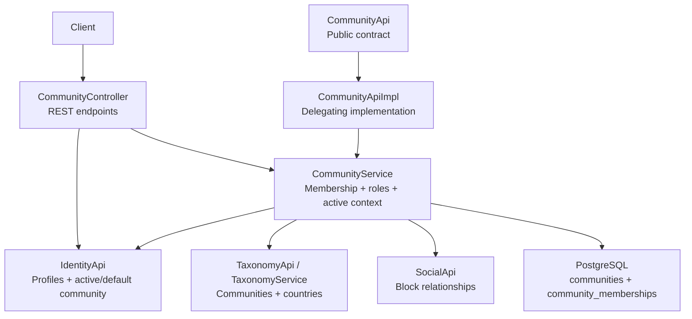
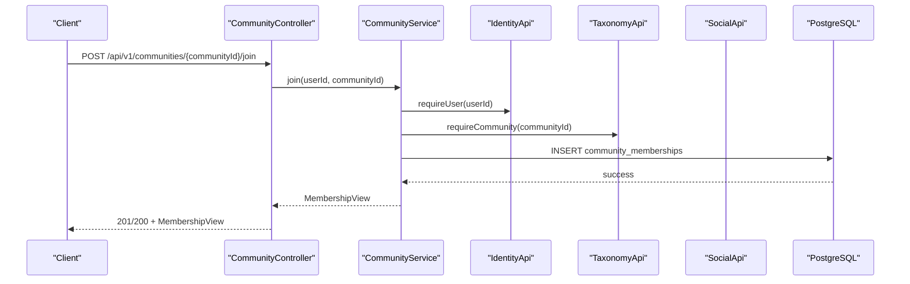
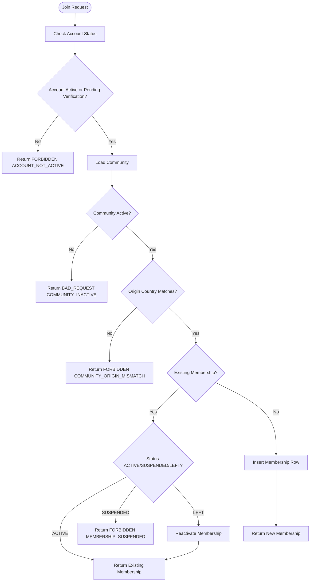
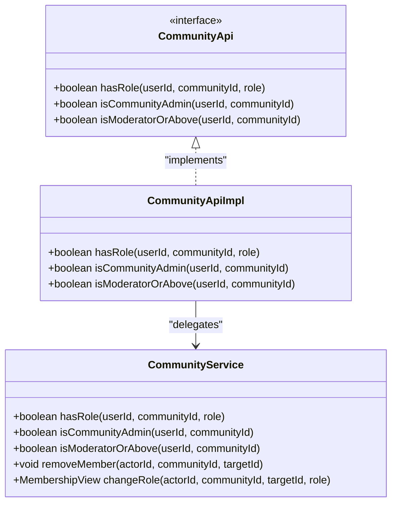
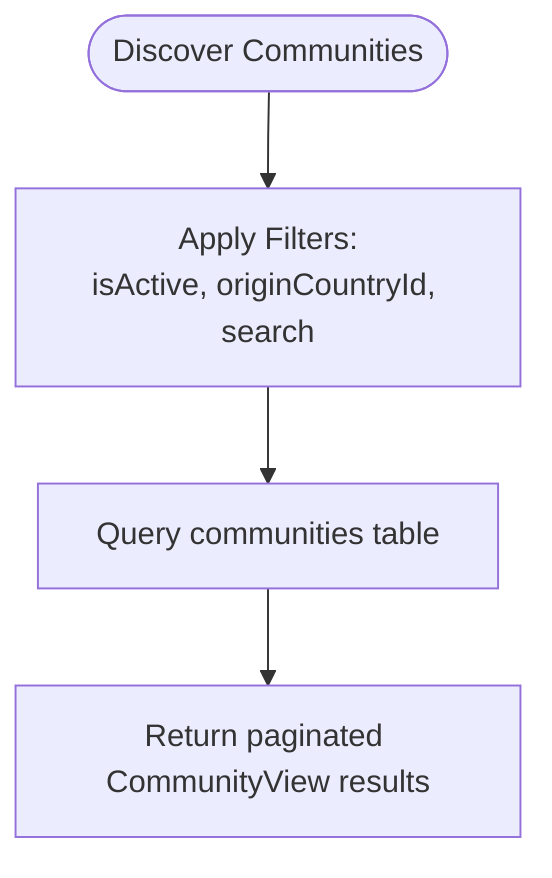
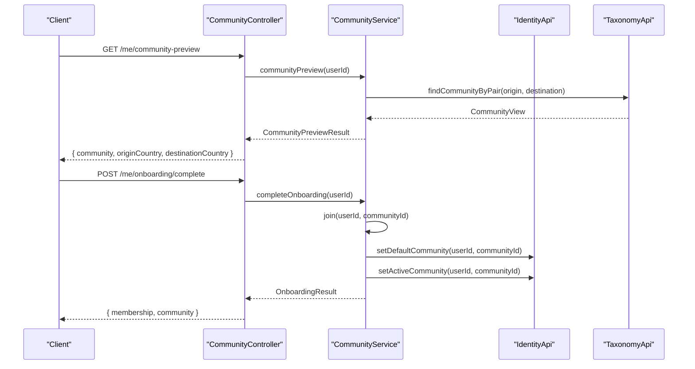
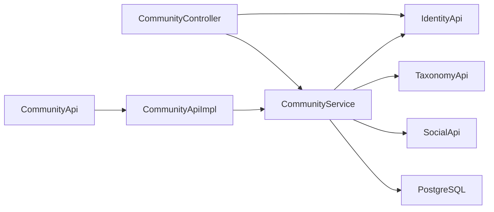

# Community Management API

<cite>
**Referenced Files in This Document**
- [CommunityController.java](file://diasporum-backend/src/main/java/com/diasporum/backend/community/internal/api/rest/CommunityController.java)
- [CommunityService.java](file://diasporum-backend/src/main/java/com/diasporum/backend/community/internal/application/CommunityService.java)
- [CommunityApiImpl.java](file://diasporum-backend/src/main/java/com/diasporum/backend/community/internal/application/CommunityApiImpl.java)
- [CommunityApi.java](file://diasporum-backend/src/main/java/com/diasporum/backend/community/CommunityApi.java)
- [TaxonomyService.java](file://diasporum-backend/src/main/java/com/diasporum/backend/taxonomy/internal/application/TaxonomyService.java)
- [V1__baseline_v10_12.sql](file://diasporum-backend/src/main/resources/db/migration/V1__baseline_v10_12.sql)
- [seed_communities.sql](file://seed_communities.sql)
</cite>

## Table of Contents
1. [Introduction](#introduction)
2. [Project Structure](#project-structure)
3. [Core Components](#core-components)
4. [Architecture Overview](#architecture-overview)
5. [Detailed Component Analysis](#detailed-component-analysis)
6. [Dependency Analysis](#dependency-analysis)
7. [Performance Considerations](#performance-considerations)
8. [Troubleshooting Guide](#troubleshooting-guide)
9. [Conclusion](#conclusion)

## Introduction
This document provides comprehensive API documentation for the Community management endpoints exposed by the Diasporum backend. It covers:
- Community discovery and catalogue browsing
- Membership lifecycle operations
- Role-based access control
- Active community context switching
- Member listing and administrative operations
- Request/response schemas for community data, membership records, and administrative actions
- Examples of community lifecycle workflows
- Notes on geographic filtering and PostGIS usage as it relates to community and location features

The community module owns user participation and authorization; the taxonomy module owns community catalogue data such as name, slug, origin country, destination country, description, activity state, and JSON settings.

## Project Structure
The community feature is implemented under the `community` package with a layered structure:
- REST controller layer exposes HTTP endpoints
- Application service layer implements business logic
- Public interface defines cross-module contracts
- Taxonomy integration provides catalogue lookups
- Database schema defines communities and memberships

**Diagram sources**
- [CommunityController.java:23-41](file://diasporum-backend/src/main/java/com/diasporum/backend/community/internal/api/rest/CommunityController.java#L23-L41)
- [CommunityService.java:21-43](file://diasporum-backend/src/main/java/com/diasporum/backend/community/internal/application/CommunityService.java#L21-L43)
- [CommunityApi.java:7-12](file://diasporum-backend/src/main/java/com/diasporum/backend/community/CommunityApi.java#L7-L12)
- [CommunityApiImpl.java:9-20](file://diasporum-backend/src/main/java/com/diasporum/backend/community/internal/application/CommunityApiImpl.java#L9-L20)
- [TaxonomyService.java:15-23](file://diasporum-backend/src/main/java/com/diasporum/backend/taxonomy/internal/application/TaxonomyService.java#L15-L23)

**Section sources**
- [CommunityController.java:23-41](file://diasporum-backend/src/main/java/com/diasporum/backend/community/internal/api/rest/CommunityController.java#L23-L41)
- [CommunityService.java:21-43](file://diasporum-backend/src/main/java/com/diasporum/backend/community/internal/application/CommunityService.java#L21-L43)
- [CommunityApi.java:7-12](file://diasporum-backend/src/main/java/com/diasporum/backend/community/CommunityApi.java#L7-L12)
- [CommunityApiImpl.java:9-20](file://diasporum-backend/src/main/java/com/diasporum/backend/community/internal/application/CommunityApiImpl.java#L9-L20)
- [TaxonomyService.java:15-23](file://diasporum-backend/src/main/java/com/diasporum/backend/taxonomy/internal/application/TaxonomyService.java#L15-L23)

## Core Components
- CommunityController: REST endpoints for membership, active context, onboarding preview/complete, member listing, and admin operations.
- CommunityService: Business logic for join/leave, active community selection, role checks, member visibility, and administrative actions.
- CommunityApi: Public interface used by other modules for membership and authorization checks.
- CommunityApiImpl: Delegating implementation of CommunityApi backed by CommunityService.
- TaxonomyService: Catalogue queries for communities, countries, and related reference data.
- Database schema: Defines communities and community_memberships tables, including indexes and triggers.

Key responsibilities:
- Membership lifecycle: join, leave, membership lookup, active membership count.
- Active community context: get/set per-user active community.
- Onboarding flow: preview auto-assigned community based on origin and current country, then complete onboarding to create membership and set default/active community.
- Member listing: paginated list of active members with block-aware filtering.
- Role-based access control: MEMBER, MODERATOR, COMMUNITY_ADMIN enforcement.
- Administrative operations: remove member, change role.

**Section sources**
- [CommunityController.java:23-181](file://diasporum-backend/src/main/java/com/diasporum/backend/community/internal/api/rest/CommunityController.java#L23-L181)
- [CommunityService.java:21-331](file://diasporum-backend/src/main/java/com/diasporum/backend/community/internal/application/CommunityService.java#L21-L331)
- [CommunityApi.java:7-51](file://diasporum-backend/src/main/java/com/diasporum/backend/community/CommunityApi.java#L7-L51)
- [CommunityApiImpl.java:9-72](file://diasporum-backend/src/main/java/com/diasporum/backend/community/internal/application/CommunityApiImpl.java#L9-L72)
- [TaxonomyService.java:145-190](file://diasporum-backend/src/main/java/com/diasporum/backend/taxonomy/internal/application/TaxonomyService.java#L145-L190)
- [V1__baseline_v10_12.sql:369-397](file://diasporum-backend/src/main/resources/db/migration/V1__baseline_v10_12.sql#L369-L397)

## Architecture Overview
The Community API follows a layered architecture:
- REST controller handles HTTP requests, parameter binding, and error mapping.
- Application service encapsulates business rules and database interactions.
- Cross-module interfaces provide stable contracts for other modules.
- External APIs (Identity, Taxonomy, Social) are composed into the service layer.
- PostgreSQL stores community catalogue and membership data.

**Diagram sources**
- [CommunityController.java:116-120](file://diasporum-backend/src/main/java/com/diasporum/backend/community/internal/api/rest/CommunityController.java#L116-L120)
- [CommunityService.java:147-187](file://diasporum-backend/src/main/java/com/diasporum/backend/community/internal/application/CommunityService.java#L147-L187)

## Detailed Component Analysis

### REST Endpoints

Base path: `/api/v1`

#### My Communities Context
- GET `/me/communities`
  - Purpose: List all ACTIVE memberships for the authenticated user.
  - Response: `{ items: [MembershipView...] }`
- GET `/me/communities/available`
  - Purpose: List communities eligible to join based on user’s origin country.
  - Response: `{ items: [CommunityView...] }`
- GET `/me/communities/{communityId}`
  - Purpose: Get the authenticated user’s membership record for a specific community.
  - Response: `MembershipView`
- GET `/me/active-community`
  - Purpose: Read the user’s persisted active community ID.
  - Response: `{ communityId: string|null }`
- PUT `/me/active-community`
  - Purpose: Set or clear the user’s active community.
  - Request body: `{ communityId: string|null }`
  - Response: `{ communityId: string }`

#### Onboarding Flow
- GET `/me/community-preview`
  - Purpose: Preview the community that will be auto-assigned based on origin and current country. Does not create membership.
  - Response: `{ community: CommunityView, originCountry: CountryView, destinationCountry: CountryView }`
- POST `/me/onboarding/complete`
  - Purpose: Complete onboarding by creating an auto-assigned membership and setting default + active community. Idempotent.
  - Response: `{ membership: MembershipView, community: CommunityView }`

#### Membership Lifecycle
- POST `/communities/{communityId}/join`
  - Purpose: Join a community. Enforces account status, community activity, and origin-country eligibility.
  - Response: `MembershipView`
- GET `/communities/{communityId}/membership`
  - Purpose: Retrieve membership record for the authenticated user.
  - Response: `MembershipView`
- DELETE `/communities/{communityId}/membership`
  - Purpose: Leave a community. Clears active community if it was the active one.
  - Response: `204 No Content`

#### Members Listing and Lookup
- GET `/communities/{communityId}/members?page=0&size=20`
  - Purpose: Paginated list of ACTIVE members visible to the viewer. Blocks are respected.
  - Response: `{ items: [ProfileSummary...], total: number, page: number, size: number }`
- GET `/communities/{communityId}/members/{userId}`
  - Purpose: Get membership record for a specific user within the community. Viewer must be an active member.
  - Response: `MembershipView`

#### Administrative Operations
- DELETE `/communities/{communityId}/members/{userId}`
  - Purpose: Remove a member. Requires COMMUNITY_ADMIN. Prevents removing self and last admin.
  - Response: `204 No Content`
- POST `/communities/{communityId}/members/{userId}/role`
  - Purpose: Change a member’s role. Requires COMMUNITY_ADMIN. Protects last admin.
  - Request body: `{ role: string }`
  - Response: `MembershipView`

#### Request/Response Schemas

- MembershipView
  - Fields:
    - `communityId`: string (UUID)
    - `userId`: string (UUID)
    - `role`: string (MEMBER | MODERATOR | COMMUNITY_ADMIN)
    - `status`: string (ACTIVE | LEFT | SUSPENDED)
    - `joinedAt`: string (ISO-8601 timestamp)

- CommunityView
  - Fields:
    - `id`: string (UUID)
    - `name`: string
    - `slug`: string
    - `originCountryId`: string (UUID)
    - `destinationCountryId`: string (UUID)
    - `description`: string
    - `isActive`: boolean

- CountryView
  - Fields:
    - `id`: string (UUID)
    - `name`: string
    - `iso2`: string
    - `iso3`: string
    - `demonym`: string
    - `flagEmoji`: string
    - `isActive`: boolean

- ProfileSummary
  - Used in member listing responses; represents minimal profile information returned by IdentityApi.

- Error Responses
  - Common HTTP statuses:
    - 400 Bad Request: invalid input or invalid role
    - 403 Forbidden: account not active, not a member, admin required
    - 404 Not Found: membership not found, community not found, user not found
    - 422 Unprocessable Entity: countries not set
    - 409 Conflict: last admin protection, inactive community conflict

**Section sources**
- [CommunityController.java:54-181](file://diasporum-backend/src/main/java/com/diasporum/backend/community/internal/api/rest/CommunityController.java#L54-L181)
- [CommunityService.java:71-248](file://diasporum-backend/src/main/java/com/diasporum/backend/community/internal/application/CommunityService.java#L71-L248)
- [CommunityApi.java:47-51](file://diasporum-backend/src/main/java/com/diasporum/backend/community/CommunityApi.java#L47-L51)
- [TaxonomyService.java:37-42](file://diasporum-backend/src/main/java/com/diasporum/backend/taxonomy/internal/application/TaxonomyService.java#L37-L42)

### Membership Workflow

**Diagram sources**
- [CommunityService.java:147-187](file://diasporum-backend/src/main/java/com/diasporum/backend/community/internal/application/CommunityService.java#L147-L187)

**Section sources**
- [CommunityService.java:147-187](file://diasporum-backend/src/main/java/com/diasporum/backend/community/internal/application/CommunityService.java#L147-L187)

### Role-Based Access Control

Roles:
- MEMBER: default role for new members
- MODERATOR: moderation authority
- COMMUNITY_ADMIN: full administration

Authorization rules:
- Only COMMUNITY_ADMIN can remove members or change roles.
- Last COMMUNITY_ADMIN cannot be removed or demoted.
- Moderator-or-above check supports moderation workflows.
- Active membership is required for most read/write operations.

**Diagram sources**
- [CommunityService.java:250-331](file://diasporum-backend/src/main/java/com/diasporum/backend/community/internal/application/CommunityService.java#L250-L331)
- [CommunityApi.java:40-45](file://diasporum-backend/src/main/java/com/diasporum/backend/community/CommunityApi.java#L40-L45)
- [CommunityApiImpl.java:52-71](file://diasporum-backend/src/main/java/com/diasporum/backend/community/internal/application/CommunityApiImpl.java#L52-L71)

**Section sources**
- [CommunityService.java:250-331](file://diasporum-backend/src/main/java/com/diasporum/backend/community/internal/application/CommunityService.java#L250-L331)
- [CommunityApi.java:40-45](file://diasporum-backend/src/main/java/com/diasporum/backend/community/CommunityApi.java#L40-L45)
- [CommunityApiImpl.java:52-71](file://diasporum-backend/src/main/java/com/diasporum/backend/community/internal/application/CommunityApiImpl.java#L52-L71)

### Community Discovery and Search

Discovery capabilities:
- Browse communities filtered by activity state and origin country.
- Full-text search across community name and slug.
- Pagination support via page and size parameters.
- Count endpoint for client-side pagination controls.

Geographic filtering:
- Community catalogue is tied to origin and destination countries.
- Eligibility to join is enforced by matching user’s origin country to community’s origin country.
- Geographic filtering at the community level uses country identifiers rather than PostGIS coordinates.

Note: PostGIS is required elsewhere in the platform for address geography, people discovery, matchmaking distances, and Nearby Reels ranking. The community catalogue itself does not use PostGIS coordinates; it relies on country references.

**Diagram sources**
- [TaxonomyService.java:147-166](file://diasporum-backend/src/main/java/com/diasporum/backend/taxonomy/internal/application/TaxonomyService.java#L147-L166)

**Section sources**
- [TaxonomyService.java:147-166](file://diasporum-backend/src/main/java/com/diasporum/backend/taxonomy/internal/application/TaxonomyService.java#L147-L166)

### Community Settings Management

Settings storage:
- The communities table includes a JSONB `settings` column.
- Current API surface does not expose dedicated endpoints for reading/writing community settings.
- Administration of settings should be performed through database migrations or internal administrative tools.

Recommendation:
- If future requirements demand API-driven settings management, introduce dedicated endpoints that validate and update the JSONB payload while preserving backward compatibility.

**Section sources**
- [V1__baseline_v10_12.sql:369-382](file://diasporum-backend/src/main/resources/db/migration/V1__baseline_v10_12.sql#L369-L382)

### Community Lifecycle Examples

Example flows:
- New user onboarding:
  - GET `/me/community-preview` returns the auto-assigned community based on origin and current country.
  - POST `/me/onboarding/complete` creates membership and sets default + active community.
- User joins a community:
  - POST `/communities/{communityId}/join` enforces eligibility and returns membership.
- User switches active community:
  - PUT `/me/active-community` updates the active community if the user is an active member.
- Admin removes a member:
  - DELETE `/communities/{communityId}/members/{userId}` requires COMMUNITY_ADMIN and protects the last admin.

**Diagram sources**
- [CommunityController.java:93-112](file://diasporum-backend/src/main/java/com/diasporum/backend/community/internal/api/rest/CommunityController.java#L93-L112)
- [CommunityService.java:104-138](file://diasporum-backend/src/main/java/com/diasporum/backend/community/internal/application/CommunityService.java#L104-L138)

**Section sources**
- [CommunityController.java:93-112](file://diasporum-backend/src/main/java/com/diasporum/backend/community/internal/api/rest/CommunityController.java#L93-L112)
- [CommunityService.java:104-138](file://diasporum-backend/src/main/java/com/diasporum/backend/community/internal/application/CommunityService.java#L104-L138)

## Dependency Analysis

**Diagram sources**
- [CommunityController.java:35-41](file://diasporum-backend/src/main/java/com/diasporum/backend/community/internal/api/rest/CommunityController.java#L35-L41)
- [CommunityService.java:32-43](file://diasporum-backend/src/main/java/com/diasporum/backend/community/internal/application/CommunityService.java#L32-L43)
- [CommunityApiImpl.java:13-20](file://diasporum-backend/src/main/java/com/diasporum/backend/community/internal/application/CommunityApiImpl.java#L13-L20)

Coupling and cohesion:
- CommunityController is thin and delegates to CommunityService.
- CommunityService composes IdentityApi, TaxonomyApi, and SocialApi for cross-cutting concerns.
- CommunityApi provides a stable contract for other modules, decoupled from internal implementation details.
- Database interactions are centralized in CommunityService using JdbcTemplate.

External dependencies:
- IdentityApi: profile summaries, active/default community persistence.
- TaxonomyApi: community catalogue, country references.
- SocialApi: block relationships affecting member visibility.

**Section sources**
- [CommunityController.java:35-41](file://diasporum-backend/src/main/java/com/diasporum/backend/community/internal/api/rest/CommunityController.java#L35-L41)
- [CommunityService.java:32-43](file://diasporum-backend/src/main/java/com/diasporum/backend/community/internal/application/CommunityService.java#L32-L43)
- [CommunityApiImpl.java:13-20](file://diasporum-backend/src/main/java/com/diasporum/backend/community/internal/application/CommunityApiImpl.java#L13-L20)

## Performance Considerations
- Pagination: Member listing and community discovery use LIMIT/OFFSET pagination. Clients should tune page size appropriately.
- Indexes:
  - `ix_memberships_user_status` optimizes membership queries by user and status.
  - `ix_memberships_community_status` optimizes membership queries by community, status, and role.
  - `ix_communities_destination_active` optimizes community queries by destination country and activity state.
- Blocking filters: Member visibility applies block filtering after fetching active members; consider caching blocked IDs for frequent viewers.
- Transaction boundaries: Join, leave, role changes, and onboarding completion are transactional to ensure consistency.

[No sources needed since this section provides general guidance]

## Troubleshooting Guide
Common errors and resolutions:
- ACCOUNT_NOT_ACTIVE: User account is not active or pending verification is not allowed for the operation. Ensure the user’s account status is ACTIVE or PENDING_VERIFICATION where applicable.
- COMMUNITY_INACTIVE: Attempted to operate on an inactive community. Activate the community or select an active one.
- COMMUNITY_ORIGIN_MISMATCH: User’s origin country does not match the community’s origin country. Update user profile origin or choose an eligible community.
- MEMBERSHIP_SUSPENDED: User’s membership is suspended. Contact administrators to review suspension.
- NOT_A_MEMBER: Viewer lacks active membership. Join the community first.
- ADMIN_REQUIRED: Operation requires COMMUNITY_ADMIN role. Verify actor’s role.
- LAST_ADMIN: Cannot remove or demote the last COMMUNITY_ADMIN. Add another admin before proceeding.
- INVALID_ROLE: Role value is not valid. Use MEMBER, MODERATOR, or COMMUNITY_ADMIN.
- COUNTRIES_NOT_SET: Onboarding preview requires both origin and current country to be set. Complete profile setup.

Operational tips:
- Use GET `/me/communities/available` to discover eligible communities based on origin country.
- Use GET `/communities/{communityId}/members` to verify membership visibility and total counts.
- For administrative tasks, ensure the actor has COMMUNITY_ADMIN and avoid targeting the last admin.

**Section sources**
- [CommunityService.java:147-187](file://diasporum-backend/src/main/java/com/diasporum/backend/community/internal/application/CommunityService.java#L147-L187)
- [CommunityService.java:272-324](file://diasporum-backend/src/main/java/com/diasporum/backend/community/internal/application/CommunityService.java#L272-L324)

## Conclusion
The Community Management API provides a robust foundation for diaspora community participation:
- Clear separation of concerns between REST, application service, and domain interfaces.
- Strong membership lifecycle controls with idempotent operations and safety nets.
- Role-based access control protecting administrative actions.
- Catalogue-driven discovery and search with country-based eligibility.
- Extensible settings storage via JSONB for future configuration needs.

For geographic filtering beyond country-level eligibility, leverage the platform’s PostGIS-enabled address and location features in conjunction with community membership to build advanced discovery experiences.

[No sources needed since this section summarizes without analyzing specific files]