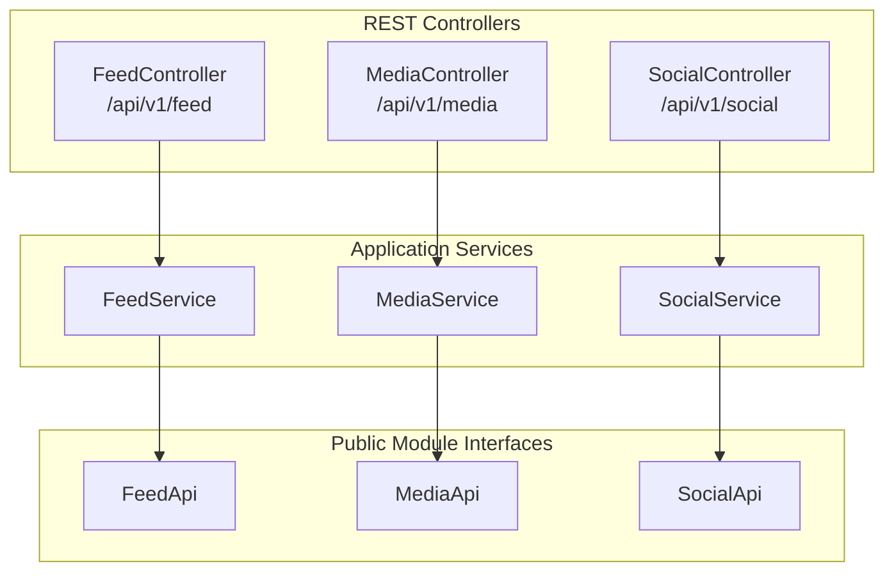
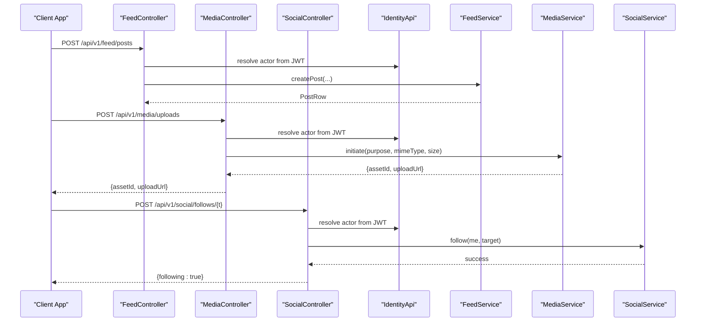
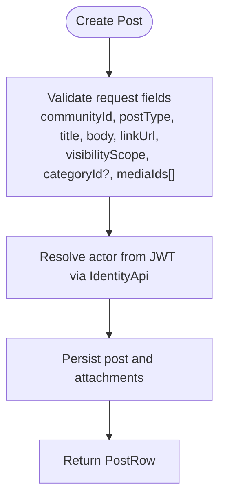
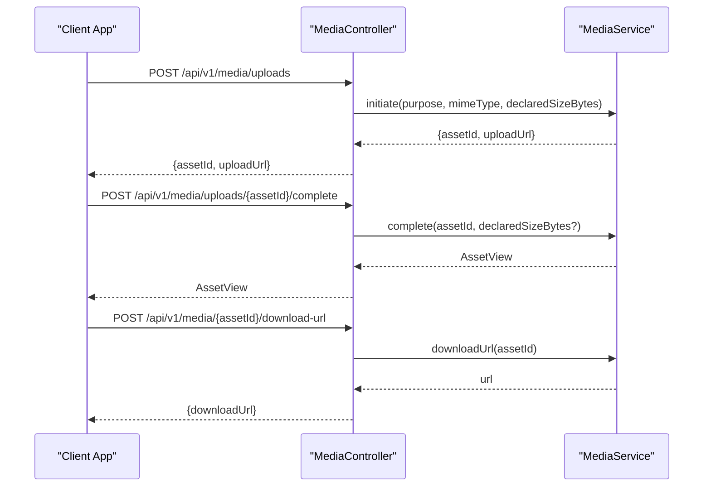
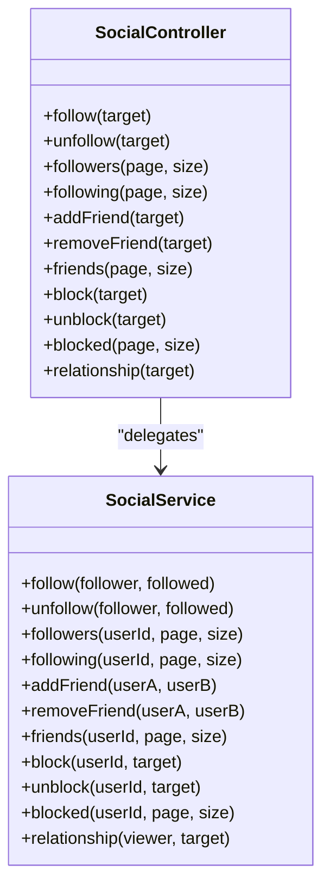
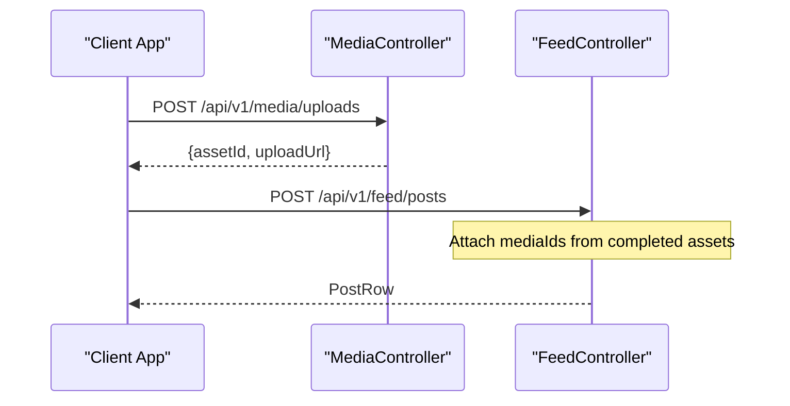
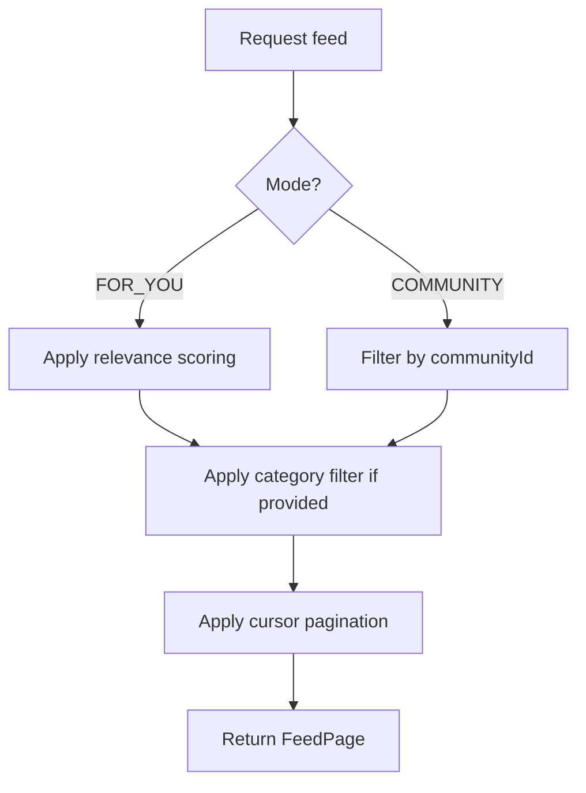
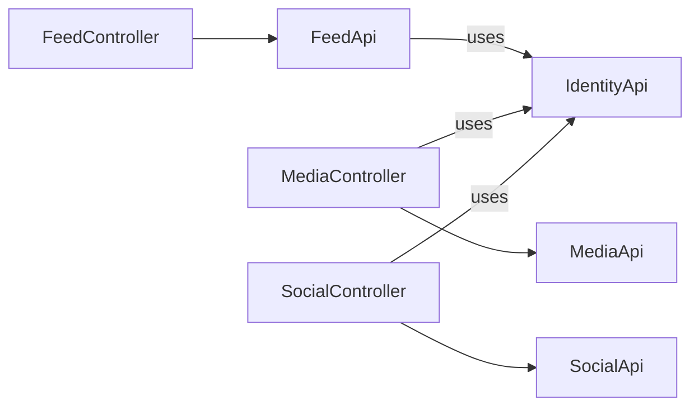

# Feed & Content API

<cite>
**Referenced Files in This Document**
- [FeedApi.java](file://diasporum-backend/src/main/java/com/diasporum/backend/feed/FeedApi.java)
- [FeedController.java](file://diasporum-backend/src/main/java/com/diasporum/backend/feed/internal/api/rest/FeedController.java)
- [MediaApi.java](file://diasporum-backend/src/main/java/com/diasporum/backend/media/MediaApi.java)
- [MediaController.java](file://diasporum-backend/src/main/java/com/diasporum/backend/media/internal/api/rest/MediaController.java)
- [SocialApi.java](file://diasporum-backend/src/main/java/com/diasporum/backend/social/SocialApi.java)
- [SocialController.java](file://diasporum-backend/src/main/java/com/diasporum/backend/social/internal/api/rest/SocialController.java)
</cite>

## Table of Contents
1. [Introduction](#introduction)
2. [Project Structure](#project-structure)
3. [Core Components](#core-components)
4. [Architecture Overview](#architecture-overview)
5. [Detailed Component Analysis](#detailed-component-analysis)
6. [Dependency Analysis](#dependency-analysis)
7. [Performance Considerations](#performance-considerations)
8. [Troubleshooting Guide](#troubleshooting-guide)
9. [Conclusion](#conclusion)
10. [Appendices](#appendices)

## Introduction
This document provides detailed API documentation for Feed and Content management endpoints, including post creation, content publishing, feed algorithms, social interactions (likes/reactions, comments, saves), media upload workflows, and engagement metrics. It also covers pagination patterns, filtering options, and integration points with identity and security layers.

The backend exposes three primary REST areas:
- Feed: posts, reels, community feeds, comments, reactions, saves, views, polls, and help posts.
- Media: asset lifecycle, presigned uploads, download URLs, and deletion.
- Social: follows, friends, blocks, relationship queries, and counts.

These APIs are designed to be consumed by clients such as mobile or web applications, while internal module boundaries keep implementation details encapsulated behind public interfaces.

## Project Structure
At a high level, the relevant backend modules follow a layered structure:
- Public API interfaces define stable contracts between modules.
- Internal REST controllers expose HTTP endpoints under `/api/v1`.
- Application services implement business logic and coordinate persistence and cross-module calls.

**Diagram sources**
- [FeedController.java:28-31](file://diasporum-backend/src/main/java/com/diasporum/backend/feed/internal/api/rest/FeedController.java#L28-L31)
- [MediaController.java:19-22](file://diasporum-backend/src/main/java/com/diasporum/backend/media/internal/api/rest/MediaController.java#L19-L22)
- [SocialController.java:19-25](file://diasporum-backend/src/main/java/com/diasporum/backend/social/internal/api/rest/SocialController.java#L19-L25)
- [FeedApi.java:7-12](file://diasporum-backend/src/main/java/com/diasporum/backend/feed/FeedApi.java#L7-L12)
- [MediaApi.java:7-11](file://diasporum-backend/src/main/java/com/diasporum/backend/media/MediaApi.java#L7-L11)
- [SocialApi.java:6-10](file://diasporum-backend/src/main/java/com/diasporum/backend/social/SocialApi.java#L6-L10)

**Section sources**
- [FeedController.java:28-31](file://diasporum-backend/src/main/java/com/diasporum/backend/feed/internal/api/rest/FeedController.java#L28-L31)
- [MediaController.java:19-22](file://diasporum-backend/src/main/java/com/diasporum/backend/media/internal/api/rest/MediaController.java#L19-L22)
- [SocialController.java:19-25](file://diasporum-backend/src/main/java/com/diasporum/backend/social/internal/api/rest/SocialController.java#L19-L25)

## Core Components
This section summarizes the core components exposed by the Feed, Media, and Social modules.

- Feed
  - Post CRUD: create, read, update, delete.
  - Feeds: community, following, reels.
  - Engagement: reactions, saves, view recording.
  - Comments: create, list, update, delete.
  - Polls: create, vote, withdraw.
  - Help posts: create, status updates.
  - Author resolution: batch profile summaries.

- Media
  - Upload initiation and completion.
  - Asset metadata retrieval.
  - Presigned download URL generation.
  - Asset deletion.

- Social
  - Follow/unfollow.
  - Friend add/remove.
  - Block/unblock.
  - Relationship query and lists.
  - Counts and follower/following lists.

**Section sources**
- [FeedController.java:62-243](file://diasporum-backend/src/main/java/com/diasporum/backend/feed/internal/api/rest/FeedController.java#L62-L243)
- [MediaController.java:39-90](file://diasporum-backend/src/main/java/com/diasporum/backend/media/internal/api/rest/MediaController.java#L39-L90)
- [SocialController.java:53-131](file://diasporum-backend/src/main/java/com/diasporum/backend/social/internal/api/rest/SocialController.java#L53-L131)

## Architecture Overview
The Feed and Content system is composed of three cooperating modules:

- Feed module: owns post and reel content, visibility checks, engagement counts, and feed algorithms.
- Media module: manages assets, readiness, and authorized downloads via short-lived URLs.
- Social module: manages relationships and interaction policies that influence visibility and access.

**Diagram sources**
- [FeedController.java:64-73](file://diasporum-backend/src/main/java/com/diasporum/backend/feed/internal/api/rest/FeedController.java#L64-L73)
- [MediaController.java:39-53](file://diasporum-backend/src/main/java/com/diasporum/backend/media/internal/api/rest/MediaController.java#L39-L53)
- [SocialController.java:54-59](file://diasporum-backend/src/main/java/com/diasporum/backend/social/internal/api/rest/SocialController.java#L54-L59)

## Detailed Component Analysis

### Feed Endpoints
Base path: `/api/v1/feed`

Authentication:
- All endpoints require an authenticated user resolved from the JWT. The controller resolves the internal profile ID using `IdentityApi`.

Post lifecycle:
- Create post: `POST /api/v1/feed/posts`
  - Request body fields:
    - `communityId`: string UUID
    - `postType`: string
    - `title`: string
    - `body`: string
    - `linkUrl`: string
    - `visibilityScope`: string; default `"COMMUNITY"`
    - `categoryId`: optional string UUID
    - `mediaIds`: array of string UUIDs
  - Response: `PostRow` object returned by service.

- Get post: `GET /api/v1/feed/posts/{postId}`
  - Returns a viewable post enforced by viewer permissions.

- Update post: `PATCH /api/v1/feed/posts/{postId}`
  - Request body fields:
    - `title`: string
    - `body`: string
    - `linkUrl`: string

- Delete post: `DELETE /api/v1/feed/posts/{postId}`

Feeds:
- Community feed: `GET /api/v1/feed/community?communityId={uuid}&mode={FOR_YOU|...}&categoryId={uuid}&cursor={string}&size={int}`
  - Default mode: `"FOR_YOU"`
  - Default size: `20`
  - Cursor-based pagination supported.

- Following feed: `GET /api/v1/feed/following?cursor={string}&size={int}`
  - Default size: `20`

- Reels feed: `GET /api/v1/feed/reels/community?communityId={uuid}&cursor={string}&size={int}`
  - Default size: `20`

Engagement:
- React: `PUT /api/v1/feed/posts/{postId}/reaction`
  - Body: `reaction` string
- Unreact: `DELETE /api/v1/feed/posts/{postId}/reaction`
- Save: `PUT /api/v1/feed/posts/{postId}/save`
- Unsave: `DELETE /api/v1/feed/posts/{postId}/save`
- Record view: `POST /api/v1/feed/views`
  - Body: `contentType`, `contentId`

Comments:
- Create comment: `POST /api/v1/feed/posts/{postId}/comments`
  - Body: `parentCommentId` (optional), `body`
- List comments: `GET /api/v1/feed/posts/{postId}/comments?page={int}&size={int}`
  - Default page: `0`, default size: `20`
- Update comment: `PATCH /api/v1/feed/comments/{commentId}`
  - Body: `body`
- Delete comment: `DELETE /api/v1/feed/comments/{commentId}`

Community help:
- Create help post: `POST /api/v1/feed/community-help`
  - Body: `communityId`, `categoryId` (optional), `helpKind`, `title`, `body`, `expiresAt` (ISO instant)
- Set help status: `PATCH /api/v1/feed/community-help/{postId}/status`
  - Body: `helpStatus`

Author resolution:
- Batch authors: `GET /api/v1/feed/authors?ids={uuid}&ids={uuid}&...`
  - Returns list of profile summaries.

Polls:
- Create poll: `POST /api/v1/feed/polls`
  - Body: `communityId`, `categoryId` (optional), `question`, `options` (array of strings), `closesAt` (ISO instant)
- Get poll: `GET /api/v1/feed/polls/{postId}`
- Vote: `POST /api/v1/feed/polls/options/{optionId}/vote`
  - Optional body: `withdraw` boolean
  - Conflict response: `409 CONFLICT` with code `VOTE_CONFLICT` on duplicate votes.

Feed algorithm notes:
- Modes include `"FOR_YOU"` and community-specific modes.
- Cursor-based pagination is used across feeds.
- Visibility enforcement is applied when retrieving individual posts.

**Diagram sources**
- [FeedController.java:64-73](file://diasporum-backend/src/main/java/com/diasporum/backend/feed/internal/api/rest/FeedController.java#L64-L73)

**Section sources**
- [FeedController.java:62-243](file://diasporum-backend/src/main/java/com/diasporum/backend/feed/internal/api/rest/FeedController.java#L62-L243)

### Media Endpoints
Base path: `/api/v1/media`

Authentication:
- All endpoints require an authenticated user resolved from the JWT.

Upload workflow:
- Initiate upload: `POST /api/v1/media/uploads`
  - Request body fields:
    - `purpose`: string
    - `mimeType`: string
    - `declaredSizeBytes`: number (optional)
  - Response: `{ assetId, uploadUrl }`
  - Error: `400 BAD_REQUEST` with code `PURPOSE_AND_MIME_REQUIRED` if required fields missing.

- Complete upload: `POST /api/v1/media/uploads/{assetId}/complete`
  - Optional body: `declaredSizeBytes`
  - Response: `AssetView`

- Cancel upload: `DELETE /api/v1/media/uploads/{assetId}`

Asset operations:
- Get asset: `GET /api/v1/media/{assetId}`
  - Owner check enforced; returns `403 FORBIDDEN` with code `NOT_OWNER` if not owner.
  - Not found: `404 NOT_FOUND` with code `MEDIA_NOT_FOUND`.

- Download URL: `POST /api/v1/media/{assetId}/download-url`
  - Response: `{ downloadUrl }`

- Delete asset: `DELETE /api/v1/media/{assetId}`

Media processing and CDN integration:
- Assets have a purpose and status indicating readiness.
- Authorized consumers receive short-lived presigned download URLs.
- Cross-module attachment validation ensures ownership and purpose alignment.

**Diagram sources**
- [MediaController.java:39-85](file://diasporum-backend/src/main/java/com/diasporum/backend/media/internal/api/rest/MediaController.java#L39-L85)

**Section sources**
- [MediaController.java:39-90](file://diasporum-backend/src/main/java/com/diasporum/backend/media/internal/api/rest/MediaController.java#L39-L90)
- [MediaApi.java:7-39](file://diasporum-backend/src/main/java/com/diasporum/backend/media/MediaApi.java#L7-L39)

### Social Endpoints
Base path: `/api/v1/social`

Authentication:
- All endpoints require an authenticated user resolved from the JWT.

Follows:
- Follow: `POST /api/v1/social/follows/{t}`
  - Response: `{ following: true }`
- Unfollow: `DELETE /api/v1/social/follows/{t}`
- Followers: `GET /api/v1/social/followers?page={int}&size={int}`
  - Returns paginated profile summaries with total count.
- Following: `GET /api/v1/social/following?page={int}&size={int}`
  - Returns paginated profile summaries with total count.

Friends:
- Add friend: `POST /api/v1/social/friends/{t}`
  - Response: `{ friends: true }`
- Remove friend: `DELETE /api/v1/social/friends/{t}`
- Friends: `GET /api/v1/social/friends?page={int}&size={int}`
  - Returns paginated profile summaries with total count.

Blocks:
- Block: `POST /api/v1/social/blocks/{t}`
  - Response: `{ blocked: true }`
- Unblock: `DELETE /api/v1/social/blocks/{t}`
- Blocked: `GET /api/v1/social/blocks?page={int}&size={int}`
  - Returns paginated IDs.

Relationship:
- Relationship: `GET /api/v1/social/relationship/{t}`
  - Returns `RelationshipView` with flags like following, followedBy, mutual, friends, blockedByMe.

Pagination helpers:
- Default page size: `20`
- Maximum page size: `100`
- Lists return `{ items, total, page, size }`.

**Diagram sources**
- [SocialController.java:53-131](file://diasporum-backend/src/main/java/com/diasporum/backend/social/internal/api/rest/SocialController.java#L53-L131)

**Section sources**
- [SocialController.java:53-131](file://diasporum-backend/src/main/java/com/diasporum/backend/social/internal/api/rest/SocialController.java#L53-L131)
- [SocialApi.java:6-68](file://diasporum-backend/src/main/java/com/diasporum/backend/social/SocialApi.java#L6-L68)

### Content Publishing Workflow
Content publishing typically involves creating a post and attaching media assets.

**Diagram sources**
- [MediaController.java:39-53](file://diasporum-backend/src/main/java/com/diasporum/backend/media/internal/api/rest/MediaController.java#L39-L53)
- [FeedController.java:64-73](file://diasporum-backend/src/main/java/com/diasporum/backend/feed/internal/api/rest/FeedController.java#L64-L73)

### Feed Pagination and Filtering
- Cursor-based pagination:
  - Community feed: `cursor` parameter supports cursor navigation.
  - Following feed: `cursor` parameter supports cursor navigation.
  - Reels feed: `cursor` parameter supports cursor navigation.
- Size parameter:
  - Defaults to `20`; can be adjusted per endpoint.
- Category filtering:
  - Community feed supports optional `categoryId`.

**Diagram sources**
- [FeedController.java:94-118](file://diasporum-backend/src/main/java/com/diasporum/backend/feed/internal/api/rest/FeedController.java#L94-L118)

**Section sources**
- [FeedController.java:94-118](file://diasporum-backend/src/main/java/com/diasporum/backend/feed/internal/api/rest/FeedController.java#L94-L118)

### Data Models and Schemas

Posts and Views:
- `PostView` (public interface):
  - Fields: `id`, `authorId`, `communityId`, `countryId`, `postType`, `status`, `visibilityScope`, `title`, `publishedAt`.

Assets and Metadata:
- `AssetView` (public interface):
  - Fields: `id`, `ownerId`, `purpose`, `status`, `mimeType`, `sizeBytes`, `detectedMimeType`.

Relationships:
- `RelationshipView` (public interface):
  - Fields: `following`, `followedBy`, `mutual`, `friends`, `blockedByMe`.

Note: Controller responses may use service-level DTOs such as `PostRow`, `CommentRow`, and `FeedPage`. These are returned directly by the controllers and represent enriched data for client consumption.

**Section sources**
- [FeedApi.java:15-31](file://diasporum-backend/src/main/java/com/diasporum/backend/feed/FeedApi.java#L15-L31)
- [MediaApi.java:14-39](file://diasporum-backend/src/main/java/com/diasporum/backend/media/MediaApi.java#L14-L39)
- [SocialApi.java:66-68](file://diasporum-backend/src/main/java/com/diasporum/backend/social/SocialApi.java#L66-L68)

## Dependency Analysis
The modules interact through well-defined public interfaces and controllers:

**Diagram sources**
- [FeedController.java:33-38](file://diasporum-backend/src/main/java/com/diasporum/backend/feed/internal/api/rest/FeedController.java#L33-L38)
- [MediaController.java:24-30](file://diasporum-backend/src/main/java/com/diasporum/backend/media/internal/api/rest/MediaController.java#L24-L30)
- [SocialController.java:27-33](file://diasporum-backend/src/main/java/com/diasporum/backend/social/internal/api/rest/SocialController.java#L27-L33)

**Section sources**
- [FeedController.java:33-38](file://diasporum-backend/src/main/java/com/diasporum/backend/feed/internal/api/rest/FeedController.java#L33-L38)
- [MediaController.java:24-30](file://diasporum-backend/src/main/java/com/diasporum/backend/media/internal/api/rest/MediaController.java#L24-L30)
- [SocialController.java:27-33](file://diasporum-backend/src/main/java/com/diasporum/backend/social/internal/api/rest/SocialController.java#L27-L33)

## Performance Considerations
- Use cursor-based pagination for large feeds to avoid expensive offset queries.
- Batch author resolution via `/api/v1/feed/authors` to minimize round trips.
- Limit page sizes to prevent excessive payload sizes; social endpoints cap at `100`.
- Prefer presigned download URLs for media delivery to offload storage and enable CDN caching where applicable.
- Avoid repeated media metadata queries; cache asset metadata on the client side when appropriate.

[No sources needed since this section provides general guidance]

## Troubleshooting Guide
Common errors and their meanings:
- `PROFILE_NOT_PROVISIONED`: Actor cannot be mapped to a profile; ensure identity provisioning is complete before calling endpoints.
- `PURPOSE_AND_MIME_REQUIRED`: Media upload initiation requires both `purpose` and `mimeType`.
- `MEDIA_NOT_FOUND`: Asset does not exist.
- `NOT_OWNER`: Attempted to access or modify an asset owned by another user.
- `VOTE_CONFLICT`: Duplicate or conflicting poll vote; retry after handling conflict.

Error handling patterns:
- Controllers throw `ResponseStatusException` with specific codes for client-side error handling.
- For media ownership, explicit forbidden responses protect unauthorized access.

**Section sources**
- [FeedController.java:41-46](file://diasporum-backend/src/main/java/com/diasporum/backend/feed/internal/api/rest/FeedController.java#L41-L46)
- [MediaController.java:45-51](file://diasporum-backend/src/main/java/com/diasporum/backend/media/internal/api/rest/MediaController.java#L45-L51)
- [MediaController.java:72-78](file://diasporum-backend/src/main/java/com/diasporum/backend/media/internal/api/rest/MediaController.java#L72-L78)
- [FeedController.java:235-242](file://diasporum-backend/src/main/java/com/diasporum/backend/feed/internal/api/rest/FeedController.java#L235-L242)

## Conclusion
The Feed & Content API provides a comprehensive set of endpoints for managing posts, media, and social interactions. It emphasizes secure authentication, clear separation of concerns, and efficient pagination and filtering mechanisms. Clients should integrate with these endpoints following the documented request/response schemas and error handling patterns to build robust content experiences.

[No sources needed since this section summarizes without analyzing specific files]

## Appendices

### Example Workflows

- Create a post with media:
  1. Initiate media upload and obtain `assetId` and `uploadUrl`.
  2. Upload media to `uploadUrl`.
  3. Complete upload and verify asset readiness.
  4. Create post with `mediaIds` referencing completed assets.

- Fetch community feed with filtering:
  1. Call `/api/v1/feed/community` with `communityId`, optional `categoryId`, and `mode`.
  2. Paginate using `cursor` and adjust `size`.

- Interact socially:
  1. Follow or unfollow users via `/api/v1/social/follows/{t}`.
  2. Query relationship state via `/api/v1/social/relationship/{t}`.

[No sources needed since this section provides conceptual examples]