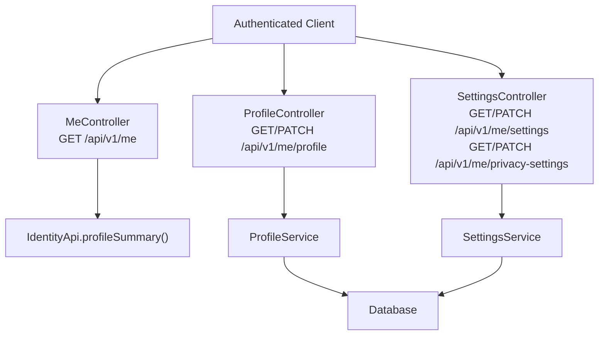
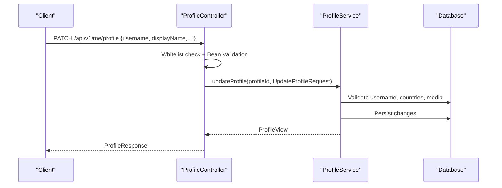
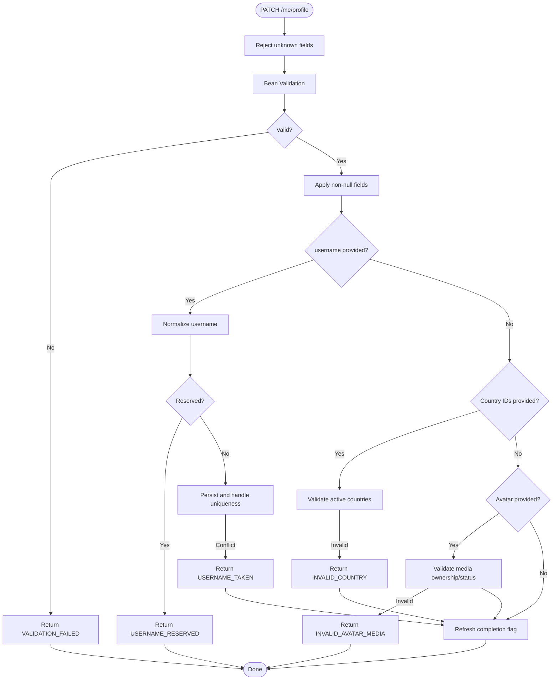
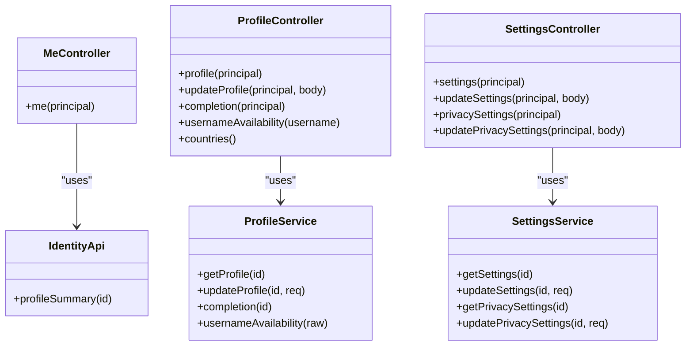

# Identity & Profile API

<cite>
**Referenced Files in This Document**
- [IdentityApi.java](file://diasporum-backend/src/main/java/com/diasporum/backend/identity/IdentityApi.java)
- [MeController.java](file://diasporum-backend/src/main/java/com/diasporum/backend/identity/internal/api/rest/MeController.java)
- [ProfileController.java](file://diasporum-backend/src/main/java/com/diasporum/backend/identity/internal/api/rest/ProfileController.java)
- [SettingsController.java](file://diasporum-backend/src/main/java/com/diasporum/backend/identity/internal/api/rest/SettingsController.java)
- [UpdateProfileRequest.java](file://diasporum-backend/src/main/java/com/diasporum/backend/identity/internal/api/rest/UpdateProfileRequest.java)
- [UpdateSettingsRequest.java](file://diasporum-backend/src/main/java/com/diasporum/backend/identity/internal/api/rest/UpdateSettingsRequest.java)
- [UpdatePrivacySettingsRequest.java](file://diasporum-backend/src/main/java/com/diasporum/backend/identity/internal/api/rest/UpdatePrivacySettingsRequest.java)
- [ProfileResponse.java](file://diasporum-backend/src/main/java/com/diasporum/backend/identity/internal/api/rest/ProfileResponse.java)
- [SettingsResponse.java](file://diasporum-backend/src/main/java/com/diasporum/backend/identity/internal/api/rest/SettingsResponse.java)
- [PrivacySettingsResponse.java](file://diasporum-backend/src/main/java/com/diasporum/backend/identity/internal/api/rest/PrivacySettingsResponse.java)
- [ProfileService.java](file://diasporum-backend/src/main/java/com/diasporum/backend/identity/internal/application/ProfileService.java)
- [SettingsService.java](file://diasporum-backend/src/main/java/com/diasporum/backend/identity/internal/application/SettingsService.java)
</cite>

## Table of Contents
1. Introduction
2. Project Structure
3. Core Components
4. Architecture Overview
5. Detailed Component Analysis
6. Dependency Analysis
7. Performance Considerations
8. Troubleshooting Guide
9. Conclusion

## Introduction
This document specifies the Identity and Profile management APIs exposed by the backend module. It covers:
- User profile retrieval and updates
- Privacy settings management
- General user settings management
- Account-related metadata endpoints
- Request/response schemas, validation rules, business constraints, and error behavior

The API is intended for authenticated clients. The current user identity is resolved from the JWT principal; client input must never be used to impersonate another user.

## Project Structure
The Identity and Profile functionality is implemented as a Spring Boot REST layer backed by application services that perform persistence and business logic.

**Diagram sources**
- [MeController.java:23-29](file://diasporum-backend/src/main/java/com/diasporum/backend/identity/internal/api/rest/MeController.java#L23-L29)
- [ProfileController.java:64-103](file://diasporum-backend/src/main/java/com/diasporum/backend/identity/internal/api/rest/ProfileController.java#L64-L103)
- [SettingsController.java:48-76](file://diasporum-backend/src/main/java/com/diasporum/backend/identity/internal/api/rest/SettingsController.java#L48-L76)
- [IdentityApi.java:25-33](file://diasporum-backend/src/main/java/com/diasporum/backend/identity/IdentityApi.java#L25-L33)
- [ProfileService.java:74-120](file://diasporum-backend/src/main/java/com/diasporum/backend/identity/internal/application/ProfileService.java#L74-L120)
- [SettingsService.java:33-94](file://diasporum-backend/src/main/java/com/diasporum/backend/identity/internal/application/SettingsService.java#L33-L94)

**Section sources**
- [MeController.java:11-33](file://diasporum-backend/src/main/java/com/diasporum/backend/identity/internal/api/rest/MeController.java#L11-L33)
- [ProfileController.java:22-105](file://diasporum-backend/src/main/java/com/diasporum/backend/identity/internal/api/rest/ProfileController.java#L22-L105)
- [SettingsController.java:21-93](file://diasporum-backend/src/main/java/com/diasporum/backend/identity/internal/api/rest/SettingsController.java#L21-L93)

## Core Components
- MeController: Returns a minimal summary of the authenticated user’s account.
- ProfileController: Own-profile read and sparse PATCH update, plus username availability and country listing.
- SettingsController: Own general settings and privacy settings read/update.
- ProfileService: Business logic for profile reads, updates, completion policy, avatar linking, and username checks.
- SettingsService: Business logic for reading/updating user_settings and user_privacy_settings.
- IdentityApi: Cross-module-safe profile summary projection.

**Section sources**
- [MeController.java:11-33](file://diasporum-backend/src/main/java/com/diasporum/backend/identity/internal/api/rest/MeController.java#L11-L33)
- [ProfileController.java:22-105](file://diasporum-backend/src/main/java/com/diasporum/backend/identity/internal/api/rest/ProfileController.java#L22-L105)
- [SettingsController.java:21-93](file://diasporum-backend/src/main/java/com/diasporum/backend/identity/internal/api/rest/SettingsController.java#L21-L93)
- [ProfileService.java:19-28](file://diasporum-backend/src/main/java/com/diasporum/backend/identity/internal/application/ProfileService.java#L19-L28)
- [SettingsService.java:15-20](file://diasporum-backend/src/main/java/com/diasporum/backend/identity/internal/application/SettingsService.java#L15-L20)
- [IdentityApi.java:8-33](file://diasporum-backend/src/main/java/com/diasporum/backend/identity/IdentityApi.java#L8-L33)

## Architecture Overview
The API follows a layered design:
- Controllers validate request bodies using Bean Validation and whitelist allowed fields.
- Application services enforce business rules (e.g., reserved usernames, active countries, community membership).
- Persistence uses JdbcTemplate with explicit SQL statements.
- Responses are typed records for clarity and immutability.

**Diagram sources**
- [ProfileController.java:69-88](file://diasporum-backend/src/main/java/com/diasporum/backend/identity/internal/api/rest/ProfileController.java#L69-L88)
- [ProfileService.java:82-120](file://diasporum-backend/src/main/java/com/diasporum/backend/identity/internal/application/ProfileService.java#L82-L120)

## Detailed Component Analysis

### Authentication and Current User
- GET /api/v1/me
  - Purpose: Return a minimal view of the authenticated user.
  - Principal: Resolved from JWT via @AuthenticationPrincipal.
  - Response: MeResponse containing id, displayName, accountStatus, profileCompleted.
  - Behavior: Delegates to IdentityApi.profileSummary(profileId). If no profile exists, returns 404 Not Found.

Request
- No body.

Response
- Fields:
  - id: UUID
  - displayName: string
  - accountStatus: string
  - profileCompleted: boolean

Errors
- 404 Not Found when the profile does not exist.

**Section sources**
- [MeController.java:23-29](file://diasporum-backend/src/main/java/com/diasporum/backend/identity/internal/api/rest/MeController.java#L23-L29)
- [IdentityApi.java:25-33](file://diasporum-backend/src/main/java/com/diasporum/backend/identity/IdentityApi.java#L25-L33)

### Profile Management
Endpoints
- GET /api/v1/me/profile
- PATCH /api/v1/me/profile
- GET /api/v1/me/profile/completion
- GET /api/v1/usernames/availability?username=...
- GET /api/v1/countries

GET /api/v1/me/profile
- Purpose: Retrieve the authenticated user’s full own profile.
- Response: ProfileResponse with id, username, displayName, bio, city, dateOfBirth, originCountryId, currentCountryId, accountStatus, profileCompleted, avatarMediaId.
- Errors:
  - 404 Not Found if the profile row is missing.

PATCH /api/v1/me/profile
- Purpose: Sparse update of the authenticated user’s profile. Only whitelisted fields are accepted.
- Allowed fields: username, displayName, bio, city, dateOfBirth, originCountryId, currentCountryId, avatarMediaId.
- Validation:
  - Field-level Bean Validation on UpdateProfileRequest.
  - Username normalization and reserved-name enforcement.
  - Country IDs must refer to active countries.
  - Avatar media ID must reference an existing, owned, ready AVATAR asset.
- Completion policy: When displayName, username, originCountryId, and currentCountryId are all non-null, profile_completed_at is set once and never reset.
- Response: Updated ProfileResponse.

Username Availability
- GET /api/v1/usernames/availability?username=...
- Response:
  - username: normalized username
  - available: boolean
  - reason: INVALID_FORMAT | RESERVED | AVAILABLE | TAKEN

Countries
- GET /api/v1/countries
- Response: List of active countries from TaxonomyApi.

Validation Rules and Constraints
- username:
  - Pattern: lowercase letters, digits, underscore; length 3–20.
  - Reserved names are rejected with conflict.
  - Uniqueness enforced at database level; conflicts return 409 Conflict.
- displayName:
  - Length 1–80.
- bio:
  - Max length 800; blank values are stored as null.
- city:
  - Max length 120; blank values are stored as null.
- dateOfBirth:
  - Must be a past date.
- originCountryId/currentCountryId:
  - Must refer to active countries; otherwise invalid.
- avatarMediaId:
  - Must reference a media object owned by the user, purpose AVATAR, status READY.

Error Codes
- PROTECTED_OR_UNKNOWN_FIELD: Unknown or protected field in PATCH body.
- VALIDATION_FAILED: Bean validation failure.
- INVALID_USERNAME: Invalid format.
- USERNAME_RESERVED: Reserved username.
- USERNAME_TAKEN: Duplicate username.
- INVALID_COUNTRY: Country not active.
- INVALID_AVATAR_MEDIA: Media reference invalid.
- PROFILE_NOT_FOUND: Profile missing.

Example Operations
- Create/Update Profile:
  - PATCH /api/v1/me/profile with any subset of allowed fields.
  - Example payload keys: username, displayName, bio, city, dateOfBirth, originCountryId, currentCountryId, avatarMediaId.
- Retrieve Profile:
  - GET /api/v1/me/profile.
- Check Completion:
  - GET /api/v1/me/profile/completion returns complete flag and missing fields.
- Check Username:
  - GET /api/v1/usernames/availability?username=john_doe.

**Diagram sources**
- [ProfileController.java:69-88](file://diasporum-backend/src/main/java/com/diasporum/backend/identity/internal/api/rest/ProfileController.java#L69-L88)
- [ProfileService.java:82-173](file://diasporum-backend/src/main/java/com/diasporum/backend/identity/internal/application/ProfileService.java#L82-L173)

**Section sources**
- [ProfileController.java:64-103](file://diasporum-backend/src/main/java/com/diasporum/backend/identity/internal/api/rest/ProfileController.java#L64-L103)
- [UpdateProfileRequest.java:9-24](file://diasporum-backend/src/main/java/com/diasporum/backend/identity/internal/api/rest/UpdateProfileRequest.java#L9-L24)
- [ProfileResponse.java:6-15](file://diasporum-backend/src/main/java/com/diasporum/backend/identity/internal/api/rest/ProfileResponse.java#L6-L15)
- [ProfileService.java:74-200](file://diasporum-backend/src/main/java/com/diasporum/backend/identity/internal/application/ProfileService.java#L74-L200)

### General User Settings
Endpoints
- GET /api/v1/me/settings
- PATCH /api/v1/me/settings

GET /api/v1/me/settings
- Purpose: Read the authenticated user’s general settings.
- Response: SettingsResponse with defaultCommunityId, activeCommunityId, preferredLanguageCode, theme.
- Errors:
  - 404 Not Found if settings row is missing.

PATCH /api/v1/me/settings
- Purpose: Sparse update of general settings. Only whitelisted keys are accepted.
- Allowed keys: theme, preferredLanguageCode, activeCommunityId, defaultCommunityId.
- Validation:
  - theme: LIGHT | DARK | SYSTEM (case-insensitive).
  - preferredLanguageCode: ISO 639-1 language code, optionally followed by hyphen and ISO 3166-1 alpha-2 region code (e.g., en-US).
  - Community IDs must refer to active communities.
- Response: Updated SettingsResponse.

Business Constraints
- Community IDs are validated against taxonomy before being persisted.

Error Codes
- PROTECTED_OR_UNKNOWN_FIELD: Unknown or protected field in PATCH body.
- VALIDATION_FAILED: Bean validation failure.
- INVALID_COMMUNITY: Community not active.
- SETTINGS_NOT_FOUND: Settings row missing.

Example Operations
- Retrieve Settings:
  - GET /api/v1/me/settings.
- Update Theme and Language:
  - PATCH /api/v1/me/settings with {"theme":"DARK","preferredLanguageCode":"en-US"}.

**Section sources**
- [SettingsController.java:48-61](file://diasporum-backend/src/main/java/com/diasporum/backend/identity/internal/api/rest/SettingsController.java#L48-L61)
- [UpdateSettingsRequest.java:6-12](file://diasporum-backend/src/main/java/com/diasporum/backend/identity/internal/api/rest/UpdateSettingsRequest.java#L6-L12)
- [SettingsResponse.java:5-8](file://diasporum-backend/src/main/java/com/diasporum/backend/identity/internal/api/rest/SettingsResponse.java#L5-L8)
- [SettingsService.java:33-94](file://diasporum-backend/src/main/java/com/diasporum/backend/identity/internal/application/SettingsService.java#L33-L94)

### Privacy Settings
Endpoints
- GET /api/v1/me/privacy-settings
- PATCH /api/v1/me/privacy-settings

GET /api/v1/me/privacy-settings
- Purpose: Read the authenticated user’s privacy settings.
- Response: PrivacySettingsResponse with profileDiscoverable, showProfileToCommunity, showCity, showOnlineStatus, allowFollowers, allowMessageRequests, dmPermission, allowPeopleSuggestions, allowMatchmakingDiscovery.
- Errors:
  - 404 Not Found if privacy settings row is missing.

PATCH /api/v1/me/privacy-settings
- Purpose: Sparse update of privacy settings. Only whitelisted keys are accepted.
- Allowed keys:
  - Boolean toggles: profileDiscoverable, showProfileToCommunity, showCity, showOnlineStatus, allowFollowers, allowMessageRequests, allowPeopleSuggestions, allowMatchmakingDiscovery.
  - dmPermission: Enum-like string restricted to NONE | MUTUAL_FOLLOWERS | COMMUNITY_MEMBERS | INTERACTED_USERS | EVERYONE.
- Validation:
  - dmPermission must match the allowed pattern.
- Response: Updated PrivacySettingsResponse.

Business Constraints
- Boolean fields are optional; only provided fields are updated.
- dmPermission is validated by pattern.

Error Codes
- PROTECTED_OR_UNKNOWN_FIELD: Unknown or protected field in PATCH body.
- VALIDATION_FAILED: Bean validation failure.
- PRIVACY_SETTINGS_NOT_FOUND: Privacy settings row missing.

Example Operations
- Retrieve Privacy Settings:
  - GET /api/v1/me/privacy-settings.
- Update DM Permission and Visibility:
  - PATCH /api/v1/me/privacy-settings with {"dmPermission":"MUTUAL_FOLLOWERS","showCity":false}.

**Section sources**
- [SettingsController.java:63-76](file://diasporum-backend/src/main/java/com/diasporum/backend/identity/internal/api/rest/SettingsController.java#L63-L76)
- [UpdatePrivacySettingsRequest.java:5-13](file://diasporum-backend/src/main/java/com/diasporum/backend/identity/internal/api/rest/UpdatePrivacySettingsRequest.java#L5-L13)
- [PrivacySettingsResponse.java:3-9](file://diasporum-backend/src/main/java/com/diasporum/backend/identity/internal/api/rest/PrivacySettingsResponse.java#L3-L9)
- [SettingsService.java:50-127](file://diasporum-backend/src/main/java/com/diasporum/backend/identity/internal/application/SettingsService.java#L50-L127)

### Data Models and Schemas

Profile Response Schema
- ProfileResponse
  - id: UUID
  - username: string
  - displayName: string
  - bio: string | null
  - city: string | null
  - dateOfBirth: date (past)
  - originCountryId: UUID
  - currentCountryId: UUID
  - accountStatus: string
  - profileCompleted: boolean
  - avatarMediaId: UUID | null

General Settings Response Schema
- SettingsResponse
  - defaultCommunityId: UUID | null
  - activeCommunityId: UUID | null
  - preferredLanguageCode: string
  - theme: string (LIGHT | DARK | SYSTEM)

Privacy Settings Response Schema
- PrivacySettingsResponse
  - profileDiscoverable: boolean
  - showProfileToCommunity: boolean
  - showCity: boolean
  - showOnlineStatus: boolean
  - allowFollowers: boolean
  - allowMessageRequests: boolean
  - dmPermission: string (NONE | MUTUAL_FOLLOWERS | COMMUNITY_MEMBERS | INTERACTED_USERS | EVERYONE)
  - allowPeopleSuggestions: boolean
  - allowMatchmakingDiscovery: boolean

Update Profile Request Schema
- UpdateProfileRequest (sparse)
  - username: string (pattern and length constraints)
  - displayName: string (length constraint)
  - bio: string (max length; blank becomes null)
  - city: string (max length; blank becomes null)
  - dateOfBirth: date (must be past)
  - originCountryId: UUID (active)
  - currentCountryId: UUID (active)
  - avatarMediaId: UUID (owned, purpose AVATAR, status READY)

Update Settings Request Schema
- UpdateSettingsRequest (sparse)
  - theme: string (LIGHT | DARK | SYSTEM)
  - preferredLanguageCode: string (language[-region])
  - activeCommunityId: UUID (active)
  - defaultCommunityId: UUID (active)

Update Privacy Settings Request Schema
- UpdatePrivacySettingsRequest (sparse)
  - Boolean toggles as listed above
  - dmPermission: string (allowed enum values)

**Section sources**
- [ProfileResponse.java:6-15](file://diasporum-backend/src/main/java/com/diasporum/backend/identity/internal/api/rest/ProfileResponse.java#L6-L15)
- [SettingsResponse.java:5-8](file://diasporum-backend/src/main/java/com/diasporum/backend/identity/internal/api/rest/SettingsResponse.java#L5-L8)
- [PrivacySettingsResponse.java:3-9](file://diasporum-backend/src/main/java/com/diasporum/backend/identity/internal/api/rest/PrivacySettingsResponse.java#L3-L9)
- [UpdateProfileRequest.java:9-24](file://diasporum-backend/src/main/java/com/diasporum/backend/identity/internal/api/rest/UpdateProfileRequest.java#L9-L24)
- [UpdateSettingsRequest.java:6-12](file://diasporum-backend/src/main/java/com/diasporum/backend/identity/internal/api/rest/UpdateSettingsRequest.java#L6-L12)
- [UpdatePrivacySettingsRequest.java:5-13](file://diasporum-backend/src/main/java/com/diasporum/backend/identity/internal/api/rest/UpdatePrivacySettingsRequest.java#L5-L13)

## Dependency Analysis
Controllers depend on application services; services depend on JdbcTemplate and external taxonomy APIs.

**Diagram sources**
- [MeController.java:23-29](file://diasporum-backend/src/main/java/com/diasporum/backend/identity/internal/api/rest/MeController.java#L23-L29)
- [ProfileController.java:64-103](file://diasporum-backend/src/main/java/com/diasporum/backend/identity/internal/api/rest/ProfileController.java#L64-L103)
- [SettingsController.java:48-76](file://diasporum-backend/src/main/java/com/diasporum/backend/identity/internal/api/rest/SettingsController.java#L48-L76)
- [IdentityApi.java:25-33](file://diasporum-backend/src/main/java/com/diasporum/backend/identity/IdentityApi.java#L25-L33)
- [ProfileService.java:74-200](file://diasporum-backend/src/main/java/com/diasporum/backend/identity/internal/application/ProfileService.java#L74-L200)
- [SettingsService.java:33-127](file://diasporum-backend/src/main/java/com/diasporum/backend/identity/internal/application/SettingsService.java#L33-L127)

**Section sources**
- [ProfileController.java:22-105](file://diasporum-backend/src/main/java/com/diasporum/backend/identity/internal/api/rest/ProfileController.java#L22-L105)
- [SettingsController.java:21-93](file://diasporum-backend/src/main/java/com/diasporum/backend/identity/internal/api/rest/SettingsController.java#L21-L93)
- [ProfileService.java:19-28](file://diasporum-backend/src/main/java/com/diasporum/backend/identity/internal/application/ProfileService.java#L19-L28)
- [SettingsService.java:15-20](file://diasporum-backend/src/main/java/com/diasporum/backend/identity/internal/application/SettingsService.java#L15-L20)

## Performance Considerations
- Sparse PATCH requests minimize payload size and reduce unnecessary writes.
- Services use direct JDBC queries for predictable performance and control.
- Completion checks and username availability queries are lightweight but should be cached at the client where appropriate to avoid repeated lookups.
- Avatar linking validates existence and ownership before writing, preventing orphaned references.

[No sources needed since this section provides general guidance]

## Troubleshooting Guide
Common errors and resolutions:
- PROTECTED_OR_UNKNOWN_FIELD
  - Cause: PATCH body contains fields not in the allowed list.
  - Resolution: Remove unknown fields and retry with only whitelisted keys.
- VALIDATION_FAILED
  - Cause: Bean validation failed (e.g., invalid date, length violations).
  - Resolution: Correct the field according to schema constraints.
- INVALID_USERNAME / USERNAME_RESERVED / USERNAME_TAKEN
  - Cause: Username violates format, is reserved, or already taken.
  - Resolution: Choose a different username; check availability first.
- INVALID_COUNTRY
  - Cause: Country ID not active.
  - Resolution: Use an active country from GET /api/v1/countries.
- INVALID_AVATAR_MEDIA
  - Cause: Avatar media ID invalid, not owned, or not ready.
  - Resolution: Upload a new AVATAR asset and ensure it reaches READY status.
- SETTINGS_NOT_FOUND / PRIVACY_SETTINGS_NOT_FOUND
  - Cause: Missing settings rows (should normally be bootstrapped).
  - Resolution: Ensure provisioning created the rows; contact support if persistent.
- USERNAME_TAKEN (conflict)
  - Cause: Database unique constraint collision.
  - Resolution: Retry with a different username.

**Section sources**
- [ProfileController.java:72-87](file://diasporum-backend/src/main/java/com/diasporum/backend/identity/internal/api/rest/ProfileController.java#L72-L87)
- [SettingsController.java:78-91](file://diasporum-backend/src/main/java/com/diasporum/backend/identity/internal/api/rest/SettingsController.java#L78-L91)
- [ProfileService.java:122-164](file://diasporum-backend/src/main/java/com/diasporum/backend/identity/internal/application/ProfileService.java#L122-L164)
- [SettingsService.java:123-127](file://diasporum-backend/src/main/java/com/diasporum/backend/identity/internal/application/SettingsService.java#L123-L127)

## Conclusion
The Identity and Profile APIs provide secure, validated, and well-constrained operations for managing user profiles, general settings, and privacy preferences. Clients should:
- Always authenticate and rely on server-resolved identity.
- Send sparse PATCH payloads with only allowed fields.
- Respect validation rules and business constraints.
- Handle documented error codes for robust integration.

[No sources needed since this section summarizes without analyzing specific files]