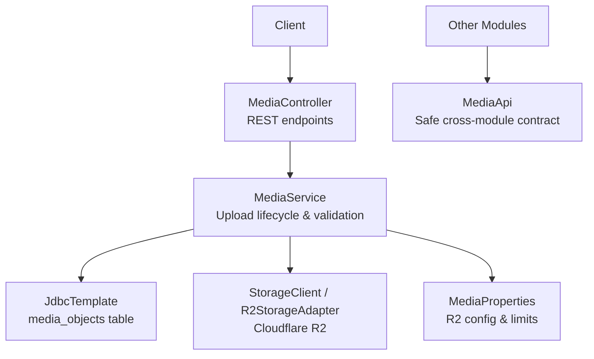
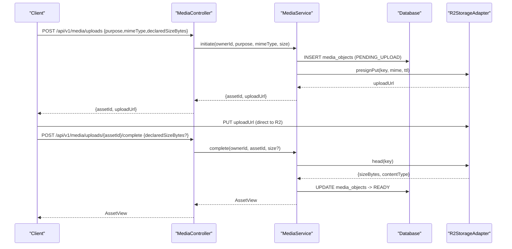
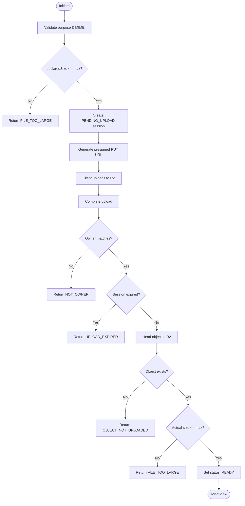
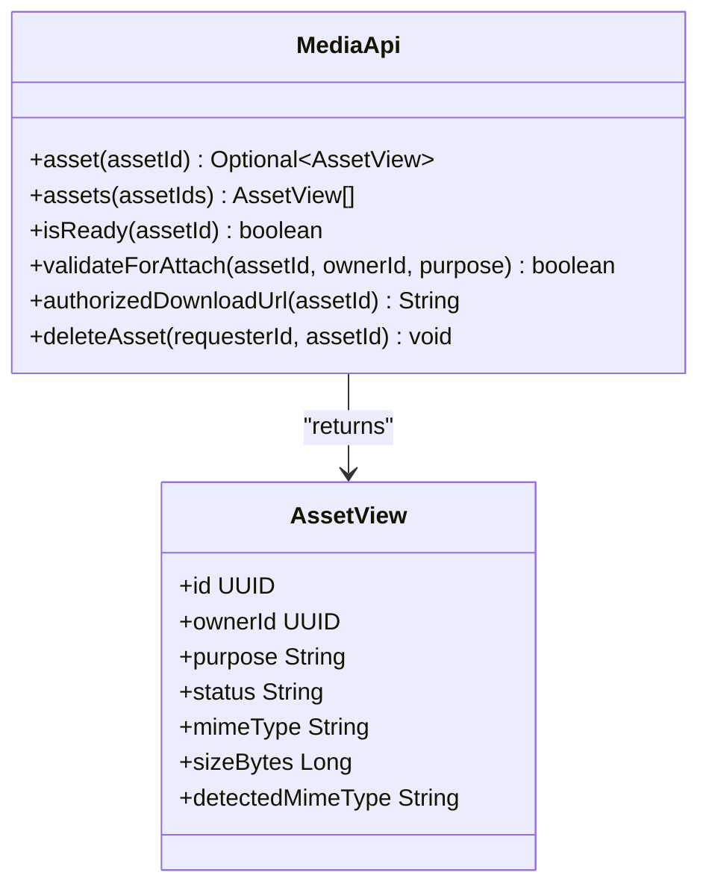
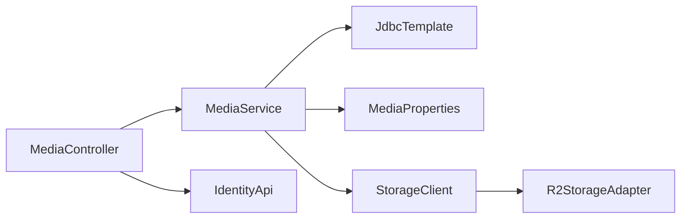

# Media Storage API

<cite>
**Referenced Files in This Document**
- [MediaController.java](file://diasporum-backend/src/main/java/com/diasporum/backend/media/internal/api/rest/MediaController.java)
- [MediaService.java](file://diasporum-backend/src/main/java/com/diasporum/backend/media/internal/application/MediaService.java)
- [MediaProperties.java](file://diasporum-backend/src/main/java/com/diasporum/backend/media/internal/infrastructure/integration/storage/MediaProperties.java)
- [R2StorageAdapter.java](file://diasporum-backend/src/main/java/com/diasporum/backend/media/internal/infrastructure/integration/storage/R2StorageAdapter.java)
- [MediaApi.java](file://diasporum-backend/src/main/java/com/diasporum/backend/media/MediaApi.java)
</cite>

## Table of Contents
1. [Introduction](#introduction)
2. [Project Structure](#project-structure)
3. [Core Components](#core-components)
4. [Architecture Overview](#architecture-overview)
5. [Detailed Component Analysis](#detailed-component-analysis)
6. [Dependency Analysis](#dependency-analysis)
7. [Performance Considerations](#performance-considerations)
8. [Troubleshooting Guide](#troubleshooting-guide)
9. [Conclusion](#conclusion)

## Introduction
This document describes the Media Storage API for uploading, managing, and downloading media assets. It covers:
- REST endpoints for initiating uploads, completing them, canceling sessions, retrieving metadata, generating short-lived download URLs, and deleting assets.
- Upload session lifecycle, validation rules, and error semantics.
- Cloud storage integration via Cloudflare R2 (S3-compatible), including presigned upload/download URLs.
- Security model based on JWT-authenticated users and ownership checks.
- Operational configuration for R2, TTLs, and size limits.

The public contract between modules is exposed through a module interface that returns safe asset views and authorized download URLs without leaking cloud credentials or SDK types.

## Project Structure
The media subsystem follows a layered design:
- REST controller exposes `/api/v1/media` endpoints.
- Application service orchestrates DB operations and storage interactions.
- Infrastructure layer integrates with Cloudflare R2 using S3-compatible clients.
- A public module boundary (`MediaApi`) provides safe cross-module access.

**Diagram sources**
- [MediaController.java:19-90](file://diasporum-backend/src/main/java/com/diasporum/backend/media/internal/api/rest/MediaController.java#L19-L90)
- [MediaService.java:16-54](file://diasporum-backend/src/main/java/com/diasporum/backend/media/internal/application/MediaService.java#L16-L54)
- [MediaProperties.java:11-40](file://diasporum-backend/src/main/java/com/diasporum/backend/media/internal/infrastructure/integration/storage/MediaProperties.java#L11-L40)
- [MediaApi.java:7-39](file://diasporum-backend/src/main/java/com/diasporum/backend/media/MediaApi.java#L7-L39)

**Section sources**
- [MediaController.java:19-90](file://diasporum-backend/src/main/java/com/diasporum/backend/media/internal/api/rest/MediaController.java#L19-L90)
- [MediaService.java:16-54](file://diasporum-backend/src/main/java/com/diasporum/backend/media/internal/application/MediaService.java#L16-L54)
- [MediaProperties.java:11-40](file://diasporum-backend/src/main/java/com/diasporum/backend/media/internal/infrastructure/integration/storage/MediaProperties.java#L11-L40)
- [MediaApi.java:7-39](file://diasporum-backend/src/main/java/com/diasporum/backend/media/MediaApi.java#L7-L39)

## Core Components
- MediaController: REST endpoints for upload initiation, completion, cancellation, metadata retrieval, download URL generation, and deletion.
- MediaService: Business logic for upload sessions, validation, status transitions, and presigned URL generation.
- MediaProperties: Configuration for R2 connectivity, TTLs, and upload limits.
- R2StorageAdapter: S3-compatible client wrapper used to presign and interact with Cloudflare R2.
- MediaApi: Safe cross-module interface returning asset views and authorized download URLs.

Key responsibilities:
- Enforce allowed purposes and MIME types.
- Validate declared sizes against configured maximums.
- Manage upload session state and expiry.
- Generate short-lived presigned URLs for direct object upload and download.
- Provide idempotent operations where applicable.

**Section sources**
- [MediaController.java:19-90](file://diasporum-backend/src/main/java/com/diasporum/backend/media/internal/api/rest/MediaController.java#L19-L90)
- [MediaService.java:21-54](file://diasporum-backend/src/main/java/com/diasporum/backend/media/internal/application/MediaService.java#L21-L54)
- [MediaProperties.java:11-40](file://diasporum-backend/src/main/java/com/diasporum/backend/media/internal/infrastructure/integration/storage/MediaProperties.java#L11-L40)
- [R2StorageAdapter.java:1-6](file://diasporum-backend/src/main/java/com/diasporum/backend/media/internal/infrastructure/integration/storage/R2StorageAdapter.java#L1-L6)
- [MediaApi.java:7-39](file://diasporum-backend/src/main/java/com/diasporum/backend/media/MediaApi.java#L7-L39)

## Architecture Overview
The upload flow uses presigned URLs so clients write directly to R2, minimizing server load. The application maintains an upload session in `media_objects`, validates it upon completion, and then issues short-lived signed download URLs.

**Diagram sources**
- [MediaController.java:39-62](file://diasporum-backend/src/main/java/com/diasporum/backend/media/internal/api/rest/MediaController.java#L39-L62)
- [MediaService.java:95-154](file://diasporum-backend/src/main/java/com/diasporum/backend/media/internal/application/MediaService.java#L95-L154)
- [R2StorageAdapter.java:1-6](file://diasporum-backend/src/main/java/com/diasporum/backend/media/internal/infrastructure/integration/storage/R2StorageAdapter.java#L1-L6)

## Detailed Component Analysis

### REST Endpoints
Base path: `/api/v1/media`

- Initiate upload
  - Method: POST
  - Path: `/uploads`
  - Auth: Required (JWT)
  - Request body:
    - `purpose`: string — one of the supported purposes
    - `mimeType`: string — must be allowed for the purpose
    - `declaredSizeBytes`: number — optional; validated against max limit
  - Response:
    - `assetId`: string (UUID)
    - `uploadUrl`: string — short-lived presigned PUT URL
  - Errors:
    - 400 BAD_REQUEST when required fields are missing or unsupported purpose/MIME
    - 503 SERVICE_UNAVAILABLE when storage is disabled

- Complete upload
  - Method: POST
  - Path: `/uploads/{assetId}/complete`
  - Auth: Required (JWT)
  - Request body:
    - `declaredSizeBytes`: number — optional
  - Response:
    - Asset view with fields such as `id`, `ownerId`, `purpose`, `status`, `mimeType`, `sizeBytes`, `detectedMimeType`
  - Errors:
    - 410 GONE if upload session expired
    - 400 BAD_REQUEST if object not uploaded or exceeds size limit
    - 403 FORBIDDEN if not owner

- Cancel upload
  - Method: DELETE
  - Path: `/uploads/{assetId}`
  - Auth: Required (JWT)
  - Response: 204 No Content on success
  - Errors:
    - 404 NOT_FOUND if asset does not exist
    - 403 FORBIDDEN if not owner

- Get asset metadata
  - Method: GET
  - Path: `/{assetId}`
  - Auth: Required (JWT)
  - Response: Asset view
  - Errors:
    - 404 NOT_FOUND
    - 403 FORBIDDEN if not owner

- Generate download URL
  - Method: POST
  - Path: `/{assetId}/download-url`
  - Auth: Required (JWT)
  - Response:
    - `downloadUrl`: string — short-lived presigned GET URL
  - Errors:
    - 409 CONFLICT if asset not ready
    - 403 FORBIDDEN if not owner

- Delete asset
  - Method: DELETE
  - Path: `/{assetId}`
  - Auth: Required (JWT)
  - Response: 204 No Content on success
  - Errors:
    - 404 NOT_FOUND
    - 403 FORBIDDEN if not owner

Notes:
- All endpoints resolve the actor from the JWT and map it to a profile ID before processing.
- Responses use simple JSON maps for upload/download URL endpoints and structured records for asset views.

**Section sources**
- [MediaController.java:19-90](file://diasporum-backend/src/main/java/com/diasporum/backend/media/internal/api/rest/MediaController.java#L19-L90)

### Upload Lifecycle and Validation
- Allowed purposes and MIME types are enforced at initiation time.
- Declared size is checked against a configured maximum.
- An upload session row is created with status `PENDING_UPLOAD`.
- Clients upload directly to R2 using the presigned URL.
- Completion verifies:
  - Ownership
  - Session expiry
  - Object existence and size
  - Updates status to `READY` and stores detected MIME type and size.

**Diagram sources**
- [MediaService.java:95-154](file://diasporum-backend/src/main/java/com/diasporum/backend/media/internal/application/MediaService.java#L95-L154)

**Section sources**
- [MediaService.java:21-54](file://diasporum-backend/src/main/java/com/diasporum/backend/media/internal/application/MediaService.java#L21-L54)
- [MediaService.java:95-154](file://diasporum-backend/src/main/java/com/diasporum/backend/media/internal/application/MediaService.java#L95-L154)

### Cloud Storage Integration (Cloudflare R2/S3)
- The system integrates with Cloudflare R2 using an S3-compatible client.
- Configuration is driven by environment variables under the prefix `diasporum.media.r2`.
- When enabled and fully configured, the service creates presigned URLs for both upload and download.
- If storage is disabled, endpoints return 503 SERVICE_UNAVAILABLE rather than failing the entire application context.

Configuration properties:
- `enabled`: boolean — feature flag
- `endpoint`: string — R2 endpoint
- `accessKeyId`: string
- `secretAccessKey`: string
- `bucket`: string
- `region`: string — defaults to `auto`
- `uploadUrlTtl`: duration — default 15 minutes
- `downloadUrlTtl`: duration — default 2 minutes
- `sessionTtl`: duration — default 15 minutes
- `maxUploadBytes`: long — default 25 MiB

Security note:
- Credentials and bucket details are never exposed in API responses.
- Only short-lived presigned URLs are returned.

**Section sources**
- [MediaProperties.java:11-40](file://diasporum-backend/src/main/java/com/diasporum/backend/media/internal/infrastructure/integration/storage/MediaProperties.java#L11-L40)
- [MediaService.java:43-50](file://diasporum-backend/src/main/java/com/diasporum/backend/media/internal/application/MediaService.java#L43-L50)
- [R2StorageAdapter.java:1-6](file://diasporum-backend/src/main/java/com/diasporum/backend/media/internal/infrastructure/integration/storage/R2StorageAdapter.java#L1-L6)

### Cross-Module Contract
Other modules should consume `MediaApi` instead of internal implementation classes. This interface:
- Returns safe asset views without exposing storage internals.
- Provides methods to check readiness and validate attachments.
- Generates authorized download URLs for consumers that already own parent-resource authorization.

**Diagram sources**
- [MediaApi.java:7-39](file://diasporum-backend/src/main/java/com/diasporum/backend/media/MediaApi.java#L7-L39)

**Section sources**
- [MediaApi.java:7-39](file://diasporum-backend/src/main/java/com/diasporum/backend/media/MediaApi.java#L7-L39)

## Dependency Analysis
- MediaController depends on IdentityApi to resolve the authenticated user’s profile ID and on MediaService for business logic.
- MediaService depends on JdbcTemplate for persistence, MediaProperties for configuration, and StorageClient (implemented by R2StorageAdapter) for cloud operations.
- R2StorageAdapter wraps AWS S3 SDK clients to perform presign and basic object operations against R2.

**Diagram sources**
- [MediaController.java:19-30](file://diasporum-backend/src/main/java/com/diasporum/backend/media/internal/api/rest/MediaController.java#L19-L30)
- [MediaService.java:30-50](file://diasporum-backend/src/main/java/com/diasporum/backend/media/internal/application/MediaService.java#L30-L50)
- [R2StorageAdapter.java:1-6](file://diasporum-backend/src/main/java/com/diasporum/backend/media/internal/infrastructure/integration/storage/R2StorageAdapter.java#L1-L6)

**Section sources**
- [MediaController.java:19-30](file://diasporum-backend/src/main/java/com/diasporum/backend/media/internal/api/rest/MediaController.java#L19-L30)
- [MediaService.java:30-50](file://diasporum-backend/src/main/java/com/diasporum/backend/media/internal/application/MediaService.java#L30-L50)
- [R2StorageAdapter.java:1-6](file://diasporum-backend/src/main/java/com/diasporum/backend/media/internal/infrastructure/integration/storage/R2StorageAdapter.java#L1-L6)

## Performance Considerations
- Direct-to-storage uploads reduce server bandwidth and CPU usage by issuing presigned URLs.
- Short TTLs for presigned URLs minimize exposure windows.
- Batch metadata queries are available for attachment lists to reduce round trips.
- Deletion failures are retried asynchronously via a job queue to avoid blocking the request path.

[No sources needed since this section provides general guidance]

## Troubleshooting Guide
Common errors and their meanings:
- PURPOSE_AND_MIME_REQUIRED: Missing or invalid purpose/mime in initiation request.
- UNSUPPORTED_PURPOSE: Purpose not recognized.
- UNSUPPORTED_MIME_TYPE: MIME not allowed for the purpose.
- FILE_TOO_LARGE: Declared or actual size exceeds configured maximum.
- MEDIA_STORAGE_DISABLED: R2 integration is not enabled or configured.
- UPLOAD_EXPIRED: Upload session exceeded its TTL.
- OBJECT_NOT_UPLOADED: Object not found during completion verification.
- MEDIA_NOT_READY: Asset not yet in READY state.
- NOT_OWNER: Actor does not own the asset.
- MEDIA_NOT_FOUND: Asset does not exist.

Operational tips:
- Ensure all R2 configuration values are set; otherwise, storage will be disabled and endpoints will return 503.
- Use the asset status field to gate downstream processing until READY.
- For large files, rely on presigned uploads and monitor completion calls for errors.

**Section sources**
- [MediaController.java:39-90](file://diasporum-backend/src/main/java/com/diasporum/backend/media/internal/api/rest/MediaController.java#L39-L90)
- [MediaService.java:95-218](file://diasporum-backend/src/main/java/com/diasporum/backend/media/internal/application/MediaService.java#L95-L218)

## Conclusion
The Media Storage API provides a secure, efficient, and configurable mechanism for handling media assets. It enforces strict validation, manages upload sessions, and integrates with Cloudflare R2 via presigned URLs. The public module boundary ensures safe cross-module usage without leaking infrastructure details.

[No sources needed since this section summarizes without analyzing specific files]