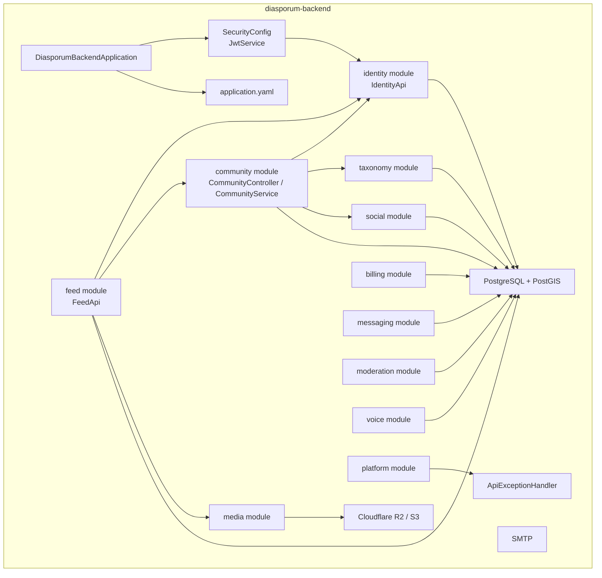
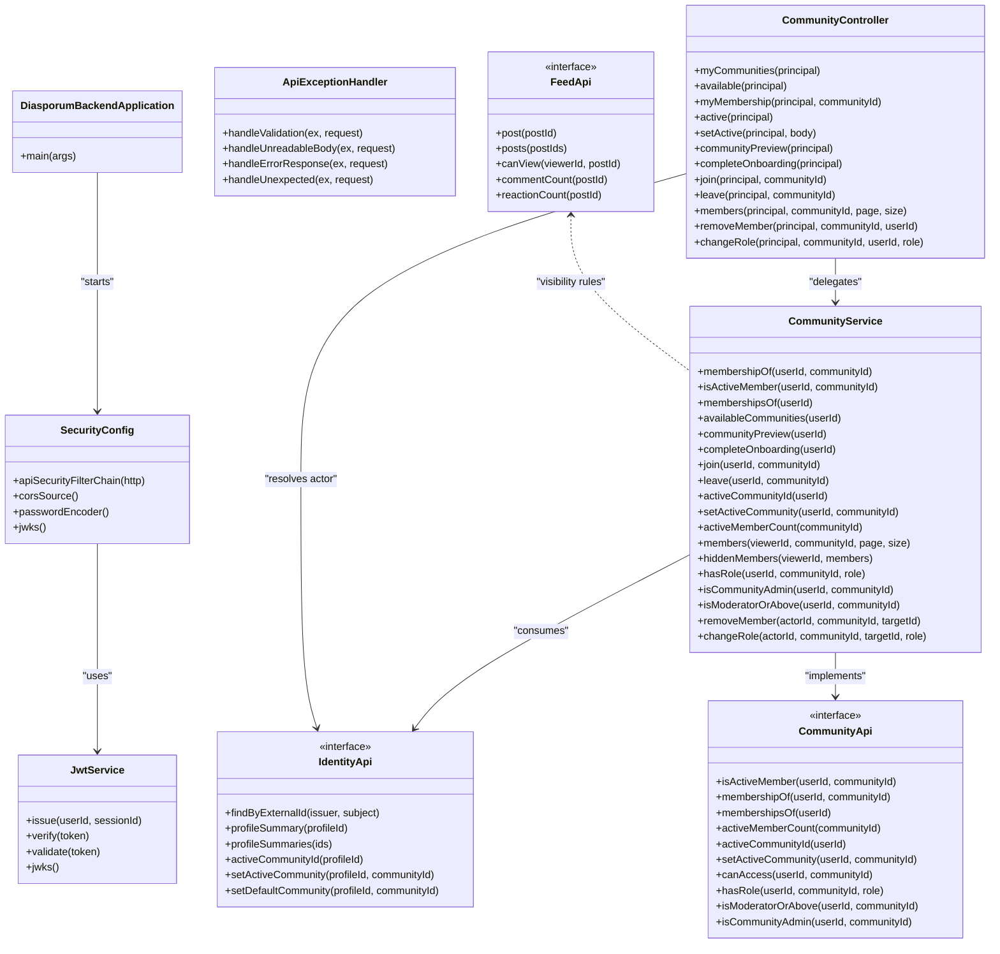
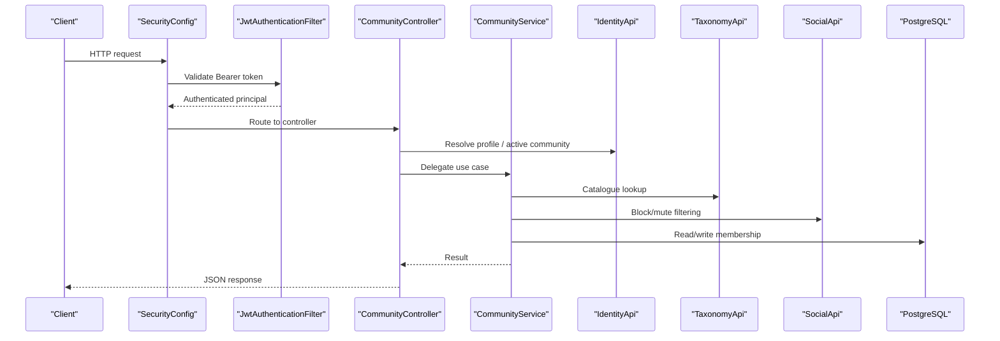
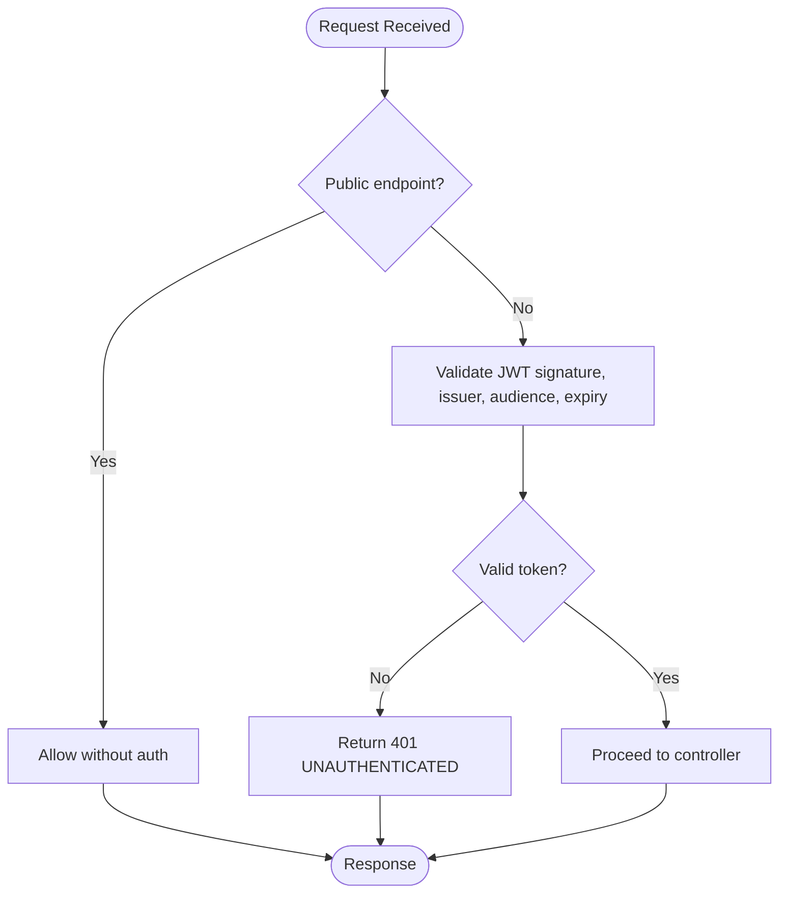
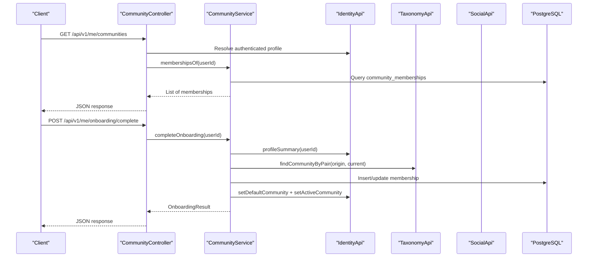
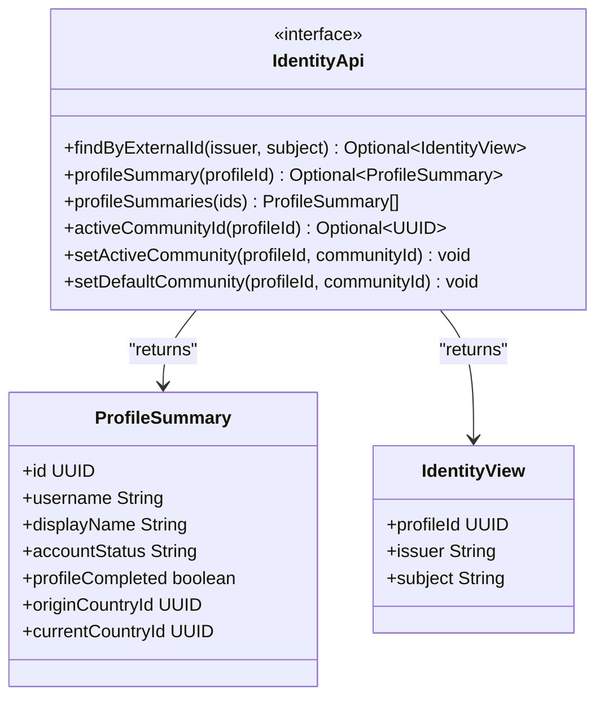
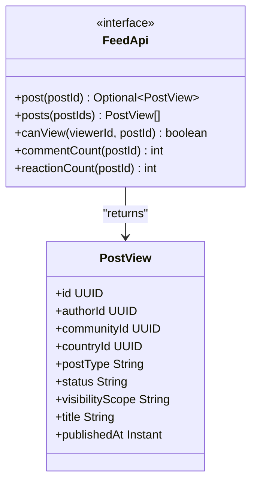
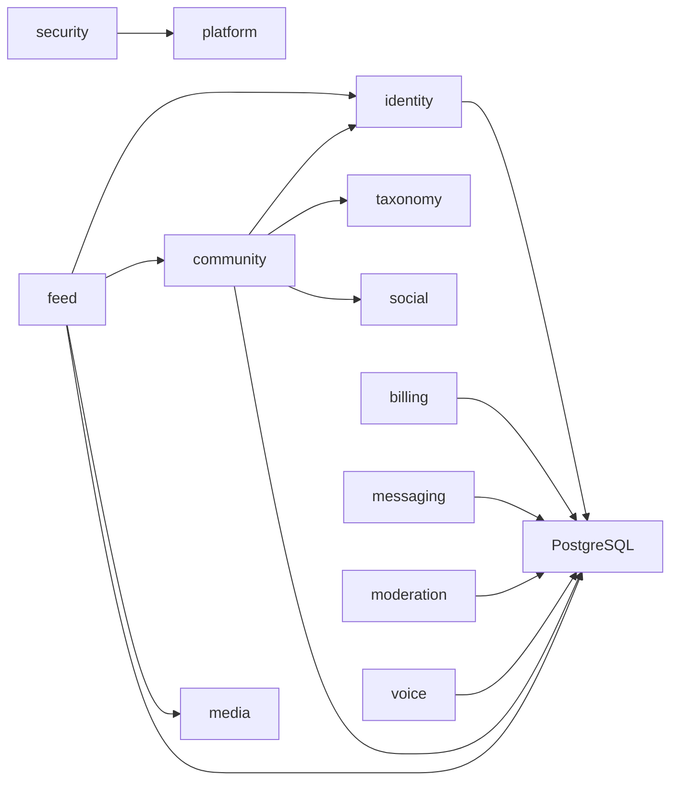

# Backend Architecture

<cite>
**Referenced Files in This Document**
- [pom.xml](file://diasporum-backend/pom.xml)
- [DiasporumBackendApplication.java](file://diasporum-backend/src/main/java/com/diasporum/backend/DiasporumBackendApplication.java)
- [application.yaml](file://diasporum-backend/src/main/resources/application.yaml)
- [SecurityConfig.java](file://diasporum-backend/src/main/java/com/diasporum/backend/security/internal/config/SecurityConfig.java)
- [JwtService.java](file://diasporum-backend/src/main/java/com/diasporum/backend/security/JwtService.java)
- [ApiExceptionHandler.java](file://diasporum-backend/src/main/java/com/diasporum/backend/platform/api/error/ApiExceptionHandler.java)
- [CommunityController.java](file://diasporum-backend/src/main/java/com/diasporum/backend/community/internal/api/rest/CommunityController.java)
- [CommunityService.java](file://diasporum-backend/src/main/java/com/diasporum/backend/community/internal/application/CommunityService.java)
- [CommunityApi.java](file://diasporum-backend/src/main/java/com/diasporum/backend/community/CommunityApi.java)
- [FeedApi.java](file://diasporum-backend/src/main/java/com/diasporum/backend/feed/FeedApi.java)
- [IdentityApi.java](file://diasporum-backend/src/main/java/com/diasporum/backend/identity/IdentityApi.java)
- [AuthFlowIntegrationTest.java](file://diasporum-backend/src/test/java/com/diasporum/backend/identity/AuthFlowIntegrationTest.java)
- [package-info.java (security)](file://diasporum-backend/src/main/java/com/diasporum/backend/security/package-info.java)
- [package-info.java (architecture tests)](file://diasporum-backend/src/test/java/com/diasporum/backend/architecture/package-info.java)
</cite>

## Table of Contents
1. [Introduction](#introduction)
2. [Project Structure](#project-structure)
3. [Core Components](#core-components)
4. [Architecture Overview](#architecture-overview)
5. [Detailed Component Analysis](#detailed-component-analysis)
6. [Dependency Analysis](#dependency-analysis)
7. [Performance Considerations](#performance-considerations)
8. [Troubleshooting Guide](#troubleshooting-guide)
9. [Conclusion](#conclusion)
10. [Appendices](#appendices)

## Introduction
This document describes the DIASPORUM backend as a Spring Boot modular monolith organized around clear domain boundaries and strict layer separation. The system follows domain-driven design principles, isolating business domains such as identity, community, feed, taxonomy, social interactions, media, billing, messaging, moderation, voice, and platform capabilities. Each module exposes narrow public interfaces while keeping implementation details under an `internal` package. Security is designed first: the API is stateless, uses RS256 JWTs issued by the application itself, and enforces authentication at the HTTP layer with resource-level authorization inside modules.

The backend runs on Java 21 with Spring Boot 4.1.2, persists data to PostgreSQL with PostGIS, manages schema evolution through Flyway, and integrates with external systems such as SMTP for email delivery and Cloudflare R2-compatible object storage for media. Cross-cutting concerns include global error handling, CORS configuration, validation, logging, and architecture-boundary enforcement via tests.

## Project Structure
At the top level, the repository contains:
- A Spring Boot backend project under `diasporum-backend`.
- Supporting documentation and database artifacts under `Diasporum_v10.11-OLD` and `Diasporum_v10.12`.
- Mobile and web clients under `diasporum-mobile` and `diasporum-web`.
- Keycloak realm configuration and deployment helpers at the repository root.

The backend source tree follows a consistent per-module layout:
- Module root: public API interfaces and published events.
- `internal/api/rest`: REST controllers, request/response DTOs, and validation.
- `internal/application`: use cases, orchestration, transaction boundaries, and ports.
- `internal/domain`: domain models, value objects, policies, domain exceptions, and domain events.
- `internal/infrastructure/persistence`: JPA entities, repositories, mappers, and SQL queries.
- `internal/infrastructure/integration`: adapters for other modules and external systems.
- `internal/config`: feature-specific Spring configuration.

**Diagram sources**
- [DiasporumBackendApplication.java:6-11](file://diasporum-backend/src/main/java/com/diasporum/backend/DiasporumBackendApplication.java#L6-L11)
- [application.yaml:1-74](file://diasporum-backend/src/main/resources/application.yaml#L1-L74)
- [SecurityConfig.java:31-67](file://diasporum-backend/src/main/java/com/diasporum/backend/security/internal/config/SecurityConfig.java#L31-L67)
- [CommunityController.java:28-41](file://diasporum-backend/src/main/java/com/diasporum/backend/community/internal/api/rest/CommunityController.java#L28-L41)
- [CommunityService.java:21-43](file://diasporum-backend/src/main/java/com/diasporum/backend/community/internal/application/CommunityService.java#L21-L43)

**Section sources**
- [DiasporumBackendApplication.java:6-11](file://diasporum-backend/src/main/java/com/diasporum/backend/DiasporumBackendApplication.java#L6-L11)
- [application.yaml:1-74](file://diasporum-backend/src/main/resources/application.yaml#L1-L74)

## Core Components
The backend’s core components are centered around security, cross-cutting error handling, and domain modules that expose stable APIs.

- Application entry point:
  - `DiasporumBackendApplication` starts the Spring Boot application and enables auto-configuration across modules.

- Security-first design:
  - `SecurityConfig` configures a stateless JWT resource server, restricts public endpoints, defines CORS behavior, and wires exception handlers for authentication and authorization failures.
  - `JwtService` issues and validates RS256 JWTs, supports persistent or ephemeral key pairs, exposes JWKS, and enforces issuer, audience, and expiration checks.

- Global error handling:
  - `ApiExceptionHandler` translates validation errors, malformed requests, Spring `ErrorResponseException`, and unexpected exceptions into a consistent API error envelope.

- Domain modules:
  - `identity` provides user profiles, external identity mapping, and active/default community settings through `IdentityApi`.
  - `community` owns membership lifecycle, active-community selection, and role-based authorization through `CommunityApi` and `CommunityService`.
  - `feed` owns posts/reels/help/polls visibility and engagement metrics through `FeedApi`.
  - Other modules (`taxonomy`, `social`, `media`, `billing`, `messaging`, `moderation`, `voice`) follow the same pattern.

**Diagram sources**
- [DiasporumBackendApplication.java:6-11](file://diasporum-backend/src/main/java/com/diasporum/backend/DiasporumBackendApplication.java#L6-L11)
- [SecurityConfig.java:31-104](file://diasporum-backend/src/main/java/com/diasporum/backend/security/internal/config/SecurityConfig.java#L31-L104)
- [JwtService.java:29-161](file://diasporum-backend/src/main/java/com/diasporum/backend/security/JwtService.java#L29-L161)
- [ApiExceptionHandler.java:23-62](file://diasporum-backend/src/main/java/com/diasporum/backend/platform/api/error/ApiExceptionHandler.java#L23-L62)
- [IdentityApi.java:8-60](file://diasporum-backend/src/main/java/com/diasporum/backend/identity/IdentityApi.java#L8-L60)
- [CommunityApi.java:7-50](file://diasporum-backend/src/main/java/com/diasporum/backend/community/CommunityApi.java#L7-L50)
- [CommunityController.java:28-181](file://diasporum-backend/src/main/java/com/diasporum/backend/community/internal/api/rest/CommunityController.java#L28-L181)
- [CommunityService.java:21-331](file://diasporum-backend/src/main/java/com/diasporum/backend/community/internal/application/CommunityService.java#L21-L331)
- [FeedApi.java:7-31](file://diasporum-backend/src/main/java/com/diasporum/backend/feed/FeedApi.java#L7-L31)

**Section sources**
- [DiasporumBackendApplication.java:6-11](file://diasporum-backend/src/main/java/com/diasporum/backend/DiasporumBackendApplication.java#L6-L11)
- [SecurityConfig.java:31-104](file://diasporum-backend/src/main/java/com/diasporum/backend/security/internal/config/SecurityConfig.java#L31-L104)
- [JwtService.java:29-161](file://diasporum-backend/src/main/java/com/diasporum/backend/security/JwtService.java#L29-L161)
- [ApiExceptionHandler.java:23-62](file://diasporum-backend/src/main/java/com/diasporum/backend/platform/api/error/ApiExceptionHandler.java#L23-L62)
- [IdentityApi.java:8-60](file://diasporum-backend/src/main/java/com/diasporum/backend/identity/IdentityApi.java#L8-L60)
- [CommunityApi.java:7-50](file://diasporum-backend/src/main/java/com/diasporum/backend/community/CommunityApi.java#L7-L50)
- [CommunityController.java:28-181](file://diasporum-backend/src/main/java/com/diasporum/backend/community/internal/api/rest/CommunityController.java#L28-L181)
- [CommunityService.java:21-331](file://diasporum-backend/src/main/java/com/diasporum/backend/community/internal/application/CommunityService.java#L21-L331)
- [FeedApi.java:7-31](file://diasporum-backend/src/main/java/com/diasporum/backend/feed/FeedApi.java#L7-L31)

## Architecture Overview
The system is a modular monolith where each domain module encapsulates its own API, application logic, domain model, persistence, and integration adapters. Modules communicate through well-defined interfaces rather than internal implementations. Security is enforced at the HTTP boundary using Spring Security and a custom JWT filter; resource-level authorization remains within modules.

Key architectural characteristics:
- Layer separation:
  - Domain: business rules, models, value objects, policies, and domain exceptions.
  - Application: use cases, orchestration, transaction boundaries, and port usage.
  - Infrastructure: persistence, external integrations, and feature-specific configuration.
- Security-first:
  - Stateless JWT resource server with RS256 keys.
  - Public endpoints explicitly whitelisted; all others require authentication.
  - CORS configured from environment variables without wildcard credentials.
- Data flow:
  - Controllers receive validated requests, delegate to services, and return structured responses.
  - Services coordinate domain logic and call other module APIs or persistence layers.
  - Persistence uses JDBC/JPA with Flyway migrations against PostgreSQL with PostGIS.
- Integration points:
  - SMTP for email delivery.
  - Cloudflare R2/S3 for media uploads/downloads.
  - External identity providers (Google, Apple) used for verification flows only.

**Diagram sources**
- [SecurityConfig.java:47-67](file://diasporum-backend/src/main/java/com/diasporum/backend/security/internal/config/SecurityConfig.java#L47-L67)
- [CommunityController.java:56-112](file://diasporum-backend/src/main/java/com/diasporum/backend/community/internal/api/rest/CommunityController.java#L56-L112)
- [CommunityService.java:71-137](file://diasporum-backend/src/main/java/com/diasporum/backend/community/internal/application/CommunityService.java#L71-L137)
- [IdentityApi.java:17-50](file://diasporum-backend/src/main/java/com/diasporum/backend/identity/IdentityApi.java#L17-L50)

## Detailed Component Analysis

### Security and Authentication
The security layer implements a stateless JWT resource server. Public endpoints are limited to registration, login, external provider flows, refresh, email verification, password reset, health checks, error handling, and JWKS. All other endpoints require a valid Bearer token. CORS is configured from environment variables and does not allow wildcard origins with credentials. Password hashing uses Argon2.

**Diagram sources**
- [SecurityConfig.java:47-67](file://diasporum-backend/src/main/java/com/diasporum/backend/security/internal/config/SecurityConfig.java#L47-L67)
- [SecurityConfig.java:70-89](file://diasporum-backend/src/main/java/com/diasporum/backend/security/internal/config/SecurityConfig.java#L70-L89)
- [SecurityConfig.java:106-116](file://diasporum-backend/src/main/java/com/diasporum/backend/security/internal/config/SecurityConfig.java#L106-L116)

**Section sources**
- [SecurityConfig.java:31-132](file://diasporum-backend/src/main/java/com/diasporum/backend/security/internal/config/SecurityConfig.java#L31-L132)
- [JwtService.java:29-161](file://diasporum-backend/src/main/java/com/diasporum/backend/security/JwtService.java#L29-L161)
- [application.yaml:8-41](file://diasporum-backend/src/main/resources/application.yaml#L8-L41)
- [AuthFlowIntegrationTest.java:223-239](file://diasporum-backend/src/test/java/com/diasporum/backend/identity/AuthFlowIntegrationTest.java#L223-L239)

### Community Module
The community module owns membership lifecycle, active-community context, and role-based authorization. Its public API is exposed through `CommunityApi`; internal implementation lives under `internal`. The controller handles REST endpoints for membership queries, joining/leaving communities, setting active community, onboarding preview/completion, member listing, and admin operations. The service coordinates identity lookups, taxonomy catalogue queries, social block filtering, and direct JDBC operations for membership data.

**Diagram sources**
- [CommunityController.java:56-112](file://diasporum-backend/src/main/java/com/diasporum/backend/community/internal/api/rest/CommunityController.java#L56-L112)
- [CommunityService.java:71-137](file://diasporum-backend/src/main/java/com/diasporum/backend/community/internal/application/CommunityService.java#L71-L137)
- [IdentityApi.java:17-50](file://diasporum-backend/src/main/java/com/diasporum/backend/identity/IdentityApi.java#L17-L50)

**Section sources**
- [CommunityApi.java:7-50](file://diasporum-backend/src/main/java/com/diasporum/backend/community/CommunityApi.java#L7-L50)
- [CommunityController.java:28-181](file://diasporum-backend/src/main/java/com/diasporum/backend/community/internal/api/rest/CommunityController.java#L28-L181)
- [CommunityService.java:21-331](file://diasporum-backend/src/main/java/com/diasporum/backend/community/internal/application/CommunityService.java#L21-L331)

### Identity Module
The identity module provides cross-module access to user profiles, external identity mappings, and active/default community settings. It is consumed by other modules exclusively through `IdentityApi`. Operations are read-focused for cross-module display and authorization; provisioning is handled internally by API endpoints.

**Diagram sources**
- [IdentityApi.java:8-60](file://diasporum-backend/src/main/java/com/diasporum/backend/identity/IdentityApi.java#L8-L60)

**Section sources**
- [IdentityApi.java:8-60](file://diasporum-backend/src/main/java/com/diasporum/backend/identity/IdentityApi.java#L8-L60)

### Feed Module
The feed module owns post metadata, visibility checks, and engagement counts. Its public API is exposed through `FeedApi`. Visibility decisions consider existence, publication status, visibility scope, and relationship filters such as blocks and mutes.

**Diagram sources**
- [FeedApi.java:7-31](file://diasporum-backend/src/main/java/com/diasporum/backend/feed/FeedApi.java#L7-L31)

**Section sources**
- [FeedApi.java:7-31](file://diasporum-backend/src/main/java/com/diasporum/backend/feed/FeedApi.java#L7-L31)

### Cross-Cutting Concerns
- Authentication and authorization:
  - Stateless JWT resource server with RS256 keys.
  - Public endpoints explicitly allowed; all others require authentication.
  - Resource-level authorization enforced inside modules.
- Logging and error handling:
  - Global exception handler maps validation, malformed requests, Spring errors, and unexpected exceptions to a consistent API error envelope.
  - Security layer returns standardized 401 and 403 responses with JSON bodies.
- Configuration:
  - Environment-driven configuration for JWT keys, mail provider, CORS origins, and media storage.
  - Ephemeral JWT keys disabled outside local development and tests.

**Section sources**
- [ApiExceptionHandler.java:23-62](file://diasporum-backend/src/main/java/com/diasporum/backend/platform/api/error/ApiExceptionHandler.java#L23-L62)
- [SecurityConfig.java:106-132](file://diasporum-backend/src/main/java/com/diasporum/backend/security/internal/config/SecurityConfig.java#L106-L132)
- [application.yaml:26-74](file://diasporum-backend/src/main/resources/application.yaml#L26-L74)

## Dependency Analysis
Module dependencies are intentionally constrained:
- `community` depends on `identity`, `taxonomy`, and `social` through their public APIs.
- `feed` depends on `identity`, `community`, and `media` through their public APIs.
- `security` is a foundational module providing authentication and authorization infrastructure.
- `platform` provides shared error handling and common utilities.

**Diagram sources**
- [CommunityService.java:21-43](file://diasporum-backend/src/main/java/com/diasporum/backend/community/internal/application/CommunityService.java#L21-L43)
- [FeedApi.java:7-31](file://diasporum-backend/src/main/java/com/diasporum/backend/feed/FeedApi.java#L7-L31)

**Section sources**
- [CommunityService.java:21-43](file://diasporum-backend/src/main/java/com/diasporum/backend/community/internal/application/CommunityService.java#L21-L43)
- [FeedApi.java:7-31](file://diasporum-backend/src/main/java/com/diasporum/backend/feed/FeedApi.java#L7-L31)

## Performance Considerations
- Stateless authentication reduces session overhead and scales horizontally.
- Pagination is applied to member listings to limit result sets.
- Direct JDBC queries are used for performance-sensitive membership operations.
- Email delivery and media storage are externalized to SMTP and object storage to avoid blocking the main thread.
- Flyway migrations ensure predictable schema evolution without runtime schema discovery overhead.

[No sources needed since this section provides general guidance]

## Troubleshooting Guide
Common operational issues and how they are handled:
- Missing or mismatched JWT keys:
  - Startup fails fast if private/public keys are misconfigured or missing in non-local environments.
  - Ephemeral keys are only allowed when explicitly enabled for local development/tests.
- Unauthenticated access:
  - Requests without valid tokens receive 401 with a standard JSON error body.
- Authorization failures:
  - Insufficient permissions receive 403 with a standard JSON error body.
- Validation errors:
  - Request validation failures return 400 with field-level error details.
- Malformed request bodies:
  - Unreadable JSON returns 400 with a machine-readable code.
- Unexpected exceptions:
  - Logged and returned as 500 with a generic error envelope.

**Section sources**
- [JwtService.java:41-80](file://diasporum-backend/src/main/java/com/diasporum/backend/security/JwtService.java#L41-L80)
- [SecurityConfig.java:106-132](file://diasporum-backend/src/main/java/com/diasporum/backend/security/internal/config/SecurityConfig.java#L106-L132)
- [ApiExceptionHandler.java:28-62](file://diasporum-backend/src/main/java/com/diasporum/backend/platform/api/error/ApiExceptionHandler.java#L28-L62)

## Conclusion
DIASPORUM’s backend is a secure, modular Spring Boot monolith that separates concerns across domain, application, and infrastructure layers. Security is enforced at the HTTP boundary with RS256 JWTs, while resource-level authorization remains within modules. Domain modules communicate through narrow public APIs, ensuring isolation and maintainability. The technology stack—Java 21, Spring Boot, PostgreSQL with PostGIS, Flyway, Nimbus JWT, and optional Cloudflare R2/S3—supports scalable, observable, and deployable operations. Architecture tests and explicit module boundaries help preserve design integrity as the system evolves.

[No sources needed since this section summarizes without analyzing specific files]

## Appendices

### Technology Stack Decisions and Rationale
- Java 21 and Spring Boot 4.1.2: modern runtime and framework features with long-term support alignment.
- Spring Security: robust, configurable security with stateless JWT support.
- Nimbus JOSE/JWT: reliable RS256 signing and verification with JWKS exposure.
- PostgreSQL with PostGIS: relational data modeling with geospatial capabilities required by community/country relationships.
- Flyway: versioned, auditable schema migrations aligned with canonical schema documents.
- SMTP: standard email delivery for verification and password reset flows.
- Cloudflare R2/S3: scalable object storage for media assets with configurable TTLs and upload limits.

**Section sources**
- [pom.xml:32-95](file://diasporum-backend/pom.xml#L32-L95)
- [application.yaml:11-74](file://diasporum-backend/src/main/resources/application.yaml#L11-L74)

### Deployment Topology
- Single Spring Boot process exposing REST APIs.
- External dependencies:
  - PostgreSQL with PostGIS for relational and geospatial data.
  - SMTP server for email delivery.
  - Cloudflare R2/S3-compatible storage for media.
  - Optional Keycloak realm configuration for external identity verification flows.
- Configuration is environment-driven via environment variables and Spring profiles.

**Section sources**
- [application.yaml:1-74](file://diasporum-backend/src/main/resources/application.yaml#L1-L74)

### Module Boundary Enforcement
- Security module boundary documented in package metadata; architecture tests enforce forbidden imports into internal packages.
- Architecture test package indicates planned enforcement of module boundaries using ArchUnit or Spring Modulith.

**Section sources**
- [package-info.java (security):1-8](file://diasporum-backend/src/main/java/com/diasporum/backend/security/package-info.java#L1-L8)
- [package-info.java (architecture tests):1-9](file://diasporum-backend/src/test/java/com/diasporum/backend/architecture/package-info.java#L1-L9)