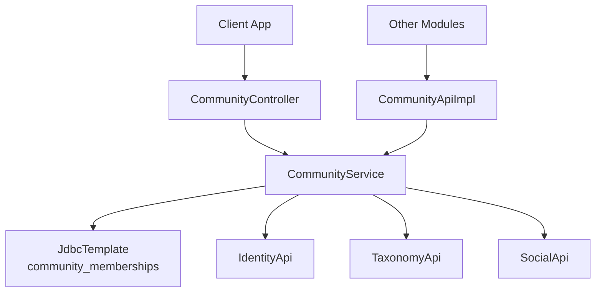
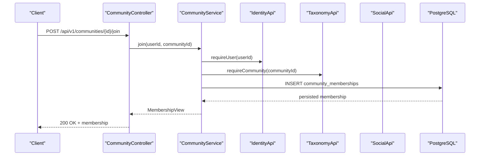
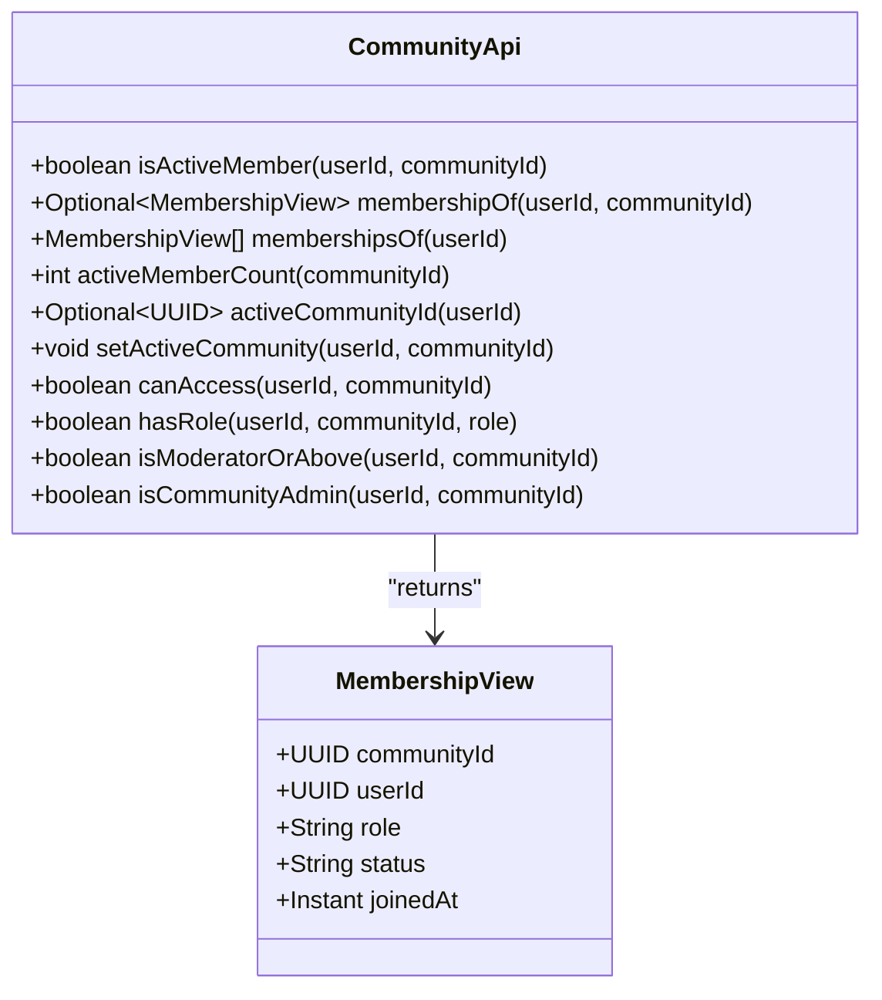
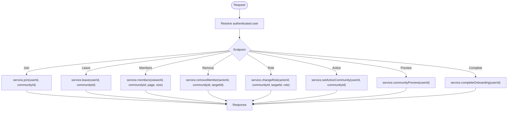
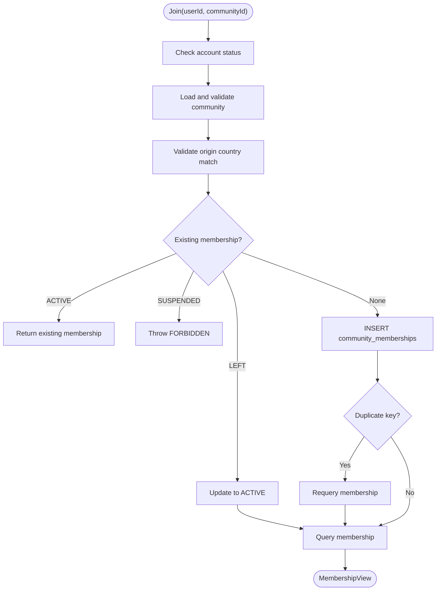
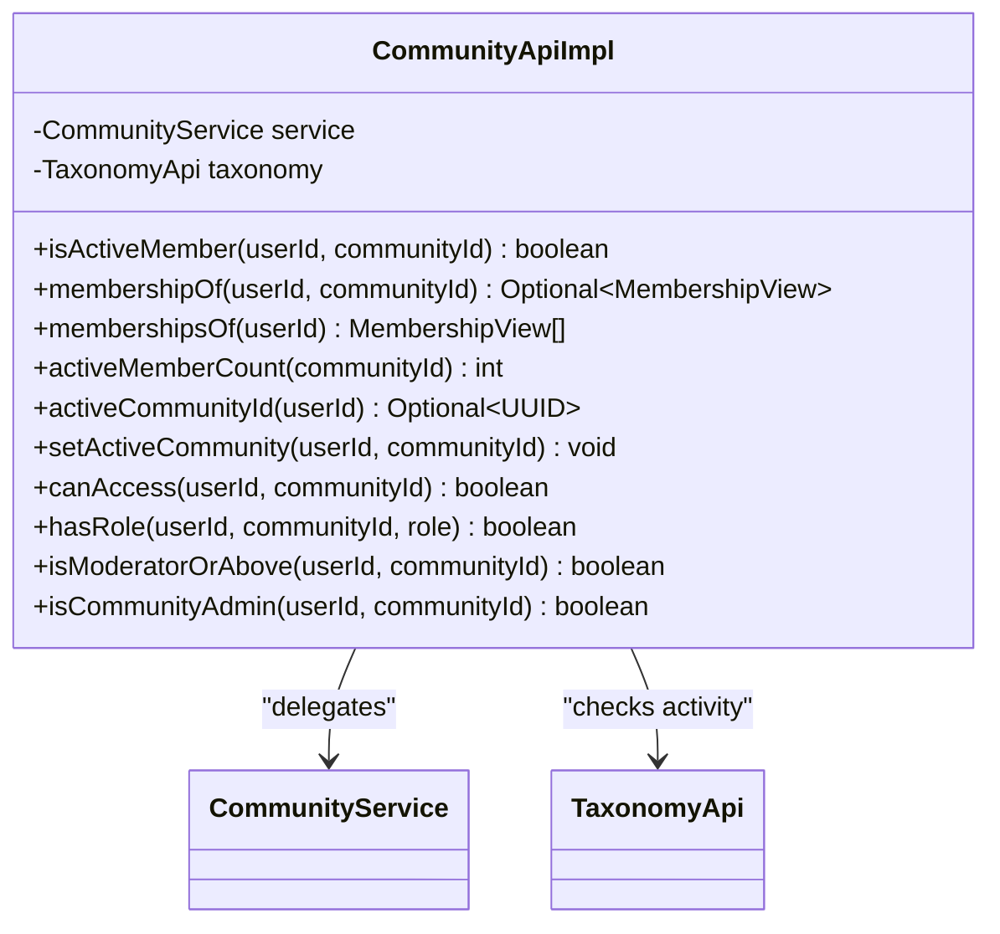
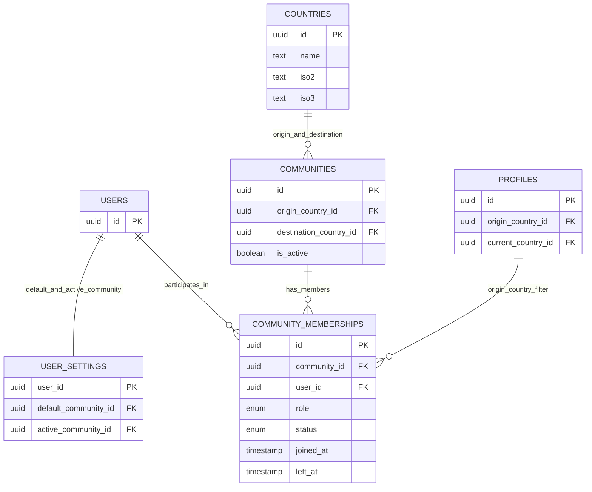
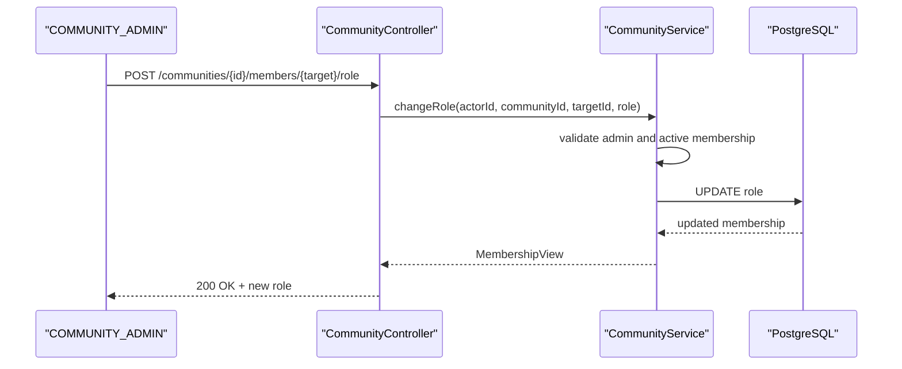
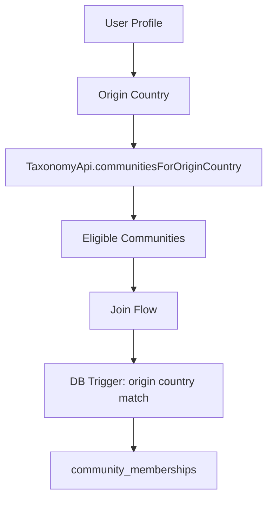
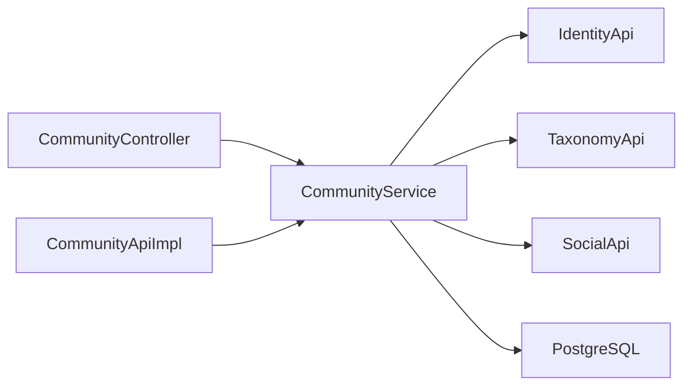

# Community Module

<cite>
**Referenced Files in This Document**
- [CommunityApi.java](file://diasporum-backend/src/main/java/com/diasporum/backend/community/CommunityApi.java)
- [CommunityController.java](file://diasporum-backend/src/main/java/com/diasporum/backend/community/internal/api/rest/CommunityController.java)
- [CommunityService.java](file://diasporum-backend/src/main/java/com/diasporum/backend/community/internal/application/CommunityService.java)
- [CommunityApiImpl.java](file://diasporum-backend/src/main/java/com/diasporum/backend/community/internal/application/CommunityApiImpl.java)
- [CommunityModuleIntegrationTest.java](file://diasporum-backend/src/test/java/com/diasporum/backend/community/CommunityModuleIntegrationTest.java)
- [Diasporum_PostgreSQL_Schema_v10_12.sql](file://Diasporum_v10.12/Diasporum_PostgreSQL_Schema_v10_12.sql)
- [package-info.java (platform/geospatial)](file://diasporum-backend/src/main/java/com/diasporum/backend/platform/geospatial/package-info.java)
</cite>

## Table of Contents
1. [Introduction](#introduction)
2. [Project Structure](#project-structure)
3. [Core Components](#core-components)
4. [Architecture Overview](#architecture-overview)
5. [Detailed Component Analysis](#detailed-component-analysis)
6. [Dependency Analysis](#dependency-analysis)
7. [Performance Considerations](#performance-considerations)
8. [Troubleshooting Guide](#troubleshooting-guide)
9. [Conclusion](#conclusion)

## Introduction
The Community module owns community participation, membership lifecycle, active-community context, and community-level authorization. It does not own the community catalogue; that responsibility belongs to the Taxonomy module. The public boundary is `CommunityApi`, which other modules consume for membership checks, role checks, and access decisions. REST endpoints are exposed through `CommunityController` for authenticated users to manage their memberships, preview onboarding, switch active communities, list members, and perform administrative operations such as removing members or changing roles.

Key responsibilities:
- Membership creation, reactivation, leaving, and idempotent join behavior.
- Active community selection per user.
- Role-based authorization within a community.
- Eligibility filtering by origin country.
- Member listing with block-aware visibility.
- Onboarding preview and automatic community assignment.

## Project Structure
The backend implementation follows a layered structure inside the `community` feature package:
- Public API contract: `CommunityApi`.
- REST controller: `CommunityController`.
- Application service: `CommunityService`.
- Delegating adapter: `CommunityApiImpl`.
- Persistence is performed directly via `JdbcTemplate` against the `community_memberships` table, while catalogue and identity data come from external APIs.

**Diagram sources**
- [CommunityController.java:28-41](file://diasporum-backend/src/main/java/com/diasporum/backend/community/internal/api/rest/CommunityController.java#L28-L41)
- [CommunityService.java:30-43](file://diasporum-backend/src/main/java/com/diasporum/backend/community/internal/application/CommunityService.java#L30-L43)
- [CommunityApiImpl.java:11-20](file://diasporum-backend/src/main/java/com/diasporum/backend/community/internal/application/CommunityApiImpl.java#L11-L20)

**Section sources**
- [CommunityApi.java:7-12](file://diasporum-backend/src/main/java/com/diasporum/backend/community/CommunityApi.java#L7-L12)
- [CommunityController.java:23-41](file://diasporum-backend/src/main/java/com/diasporum/backend/community/internal/api/rest/CommunityController.java#L23-L41)
- [CommunityService.java:21-43](file://diasporum-backend/src/main/java/com/diasporum/backend/community/internal/application/CommunityService.java#L21-L43)

## Core Components
- `CommunityApi`: Public interface used by other modules for membership queries, role checks, and access control. It exposes a lightweight `MembershipView` record instead of internal persistence types.
- `CommunityController`: Spring REST controller exposing `/api/v1/me/*` and `/api/v1/communities/*` endpoints for membership, active-context, onboarding, member listing, and admin operations.
- `CommunityService`: Business logic for joining, leaving, switching active community, listing members, role management, and onboarding completion. It coordinates identity, taxonomy, social blocking, and direct SQL access.
- `CommunityApiImpl`: Thin delegator implementing `CommunityApi` and adding cross-cutting access rules such as requiring both active membership and an active community.

**Section sources**
- [CommunityApi.java:13-50](file://diasporum-backend/src/main/java/com/diasporum/backend/community/CommunityApi.java#L13-L50)
- [CommunityController.java:28-181](file://diasporum-backend/src/main/java/com/diasporum/backend/community/internal/api/rest/CommunityController.java#L28-L181)
- [CommunityService.java:29-333](file://diasporum-backend/src/main/java/com/diasporum/backend/community/internal/application/CommunityService.java#L29-L333)
- [CommunityApiImpl.java:9-71](file://diasporum-backend/src/main/java/com/diasporum/backend/community/internal/application/CommunityApiImpl.java#L9-L71)

## Architecture Overview
The Community module integrates with several other modules:
- IdentityApi provides profile summaries, default and active community settings, and profile lookup by external identity.
- TaxonomyApi provides community catalogue data, country information, and eligibility discovery.
- SocialApi provides block relationships used to hide blocked members from listings.
- PostgreSQL stores membership state and enforces origin-country eligibility through a database trigger.

**Diagram sources**
- [CommunityController.java:116-120](file://diasporum-backend/src/main/java/com/diasporum/backend/community/internal/api/rest/CommunityController.java#L116-L120)
- [CommunityService.java:147-187](file://diasporum-backend/src/main/java/com/diasporum/backend/community/internal/application/CommunityService.java#L147-L187)
- [Diasporum_PostgreSQL_Schema_v10_12.sql:384-413](file://Diasporum_v10.12/Diasporum_PostgreSQL_Schema_v10_12.sql#L384-L413)

## Detailed Component Analysis

### CommunityApi Interface
`CommunityApi` defines the stable contract for other modules:
- Membership queries: active membership check, single membership lookup, all active memberships.
- Active community context: read and set the user’s active community.
- Authorization helpers: role check, moderator-or-above check, community-admin check.
- Access decision: `canAccess` requires both active membership and an active community.

This interface intentionally avoids exposing persistence internals and returns only `MembershipView`.

**Diagram sources**
- [CommunityApi.java:13-50](file://diasporum-backend/src/main/java/com/diasporum/backend/community/CommunityApi.java#L13-L50)

**Section sources**
- [CommunityApi.java:7-50](file://diasporum-backend/src/main/java/com/diasporum/backend/community/CommunityApi.java#L7-L50)

### CommunityController REST Endpoints
`CommunityController` exposes authenticated REST endpoints under `/api/v1`. The actor is resolved from the JWT principal, and path parameters represent target entities.

Key endpoint groups:
- My context:
  - `GET /api/v1/me/communities` — active memberships.
  - `GET /api/v1/me/communities/available` — eligible communities based on origin country.
  - `GET /api/v1/me/communities/{communityId}` — membership for a specific community.
  - `GET /api/v1/me/active-community` — current active community.
  - `PUT /api/v1/me/active-community` — set active community.
- Onboarding:
  - `GET /api/v1/me/community-preview` — preview auto-assigned community.
  - `POST /api/v1/me/onboarding/complete` — complete onboarding and assign membership plus default and active community.
- Membership lifecycle:
  - `POST /api/v1/communities/{communityId}/join` — join a community.
  - `GET /api/v1/communities/{communityId}/membership` — get membership.
  - `DELETE /api/v1/communities/{communityId}/membership` — leave a community.
- Members:
  - `GET /api/v1/communities/{communityId}/members` — paginated visible members.
  - `GET /api/v1/communities/{communityId}/members/{userId}` — member detail (requires membership).
- Admin:
  - `DELETE /api/v1/communities/{communityId}/members/{userId}` — remove member.
  - `POST /api/v1/communities/{communityId}/members/{userId}/role` — change member role.

**Diagram sources**
- [CommunityController.java:56-181](file://diasporum-backend/src/main/java/com/diasporum/backend/community/internal/api/rest/CommunityController.java#L56-L181)

**Section sources**
- [CommunityController.java:28-181](file://diasporum-backend/src/main/java/com/diasporum/backend/community/internal/api/rest/CommunityController.java#L28-L181)

### CommunityService Business Logic
`CommunityService` implements the core business rules:

- Eligibility and validation:
  - Requires an active user account or pending verification.
  - Requires an active community.
  - Enforces origin-country matching between user and community.
- Membership lifecycle:
  - Idempotent join: returns existing ACTIVE membership or creates one; handles race conditions.
  - Reactivation: LEFT membership can be reactivated by joining again.
  - Leaving: sets status to LEFT and clears active community if it was the selected one.
- Active community:
  - Only active members may set a community as active.
  - Null value clears the active selection.
- Member listing:
  - Requires viewer to be an active member.
  - Returns ACTIVE members only, paginated.
  - Filters out blocked users using SocialApi.
- Roles and administration:
  - Role checks: MEMBER, MODERATOR, COMMUNITY_ADMIN.
  - Moderator-or-above helper for moderation authority.
  - Last admin protection: prevents demoting or removing the final COMMUNITY_ADMIN.
  - Invalid role updates return a clear error.

**Diagram sources**
- [CommunityService.java:147-187](file://diasporum-backend/src/main/java/com/diasporum/backend/community/internal/application/CommunityService.java#L147-L187)

**Section sources**
- [CommunityService.java:55-69](file://diasporum-backend/src/main/java/com/diasporum/backend/community/internal/application/CommunityService.java#L55-L69)
- [CommunityService.java:147-202](file://diasporum-backend/src/main/java/com/diasporum/backend/community/internal/application/CommunityService.java#L147-L202)
- [CommunityService.java:210-248](file://diasporum-backend/src/main/java/com/diasporum/backend/community/internal/application/CommunityService.java#L210-L248)
- [CommunityService.java:252-331](file://diasporum-backend/src/main/java/com/diasporum/backend/community/internal/application/CommunityService.java#L252-L331)

### CommunityApiImpl Delegation
`CommunityApiImpl` delegates most calls to `CommunityService` and adds cross-module access policy:
- `canAccess` combines membership and community activity.
- Role methods delegate to service but keep the public API clean.

**Diagram sources**
- [CommunityApiImpl.java:11-71](file://diasporum-backend/src/main/java/com/diasporum/backend/community/internal/application/CommunityApiImpl.java#L11-L71)

**Section sources**
- [CommunityApiImpl.java:9-71](file://diasporum-backend/src/main/java/com/diasporum/backend/community/internal/application/CommunityApiImpl.java#L9-L71)

### Domain Model and Relationships
The domain model centers on `community_memberships`, linking users to communities with role and lifecycle state. Related tables include:
- `communities`: catalogue entries with origin and destination countries.
- `countries`: reference data for origin and destination.
- `profiles`: user profile including origin and current country.
- `users`: primary user entity referenced by memberships.
- `user_settings`: stores default and active community selections.

**Diagram sources**
- [Diasporum_PostgreSQL_Schema_v10_12.sql:384-423](file://Diasporum_v10.12/Diasporum_PostgreSQL_Schema_v10_12.sql#L384-L423)

**Section sources**
- [Diasporum_PostgreSQL_Schema_v10_12.sql:384-423](file://Diasporum_v10.12/Diasporum_PostgreSQL_Schema_v10_12.sql#L384-L423)

### Community Lifecycle Examples
- Create membership:
  - Call `POST /api/v1/communities/{communityId}/join`.
  - Service validates account status, community activity, and origin country.
  - Idempotent behavior ensures duplicate requests do not create duplicates.
- Leave community:
  - Call `DELETE /api/v1/communities/{communityId}/membership`.
  - Membership becomes LEFT; active community cleared if it was selected.
- Reactivate membership:
  - Call join again after leaving; membership transitions back to ACTIVE.
- Set active community:
  - Call `PUT /api/v1/me/active-community` with a community ID.
  - Requires active membership; null clears selection.
- Onboarding:
  - Preview: `GET /api/v1/me/community-preview`.
  - Complete: `POST /api/v1/me/onboarding/complete` creates membership and sets default and active community.

**Section sources**
- [CommunityController.java:91-133](file://diasporum-backend/src/main/java/com/diasporum/backend/community/internal/api/rest/CommunityController.java#L91-L133)
- [CommunityService.java:127-138](file://diasporum-backend/src/main/java/com/diasporum/backend/community/internal/application/CommunityService.java#L127-L138)
- [CommunityService.java:147-202](file://diasporum-backend/src/main/java/com/diasporum/backend/community/internal/application/CommunityService.java#L147-L202)
- [CommunityService.java:210-222](file://diasporum-backend/src/main/java/com/diasporum/backend/community/internal/application/CommunityService.java#L210-L222)

### Member Role Assignments and Administrative Operations
- Role hierarchy:
  - MEMBER: default role.
  - MODERATOR: moderation authority.
  - COMMUNITY_ADMIN: full administrative authority.
- Change role:
  - `POST /api/v1/communities/{communityId}/members/{userId}/role` with body containing role.
  - Requires COMMUNITY_ADMIN actor.
  - Prevents demoting the last COMMUNITY_ADMIN.
- Remove member:
  - `DELETE /api/v1/communities/{communityId}/members/{userId}`.
  - Requires COMMUNITY_ADMIN actor.
  - Sets membership status to LEFT; protects last admin.

**Diagram sources**
- [CommunityController.java:172-181](file://diasporum-backend/src/main/java/com/diasporum/backend/community/internal/api/rest/CommunityController.java#L172-L181)
- [CommunityService.java:297-324](file://diasporum-backend/src/main/java/com/diasporum/backend/community/internal/application/CommunityService.java#L297-L324)

**Section sources**
- [CommunityController.java:166-181](file://diasporum-backend/src/main/java/com/diasporum/backend/community/internal/api/rest/CommunityController.java#L166-L181)
- [CommunityService.java:272-331](file://diasporum-backend/src/main/java/com/diasporum/backend/community/internal/application/CommunityService.java#L272-L331)

### Community Discovery and Geographic Filtering
Discovery of eligible communities is driven by the user’s origin country:
- `availableCommunities` uses the user’s origin country to query the taxonomy for matching active communities.
- Database trigger `trg_membership_origin_country` enforces that membership inserts or updates must align the user’s origin country with the community’s origin country.

Geographic filtering using PostGIS:
- The repository structure supports PostGIS geography for radius search and distance ordering across feature modules.
- The Community module itself focuses on country-based eligibility rather than per-post geographic proximity.
- Reusable geospatial primitives live under `platform/geospatial`; feature modules implement their own spatial repositories and privacy filters.

**Diagram sources**
- [CommunityService.java:89-97](file://diasporum-backend/src/main/java/com/diasporum/backend/community/internal/application/CommunityService.java#L89-L97)
- [Diasporum_PostgreSQL_Schema_v10_12.sql:399-413](file://Diasporum_v10.12/Diasporum_PostgreSQL_Schema_v10_12.sql#L399-L413)
- [package-info.java (platform/geospatial):1-4](file://diasporum-backend/src/main/java/com/diasporum/backend/platform/geospatial/package-info.java#L1-L4)

**Section sources**
- [CommunityService.java:89-97](file://diasporum-backend/src/main/java/com/diasporum/backend/community/internal/application/CommunityService.java#L89-L97)
- [Diasporum_PostgreSQL_Schema_v10_12.sql:399-413](file://Diasporum_v10.12/Diasporum_PostgreSQL_Schema_v10_12.sql#L399-L413)
- [package-info.java (platform/geospatial):1-4](file://diasporum-backend/src/main/java/com/diasporum/backend/platform/geospatial/package-info.java#L1-L4)

### Community-Specific Permissions and Access Controls
- Access control:
  - `canAccess` requires active membership and an active community.
  - Member listing requires the viewer to be an active member.
- Role-based permissions:
  - `hasRole` checks exact role.
  - `isModeratorOrAbove` allows MODERATOR or COMMUNITY_ADMIN.
  - `isCommunityAdmin` restricts administrative operations to COMMUNITY_ADMIN.
- Protection rules:
  - Last COMMUNITY_ADMIN cannot be removed or demoted.
  - Non-admins cannot remove members or change roles.
- Visibility:
  - Blocked users are hidden from member lists using SocialApi.

**Section sources**
- [CommunityApiImpl.java:52-71](file://diasporum-backend/src/main/java/com/diasporum/backend/community/internal/application/CommunityApiImpl.java#L52-L71)
- [CommunityService.java:233-248](file://diasporum-backend/src/main/java/com/diasporum/backend/community/internal/application/CommunityService.java#L233-L248)
- [CommunityService.java:252-331](file://diasporum-backend/src/main/java/com/diasporum/backend/community/internal/application/CommunityService.java#L252-L331)

## Dependency Analysis
The Community module depends on:
- IdentityApi for profile lookups and user settings.
- TaxonomyApi for community catalogue and country data.
- SocialApi for block relationships.
- PostgreSQL for membership persistence and trigger enforcement.

**Diagram sources**
- [CommunityController.java:35-41](file://diasporum-backend/src/main/java/com/diasporum/backend/community/internal/api/rest/CommunityController.java#L35-L41)
- [CommunityService.java:32-43](file://diasporum-backend/src/main/java/com/diasporum/backend/community/internal/application/CommunityService.java#L32-L43)
- [CommunityApiImpl.java:13-20](file://diasporum-backend/src/main/java/com/diasporum/backend/community/internal/application/CommunityApiImpl.java#L13-L20)

**Section sources**
- [CommunityController.java:35-41](file://diasporum-backend/src/main/java/com/diasporum/backend/community/internal/api/rest/CommunityController.java#L35-L41)
- [CommunityService.java:32-43](file://diasporum-backend/src/main/java/com/diasporum/backend/community/internal/application/CommunityService.java#L32-L43)

## Performance Considerations
- Direct JDBC queries use indexed columns:
  - `ix_memberships_user_status` optimizes user-centric membership queries.
  - `ix_memberships_community_status` optimizes community-centric membership and role queries.
- Pagination is applied to member listing to avoid large result sets.
- Idempotent join reduces duplicate writes and race-condition overhead.
- Blocking visibility is computed in memory over a filtered set of active members.

Recommendations:
- Keep page sizes bounded; the controller already caps maximum page size.
- Prefer cursor-based pagination for very large member lists.
- Cache frequently accessed community activity flags at the taxonomy layer if needed.

[No sources needed since this section provides general guidance]

## Troubleshooting Guide
Common errors and their meanings:
- `PROFILE_NOT_PROVISIONED`: Internal profile lookup failed for the authenticated user.
- `USER_NOT_FOUND`: Required user profile not found.
- `COMMUNITY_NOT_FOUND`: Required community not found.
- `COMMUNITY_INACTIVE`: Attempted operation on an inactive community.
- `ACCOUNT_NOT_ACTIVE`: Account status blocks joining.
- `COMMUNITY_ORIGIN_MISMATCH`: User origin country does not match community origin.
- `MEMBERSHIP_SUSPENDED`: Cannot join a suspended membership.
- `NOT_A_MEMBER`: Active membership required for operation.
- `ADMIN_REQUIRED`: COMMUNITY_ADMIN role required.
- `LAST_ADMIN`: Attempt to remove or demote the last administrator.
- `INVALID_ROLE`: Role value not valid for the community role type.
- `ROLE_REQUIRED`: Role field missing in request body.

Operational tips:
- Verify user profile origin and current country before onboarding.
- Ensure community is active before allowing joins or role changes.
- Use integration tests to validate end-to-end flows against a real PostgreSQL instance.

**Section sources**
- [CommunityController.java:43-48](file://diasporum-backend/src/main/java/com/diasporum/backend/community/internal/api/rest/CommunityController.java#L43-L48)
- [CommunityController.java:172-181](file://diasporum-backend/src/main/java/com/diasporum/backend/community/internal/api/rest/CommunityController.java#L172-L181)
- [CommunityService.java:55-69](file://diasporum-backend/src/main/java/com/diasporum/backend/community/internal/application/CommunityService.java#L55-L69)
- [CommunityService.java:147-187](file://diasporum-backend/src/main/java/com/diasporum/backend/community/internal/application/CommunityService.java#L147-L187)
- [CommunityService.java:272-331](file://diasporum-backend/src/main/java/com/diasporum/backend/community/internal/application/CommunityService.java#L272-L331)

## Conclusion
The Community module provides a robust foundation for community participation, membership lifecycle, and role-based authorization. It integrates cleanly with identity, taxonomy, and social modules while enforcing eligibility and safety through both application logic and database triggers. The public `CommunityApi` offers a stable contract for other modules, and the REST controller exposes clear endpoints for user-facing operations. For future enhancements, consider extending discovery with optional PostGIS-based proximity filters where appropriate, while preserving privacy and performance constraints.

[No sources needed since this section summarizes without analyzing specific files]