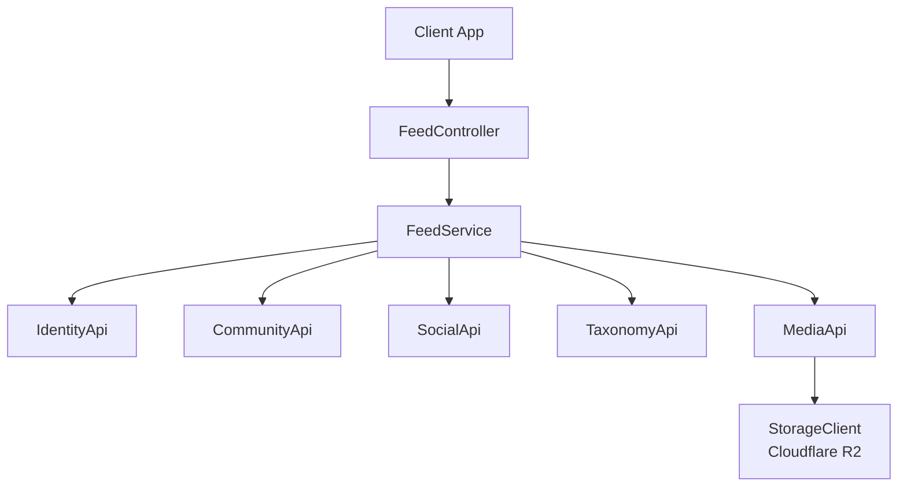
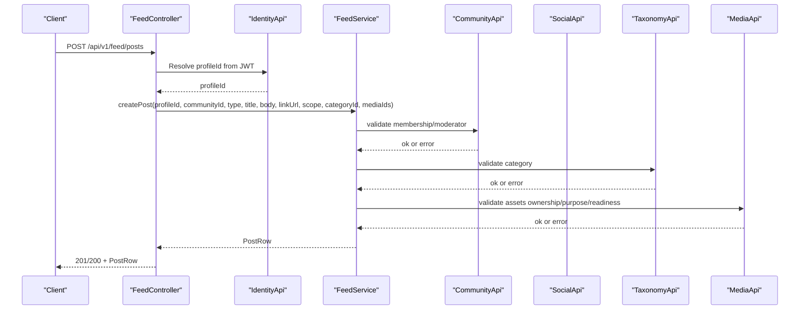
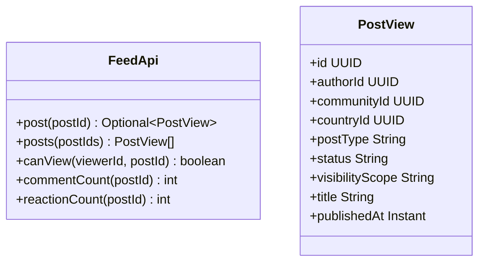
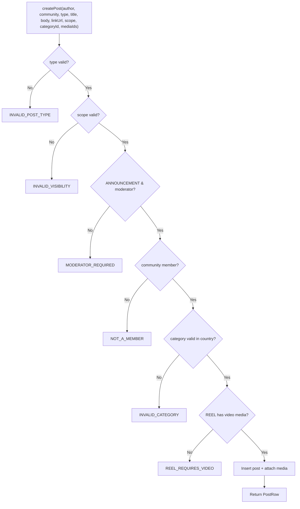
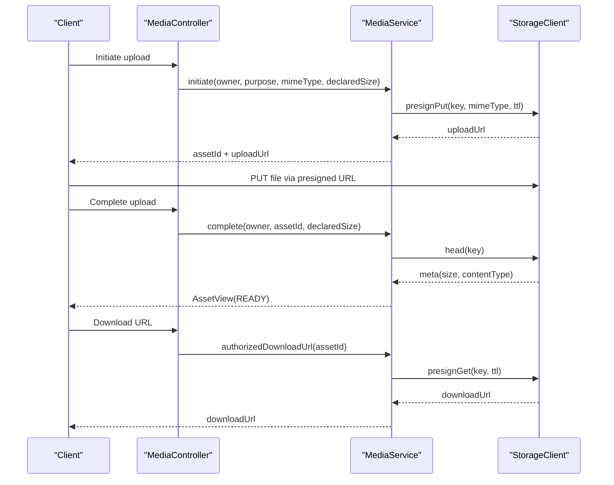
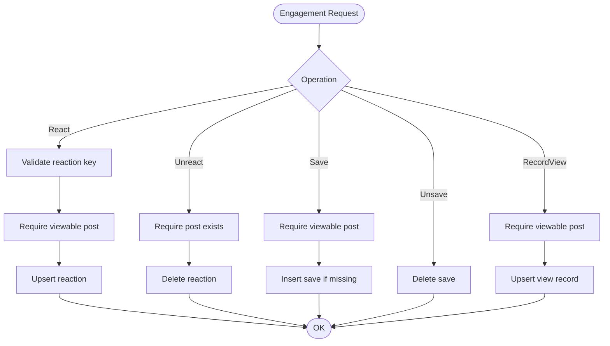
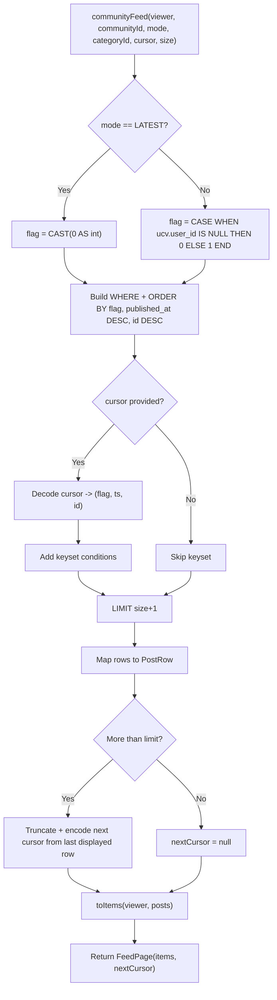
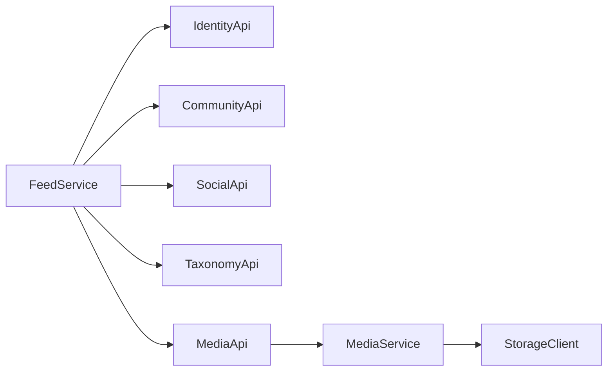

# Feed Module

<cite>
**Referenced Files in This Document**
- [FeedApi.java](file://diasporum-backend/src/main/java/com/diasporum/backend/feed/FeedApi.java)
- [FeedController.java](file://diasporum-backend/src/main/java/com/diasporum/backend/feed/internal/api/rest/FeedController.java)
- [FeedService.java](file://diasporum-backend/src/main/java/com/diasporum/backend/feed/internal/application/FeedService.java)
- [FeedApiImpl.java](file://diasporum-backend/src/main/java/com/diasporum/backend/feed/internal/application/FeedApiImpl.java)
- [MediaApi.java](file://diasporum-backend/src/main/java/com/diasporum/backend/media/MediaApi.java)
- [MediaApiImpl.java](file://diasporum-backend/src/main/java/com/diasporum/backend/media/internal/application/MediaApiImpl.java)
- [MediaService.java](file://diasporum-backend/src/main/java/com/diasporum/backend/media/internal/application/MediaService.java)
</cite>

## Table of Contents
1. [Introduction](#introduction)
2. [Project Structure](#project-structure)
3. [Core Components](#core-components)
4. [Architecture Overview](#architecture-overview)
5. [Detailed Component Analysis](#detailed-component-analysis)
6. [Dependency Analysis](#dependency-analysis)
7. [Performance Considerations](#performance-considerations)
8. [Troubleshooting Guide](#troubleshooting-guide)
9. [Conclusion](#conclusion)

## Introduction
This document explains the Feed module implementation: how posts, comments, reactions, saves, polls, and community help content are created and consumed; how media assets are attached to feed items; and how social visibility rules shape what a viewer can see. It also documents the public `FeedApi` contract used by other modules, the REST endpoints exposed by `FeedController`, and the business logic implemented in `FeedService`. Media handling is covered through the `MediaApi` and `MediaService`, including upload sessions, readiness checks, and short-lived presigned URLs for Cloudflare R2 storage.

The Feed module owns post metadata, visibility checks, and engagement counts for other modules. External content categories (events, jobs, etc.) are referenced by their source modules rather than duplicated here.

## Project Structure
The Feed module follows a layered design:

- Public API boundary: `FeedApi` defines safe cross-module operations such as reading post metadata, checking viewability, and fetching comment/reaction counts.
- REST layer: `FeedController` exposes HTTP endpoints under `/api/v1/feed`.
- Application layer: `FeedService` implements post lifecycle, feed composition, engagement, comments, polls, and community help workflows.
- Cross-module integration: `FeedService` depends on `IdentityApi`, `CommunityApi`, `SocialApi`, `TaxonomyApi`, and `MediaApi`.
- Media module: `MediaApi` and `MediaService` manage asset metadata, upload sessions, readiness, and presigned storage access.



**Diagram sources**
- [FeedController.java:28-40](file://diasporum-backend/src/main/java/com/diasporum/backend/feed/internal/api/rest/FeedController.java#L28-L40)
- [FeedService.java:43-59](file://diasporum-backend/src/main/java/com/diasporum/backend/feed/internal/application/FeedService.java#L43-L59)
- [MediaService.java:30-50](file://diasporum-backend/src/main/java/com/diasporum/backend/media/internal/application/MediaService.java#L30-L50)

**Section sources**
- [FeedApi.java:7-31](file://diasporum-backend/src/main/java/com/diasporum/backend/feed/FeedApi.java#L7-L31)
- [FeedController.java:28-245](file://diasporum-backend/src/main/java/com/diasporum/backend/feed/internal/api/rest/FeedController.java#L28-L245)
- [FeedService.java:22-59](file://diasporum-backend/src/main/java/com/diasporum/backend/feed/internal/application/FeedService.java#L22-L59)
- [MediaApi.java:7-39](file://diasporum-backend/src/main/java/com/diasporum/backend/media/MediaApi.java#L7-L39)

## Core Components
- `FeedApi`: Public-safe interface for other modules to read post metadata, check viewability, and fetch engagement counts without exposing internal types.
- `FeedController`: REST controller mapping HTTP requests to `FeedService` methods. The authenticated actor is resolved from the JWT via `DiasporumUserPrincipal` and then mapped to a profile ID using `IdentityApi`.
- `FeedService`: Central business logic for posts, comments, reactions, saves, views, polls, community help, and unified feed composition with cursor-based pagination.
- `MediaApi` / `MediaApiImpl`: Public contract and delegating implementation for asset metadata, readiness validation, and authorized download URLs.
- `MediaService`: Upload session lifecycle, storage client integration, readiness transitions, and deletion with retry job fallback.

Key responsibilities:
- Post creation enforces allowed types, visibility scope, community membership, category validity, and media purpose constraints.
- Feed queries support “For You” (unseen first) and “Latest” modes, with keyset pagination based on timestamp and ID.
- Social interactions include reactions, saves, and view tracking, all gated by visibility and block/mute rules.
- Comments support paging and moderation controls.
- Polls and community help have dedicated state machines and validation.

**Section sources**
- [FeedApi.java:7-31](file://diasporum-backend/src/main/java/com/diasporum/backend/feed/FeedApi.java#L7-L31)
- [FeedController.java:28-245](file://diasporum-backend/src/main/java/com/diasporum/backend/feed/internal/api/rest/FeedController.java#L28-L245)
- [FeedService.java:22-59](file://diasporum-backend/src/main/java/com/diasporum/backend/feed/internal/application/FeedService.java#L22-L59)
- [MediaApi.java:7-39](file://diasporum-backend/src/main/java/com/diasporum/backend/media/MediaApi.java#L7-L39)
- [MediaService.java:16-50](file://diasporum-backend/src/main/java/com/diasporum/backend/media/internal/application/MediaService.java#L16-L50)

## Architecture Overview
The Feed module integrates multiple domain services:

- Identity resolution maps the JWT principal to a profile ID.
- Community membership and moderation checks gate write operations and visibility.
- Social relationships determine blocking and following behavior.
- Taxonomy validates categories against country context.
- Media attachment requires assets to be owned, ready, and purpose-matched.



**Diagram sources**
- [FeedController.java:64-73](file://diasporum-backend/src/main/java/com/diasporum/backend/feed/internal/api/rest/FeedController.java#L64-L73)
- [FeedService.java:118-162](file://diasporum-backend/src/main/java/com/diasporum/backend/feed/internal/application/FeedService.java#L118-L162)
- [MediaApi.java:20-25](file://diasporum-backend/src/main/java/com/diasporum/backend/media/MediaApi.java#L20-L25)

## Detailed Component Analysis

### FeedApi Interface
`FeedApi` provides a stable, public surface for other modules:

- Read post metadata safely (`post`, `posts`).
- Check whether a viewer can see a post (`canView`).
- Fetch engagement counts (`commentCount`, `reactionCount`).
- `PostView` contains only safe fields: identifiers, type, status, visibility scope, title, and publication time.

This boundary prevents internal types and implementation details from leaking into other modules.



**Diagram sources**
- [FeedApi.java:7-31](file://diasporum-backend/src/main/java/com/diasporum/backend/feed/FeedApi.java#L7-L31)

**Section sources**
- [FeedApi.java:7-31](file://diasporum-backend/src/main/java/com/diasporum/backend/feed/FeedApi.java#L7-L31)
- [FeedApiImpl.java:9-43](file://diasporum-backend/src/main/java/com/diasporum/backend/feed/internal/application/FeedApiImpl.java#L9-L43)

### FeedController Endpoints
`FeedController` exposes REST endpoints under `/api/v1/feed`:

- Posts: create, get, update, delete.
- Feeds: community feed, following feed, reels feed.
- Engagement: react/unreact, save/unsave, record view.
- Comments: create, list, update, delete.
- Community help: create, status transition.
- Polls: create, get, vote/withdraw.
- Author resolution: batch profile summaries.

Authentication is handled via Spring Security’s `@AuthenticationPrincipal`, extracting `DiasporumUserPrincipal`. The controller resolves the user’s profile ID through `IdentityApi` before invoking service methods.

```mermaid
flowchart TD
Start(["HTTP Request"]) --> Auth["Extract Principal<br/>Resolve ProfileId"]
Auth --> Route{"Endpoint"}
Route --> |POST /posts| CreatePost["Create Post"]
Route --> |GET /posts/{id}| GetPost["Get Post"]
Route --> |PATCH /posts/{id}| UpdatePost["Update Post"]
Route --> |DELETE /posts/{id}| DeletePost["Delete Post"]
Route --> |GET /community| CommunityFeed["Community Feed"]
Route --> |GET /following| FollowingFeed["Following Feed"]
Route --> |GET /reels/community| ReelsFeed["Reels Feed"]
Route --> |PUT /posts/{id}/reaction| React["React"]
Route --> |DELETE /posts/{id}/reaction| Unreact["Unreact"]
Route --> |PUT /posts/{id}/save| Save["Save"]
Route --> |DELETE /posts/{id}/save| Unsave["Unsave"]
Route --> |POST /views| RecordView["Record View"]
Route --> |POST /posts/{id}/comments| Comment["Comment"]
Route --> |GET /posts/{id}/comments| Comments["List Comments"]
Route --> |PATCH /comments/{id}| UpdateComment["Update Comment"]
Route --> |DELETE /comments/{id}| DeleteComment["Delete Comment"]
Route --> |POST /community-help| CreateHelp["Create Help Post"]
Route --> |PATCH /community-help/{id}/status| HelpStatus["Set Help Status"]
Route --> |POST /polls| CreatePoll["Create Poll"]
Route --> |GET /polls/{id}| GetPoll["Get Poll"]
Route --> |POST /polls/options/{id}/vote| Vote["Vote/Withdraw"]
CreatePost --> End(["Response"])
GetPost --> End
UpdatePost --> End
DeletePost --> End
CommunityFeed --> End
FollowingFeed --> End
ReelsFeed --> End
React --> End
Unreact --> End
Save --> End
Unsave --> End
RecordView --> End
Comment --> End
Comments --> End
UpdateComment --> End
DeleteComment --> End
CreateHelp --> End
HelpStatus --> End
CreatePoll --> End
GetPoll --> End
Vote --> End
```

**Diagram sources**
- [FeedController.java:64-243](file://diasporum-backend/src/main/java/com/diasporum/backend/feed/internal/api/rest/FeedController.java#L64-L243)

**Section sources**
- [FeedController.java:28-245](file://diasporum-backend/src/main/java/com/diasporum/backend/feed/internal/api/rest/FeedController.java#L28-L245)

### FeedService Business Logic
`FeedService` implements core domain operations:

- Post lifecycle:
  - Creation validates post type, visibility scope, moderator-only announcement type, community membership, category validity, and media requirements (e.g., REEL must include video).
  - Updates allow author or moderator edits.
  - Deletion soft-deletes posts.
- Media attachment:
  - Validates asset ownership, readiness, and purpose (`FEED_IMAGE` or `FEED_VIDEO`; REEL requires `FEED_VIDEO`).
  - Attaches media in sort order.
- Feed composition:
  - Community feed supports “FOR_YOU” (unseen first) and “LATEST” (strict reverse chronological).
  - Following feed aggregates published posts from followed users.
  - Reels feed filters community feed to REEL-type posts.
- Engagement:
  - Reactions upsert per user per post.
  - Saves are idempotent.
  - Views are recorded with existence and accessibility checks.
- Comments:
  - Creation validates post comment enablement, viewability, and body length.
  - Paging uses offset-based pagination.
  - Update/delete enforce authorship or moderation.
- Polls:
  - Creation validates option count and stores poll configuration and options.
  - Voting enforces closed state, result visibility rules, and single/multiple vote policies.
- Community help:
  - Creation creates a special post and help metadata.
  - Status transitions follow a defined state machine with lazy expiry.



**Diagram sources**
- [FeedService.java:118-162](file://diasporum-backend/src/main/java/com/diasporum/backend/feed/internal/application/FeedService.java#L118-L162)

**Section sources**
- [FeedService.java:118-162](file://diasporum-backend/src/main/java/com/diasporum/backend/feed/internal/application/FeedService.java#L118-L162)
- [FeedService.java:164-198](file://diasporum-backend/src/main/java/com/diasporum/backend/feed/internal/application/FeedService.java#L164-L198)
- [FeedService.java:225-312](file://diasporum-backend/src/main/java/com/diasporum/backend/feed/internal/application/FeedService.java#L225-L312)
- [FeedService.java:331-450](file://diasporum-backend/src/main/java/com/diasporum/backend/feed/internal/application/FeedService.java#L331-L450)
- [FeedService.java:481-546](file://diasporum-backend/src/main/java/com/diasporum/backend/feed/internal/application/FeedService.java#L481-L546)
- [FeedService.java:550-625](file://diasporum-backend/src/main/java/com/diasporum/backend/feed/internal/application/FeedService.java#L550-L625)
- [FeedService.java:629-693](file://diasporum-backend/src/main/java/com/diasporum/backend/feed/internal/application/FeedService.java#L629-L693)
- [FeedService.java:697-803](file://diasporum-backend/src/main/java/com/diasporum/backend/feed/internal/application/FeedService.java#L697-L803)

### Media Handling Through MediaApi
The media workflow separates upload initiation, completion, and consumption:

- Initiation:
  - Validates purpose and MIME type against an allowlist.
  - Creates a `media_objects` row with a generated key and bucket name.
  - Returns a presigned PUT URL for direct upload to storage.
- Completion:
  - Verifies ownership and session TTL.
  - Checks object existence and size via storage head operation.
  - Marks asset as READY and records detected MIME type and size.
- Consumption:
  - `authorizedDownloadUrl` returns a short-lived presigned GET URL for authorized consumers.
  - Feed attaches only assets that are READY, owned by the post author, and purpose-matched.



**Diagram sources**
- [MediaService.java:95-155](file://diasporum-backend/src/main/java/com/diasporum/backend/media/internal/application/MediaService.java#L95-L155)
- [MediaService.java:182-191](file://diasporum-backend/src/main/java/com/diasporum/backend/media/internal/application/MediaService.java#L182-L191)

**Section sources**
- [MediaApi.java:7-39](file://diasporum-backend/src/main/java/com/diasporum/backend/media/MediaApi.java#L7-L39)
- [MediaApiImpl.java:9-59](file://diasporum-backend/src/main/java/com/diasporum/backend/media/internal/application/MediaApiImpl.java#L9-L59)
- [MediaService.java:16-50](file://diasporum-backend/src/main/java/com/diasporum/backend/media/internal/application/MediaService.java#L16-L50)
- [MediaService.java:95-155](file://diasporum-backend/src/main/java/com/diasporum/backend/media/internal/application/MediaService.java#L95-L155)
- [MediaService.java:168-191](file://diasporum-backend/src/main/java/com/diasporum/backend/media/internal/application/MediaService.java#L168-L191)

### Social Interaction Features
- Reactions:
  - Upsert per user per post; invalid reaction keys are rejected.
  - Requires viewability to prevent abuse.
- Saves:
  - Idempotent insert; unsave removes the relationship.
- Views:
  - Recorded with existence and accessibility checks; increments view count and updates last viewed timestamp.
- Blocking and membership:
  - Blocked authors are filtered out during feed composition.
  - Non-COUNTRY scoped posts require community membership.



**Diagram sources**
- [FeedService.java:497-546](file://diasporum-backend/src/main/java/com/diasporum/backend/feed/internal/application/FeedService.java#L497-L546)
- [FeedService.java:481-493](file://diasporum-backend/src/main/java/com/diasporum/backend/feed/internal/application/FeedService.java#L481-L493)

**Section sources**
- [FeedService.java:497-546](file://diasporum-backend/src/main/java/com/diasporum/backend/feed/internal/application/FeedService.java#L497-L546)
- [FeedService.java:481-493](file://diasporum-backend/src/main/java/com/diasporum/backend/feed/internal/application/FeedService.java#L481-L493)

### Feed Algorithms and Pagination
- Ranking:
  - “FOR_YOU” mode prioritizes unseen posts first, then newest; “LATEST” mode is strict reverse chronological.
  - Unseen flag is derived from `user_content_views`.
- Cursor-based pagination:
  - Community feed encodes a cursor as base64 `(flag|timestamp|id)` and decodes it to build keyset conditions.
  - Following feed uses `(published_at, id)` tuples for cursoring.
- Batch enrichment:
  - Authors, reactions, views, saves, and category names are fetched in batches to reduce round trips.



**Diagram sources**
- [FeedService.java:331-388](file://diasporum-backend/src/main/java/com/diasporum/backend/feed/internal/application/FeedService.java#L331-L388)
- [FeedService.java:393-450](file://diasporum-backend/src/main/java/com/diasporum/backend/feed/internal/application/FeedService.java#L393-L450)
- [FeedService.java:452-472](file://diasporum-backend/src/main/java/com/diasporum/backend/feed/internal/application/FeedService.java#L452-L472)

**Section sources**
- [FeedService.java:331-388](file://diasporum-backend/src/main/java/com/diasporum/backend/feed/internal/application/FeedService.java#L331-L388)
- [FeedService.java:393-450](file://diasporum-backend/src/main/java/com/diasporum/backend/feed/internal/application/FeedService.java#L393-L450)
- [FeedService.java:452-472](file://diasporum-backend/src/main/java/com/diasporum/backend/feed/internal/application/FeedService.java#L452-L472)

### Real-Time Updates
The current implementation does not include server-side real-time push mechanisms. Real-time updates would typically involve:
- Publishing events when posts, comments, reactions, or saves change.
- Subscribing clients to channels keyed by community, user, or post.
- Invalidating caches on the client side upon receiving updates.

As implemented, clients should poll or use optimistic UI updates and rely on the existing APIs for consistency.

[No sources needed since this section provides general guidance]

## Dependency Analysis
The Feed module depends on several external APIs:

- IdentityApi: Resolves profile IDs and batch profile summaries.
- CommunityApi: Membership and moderator checks.
- SocialApi: Blocking and following relationships.
- TaxonomyApi: Category validation against country context.
- MediaApi: Asset metadata, readiness, and authorized downloads.



**Diagram sources**
- [FeedService.java:43-59](file://diasporum-backend/src/main/java/com/diasporum/backend/feed/internal/application/FeedService.java#L43-L59)
- [MediaService.java:30-50](file://diasporum-backend/src/main/java/com/diasporum/backend/media/internal/application/MediaService.java#L30-L50)

**Section sources**
- [FeedService.java:43-59](file://diasporum-backend/src/main/java/com/diasporum/backend/feed/internal/application/FeedService.java#L43-L59)
- [MediaService.java:30-50](file://diasporum-backend/src/main/java/com/diasporum/backend/media/internal/application/MediaService.java#L30-L50)

## Performance Considerations
- Batched enrichment:
  - Authors, reactions, views, saves, and category names are fetched in bulk to minimize database round trips.
- Keyset pagination:
  - Cursor-based pagination avoids expensive OFFSET scans and ensures stable ordering.
- Size clamping:
  - Page sizes are clamped to default and maximum limits to prevent oversized responses.
- Media readiness:
  - Only READY assets are attached; this prevents serving incomplete or invalid media.
- Storage integration:
  - Presigned URLs offload large transfers directly to storage while keeping authorization at the application layer.

Recommendations:
- Consider caching frequently accessed post metadata and category names where appropriate.
- Use connection pooling and prepared statements consistently (already present via JdbcTemplate).
- Monitor storage latency and consider CDN caching for static media where feasible.

[No sources needed since this section provides general guidance]

## Troubleshooting Guide
Common errors and their meanings:

- INVALID_POST_TYPE: Unsupported post type.
- INVALID_VISIBILITY: Unsupported visibility scope.
- MODERATOR_REQUIRED: Announcement requires moderator role.
- NOT_A_MEMBER: User is not an active community member.
- COMMUNITY_NOT_FOUND: Community reference invalid.
- INVALID_CATEGORY: Category not active in the relevant country context.
- REEL_REQUIRES_VIDEO: REEL posts must include video media.
- MEDIA_NOT_FOUND: Referenced media asset not found.
- MEDIA_NOT_OWNED: Media asset not owned by the post author.
- MEDIA_NOT_READY: Media asset not yet processed to READY.
- MEDIA_WRONG_PURPOSE: Media purpose mismatch (image/video vs reel/image).
- NOT_AUTHOR: Actor is neither the post/comment author nor a moderator.
- COMMENTS_DISABLED: Comments disabled for the post.
- INVALID_COMMENT: Empty or too long comment body.
- COMMENT_NOT_FOUND: Comment identifier not found.
- INVALID_HELP_KIND: Unsupported help kind.
- INVALID_STATUS_TRANSITION: Help status transition not allowed.
- HELP_POST_NOT_FOUND: Help post not found.
- INVALID_OPTIONS: Poll options count out of range.
- POLL_CLOSED: Poll closed or expired.
- WITHDRAW_NOT_ALLOWED: Withdraw not permitted by poll settings.
- ALREADY_VOTED: Single-vote policy violation.
- OPTION_NOT_FOUND: Poll option not found.
- MEDIA_STORAGE_DISABLED: Storage backend unavailable.
- UNSUPPORTED_PURPOSE: Purpose not supported by media module.
- UNSUPPORTED_MIME_TYPE: MIME type not allowed for the purpose.
- FILE_TOO_LARGE: Declared or actual size exceeds limit.
- UPLOAD_EXPIRED: Upload session expired.
- OBJECT_NOT_UPLOADED: Object missing after upload completion.
- MEDIA_NOT_READY: Asset not READY for download.
- NOT_OWNER: Requester does not own the asset.

Operational notes:
- Poll voting duplicates are handled by database constraints; controllers map duplicate key exceptions to 409 Conflict.
- Media deletion failures trigger a background job to retry deletion asynchronously.

**Section sources**
- [FeedController.java:232-243](file://diasporum-backend/src/main/java/com/diasporum/backend/feed/internal/api/rest/FeedController.java#L232-L243)
- [FeedService.java:108-114](file://diasporum-backend/src/main/java/com/diasporum/backend/feed/internal/application/FeedService.java#L108-L114)
- [FeedService.java:118-162](file://diasporum-backend/src/main/java/com/diasporum/backend/feed/internal/application/FeedService.java#L118-L162)
- [FeedService.java:164-198](file://diasporum-backend/src/main/java/com/diasporum/backend/feed/internal/application/FeedService.java#L164-L198)
- [FeedService.java:550-625](file://diasporum-backend/src/main/java/com/diasporum/backend/feed/internal/application/FeedService.java#L550-L625)
- [FeedService.java:629-693](file://diasporum-backend/src/main/java/com/diasporum/backend/feed/internal/application/FeedService.java#L629-L693)
- [FeedService.java:697-803](file://diasporum-backend/src/main/java/com/diasporum/backend/feed/internal/application/FeedService.java#L697-L803)
- [MediaService.java:95-155](file://diasporum-backend/src/main/java/com/diasporum/backend/media/internal/application/MediaService.java#L95-L155)
- [MediaService.java:168-218](file://diasporum-backend/src/main/java/com/diasporum/backend/media/internal/application/MediaService.java#L168-L218)

## Conclusion
The Feed module provides a robust foundation for community-driven content, combining strict validation, clear visibility rules, and efficient feed composition. Its public `FeedApi` enables safe cross-module usage, while `FeedController` offers comprehensive REST endpoints for creating and interacting with posts, comments, reactions, saves, polls, and community help. Media handling integrates cleanly with storage via presigned URLs, ensuring secure and scalable uploads and downloads. Cursor-based pagination and batched enrichment optimize performance, and well-defined error codes aid troubleshooting. Future enhancements may include real-time updates and additional ranking strategies, but the current architecture supports these extensions cleanly.