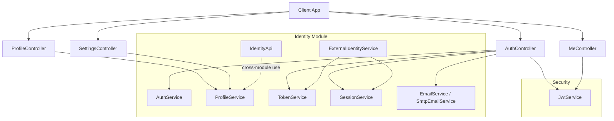
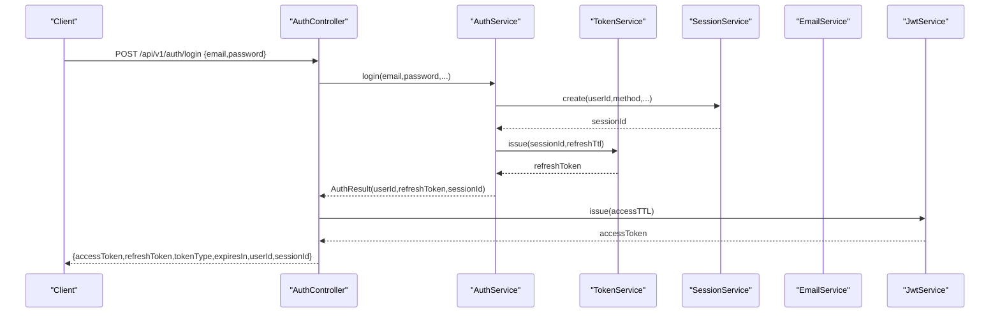
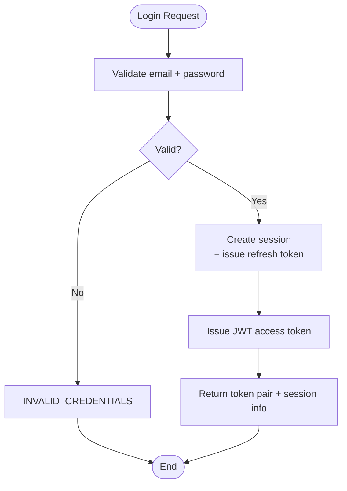
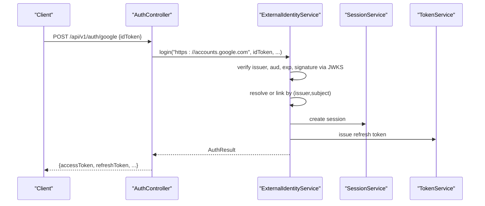
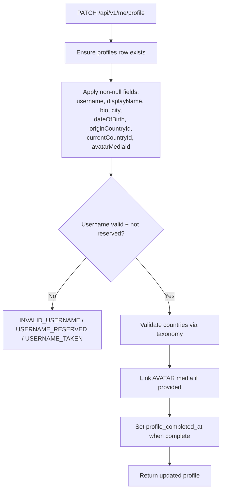
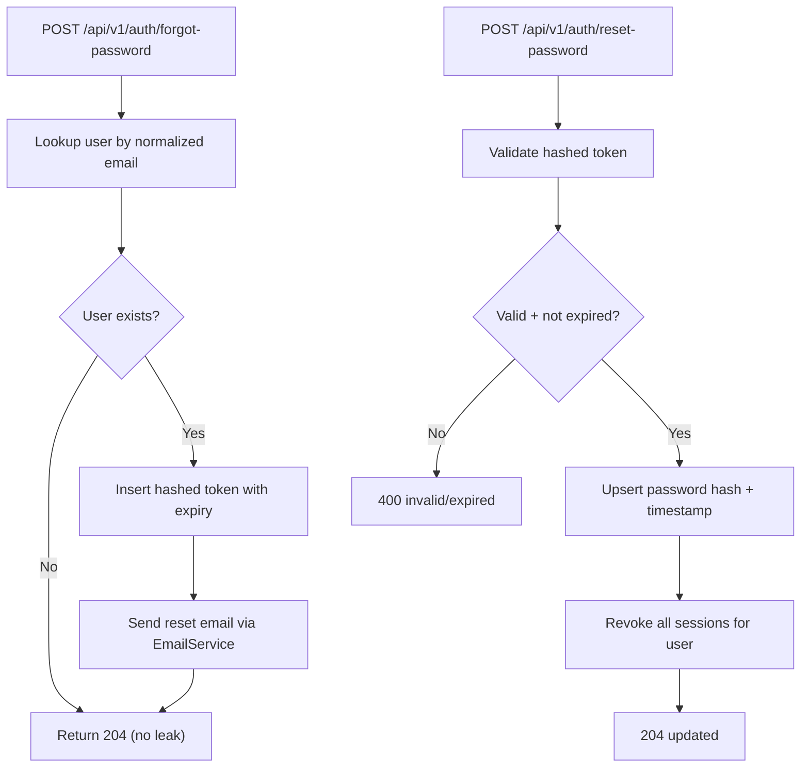
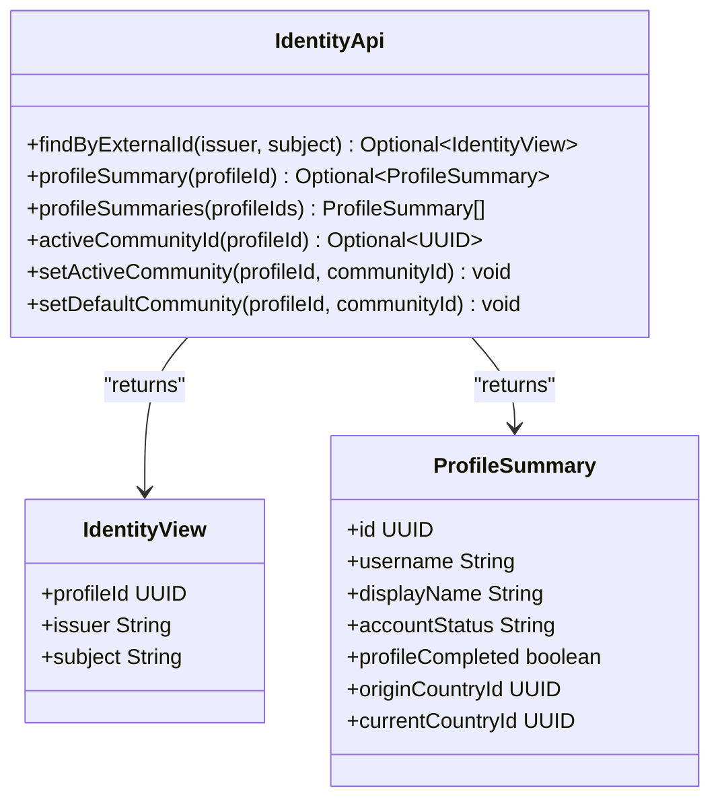
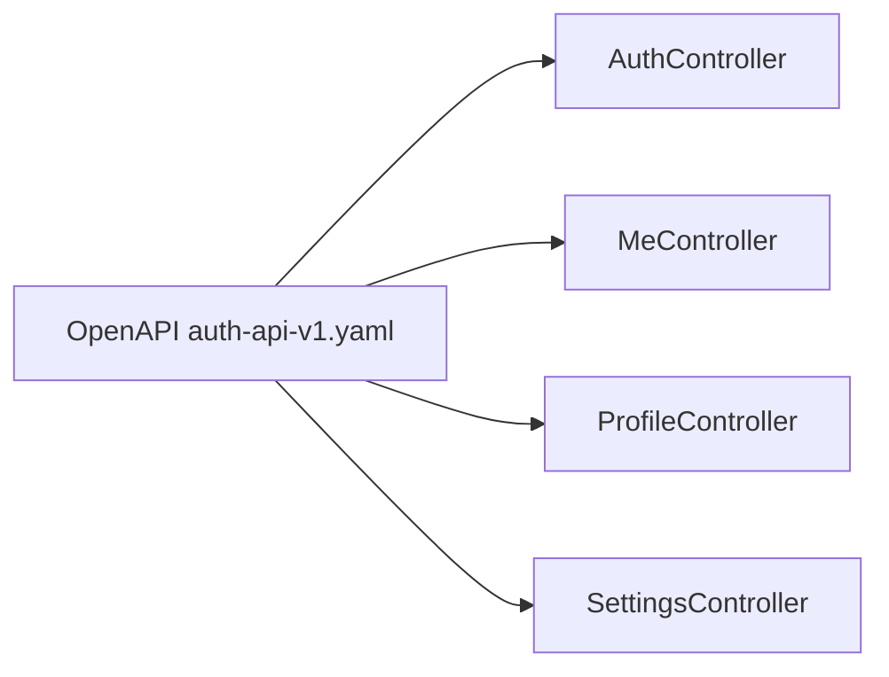
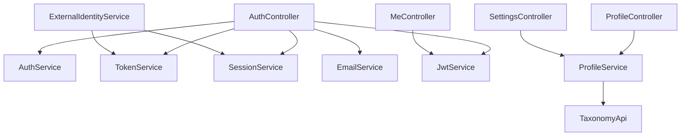

# Identity Module

<cite>
**Referenced Files in This Document**
- [IdentityApi.java](file://diasporum-backend/src/main/java/com/diasporum/backend/identity/IdentityApi.java)
- [AuthService.java](file://diasporum-backend/src/main/java/com/diasporum/backend/identity/internal/application/AuthService.java)
- [ExternalIdentityService.java](file://diasporum-backend/src/main/java/com/diasporum/backend/identity/internal/application/ExternalIdentityService.java)
- [ProfileService.java](file://diasporum-backend/src/main/java/com/diasporum/backend/identity/internal/application/ProfileService.java)
- [JwtService.java](file://diasporum-backend/src/main/java/com/diasporum/backend/security/JwtService.java)
- [AuthController.java](file://diasporum-backend/src/main/java/com/diasporum/backend/identity/internal/api/rest/AuthController.java)
- [MeController.java](file://diasporum-backend/src/main/java/com/diasporum/backend/identity/internal/api/rest/MeController.java)
- [ProfileController.java](file://diasporum-backend/src/main/java/com/diasporum/backend/identity/internal/api/rest/ProfileController.java)
- [SettingsController.java](file://diasporum-backend/src/main/java/com/diasporum/backend/identity/internal/api/rest/SettingsController.java)
- [SmtpEmailService.java](file://diasporum-backend/src/main/java/com/diasporum/backend/identity/internal/application/SmtpEmailService.java)
- [auth-api-v1.yaml](file://diasporum-backend/docs/auth-api-v1.yaml)
- [authentication-operations.md](file://diasporum-backend/docs/authentication-operations.md)
</cite>

## Table of Contents
1. [Introduction](#introduction)
2. [Project Structure](#project-structure)
3. [Core Components](#core-components)
4. [Architecture Overview](#architecture-overview)
5. [Detailed Component Analysis](#detailed-component-analysis)
6. [Dependency Analysis](#dependency-analysis)
7. [Performance Considerations](#performance-considerations)
8. [Troubleshooting Guide](#troubleshooting-guide)
9. [Conclusion](#conclusion)

## Introduction
This document explains the Identity module implementation for Diasporum v10.12. It covers user authentication flows, profile management operations, external identity provider integration (Google and Apple), email service integration for password reset and verification workflows, and cross-module identity access through the public `IdentityApi`. The goal is to make the codebase understandable for both developers and operators while preserving precise references to the actual implementation files.

## Project Structure
The Identity module follows a layered structure:
- Public API boundary: `IdentityApi` exposes safe, cross-module operations such as external identity lookup and profile summaries.
- Internal REST layer: controllers under `identity.internal.api.rest` expose `/api/v1/*` endpoints for authentication, profile, and settings operations.
- Application services: business logic for authentication, external identity linking, profile management, sessions, tokens, and email delivery.
- Security utilities: JWT issuance/validation and session validation used by controllers and services.

**Diagram sources**
- [AuthController.java](file://diasporum-backend/src/main/java/com/diasporum/backend/identity/internal/api/rest/AuthController.java)
- [MeController.java](file://diasporum-backend/src/main/java/com/diasporum/backend/identity/internal/api/rest/MeController.java)
- [ProfileController.java](file://diasporum-backend/src/main/java/com/diasporum/backend/identity/internal/api/rest/ProfileController.java)
- [SettingsController.java](file://diasporum-backend/src/main/java/com/diasporum/backend/identity/internal/api/rest/SettingsController.java)
- [AuthService.java](file://diasporum-backend/src/main/java/com/diasporum/backend/identity/internal/application/AuthService.java)
- [ExternalIdentityService.java](file://diasporum-backend/src/main/java/com/diasporum/backend/identity/internal/application/ExternalIdentityService.java)
- [ProfileService.java](file://diasporum-backend/src/main/java/com/diasporum/backend/identity/internal/application/ProfileService.java)
- [JwtService.java](file://diasporum-backend/src/main/java/com/diasporum/backend/security/JwtService.java)
- [IdentityApi.java](file://diasporum-backend/src/main/java/com/diasporum/backend/identity/IdentityApi.java)

**Section sources**
- [IdentityApi.java:8-16](file://diasporum-backend/src/main/java/com/diasporum/backend/identity/IdentityApi.java#L8-L16)
- [auth-api-v1.yaml:1-22](file://diasporum-backend/docs/auth-api-v1.yaml#L1-L22)

## Core Components
- `IdentityApi`: Cross-module interface providing read-only identity lookups and safe profile summaries without exposing sensitive fields.
- `AuthService`: Password-based registration, login, refresh, logout, email verification, password reset/change, and session/token orchestration.
- `ExternalIdentityService`: Google and Apple ID token verification via JWKS, account linking/unlinking, and session creation for social sign-in.
- `ProfileService`: Own-profile CRUD, sparse PATCH updates, username availability checks, avatar linking, country validation, and completion policy.
- `JwtService`: RS256 JWT access token issuance, validation, JWKS exposure, and key configuration enforcement.
- Controllers (`AuthController`, `MeController`, `ProfileController`, `SettingsController`): HTTP endpoints that bind requests to application services and return OpenAPI-defined responses.
- `SmtpEmailService`: SMTP-backed email delivery for verification and password-reset links.

**Section sources**
- [IdentityApi.java:17-61](file://diasporum-backend/src/main/java/com/diasporum/backend/identity/IdentityApi.java#L17-L61)
- [AuthService.java:12-39](file://diasporum-backend/src/main/java/com/diasporum/backend/identity/internal/application/AuthService.java#L12-L39)
- [ExternalIdentityService.java:22-53](file://diasporum-backend/src/main/java/com/diasporum/backend/identity/internal/application/ExternalIdentityService.java#L22-L53)
- [ProfileService.java:19-55](file://diasporum-backend/src/main/java/com/diasporum/backend/identity/internal/application/ProfileService.java#L19-L55)
- [JwtService.java:20-28](file://diasporum-backend/src/main/java/com/diasporum/backend/security/JwtService.java#L20-L28)
- [auth-api-v1.yaml:61-335](file://diasporum-backend/docs/auth-api-v1.yaml#L61-L335)

## Architecture Overview
The authentication architecture uses:
- Stateless RS256 JWT access tokens with short TTLs.
- Opaque, database-backed refresh tokens with single-use rotation and family revocation.
- Database-backed device-scoped sessions with absolute TTL.
- External identity providers verified against their JWKS; linking is based on `(issuer, subject)` and verified email.
- Email service abstraction supporting local logging and SMTP delivery.

**Diagram sources**
- [AuthController.java](file://diasporum-backend/src/main/java/com/diasporum/backend/identity/internal/api/rest/AuthController.java)
- [AuthService.java:65-93](file://diasporum-backend/src/main/java/com/diasporum/backend/identity/internal/application/AuthService.java#L65-L93)
- [JwtService.java:108-129](file://diasporum-backend/src/main/java/com/diasporum/backend/security/JwtService.java#L108-L129)

## Detailed Component Analysis

### Authentication Flow (Password Login, Refresh, Logout)
- Registration creates an active account and stores a hashed password.
- Login validates credentials, creates a session, issues a refresh token, and returns an access token via `JwtService`.
- Refresh rotates the refresh token and reuses the existing session if still active.
- Logout revokes the current session; logout-all revokes all sessions for the account.

**Diagram sources**
- [AuthService.java:65-93](file://diasporum-backend/src/main/java/com/diasporum/backend/identity/internal/application/AuthService.java#L65-L93)
- [JwtService.java:108-129](file://diasporum-backend/src/main/java/com/diasporum/backend/security/JwtService.java#L108-L129)

**Section sources**
- [AuthService.java:45-116](file://diasporum-backend/src/main/java/com/diasporum/backend/identity/internal/application/AuthService.java#L45-L116)
- [auth-api-v1.yaml:86-166](file://diasporum-backend/docs/auth-api-v1.yaml#L86-L166)

### Social Authentication (Google and Apple)
- Providers’ ID tokens are verified against remote JWKS.
- Existing linked identities log in directly; otherwise, a verified email is used to link or create an account.
- Linking/unlinking endpoints allow adding/removing provider identities with safety checks to prevent removing the last auth method.

**Diagram sources**
- [ExternalIdentityService.java:61-129](file://diasporum-backend/src/main/java/com/diasporum/backend/identity/internal/application/ExternalIdentityService.java#L61-L129)
- [auth-api-v1.yaml:106-146](file://diasporum-backend/docs/auth-api-v1.yaml#L106-L146)

**Section sources**
- [ExternalIdentityService.java:57-144](file://diasporum-backend/src/main/java/com/diasporum/backend/identity/internal/application/ExternalIdentityService.java#L57-L144)
- [auth-api-v1.yaml:106-146](file://diasporum-backend/docs/auth-api-v1.yaml#L106-L146)
- [authentication-operations.md:121-154](file://diasporum-backend/docs/authentication-operations.md#L121-L154)

### Profile Management (CRUD, Completion, Username Policy)
- Read own profile with avatar media resolution.
- Sparse PATCH update supports optional fields; empty strings clear bio/city.
- Username normalization, reserved-name protection, uniqueness enforcement, and availability check.
- Country IDs validated through taxonomy integration.
- Completion policy sets `profile_completed_at` once when required fields are present.

**Diagram sources**
- [ProfileService.java:82-173](file://diasporum-backend/src/main/java/com/diasporum/backend/identity/internal/application/ProfileService.java#L82-L173)
- [ProfileService.java:185-200](file://diasporum-backend/src/main/java/com/diasporum/backend/identity/internal/application/ProfileService.java#L185-L200)

**Section sources**
- [ProfileService.java:19-55](file://diasporum-backend/src/main/java/com/diasporum/backend/identity/internal/application/ProfileService.java#L19-L55)
- [ProfileService.java:74-120](file://diasporum-backend/src/main/java/com/diasporum/backend/identity/internal/application/ProfileService.java#L74-L120)
- [ProfileService.java:122-173](file://diasporum-backend/src/main/java/com/diasporum/backend/identity/internal/application/ProfileService.java#L122-L173)
- [ProfileService.java:175-200](file://diasporum-backend/src/main/java/com/diasporum/backend/identity/internal/application/ProfileService.java#L175-L200)

### Email Service Integration (Verification and Reset)
- Verification tokens are hashed and stored; activation only affects pending accounts.
- Resend verification always returns success without leaking existence.
- Password reset generates time-limited tokens, sends emails, and revokes sessions upon successful reset.
- SMTP configuration is enforced at startup; local mode logs links instead of sending.

**Diagram sources**
- [AuthService.java:148-175](file://diasporum-backend/src/main/java/com/diasporum/backend/identity/internal/application/AuthService.java#L148-L175)
- [SmtpEmailService.java](file://diasporum-backend/src/main/java/com/diasporum/backend/identity/internal/application/SmtpEmailService.java)
- [authentication-operations.md:108-119](file://diasporum-backend/docs/authentication-operations.md#L108-L119)

**Section sources**
- [AuthService.java:118-175](file://diasporum-backend/src/main/java/com/diasporum/backend/identity/internal/application/AuthService.java#L118-L175)
- [auth-api-v1.yaml:167-222](file://diasporum-backend/docs/auth-api-v1.yaml#L167-L222)
- [authentication-operations.md:108-119](file://diasporum-backend/docs/authentication-operations.md#L108-L119)

### IdentityApi Interface and Implementations
- `IdentityApi` provides:
  - Lookup of internal profile by external identity (issuer, subject).
  - Safe profile summaries for cross-module display and authorization.
  - Active/default community selection persistence.
- Implementations live under `identity.internal.application` and are consumed by other modules without exposing internal APIs.

**Diagram sources**
- [IdentityApi.java:17-61](file://diasporum-backend/src/main/java/com/diasporum/backend/identity/IdentityApi.java#L17-L61)

**Section sources**
- [IdentityApi.java:8-61](file://diasporum-backend/src/main/java/com/diasporum/backend/identity/IdentityApi.java#L8-L61)

### Controller Layer and OpenAPI Contract
- `AuthController` implements the authentication endpoints defined in the OpenAPI spec.
- `MeController` exposes current account identity and related session operations.
- `ProfileController` handles profile reads and updates.
- `SettingsController` manages user settings including privacy-related preferences.

**Diagram sources**
- [auth-api-v1.yaml:61-335](file://diasporum-backend/docs/auth-api-v1.yaml#L61-L335)
- [AuthController.java](file://diasporum-backend/src/main/java/com/diasporum/backend/identity/internal/api/rest/AuthController.java)
- [MeController.java](file://diasporum-backend/src/main/java/com/diasporum/backend/identity/internal/api/rest/MeController.java)
- [ProfileController.java](file://diasporum-backend/src/main/java/com/diasporum/backend/identity/internal/api/rest/ProfileController.java)
- [SettingsController.java](file://diasporum-backend/src/main/java/com/diasporum/backend/identity/internal/api/rest/SettingsController.java)

**Section sources**
- [auth-api-v1.yaml:61-335](file://diasporum-backend/docs/auth-api-v1.yaml#L61-L335)

## Dependency Analysis
Key dependencies and relationships:
- Controllers depend on application services for business logic.
- `AuthService` depends on `SessionService`, `TokenService`, and `EmailService`.
- `ExternalIdentityService` depends on `SessionService`, `TokenService`, and remote JWKS for Google and Apple.
- `ProfileService` depends on `TaxonomyApi` for country validation and integrates with media storage for avatars.
- `JwtService` is used by controllers and services for access token lifecycle.

**Diagram sources**
- [AuthService.java:19-39](file://diasporum-backend/src/main/java/com/diasporum/backend/identity/internal/application/AuthService.java#L19-L39)
- [ExternalIdentityService.java:31-53](file://diasporum-backend/src/main/java/com/diasporum/backend/identity/internal/application/ExternalIdentityService.java#L31-L53)
- [ProfileService.java:49-55](file://diasporum-backend/src/main/java/com/diasporum/backend/identity/internal/application/ProfileService.java#L49-L55)
- [JwtService.java:35-40](file://diasporum-backend/src/main/java/com/diasporum/backend/security/JwtService.java#L35-L40)

**Section sources**
- [AuthService.java:19-39](file://diasporum-backend/src/main/java/com/diasporum/backend/identity/internal/application/AuthService.java#L19-L39)
- [ExternalIdentityService.java:31-53](file://diasporum-backend/src/main/java/com/diasporum/backend/identity/internal/application/ExternalIdentityService.java#L31-L53)
- [ProfileService.java:49-55](file://diasporum-backend/src/main/java/com/diasporum/backend/identity/internal/application/ProfileService.java#L49-L55)
- [JwtService.java:35-40](file://diasporum-backend/src/main/java/com/diasporum/backend/security/JwtService.java#L35-L40)

## Performance Considerations
- Use batch profile summary queries for list enrichment to reduce round-trips across modules.
- Keep access tokens short-lived; rely on refresh rotation to minimize token exposure risk.
- Avoid unnecessary DB writes by using sparse PATCH updates for profiles.
- Cache JWKS retrieval where appropriate; Nimbus `RemoteJWKSet` already handles remote fetching.
- Prefer parameterized SQL and avoid string concatenation to prevent injection and improve plan reuse.

[No sources needed since this section provides general guidance]

## Troubleshooting Guide
Common operational issues and resolutions:
- JWT key misconfiguration:
  - Missing or mismatched private/public keys cause startup failures.
  - Ensure both keys are set together and match; rotate keys by updating `kid` and redeploying.
- Email delivery failures:
  - SMTP host missing or TLS misconfiguration causes startup or send failures.
  - In local development, verify links are logged rather than sent.
- External identity verification errors:
  - Invalid issuer, audience, expiration, or signature results in 401.
  - Verify configured client IDs and JWKS URLs for Google and Apple.
- CORS preflight failures:
  - Unlisted origins receive 403; configure allowed origins explicitly.

**Section sources**
- [authentication-operations.md:67-82](file://diasporum-backend/docs/authentication-operations.md#L67-L82)
- [authentication-operations.md:108-119](file://diasporum-backend/docs/authentication-operations.md#L108-L119)
- [authentication-operations.md:121-154](file://diasporum-backend/docs/authentication-operations.md#L121-L154)
- [authentication-operations.md:156-164](file://diasporum-backend/docs/authentication-operations.md#L156-L164)

## Conclusion
The Identity module provides a secure, extensible foundation for user authentication, profile management, and external identity provider integration. Its design emphasizes:
- Clear separation between public cross-module APIs and internal implementations.
- Strong security posture with RS256 JWTs, opaque refresh tokens, and database-backed sessions.
- Robust external identity handling with JWKS verification and careful linking policies.
- Operational clarity through environment-driven configuration and explicit error semantics.

[No sources needed since this section summarizes without analyzing specific files]