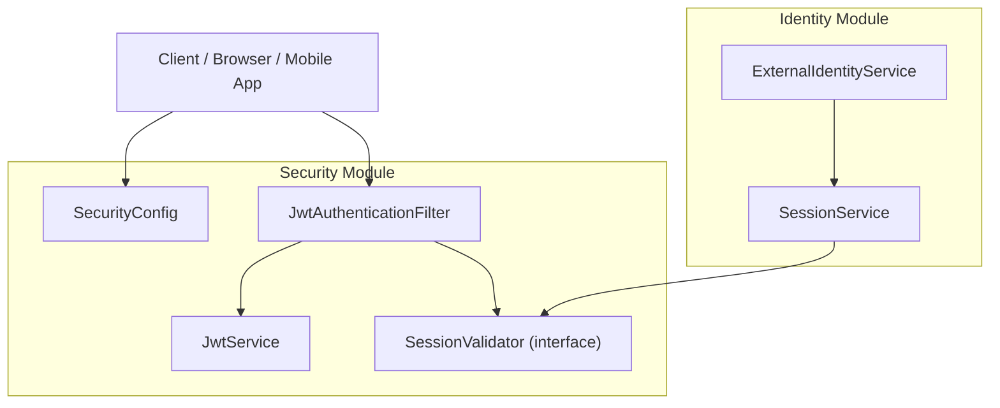
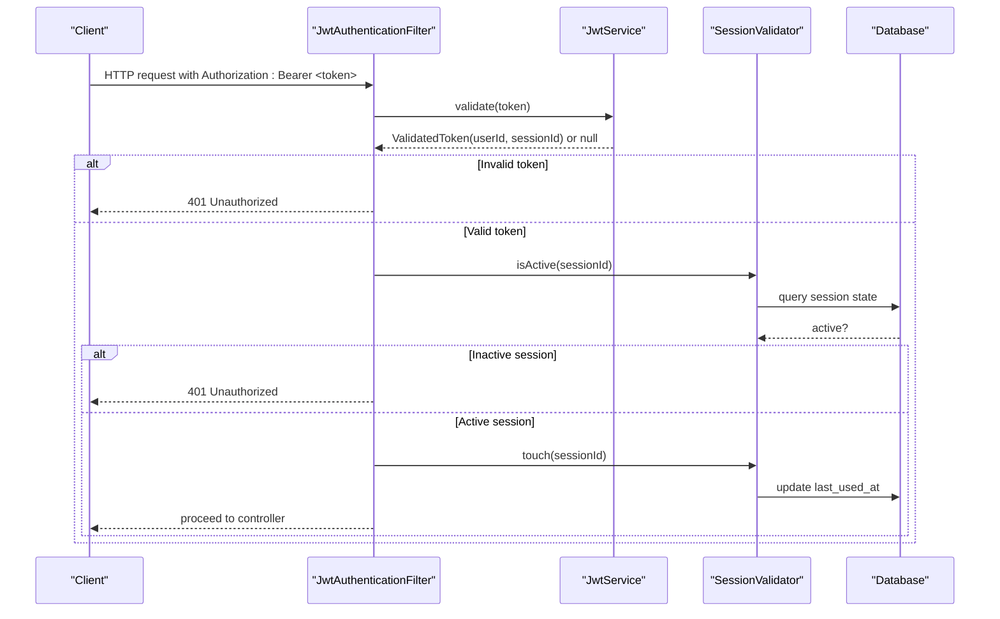
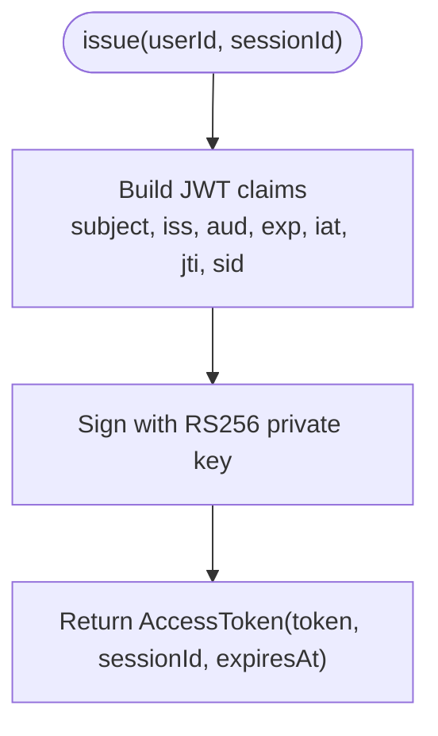
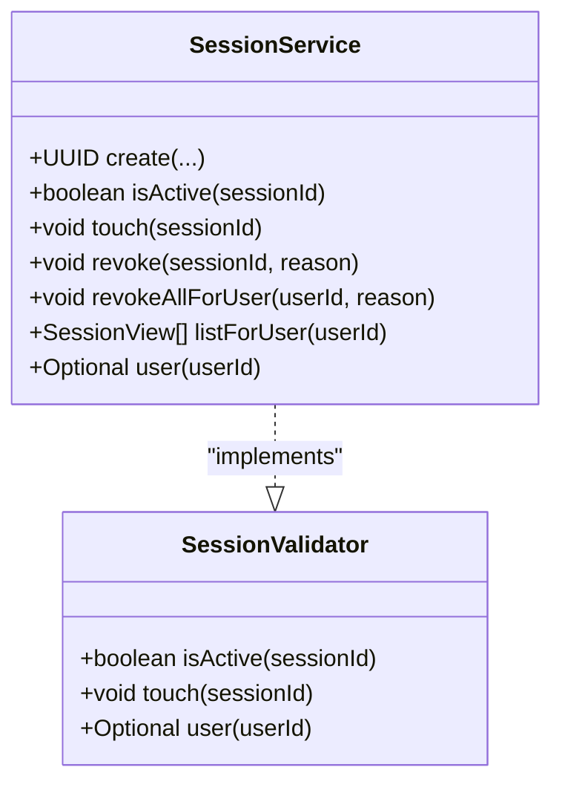
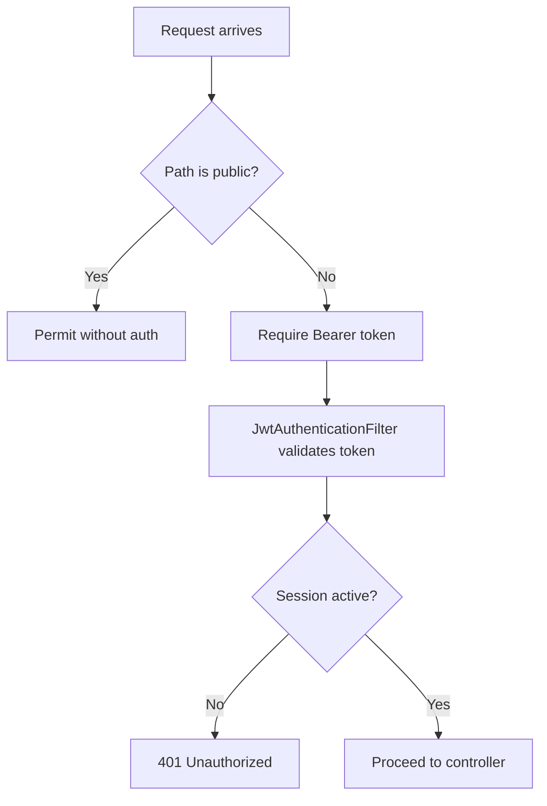
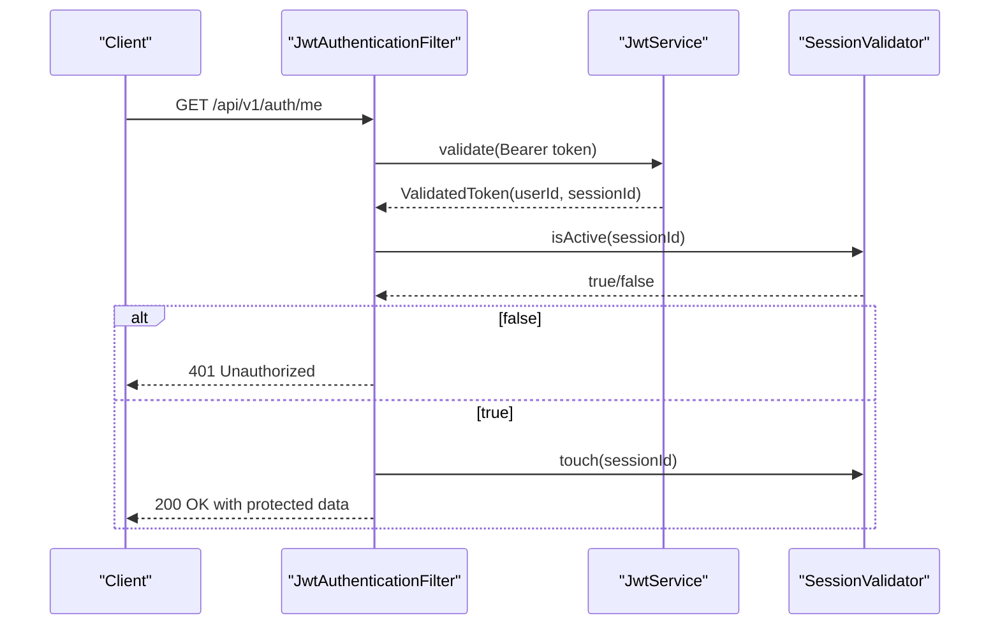
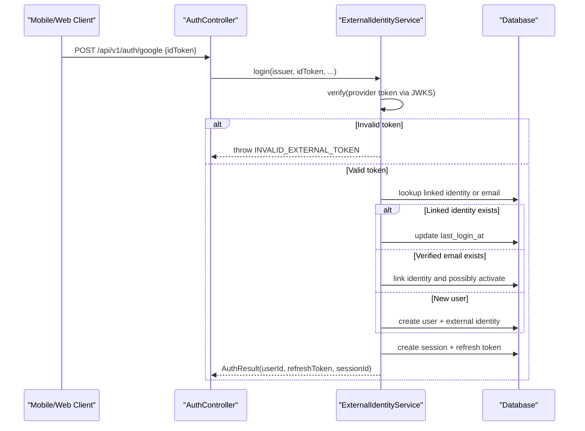
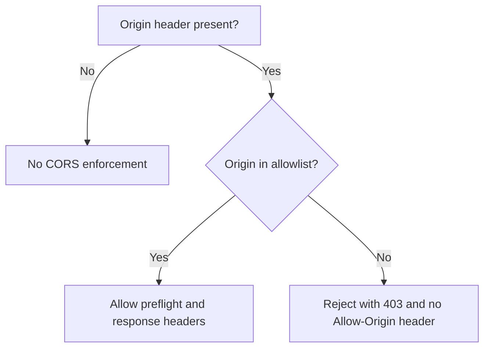
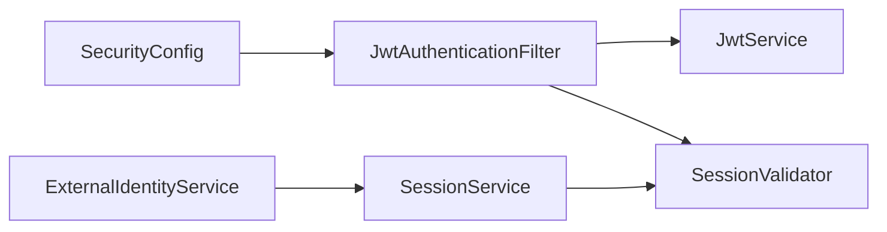

# Security Architecture

<cite>
**Referenced Files in This Document**
- [JwtService.java](file://diasporum-backend/src/main/java/com/diasporum/backend/security/JwtService.java)
- [SessionValidator.java](file://diasporum-backend/src/main/java/com/diasporum/backend/security/SessionValidator.java)
- [SecurityConfig.java](file://diasporum-backend/src/main/java/com/diasporum/backend/security/internal/config/SecurityConfig.java)
- [JwtAuthenticationFilter.java](file://diasporum-backend/src/main/java/com/diasporum/backend/security/internal/authentication/JwtAuthenticationFilter.java)
- [SessionService.java](file://diasporum-backend/src/main/java/com/diasporum/backend/identity/internal/application/SessionService.java)
- [ExternalIdentityService.java](file://diasporum-backend/src/main/java/com/diasporum/backend/identity/internal/application/ExternalIdentityService.java)
- [AuthFlowIntegrationTest.java](file://diasporum-backend/src/test/java/com/diasporum/backend/identity/AuthFlowIntegrationTest.java)
- [CorsConfigurationTest.java](file://diasporum-backend/src/test/java/com/diasporum/backend/security/CorsConfigurationTest.java)
</cite>

## Table of Contents
1. [Introduction](#introduction)
2. [Project Structure](#project-structure)
3. [Core Components](#core-components)
4. [Architecture Overview](#architecture-overview)
5. [Detailed Component Analysis](#detailed-component-analysis)
6. [Dependency Analysis](#dependency-analysis)
7. [Performance Considerations](#performance-considerations)
8. [Troubleshooting Guide](#troubleshooting-guide)
9. [Conclusion](#conclusion)

## Introduction
This document explains the security architecture for the Diasporum backend. It focuses on:
- JWT-based authentication using RS256 tokens issued by a local `JwtService`.
- Stateless session management through per-device sessions and refresh tokens.
- Application-wide CORS configuration and Spring Security policy.
- Authorization boundaries, including role-based access control patterns and external identity provider integration (Google and Apple).

The implementation is designed to be accessible to beginners while providing enough technical depth for experienced developers implementing custom security features.

## Project Structure
The security-related code is primarily located under the `security` module and integrates with the `identity` module for session persistence and external identity verification.

**Diagram sources**
- [SecurityConfig.java:31-68](file://diasporum-backend/src/main/java/com/diasporum/backend/security/internal/config/SecurityConfig.java#L31-L68)
- [JwtAuthenticationFilter.java:22-59](file://diasporum-backend/src/main/java/com/diasporum/backend/security/internal/authentication/JwtAuthenticationFilter.java#L22-L59)
- [JwtService.java:20-30](file://diasporum-backend/src/main/java/com/diasporum/backend/security/JwtService.java#L20-L30)
- [SessionValidator.java:6-24](file://diasporum-backend/src/main/java/com/diasporum/backend/security/SessionValidator.java#L6-L24)
- [SessionService.java:13-18](file://diasporum-backend/src/main/java/com/diasporum/backend/identity/internal/application/SessionService.java#L13-L18)
- [ExternalIdentityService.java:22-53](file://diasporum-backend/src/main/java/com/diasporum/backend/identity/internal/application/ExternalIdentityService.java#L22-L53)

**Section sources**
- [SecurityConfig.java:31-68](file://diasporum-backend/src/main/java/com/diasporum/backend/security/internal/config/SecurityConfig.java#L31-L68)
- [JwtAuthenticationFilter.java:22-59](file://diasporum-backend/src/main/java/com/diasporum/backend/security/internal/authentication/JwtAuthenticationFilter.java#L22-L59)
- [JwtService.java:20-30](file://diasporum-backend/src/main/java/com/diasporum/backend/security/JwtService.java#L20-L30)
- [SessionValidator.java:6-24](file://diasporum-backend/src/main/java/com/diasporum/backend/security/SessionValidator.java#L6-L24)
- [SessionService.java:13-18](file://diasporum-backend/src/main/java/com/diasporum/backend/identity/internal/application/SessionService.java#L13-L18)
- [ExternalIdentityService.java:22-53](file://diasporum-backend/src/main/java/com/diasporum/backend/identity/internal/application/ExternalIdentityService.java#L22-L53)

## Core Components
- JwtService: Issues and validates RS256 JWTs, exposes JWKS, and enforces issuer/audience/expiry checks.
- SessionValidator: Interface defining active session checks, touch semantics, and minimal user info retrieval.
- SessionService: Implements SessionValidator; persists device sessions and revocation state.
- SecurityConfig: Configures Spring Security, CORS, password encoding, and public endpoints like JWKS.
- JwtAuthenticationFilter: Validates Bearer tokens, checks session activity, and populates the security principal.
- ExternalIdentityService: Verifies Google/Apple ID tokens via remote JWKS and links or creates accounts.

Key responsibilities:
- Token lifecycle: issue, validate, expose JWKS.
- Session lifecycle: create, check activity, touch last-used, revoke single/all.
- Request authentication: filter, principal construction.
- External identity: verify provider tokens, link existing users, enforce account status.

**Section sources**
- [JwtService.java:20-30](file://diasporum-backend/src/main/java/com/diasporum/backend/security/JwtService.java#L20-L30)
- [SessionValidator.java:6-24](file://diasporum-backend/src/main/java/com/diasporum/backend/security/SessionValidator.java#L6-L24)
- [SessionService.java:13-18](file://diasporum-backend/src/main/java/com/diasporum/backend/identity/internal/application/SessionService.java#L13-L18)
- [SecurityConfig.java:31-68](file://diasporum-backend/src/main/java/com/diasporum/backend/security/internal/config/SecurityConfig.java#L31-L68)
- [JwtAuthenticationFilter.java:22-59](file://diasporum-backend/src/main/java/com/diasporum/backend/security/internal/authentication/JwtAuthenticationFilter.java#L22-L59)
- [ExternalIdentityService.java:22-53](file://diasporum-backend/src/main/java/com/diasporum/backend/identity/internal/application/ExternalIdentityService.java#L22-L53)

## Architecture Overview
The system is a stateless REST API secured by Spring Security. Clients send Bearer tokens; the filter validates them against the local key pair and ensures the associated session is active. Public endpoints include registration, login, social login, refresh, email verification, and password recovery. The JWKS endpoint publishes the public key for clients and third-party verifiers.

**Diagram sources**
- [JwtAuthenticationFilter.java:33-59](file://diasporum-backend/src/main/java/com/diasporum/backend/security/internal/authentication/JwtAuthenticationFilter.java#L33-L59)
- [JwtService.java:131-154](file://diasporum-backend/src/main/java/com/diasporum/backend/security/JwtService.java#L131-L154)
- [SessionService.java:53-63](file://diasporum-backend/src/main/java/com/diasporum/backend/identity/internal/application/SessionService.java#L53-L63)

## Detailed Component Analysis

### JwtService: Token Issuance and Validation
- Algorithm: RS256 with configurable issuer, audience, kid, TTL, and persistent or ephemeral keys.
- Key loading: Loads PEM private/public keys at startup; validates that the pair matches; fails fast if misconfigured.
- Token issuance: Creates signed JWT with subject=userId, claim sid=sessionId, issuer, audience, exp, iat, jti.
- Token validation: Verifies signature, issuer, audience, and expiry; returns claims or null.
- JWKS exposure: Provides public JWK set for client verification.

**Diagram sources**
- [JwtService.java:108-129](file://diasporum-backend/src/main/java/com/diasporum/backend/security/JwtService.java#L108-L129)

**Section sources**
- [JwtService.java:20-30](file://diasporum-backend/src/main/java/com/diasporum/backend/security/JwtService.java#L20-L30)
- [JwtService.java:41-80](file://diasporum-backend/src/main/java/com/diasporum/backend/security/JwtService.java#L41-L80)
- [JwtService.java:108-129](file://diasporum-backend/src/main/java/com/diasporum/backend/security/JwtService.java#L108-L129)
- [JwtService.java:131-161](file://diasporum-backend/src/main/java/com/diasporum/backend/security/JwtService.java#L131-L161)

### SessionValidator and SessionService: Session Management
- SessionValidator defines:
  - isActive(sessionId): true when not revoked and not absolutely expired.
  - touch(sessionId): updates last-used timestamp.
  - user(userId): returns minimal user info for principal construction.
- SessionService implements these operations and persists sessions and revocation state.

**Diagram sources**
- [SessionValidator.java:6-24](file://diasporum-backend/src/main/java/com/diasporum/backend/security/SessionValidator.java#L6-L24)
- [SessionService.java:13-18](file://diasporum-backend/src/main/java/com/diasporum/backend/identity/internal/application/SessionService.java#L13-L18)
- [SessionService.java:38-63](file://diasporum-backend/src/main/java/com/diasporum/backend/identity/internal/application/SessionService.java#L38-L63)
- [SessionService.java:70-110](file://diasporum-backend/src/main/java/com/diasporum/backend/identity/internal/application/SessionService.java#L70-L110)

**Section sources**
- [SessionValidator.java:6-24](file://diasporum-backend/src/main/java/com/diasporum/backend/security/SessionValidator.java#L6-L24)
- [SessionService.java:13-18](file://diasporum-backend/src/main/java/com/diasporum/backend/identity/internal/application/SessionService.java#L13-L18)
- [SessionService.java:38-63](file://diasporum-backend/src/main/java/com/diasporum/backend/identity/internal/application/SessionService.java#L38-L63)
- [SessionService.java:70-110](file://diasporum-backend/src/main/java/com/diasporum/backend/identity/internal/application/SessionService.java#L70-L110)

### SecurityConfig: Application-Wide Security Policies
- Disables CSRF for stateless REST APIs.
- Configures CORS with an allowlist from environment; rejects wildcard with credentials.
- Defines public endpoints: register, login, google/apple login, refresh, verify-email, resend-verification, forgot-password, reset-password, actuator health, error, and JWKS.
- Adds JwtAuthenticationFilter before UsernamePasswordAuthenticationFilter.
- Custom AuthenticationEntryPoint and AccessDeniedHandler return consistent JSON errors.
- PasswordEncoder uses Argon2.
- JWKS endpoint serves public key material.

**Diagram sources**
- [SecurityConfig.java:46-68](file://diasporum-backend/src/main/java/com/diasporum/backend/security/internal/config/SecurityConfig.java#L46-L68)
- [SecurityConfig.java:70-89](file://diasporum-backend/src/main/java/com/diasporum/backend/security/internal/config/SecurityConfig.java#L70-L89)
- [SecurityConfig.java:96-104](file://diasporum-backend/src/main/java/com/diasporum/backend/security/internal/config/SecurityConfig.java#L96-L104)
- [SecurityConfig.java:106-130](file://diasporum-backend/src/main/java/com/diasporum/backend/security/internal/config/SecurityConfig.java#L106-L130)

**Section sources**
- [SecurityConfig.java:31-68](file://diasporum-backend/src/main/java/com/diasporum/backend/security/internal/config/SecurityConfig.java#L31-L68)
- [SecurityConfig.java:70-89](file://diasporum-backend/src/main/java/com/diasporum/backend/security/internal/config/SecurityConfig.java#L70-L89)
- [SecurityConfig.java:91-104](file://diasporum-backend/src/main/java/com/diasporum/backend/security/internal/config/SecurityConfig.java#L91-L104)
- [SecurityConfig.java:106-130](file://diasporum-backend/src/main/java/com/diasporum/backend/security/internal/config/SecurityConfig.java#L106-L130)

### JwtAuthenticationFilter: Request Authentication Flow
- Extracts Bearer token from Authorization header.
- Calls JwtService.validate to obtain userId and sessionId.
- Checks SessionValidator.isActive; if inactive, returns 401.
- Touches session to update last-used timestamp.
- Loads user info and sets DiasporumUserPrincipal in SecurityContext.

**Diagram sources**
- [JwtAuthenticationFilter.java:33-59](file://diasporum-backend/src/main/java/com/diasporum/backend/security/internal/authentication/JwtAuthenticationFilter.java#L33-L59)
- [JwtService.java:146-154](file://diasporum-backend/src/main/java/com/diasporum/backend/security/JwtService.java#L146-L154)
- [SessionService.java:53-63](file://diasporum-backend/src/main/java/com/diasporum/backend/identity/internal/application/SessionService.java#L53-L63)

**Section sources**
- [JwtAuthenticationFilter.java:22-59](file://diasporum-backend/src/main/java/com/diasporum/backend/security/internal/authentication/JwtAuthenticationFilter.java#L22-L59)

### External Identity Provider Integration (Google, Apple)
- ExternalIdentityService verifies provider ID tokens using RemoteJWKSet for each provider.
- Validates issuer, audience (client IDs), expiration, and signature.
- Supports linking verified emails to existing accounts or creating new accounts.
- Enforces account status restrictions (e.g., restricted/deleted accounts cannot log in).
- Creates long-lived sessions and refresh tokens after successful login/linking.

**Diagram sources**
- [ExternalIdentityService.java:61-129](file://diasporum-backend/src/main/java/com/diasporum/backend/identity/internal/application/ExternalIdentityService.java#L61-L129)
- [ExternalIdentityService.java:167-198](file://diasporum-backend/src/main/java/com/diasporum/backend/identity/internal/application/ExternalIdentityService.java#L167-L198)

**Section sources**
- [ExternalIdentityService.java:22-53](file://diasporum-backend/src/main/java/com/diasporum/backend/identity/internal/application/ExternalIdentityService.java#L22-L53)
- [ExternalIdentityService.java:61-129](file://diasporum-backend/src/main/java/com/diasporum/backend/identity/internal/application/ExternalIdentityService.java#L61-L129)
- [ExternalIdentityService.java:167-198](file://diasporum-backend/src/main/java/com/diasporum/backend/identity/internal/application/ExternalIdentityService.java#L167-L198)

### Protected Endpoints and Role-Based Access Control
- Protected endpoints require a valid Bearer token; examples include `/api/v1/auth/me`, `/api/v1/auth/sessions`, `/api/v1/auth/logout`, `/api/v1/auth/change-password`, and `/api/v1/me`.
- Role-based access control is enforced at the application layer rather than via a generic roles framework. Platform roles are stored globally and scoped; community/business roles are managed within their respective modules.
- Tests assert that unauthenticated requests to protected endpoints receive 401 Unauthorized.

Examples of protected endpoints:
- GET `/api/v1/auth/me`
- GET `/api/v1/auth/sessions`
- POST `/api/v1/auth/logout`
- POST `/api/v1/auth/change-password`
- GET `/api/v1/me`

Role-based access control notes:
- Roles are not embedded in the JWT; authorization logic resides in domain services and controllers.
- Community roles, platform roles, and business roles are checked by fixed Java policies within their modules.

**Section sources**
- [AuthFlowIntegrationTest.java:223-239](file://diasporum-backend/src/test/java/com/diasporum/backend/identity/AuthFlowIntegrationTest.java#L223-L239)

### CORS Configuration
- Allowed origins are configured via environment variable; no wildcard is emitted.
- Preflight requests for allowed origins succeed; unconfigured origins are rejected.
- Credentials are disabled to avoid wildcard-with-credentials pitfalls.

**Diagram sources**
- [SecurityConfig.java:70-89](file://diasporum-backend/src/main/java/com/diasporum/backend/security/internal/config/SecurityConfig.java#L70-L89)
- [CorsConfigurationTest.java:44-79](file://diasporum-backend/src/test/java/com/diasporum/backend/security/CorsConfigurationTest.java#L44-L79)

**Section sources**
- [SecurityConfig.java:70-89](file://diasporum-backend/src/main/java/com/diasporum/backend/security/internal/config/SecurityConfig.java#L70-L89)
- [CorsConfigurationTest.java:44-79](file://diasporum-backend/src/test/java/com/diasporum/backend/security/CorsConfigurationTest.java#L44-L79)

## Dependency Analysis
The security module depends on Spring Security and Nimbus JOSE for JWT handling. The identity module provides session persistence and external identity verification. The filter depends on JwtService and SessionValidator to authenticate requests.

**Diagram sources**
- [SecurityConfig.java:31-68](file://diasporum-backend/src/main/java/com/diasporum/backend/security/internal/config/SecurityConfig.java#L31-L68)
- [JwtAuthenticationFilter.java:22-59](file://diasporum-backend/src/main/java/com/diasporum/backend/security/internal/authentication/JwtAuthenticationFilter.java#L22-L59)
- [SessionService.java:13-18](file://diasporum-backend/src/main/java/com/diasporum/backend/identity/internal/application/SessionService.java#L13-L18)
- [ExternalIdentityService.java:22-53](file://diasporum-backend/src/main/java/com/diasporum/backend/identity/internal/application/ExternalIdentityService.java#L22-L53)

**Section sources**
- [SecurityConfig.java:31-68](file://diasporum-backend/src/main/java/com/diasporum/backend/security/internal/config/SecurityConfig.java#L31-L68)
- [JwtAuthenticationFilter.java:22-59](file://diasporum-backend/src/main/java/com/diasporum/backend/security/internal/authentication/JwtAuthenticationFilter.java#L22-L59)
- [SessionService.java:13-18](file://diasporum-backend/src/main/java/com/diasporum/backend/identity/internal/application/SessionService.java#L13-L18)
- [ExternalIdentityService.java:22-53](file://diasporum-backend/src/main/java/com/diasporum/backend/identity/internal/application/ExternalIdentityService.java#L22-L53)

## Performance Considerations
- Stateless design avoids server-side session storage for authentication state; only device sessions are persisted for revocation and auditability.
- Short-lived access tokens reduce exposure window; refresh tokens provide re-authentication without repeated credential entry.
- Remote JWKS fetching for external providers introduces network latency; caching strategies should be considered at the application level if needed.
- Argon2 password hashing is secure but computationally intensive; tune parameters according to deployment capacity.

[No sources needed since this section provides general guidance]

## Troubleshooting Guide
Common issues and mitigations:
- Misconfigured JWT keys: Startup validation fails fast if private/public keys do not match or if ephemeral keys are used outside development.
- Invalid or tampered tokens: Verification returns null; filter responds with 401 Unauthorized.
- Expired or revoked sessions: Session checks fail; filter responds with 401 Unauthorized.
- CORS misconfiguration: Wildcard with credentials is rejected; ensure explicit allowlist and correct credentials settings.
- External token verification failures: Wrong issuer, audience, or signature results in INVALID_EXTERNAL_TOKEN.

Operational checks:
- Verify JWKS endpoint returns RSA key with expected kid.
- Confirm protected endpoints return 401 when unauthenticated.
- Validate CORS preflight responses for configured origins.

**Section sources**
- [JwtService.java:41-80](file://diasporum-backend/src/main/java/com/diasporum/backend/security/JwtService.java#L41-L80)
- [JwtService.java:131-154](file://diasporum-backend/src/main/java/com/diasporum/backend/security/JwtService.java#L131-L154)
- [JwtAuthenticationFilter.java:33-59](file://diasporum-backend/src/main/java/com/diasporum/backend/security/internal/authentication/JwtAuthenticationFilter.java#L33-L59)
- [SecurityConfig.java:70-89](file://diasporum-backend/src/main/java/com/diasporum/backend/security/internal/config/SecurityConfig.java#L70-L89)
- [ExternalIdentityService.java:167-198](file://diasporum-backend/src/main/java/com/diasporum/backend/identity/internal/application/ExternalIdentityService.java#L167-L198)
- [AuthFlowIntegrationTest.java:223-239](file://diasporum-backend/src/test/java/com/diasporum/backend/identity/AuthFlowIntegrationTest.java#L223-L239)
- [CorsConfigurationTest.java:44-79](file://diasporum-backend/src/test/java/com/diasporum/backend/security/CorsConfigurationTest.java#L44-L79)

## Conclusion
The Diasporum backend implements a robust, stateless security model centered on RS256 JWTs, per-device sessions, and strict CORS policies. JwtService handles token issuance and validation with strong key management, while SessionValidator and SessionService manage session lifecycles. SecurityConfig configures Spring Security and public endpoints, and JwtAuthenticationFilter enforces authentication on protected routes. External identity providers are integrated securely via JWKS verification, with careful account linking and status enforcement. Role-based access control is implemented at the application layer, ensuring fine-grained permissions without relying on generic frameworks.

[No sources needed since this section summarizes without analyzing specific files]