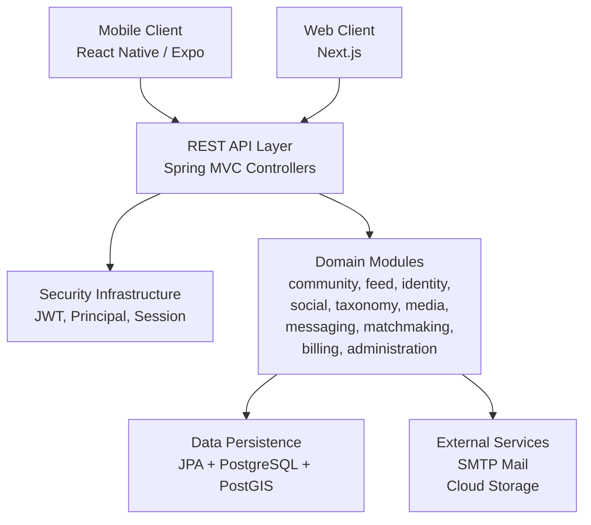
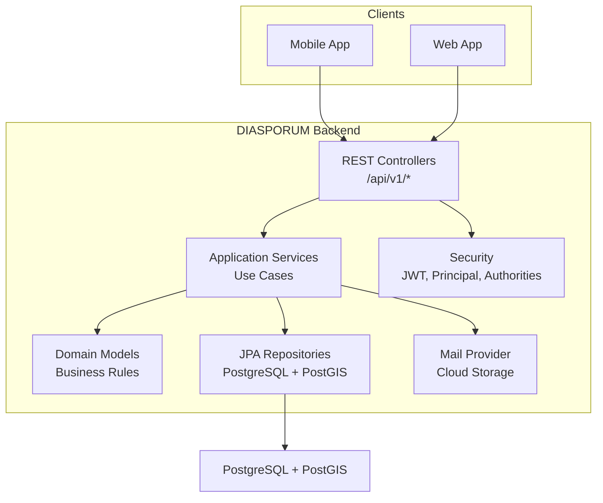
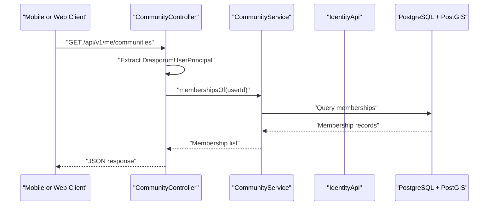
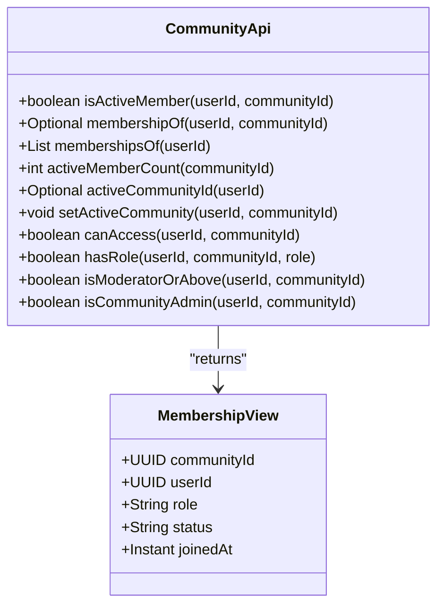
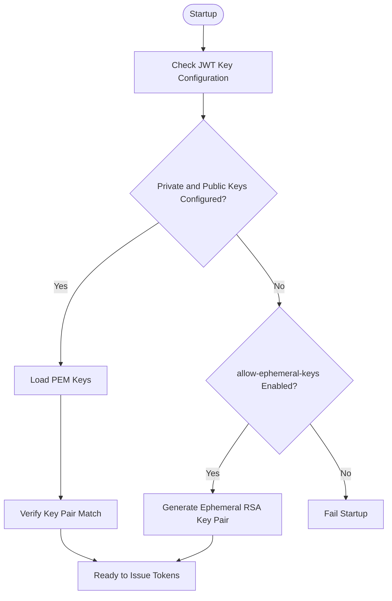
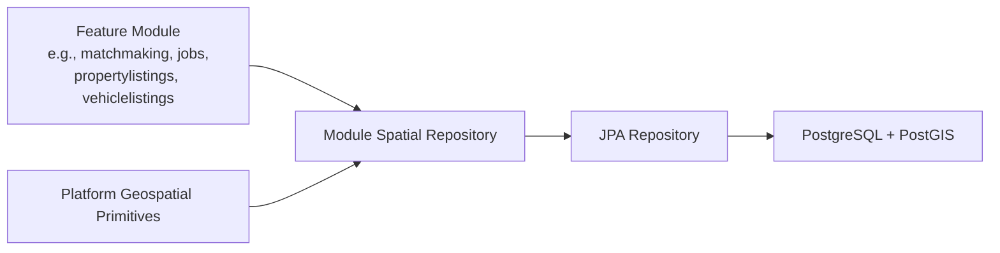

# System Overview

<cite>
**Referenced Files in This Document**
- [pom.xml](file://diasporum-backend/pom.xml)
- [DiasporumBackendApplication.java](file://diasporum-backend/src/main/java/com/diasporum/backend/DiasporumBackendApplication.java)
- [application.yaml](file://diasporum-backend/src/main/resources/application.yaml)
- [compose.yaml](file://compose.yaml)
- [CommunityApi.java](file://diasporum-backend/src/main/java/com/diasporum/backend/community/CommunityApi.java)
- [CommunityController.java](file://diasporum-backend/src/main/java/com/diasporum/backend/community/internal/api/rest/CommunityController.java)
- [DiasporumUserPrincipal.java](file://diasporum-backend/src/main/java/com/diasporum/backend/security/DiasporumUserPrincipal.java)
- [JwtService.java](file://diasporum-backend/src/main/java/com/diasporum/backend/security/JwtService.java)
- [package-info.java (platform geospatial)](file://diasporum-backend/src/main/java/com/diasporum/backend/platform/geospatial/package-info.java)
- [DiasporumBackendApplicationTests.java](file://diasporum-backend/src/test/java/com/diasporum/backend/DiasporumBackendApplicationTests.java)
- [DIASPORUM_Spring_Boot_REST_API_Folder_Structure_v10_12.md](file://Diasporum_v10.12/Diasporum_Spring_Boot_REST_API_Folder_Structure_v10_12.md)
- [api-client.ts](file://diasporum-mobile/src/core/api/api-client.ts)
</cite>

## Table of Contents
1. [Introduction](#introduction)
2. [Project Structure](#project-structure)
3. [Core Components](#core-components)
4. [Architecture Overview](#architecture-overview)
5. [Detailed Component Analysis](#detailed-component-analysis)
6. [Dependency Analysis](#dependency-analysis)
7. [Performance Considerations](#performance-considerations)
8. [Troubleshooting Guide](#troubleshooting-guide)
9. [Conclusion](#conclusion)

## Introduction
DIASPORUM is a diaspora community platform designed to connect people across geographical boundaries through communities, social feeds, messaging, media, and location-aware services. The backend is a Spring Boot modular monolith that exposes a versioned REST API consumed by mobile and web clients. It centralizes identity, security, persistence, and cross-cutting concerns while organizing business capabilities into bounded modules such as community, feed, identity, social, taxonomy, media, messaging, matchmaking, billing, and administration.

The system’s purpose is to help users find local and global communities, share content, communicate directly or in groups, discover nearby opportunities, and participate in shared activities. Geographical context is important: the platform supports PostGIS-based spatial queries so features like nearby discovery, venue search, and location-aware feeds can operate on real-world coordinates.

## Project Structure
The repository contains three main runtime areas:

- `diasporum-backend`: Java 21 Spring Boot application with modular package structure, JPA persistence, Flyway migrations, Quartz scheduling, security, mail support, and optional cloud storage integration.
- `diasporum-mobile`: React Native / Expo mobile client communicating with the backend REST API.
- `diasporum-web`: Next.js web frontend intended for browser access.
- `keycloak`: Identity provider configuration used historically; current backend authentication uses first-party RS256 JWTs with external Google and Apple verification only.
- `Diasporum_v10.11-OLD` and `Diasporum_v10.12`: Documentation and database schema artifacts describing module layout, folder structure, and baseline data.

**Diagram sources**
- [DiasporumBackendApplication.java:6-11](file://diasporum-backend/src/main/java/com/diasporum/backend/DiasporumBackendApplication.java#L6-L11)
- [CommunityController.java:28-41](file://diasporum-backend/src/main/java/com/diasporum/backend/community/internal/api/rest/CommunityController.java#L28-L41)
- [JwtService.java:29-30](file://diasporum-backend/src/main/java/com/diasporum/backend/security/JwtService.java#L29-L30)
- [application.yaml:26-74](file://diasporum-backend/src/main/resources/application.yaml#L26-L74)

**Section sources**
- [DiasporumBackendApplication.java:6-11](file://diasporum-backend/src/main/java/com/diasporum/backend/DiasporumBackendApplication.java#L6-L11)
- [DIASPORUM_Spring_Boot_REST_API_Folder_Structure_v10_12.md:144-156](file://Diasporum_v10.12/Diasporum_Spring_Boot_REST_API_Folder_Structure_v10_12.md#L144-L156)

## Core Components
The backend is organized around four primary architectural layers:

| Layer | Responsibility | Examples |
|---|---|---|
| REST API layer | HTTP endpoints, request validation, status codes, DTOs, and controller orchestration | CommunityController, FeedController, identity controllers |
| Application layer | Use cases, transaction boundaries, cross-module coordination | CommunityService, application ports |
| Domain layer | Business rules, models, value objects, policies, domain exceptions | Module-specific domain classes |
| Infrastructure layer | Persistence, external integrations, configuration, security wiring | JPA entities, repositories, SMTP, cloud storage, JWT |

Each feature module follows a consistent internal layout:

- `internal/api/rest`: REST endpoints under `/api/v1`.
- `internal/application`: Use-case implementations and service interfaces.
- `internal/domain`: Business logic independent of web and persistence.
- `internal/infrastructure/persistence`: JPA entities, repositories, and mapping.
- `internal/infrastructure/integration`: Adapters for other modules or external systems.
- Root-level public interface: Narrow APIs exposed to other modules.

This design keeps controllers thin, isolates business rules, and ensures each module owns its data and behavior while sharing infrastructure through well-defined contracts.

**Section sources**
- [DIASPORUM_Spring_Boot_REST_API_Folder_Structure_v10_12.md:144-156](file://Diasporum_v10.12/Diasporum_Spring_Boot_REST_API_Folder_Structure_v10_12.md#L144-L156)
- [CommunityController.java:28-41](file://diasporum-backend/src/main/java/com/diasporum/backend/community/internal/api/rest/CommunityController.java#L28-L41)

## Architecture Overview
The DIASPORUM backend is a single deployable Spring Boot application that behaves like a modular monolith. It does not split into separate microservices at runtime; instead, it enforces module boundaries through package structure, public APIs, and architecture tests.

Key architectural characteristics:

- **Modular monolith**: Multiple bounded domains coexist in one process, reducing operational complexity while preserving separation of concerns.
- **Versioned REST API**: Clients call `/api/v1` endpoints; controllers delegate to application services.
- **First-party JWT authentication**: Access tokens are signed with RS256 using configured RSA keys; external providers such as Google and Apple are used for identity verification rather than session authority.
- **PostgreSQL with PostGIS**: Relational persistence with strong spatial support for distance and radius queries.
- **Configuration-driven behavior**: Environment variables control JWT settings, CORS, email delivery, and optional cloud storage.
- **Containerized development stack**: Docker Compose provides PostgreSQL with PostGIS for local development.

**Diagram sources**
- [CommunityController.java:28-41](file://diasporum-backend/src/main/java/com/diasporum/backend/community/internal/api/rest/CommunityController.java#L28-L41)
- [JwtService.java:29-30](file://diasporum-backend/src/main/java/com/diasporum/backend/security/JwtService.java#L29-L30)
- [application.yaml:26-74](file://diasporum-backend/src/main/resources/application.yaml#L26-L74)
- [compose.yaml:21-41](file://compose.yaml#L21-L41)

**Section sources**
- [pom.xml:5-31](file://diasporum-backend/pom.xml#L5-L31)
- [application.yaml:1-74](file://diasporum-backend/src/main/resources/application.yaml#L1-L74)
- [compose.yaml:1-50](file://compose.yaml#L1-L50)

## Detailed Component Analysis

### REST API Layer
Controllers expose `/api/v1` endpoints and act as the entry point for both mobile and web clients. They validate requests, map inputs to application services, and return structured responses. Controllers do not contain business rules or direct database queries.

Example responsibilities demonstrated by the community controller:

- Resolve the authenticated user from Spring Security.
- Map path parameters and request bodies to use-case calls.
- Return membership views, pagination metadata, and error responses.
- Coordinate with identity and community services.

**Diagram sources**
- [CommunityController.java:56-59](file://diasporum-backend/src/main/java/com/diasporum/backend/community/internal/api/rest/CommunityController.java#L56-L59)
- [CommunityApi.java:13-22](file://diasporum-backend/src/main/java/com/diasporum/backend/community/CommunityApi.java#L13-L22)

**Section sources**
- [CommunityController.java:28-183](file://diasporum-backend/src/main/java/com/diasporum/backend/community/internal/api/rest/CommunityController.java#L28-L183)
- [DIASPORUM_Spring_Boot_REST_API_Folder_Structure_v10_12.md:144-156](file://Diasporum_v10.12/Diasporum_Spring_Boot_REST_API_Folder_Structure_v10_12.md#L144-L156)

### Domain Modules
Modules encapsulate distinct business capabilities. Each module exposes a narrow public API and keeps implementation details under `internal`.

The community module demonstrates this pattern:

- Public API defines membership checks, active-community selection, role checks, and authorization helpers.
- Internal REST controller handles HTTP requests.
- Internal application layer implements use cases.
- Internal domain layer holds business rules.
- Internal persistence layer stores membership and community state.

**Diagram sources**
- [CommunityApi.java:13-51](file://diasporum-backend/src/main/java/com/diasporum/backend/community/CommunityApi.java#L13-L51)

**Section sources**
- [CommunityApi.java:1-52](file://diasporum-backend/src/main/java/com/diasporum/backend/community/CommunityApi.java#L1-L52)
- [DIASPORUM_Spring_Boot_REST_API_Folder_Structure_v10_12.md:158-185](file://Diasporum_v10.12/Diasporum_Spring_Boot_REST_API_Folder_Structure_v10_12.md#L158-L185)

### Security Infrastructure
Security is implemented through Spring Security, a custom principal, and a dedicated JWT service.

Key behaviors:

- `DiasporumUserPrincipal` represents an authenticated user with `userId`, `sessionId`, email, and authorities.
- `JwtService` issues RS256 access tokens with issuer, audience, expiration, and session ID claims.
- Startup validation ensures private and public keys match when configured.
- Ephemeral key generation is disabled outside local development and tests.
- A JWKS endpoint exposes the public key for token verification.

**Diagram sources**
- [JwtService.java:41-80](file://diasporum-backend/src/main/java/com/diasporum/backend/security/JwtService.java#L41-L80)
- [application.yaml:26-41](file://diasporum-backend/src/main/resources/application.yaml#L26-L41)

**Section sources**
- [DiasporumUserPrincipal.java:10-24](file://diasporum-backend/src/main/java/com/diasporum/backend/security/DiasporumUserPrincipal.java#L10-L24)
- [JwtService.java:29-163](file://diasporum-backend/src/main/java/com/diasporum/backend/security/JwtService.java#L29-L163)
- [application.yaml:26-41](file://diasporum-backend/src/main/resources/application.yaml#L26-L41)

### Data Persistence
Persistence uses Spring Data JPA against PostgreSQL with PostGIS enabled for spatial operations. The development compose file runs `postgis/postgis:17-3.5`, and tests also use the same image via Testcontainers.

Spatial support is intentionally scoped:

- Reusable geospatial primitives live under `platform/geospatial`.
- Feature modules own their spatial repositories and privacy filters.
- PostGIS geography is used for radius search and distance ordering.

**Diagram sources**
- [package-info.java (platform geospatial):1-4](file://diasporum-backend/src/main/java/com/diasporum/backend/platform/geospatial/package-info.java#L1-L4)
- [compose.yaml:21-41](file://compose.yaml#L21-L41)
- [DiasporumBackendApplicationTests.java:15-18](file://diasporum-backend/src/test/java/com/diasporum/backend/DiasporumBackendApplicationTests.java#L15-L18)

**Section sources**
- [compose.yaml:21-41](file://compose.yaml#L21-L41)
- [package-info.java (platform geospatial):1-4](file://diasporum-backend/src/main/java/com/diasporum/backend/platform/geospatial/package-info.java#L1-L4)
- [DiasporumBackendApplicationTests.java:15-18](file://diasporum-backend/src/test/java/com/diasporum/backend/DiasporumBackendApplicationTests.java#L15-L18)

### Technology Stack Decisions and Rationale
The backend uses:

- **Java 21**: Modern language features, performance improvements, and long-term support alignment.
- **Spring Boot 4.1.2**: Framework foundation providing web, security, data, validation, mail, actuator, and testing starters.
- **PostgreSQL with PostGIS**: Strong relational capabilities combined with mature geospatial functions for location-aware features.
- **Flyway**: Database migration management.
- **Quartz**: Job scheduling for background tasks.
- **Nimbus JOSE + JWT**: RS256 token signing and verification.
- **Bouncy Castle**: Cryptographic primitives.
- **AWS S3 SDK**: Optional cloud storage integration for media.
- **Testcontainers**: Containerized test databases.

These choices balance developer productivity, operational simplicity, and domain requirements such as secure authentication, reliable persistence, and spatial queries.

**Section sources**
- [pom.xml:5-152](file://diasporum-backend/pom.xml#L5-L152)
- [application.yaml:1-74](file://diasporum-backend/src/main/resources/application.yaml#L1-L74)

## Dependency Analysis
The backend depends on Spring Boot starters, PostgreSQL drivers, Flyway, security libraries, and optional cloud storage. The containerized development environment depends on PostgreSQL with PostGIS.

```mermaid
graph TB
Backend["diasporum-backend"]
SpringBoot["Spring Boot 4.1.2"]
JPA["spring-boot-starter-data-jpa"]
Security["spring-boot-starter-security"]
WebMvc["spring-boot-starter-webmvc"]
Validation["spring-boot-starter-validation"]
Mail["spring-boot-starter-mail"]
Actuator["spring-boot-starter-actuator"]
Flyway["spring-boot-starter-flyway"]
Quartz["spring-boot-starter-quartz"]
PostgresDriver["postgresql JDBC driver"]
PostGIS["PostgreSQL + PostGIS"]
Nimbus["nimbus-jose-jwt"]
BouncyCastle["bcprov-jdk18on"]
S3SDK["aws-sdk s3"]
Testcontainers["testcontainers-postgresql"]
Backend --> SpringBoot
Backend --> JPA
Backend --> Security
Backend --> WebMvc
Backend --> Validation
Backend --> Mail
Backend --> Actuator
Backend --> Flyway
Backend --> Quartz
Backend --> PostgresDriver
Backend --> Nimbus
Backend --> BouncyCastle
Backend --> S3SDK
Backend --> Testcontainers
PostgresDriver --> PostGIS
```

**Diagram sources**
- [pom.xml:32-152](file://diasporum-backend/pom.xml#L32-L152)
- [compose.yaml:21-41](file://compose.yaml#L21-L41)

**Section sources**
- [pom.xml:32-152](file://diasporum-backend/pom.xml#L32-L152)
- [compose.yaml:21-41](file://compose.yaml#L21-L41)

## Performance Considerations
- **Modular monolith benefits**: Single deployment reduces inter-service latency and simplifies transactions within a module, while still allowing clear boundaries for future evolution.
- **Pagination and limits**: Controllers enforce default and maximum page sizes to prevent unbounded result sets.
- **Short-lived access tokens**: JWT access tokens have configurable TTLs, reducing long-lived credential exposure.
- **Geospatial queries**: PostGIS enables efficient radius and distance filtering; modules should keep spatial queries focused and indexed appropriately.
- **CORS configuration**: Browser-origin restrictions limit unnecessary cross-origin traffic while native mobile clients remain unaffected.
- **Optional cloud storage**: Media upload/download URLs and sessions are time-bounded to reduce resource retention.

[No sources needed since this section provides general guidance]

## Troubleshooting Guide
Common operational and configuration issues include:

- **Missing JWT keys**: If neither private nor public keys are configured and ephemeral keys are disabled, startup fails. Ensure both keys are provided together in production.
- **Mismatched JWT key pair**: Startup validates that the private and public keys match; a mismatch causes immediate failure.
- **Email delivery not configured**: The mail provider must be explicitly set; otherwise, the application may fail fast rather than silently drop verification emails.
- **CORS misconfiguration**: Empty allowed origins block browser cross-origin requests; verify `DIASPORUM_CORS_ALLOWED_ORIGINS` for web clients.
- **Database connectivity**: Local development relies on the compose PostgreSQL service; ensure environment variables and ports match the expected configuration.
- **Token refresh flow**: Mobile clients implement proactive expiry checks and retry on 401 after refresh; failures propagate as normalized API errors.

**Section sources**
- [JwtService.java:41-80](file://diasporum-backend/src/main/java/com/diasporum/backend/security/JwtService.java#L41-L80)
- [application.yaml:11-58](file://diasporum-backend/src/main/resources/application.yaml#L11-L58)
- [compose.yaml:21-41](file://compose.yaml#L21-L41)
- [api-client.ts](file://diasporum-mobile/src/core/api/api-client.ts)

## Conclusion
DIASPORUM’s backend is a purpose-built Spring Boot modular monolith that connects diaspora communities through a secure, extensible REST API. It separates concerns across REST controllers, application services, domain logic, and infrastructure while keeping deployment simple. The technology stack emphasizes modern Java, robust security with RS256 JWTs, relational persistence with PostGIS, and configuration-driven behavior suitable for local development and production.

For mobile and web clients, the backend provides a stable API surface, predictable error handling, and optional spatial features that enable location-aware community experiences. As the platform grows, the modular structure supports adding new domains without destabilizing existing functionality, and the containerized development stack makes local iteration fast and reliable.

[No sources needed since this section summarizes without analyzing specific files]