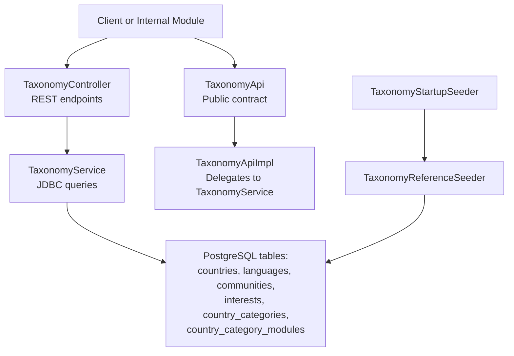
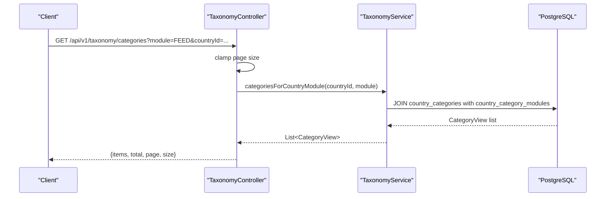
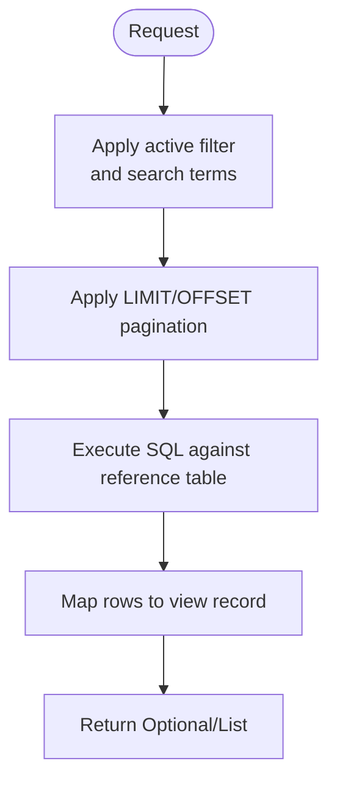
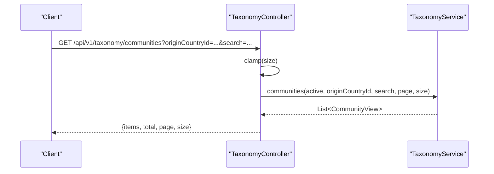
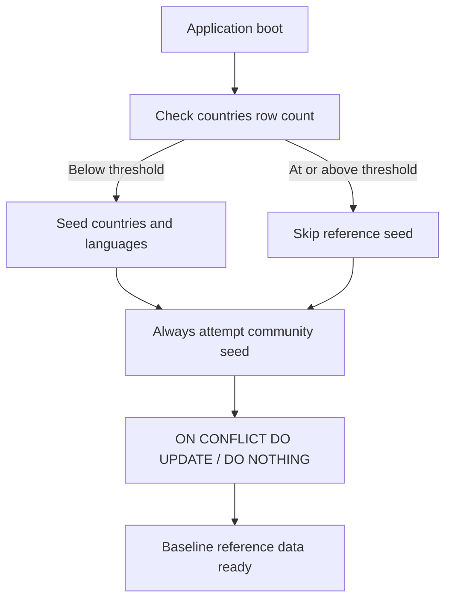
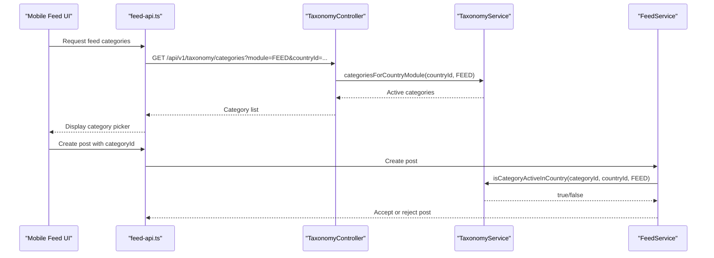
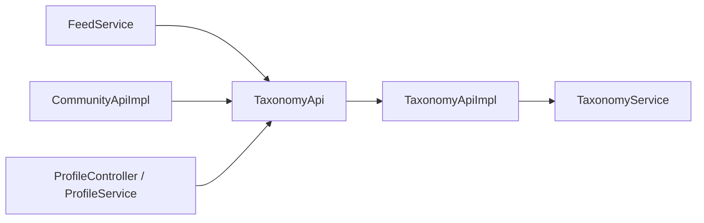

# Taxonomy Module

<cite>
**Referenced Files in This Document**
- [TaxonomyApi.java](file://diasporum-backend/src/main/java/com/diasporum/backend/taxonomy/TaxonomyApi.java)
- [TaxonomyController.java](file://diasporum-backend/src/main/java/com/diasporum/backend/taxonomy/internal/api/rest/TaxonomyController.java)
- [TaxonomyService.java](file://diasporum-backend/src/main/java/com/diasporum/backend/taxonomy/internal/application/TaxonomyService.java)
- [TaxonomyApiImpl.java](file://diasporum-backend/src/main/java/com/diasporum/backend/taxonomy/internal/application/TaxonomyApiImpl.java)
- [TaxonomyStartupSeeder.java](file://diasporum-backend/src/main/java/com/diasporum/backend/taxonomy/internal/application/TaxonomyStartupSeeder.java)
- [TaxonomyReferenceSeeder.java](file://diasporum-backend/src/main/java/com/diasporum/backend/taxonomy/internal/application/TaxonomyReferenceSeeder.java)
- [seed_reference_data.sql](file://seed_reference_data.sql)
- [FeedService.java](file://diasporum-backend/src/main/java/com/diasporum/backend/feed/internal/application/FeedService.java)
- [CommunityApiImpl.java](file://diasporum-backend/src/main/java/com/diasporum/backend/community/internal/application/CommunityApiImpl.java)
- [ProfileController.java](file://diasporum-backend/src/main/java/com/diasporum/backend/identity/internal/api/rest/ProfileController.java)
- [feed-api.ts](file://diasporum-mobile/src/features/feed/services/feed-api.ts)
</cite>

## Table of Contents
1. [Introduction](#introduction)
2. [Project Structure](#project-structure)
3. [Core Components](#core-components)
4. [Architecture Overview](#architecture-overview)
5. [Detailed Component Analysis](#detailed-component-analysis)
6. [Dependency Analysis](#dependency-analysis)
7. [Performance Considerations](#performance-considerations)
8. [Troubleshooting Guide](#troubleshooting-guide)
9. [Conclusion](#conclusion)

## Introduction
The Taxonomy module provides the platform’s shared reference catalog for hierarchical categorization and discovery. It models countries, languages, diaspora communities, interests, and country-specific content categories. Other modules consume this catalog through a stable public interface rather than direct database access.

Key responsibilities:
- Provide read-only taxonomy lookups for onboarding, community selection, feed filtering, and profile configuration.
- Seed baseline reference data at startup using idempotent upserts.
- Expose paginated REST endpoints for countries, languages, communities, interests, and category lists.
- Enforce active-state checks and module-scoped category activation for content classification.

## Project Structure
The backend implementation is organized under `com.diasporum.backend.taxonomy`:
- Public API contract: `TaxonomyApi`.
- Internal REST controller: `TaxonomyController`.
- Application-layer service: `TaxonomyService`.
- Public API implementation: `TaxonomyApiImpl`.
- Startup seeding: `TaxonomyStartupSeeder` and `TaxonomyReferenceSeeder`.
- SQL seed script: `seed_reference_data.sql`.

**Diagram sources**
- [TaxonomyController.java:23-127](file://diasporum-backend/src/main/java/com/diasporum/backend/taxonomy/internal/api/rest/TaxonomyController.java#L23-L127)
- [TaxonomyService.java:15-271](file://diasporum-backend/src/main/java/com/diasporum/backend/taxonomy/internal/application/TaxonomyService.java#L15-L271)
- [TaxonomyApi.java:7-71](file://diasporum-backend/src/main/java/com/diasporum/backend/taxonomy/TaxonomyApi.java#L7-L71)
- [TaxonomyApiImpl.java:9-99](file://diasporum-backend/src/main/java/com/diasporum/backend/taxonomy/internal/application/TaxonomyApiImpl.java#L9-L99)
- [TaxonomyStartupSeeder.java:11-49](file://diasporum-backend/src/main/java/com/diasporum/backend/taxonomy/internal/application/TaxonomyStartupSeeder.java#L11-L49)
- [TaxonomyReferenceSeeder.java:8-101](file://diasporum-backend/src/main/java/com/diasporum/backend/taxonomy/internal/application/TaxonomyReferenceSeeder.java#L8-L101)

**Section sources**
- [TaxonomyApi.java:7-71](file://diasporum-backend/src/main/java/com/diasporum/backend/taxonomy/TaxonomyApi.java#L7-L71)
- [TaxonomyController.java:19-127](file://diasporum-backend/src/main/java/com/diasporum/backend/taxonomy/internal/api/rest/TaxonomyController.java#L19-L127)
- [TaxonomyService.java:15-271](file://diasporum-backend/src/main/java/com/diasporum/backend/taxonomy/internal/application/TaxonomyService.java#L15-L271)
- [TaxonomyApiImpl.java:9-99](file://diasporum-backend/src/main/java/com/diasporum/backend/taxonomy/internal/application/TaxonomyApiImpl.java#L9-L99)
- [TaxonomyStartupSeeder.java:11-49](file://diasporum-backend/src/main/java/com/diasporum/backend/taxonomy/internal/application/TaxonomyStartupSeeder.java#L11-L49)
- [TaxonomyReferenceSeeder.java:8-101](file://diasporum-backend/src/main/java/com/diasporum/backend/taxonomy/internal/application/TaxonomyReferenceSeeder.java#L8-L101)

## Core Components
- **TaxonomyApi**: Stable public interface consumed by other modules. It exposes lookup methods for countries, languages, communities, interests, and category activation checks. It also defines view records such as `CountryView`, `LanguageView`, `CommunityView`, `InterestView`, and `CategoryView`.
- **TaxonomyService**: Business logic layer that executes JDBC queries against the reference tables. It supports pagination, search, active filters, and module-scoped category validation.
- **TaxonomyApiImpl**: Thin delegating implementation of `TaxonomyApi` that forwards calls to `TaxonomyService`.
- **TaxonomyController**: Read-only REST controller exposing `/api/v1/taxonomy` endpoints with consistent pagination responses.
- **TaxonomyStartupSeeder**: Spring `ApplicationRunner` that seeds baseline reference data on application startup.
- **TaxonomyReferenceSeeder**: Idempotent upsert-based seeder for countries, languages, interests, and development communities.
- **seed_reference_data.sql**: SQL seed script for countries and languages used during clean installs.

**Section sources**
- [TaxonomyApi.java:7-71](file://diasporum-backend/src/main/java/com/diasporum/backend/taxonomy/TaxonomyApi.java#L7-L71)
- [TaxonomyService.java:15-271](file://diasporum-backend/src/main/java/com/diasporum/backend/taxonomy/internal/application/TaxonomyService.java#L15-L271)
- [TaxonomyApiImpl.java:9-99](file://diasporum-backend/src/main/java/com/diasporum/backend/taxonomy/internal/application/TaxonomyApiImpl.java#L9-L99)
- [TaxonomyController.java:19-127](file://diasporum-backend/src/main/java/com/diasporum/backend/taxonomy/internal/api/rest/TaxonomyController.java#L19-L127)
- [TaxonomyStartupSeeder.java:11-49](file://diasporum-backend/src/main/java/com/diasporum/backend/taxonomy/internal/application/TaxonomyStartupSeeder.java#L11-L49)
- [TaxonomyReferenceSeeder.java:8-101](file://diasporum-backend/src/main/java/com/diasporum/backend/taxonomy/internal/application/TaxonomyReferenceSeeder.java#L8-L101)
- [seed_reference_data.sql:1-217](file://seed_reference_data.sql#L1-L217)

## Architecture Overview
The taxonomy architecture separates concerns across layers:
- The REST layer (`TaxonomyController`) validates request parameters and returns paginated results.
- The application layer (`TaxonomyService`) performs efficient SQL queries and maps rows to view records.
- The public API boundary (`TaxonomyApi` + `TaxonomyApiImpl`) isolates consumers from internal persistence details.
- The seeding layer (`TaxonomyStartupSeeder` + `TaxonomyReferenceSeeder`) ensures baseline data exists without overwriting operator-curated entries.

**Diagram sources**
- [TaxonomyController.java:92-103](file://diasporum-backend/src/main/java/com/diasporum/backend/taxonomy/internal/api/rest/TaxonomyController.java#L92-L103)
- [TaxonomyService.java:246-261](file://diasporum-backend/src/main/java/com/diasporum/backend/taxonomy/internal/application/TaxonomyService.java#L246-L261)

## Detailed Component Analysis

### TaxonomyApi Interface
`TaxonomyApi` defines the cross-module contract for taxonomy lookups:
- Country operations: find by ID or ISO-2 code, check activity, list active countries.
- Language operations: find by ID or code, check activity, list active languages.
- Community operations: find by ID, check activity, list communities for an origin country, find exact origin+destination pair.
- Category operations: find category by ID, check if category is active in a country and module.
- Interest operations: find by key, check activity.

This interface is intentionally small and focused on read-only reference data. View records encapsulate query results so consumers do not depend on database column names.

**Section sources**
- [TaxonomyApi.java:7-71](file://diasporum-backend/src/main/java/com/diasporum/backend/taxonomy/TaxonomyApi.java#L7-L71)

### TaxonomyService Business Logic
`TaxonomyService` implements the actual queries:
- Countries: filtered by active state and text search; paginated listing and count; single lookup by ID or ISO-2; activity check.
- Languages: filtered by active state and text search; paginated listing and count; single lookup by ID or code; activity check.
- Communities: filtered by active state, origin country, and text search; paginated listing and count; single lookup by ID; exact origin+destination pair lookup; activity check.
- Interests: filtered by active state, category, and text search; paginated listing and count; lookup by key; activity check.
- Categories: lookup by ID; list categories for a country and module; validate category activation for a country and module.

The service uses `JdbcTemplate` directly and maps result sets to view records. Missing rows are handled gracefully via `Optional` or boolean checks.

**Diagram sources**
- [TaxonomyService.java:51-95](file://diasporum-backend/src/main/java/com/diasporum/backend/taxonomy/internal/application/TaxonomyService.java#L51-L95)
- [TaxonomyService.java:97-143](file://diasporum-backend/src/main/java/com/diasporum/backend/taxonomy/internal/application/TaxonomyService.java#L97-L143)
- [TaxonomyService.java:145-190](file://diasporum-backend/src/main/java/com/diasporum/backend/taxonomy/internal/application/TaxonomyService.java#L145-L190)
- [TaxonomyService.java:192-233](file://diasporum-backend/src/main/java/com/diasporum/backend/taxonomy/internal/application/TaxonomyService.java#L192-L233)
- [TaxonomyService.java:235-271](file://diasporum-backend/src/main/java/com/diasporum/backend/taxonomy/internal/application/TaxonomyService.java#L235-L271)

**Section sources**
- [TaxonomyService.java:15-271](file://diasporum-backend/src/main/java/com/diasporum/backend/taxonomy/internal/application/TaxonomyService.java#L15-L271)

### TaxonomyApiImpl Delegation
`TaxonomyApiImpl` implements `TaxonomyApi` by delegating every method to `TaxonomyService`. This keeps the public API surface decoupled from internal implementation details. For example, `communitiesForOriginCountry` requests active communities with a large default page size suitable for dropdowns.

**Section sources**
- [TaxonomyApiImpl.java:9-99](file://diasporum-backend/src/main/java/com/diasporum/backend/taxonomy/internal/application/TaxonomyApiImpl.java#L9-L99)

### TaxonomyController REST Endpoints
`TaxonomyController` exposes read-only endpoints under `/api/v1/taxonomy`:
- `/countries` and `/countries/{id}`
- `/languages` and `/languages/{id}`
- `/communities` and `/communities/{id}`
- `/categories` with `countryId` and `module` parameters
- `/interests` and `/interests/{key}`

All list endpoints return a consistent pagination envelope with `items`, `total`, `page`, and `size`. Page sizes are clamped between a default and maximum value.

**Diagram sources**
- [TaxonomyController.java:74-84](file://diasporum-backend/src/main/java/com/diasporum/backend/taxonomy/internal/api/rest/TaxonomyController.java#L74-L84)
- [TaxonomyService.java:147-166](file://diasporum-backend/src/main/java/com/diasporum/backend/taxonomy/internal/application/TaxonomyService.java#L147-L166)

**Section sources**
- [TaxonomyController.java:19-127](file://diasporum-backend/src/main/java/com/diasporum/backend/taxonomy/internal/api/rest/TaxonomyController.java#L19-L127)

### Startup Seeder and Reference Data Seeding
Startup seeding runs when the application starts:
- If the `countries` table has fewer than a threshold number of rows, it seeds countries and languages.
- It always attempts to seed development communities because community seeding uses `ON CONFLICT DO NOTHING`, preserving admin-curated entries.
- `TaxonomyReferenceSeeder` performs idempotent upserts keyed on natural keys: `iso2`, `language_code`, `interest_key`, and `(origin_country_id, destination_country_id)`.

SQL seed scripts provide an alternative initialization path for clean environments.

**Diagram sources**
- [TaxonomyStartupSeeder.java:32-49](file://diasporum-backend/src/main/java/com/diasporum/backend/taxonomy/internal/application/TaxonomyStartupSeeder.java#L32-L49)
- [TaxonomyReferenceSeeder.java:49-101](file://diasporum-backend/src/main/java/com/diasporum/backend/taxonomy/internal/application/TaxonomyReferenceSeeder.java#L49-L101)
- [seed_reference_data.sql:1-217](file://seed_reference_data.sql#L1-L217)

**Section sources**
- [TaxonomyStartupSeeder.java:11-49](file://diasporum-backend/src/main/java/com/diasporum/backend/taxonomy/internal/application/TaxonomyStartupSeeder.java#L11-L49)
- [TaxonomyReferenceSeeder.java:8-101](file://diasporum-backend/src/main/java/com/diasporum/backend/taxonomy/internal/application/TaxonomyReferenceSeeder.java#L8-L101)
- [seed_reference_data.sql:1-217](file://seed_reference_data.sql#L1-L217)

### Category Hierarchies and Content Classification Workflow
Categories are tied to countries and activated per module. The feed module requires a valid category for posts, and the system validates whether a category is active for a given country and module before accepting content.

Example workflow:
1. A client requests available feed categories for a destination country using `GET /api/v1/taxonomy/categories?module=FEED&countryId=...`.
2. The controller delegates to `categoriesForCountryModule`.
3. The service joins `country_categories` with `country_category_modules` and returns active categories for the module.
4. When creating feed content, the feed service validates the selected category using `isCategoryActiveInCountry`.

**Diagram sources**
- [feed-api.ts:22-27](file://diasporum-mobile/src/features/feed/services/feed-api.ts#L22-L27)
- [TaxonomyController.java:92-103](file://diasporum-backend/src/main/java/com/diasporum/backend/taxonomy/internal/api/rest/TaxonomyController.java#L92-L103)
- [TaxonomyService.java:246-271](file://diasporum-backend/src/main/java/com/diasporum/backend/taxonomy/internal/application/TaxonomyService.java#L246-L271)
- [FeedService.java:43-58](file://diasporum-backend/src/main/java/com/diasporum/backend/feed/internal/application/FeedService.java#L43-L58)

**Section sources**
- [TaxonomyController.java:92-103](file://diasporum-backend/src/main/java/com/diasporum/backend/taxonomy/internal/api/rest/TaxonomyController.java#L92-L103)
- [TaxonomyService.java:235-271](file://diasporum-backend/src/main/java/com/diasporum/backend/taxonomy/internal/application/TaxonomyService.java#L235-L271)
- [FeedService.java:43-58](file://diasporum-backend/src/main/java/com/diasporum/backend/feed/internal/application/FeedService.java#L43-L58)
- [feed-api.ts:22-27](file://diasporum-mobile/src/features/feed/services/feed-api.ts#L22-L27)

### Country-Community Relationships
Communities represent diaspora corridors between an origin country and a destination country. The taxonomy provides:
- Listing communities for an origin country.
- Exact lookup by origin+destination pair.
- Activity checks for community existence.

This enables features such as diaspora eligibility listings and community discovery based on user origin and destination.

**Section sources**
- [TaxonomyService.java:145-190](file://diasporum-backend/src/main/java/com/diasporum/backend/taxonomy/internal/application/TaxonomyService.java#L145-L190)
- [TaxonomyApi.java:31-39](file://diasporum-backend/src/main/java/com/diasporum/backend/taxonomy/TaxonomyApi.java#L31-L39)

## Dependency Analysis
Other modules depend on `TaxonomyApi` rather than internal taxonomy classes:
- Feed module uses `TaxonomyApi` to validate categories for posts.
- Community module uses `TaxonomyApi` to resolve diaspora communities by country pairs.
- Identity/profile modules use `TaxonomyApi` to expose countries and languages for onboarding and settings.

**Diagram sources**
- [FeedService.java:43-58](file://diasporum-backend/src/main/java/com/diasporum/backend/feed/internal/application/FeedService.java#L43-L58)
- [CommunityApiImpl.java:14-17](file://diasporum-backend/src/main/java/com/diasporum/backend/community/internal/application/CommunityApiImpl.java#L14-L17)
- [ProfileController.java:42-47](file://diasporum-backend/src/main/java/com/diasporum/backend/identity/internal/api/rest/ProfileController.java#L42-L47)
- [TaxonomyApiImpl.java:9-99](file://diasporum-backend/src/main/java/com/diasporum/backend/taxonomy/internal/application/TaxonomyApiImpl.java#L9-L99)
- [TaxonomyService.java:15-271](file://diasporum-backend/src/main/java/com/diasporum/backend/taxonomy/internal/application/TaxonomyService.java#L15-L271)

**Section sources**
- [FeedService.java:43-58](file://diasporum-backend/src/main/java/com/diasporum/backend/feed/internal/application/FeedService.java#L43-L58)
- [CommunityApiImpl.java:14-17](file://diasporum-backend/src/main/java/com/diasporum/backend/community/internal/application/CommunityApiImpl.java#L14-L17)
- [ProfileController.java:42-47](file://diasporum-backend/src/main/java/com/diasporum/backend/identity/internal/api/rest/ProfileController.java#L42-L47)

## Performance Considerations
- Small reference tables: countries, languages, communities, interests, and category mappings are relatively small and indexed, making direct JDBC queries efficient without an additional cache layer.
- Pagination: all list endpoints enforce page size limits to avoid large payloads.
- Search: case-insensitive search uses pattern matching; ensure appropriate indexes exist on searchable columns such as `name`, `slug`, `display_name`, and `interest_key`.
- Category validation: module-scoped category checks join two tables but remain lightweight due to constrained cardinality.
- Startup seeding: idempotent upserts prevent repeated writes and protect operator-curated data.

[No sources needed since this section provides general guidance]

## Troubleshooting Guide
Common issues and resolutions:
- Missing reference data: verify that `TaxonomyStartupSeeder` ran and that the `countries` table meets the seed threshold. If not, re-run the application or seed manually.
- Not found errors: REST endpoints throw explicit not-found exceptions for missing resources (e.g., country, language, community, interest). Validate IDs and active states.
- Category not allowed: ensure the category is active, belongs to the target country, and is enabled for the requested module. Use `isCategoryActiveInCountry` before accepting content.
- Community not found: confirm both origin and destination countries exist and that the exact pair is seeded or created by administrators.

**Section sources**
- [TaxonomyController.java:51-55](file://diasporum-backend/src/main/java/com/diasporum/backend/taxonomy/internal/api/rest/TaxonomyController.java#L51-L55)
- [TaxonomyController.java:68-72](file://diasporum-backend/src/main/java/com/diasporum/backend/taxonomy/internal/api/rest/TaxonomyController.java#L68-L72)
- [TaxonomyController.java:86-90](file://diasporum-backend/src/main/java/com/diasporum/backend/taxonomy/internal/api/rest/TaxonomyController.java#L86-L90)
- [TaxonomyController.java:117-121](file://diasporum-backend/src/main/java/com/diasporum/backend/taxonomy/internal/api/rest/TaxonomyController.java#L117-L121)
- [TaxonomyService.java:82-89](file://diasporum-backend/src/main/java/com/diasporum/backend/taxonomy/internal/application/TaxonomyService.java#L82-L89)
- [TaxonomyService.java:129-137](file://diasporum-backend/src/main/java/com/diasporum/backend/taxonomy/internal/application/TaxonomyService.java#L129-L137)
- [TaxonomyService.java:183-190](file://diasporum-backend/src/main/java/com/diasporum/backend/taxonomy/internal/application/TaxonomyService.java#L183-L190)
- [TaxonomyService.java:221-229](file://diasporum-backend/src/main/java/com/diasporum/backend/taxonomy/internal/application/TaxonomyService.java#L221-L229)
- [TaxonomyService.java:263-271](file://diasporum-backend/src/main/java/com/diasporum/backend/taxonomy/internal/application/TaxonomyService.java#L263-L271)

## Conclusion
The Taxonomy module centralizes reference data and hierarchical categorization for the Diasporum platform. Its design emphasizes:
- A clear public API boundary.
- Efficient, paginated, and searchable reference queries.
- Idempotent startup seeding that preserves administrator-curated data.
- Module-scoped category activation for safe content classification.
- Integration points with feed, community, and identity modules for onboarding, discovery, and filtering.

For large taxonomy structures, continue monitoring query performance, consider adding targeted indexes, and evaluate caching only after measuring hot paths such as active country/language lists and category enumerations.

[No sources needed since this section summarizes without analyzing specific files]