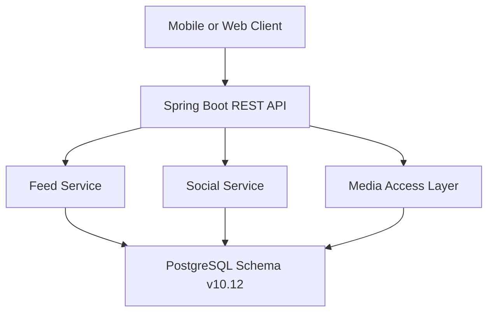
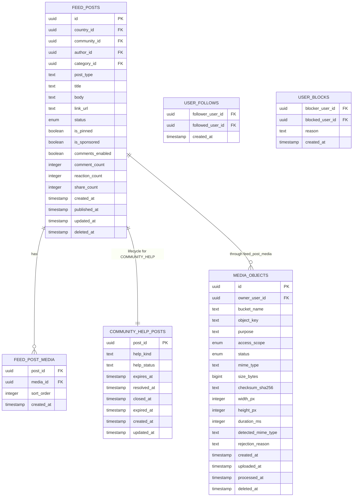
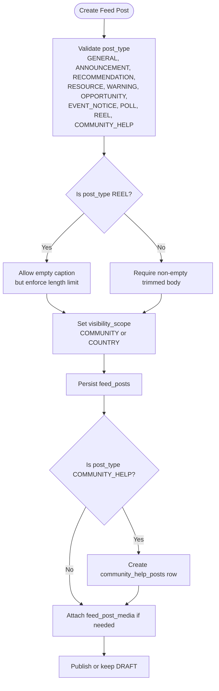
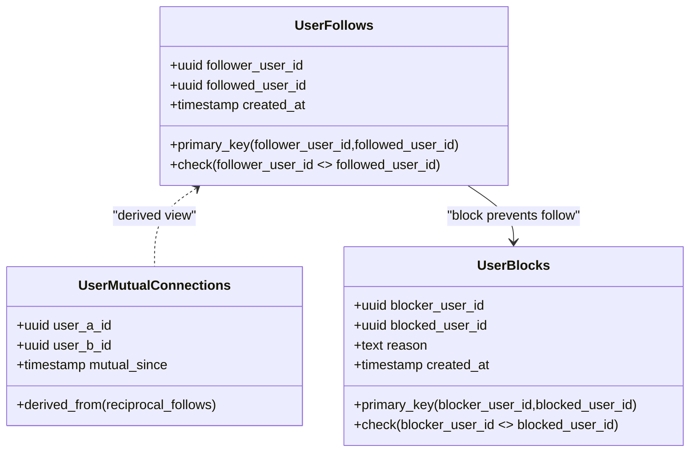
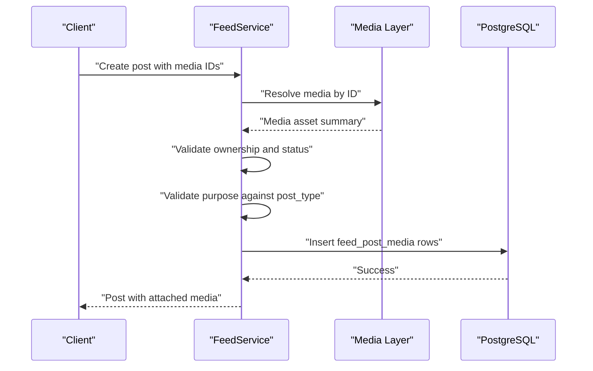
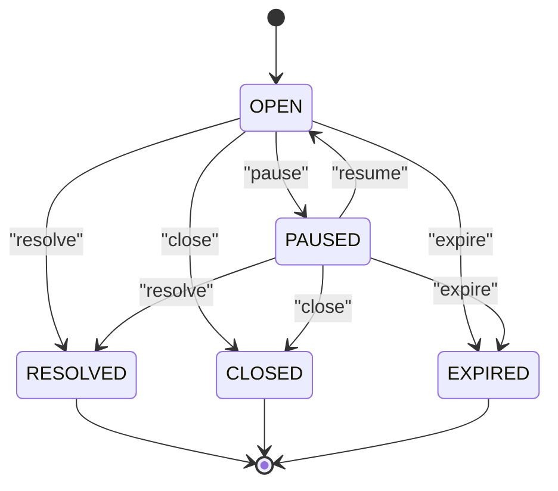
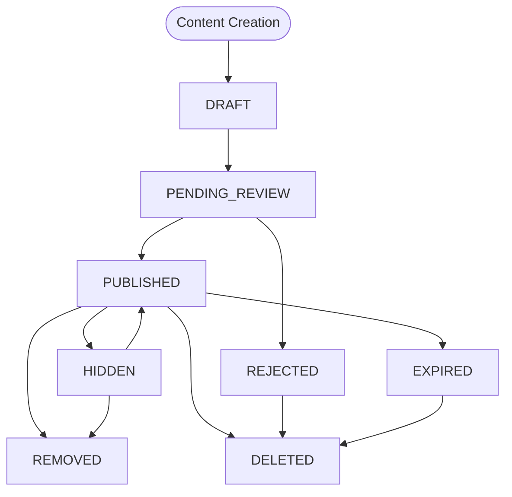
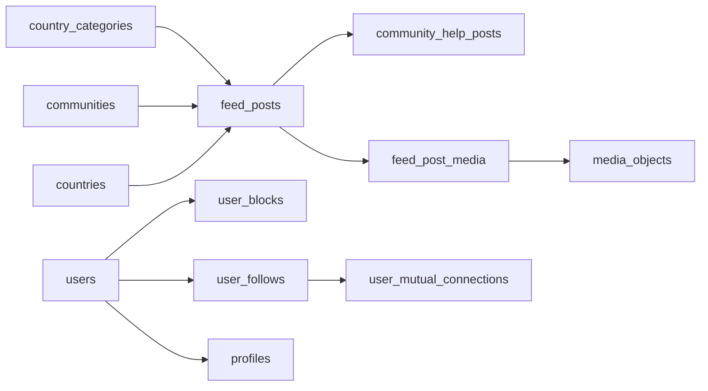

# Content and Social Model

<cite>
**Referenced Files in This Document**   
- [Diasporum_PostgreSQL_Schema_v10_12.sql](file://Diasporum_v10.12/Diasporum_PostgreSQL_Schema_v10_12.sql)
- [V1__baseline_v10_12.sql](file://diasporum-backend/src/main/resources/db/migration/V1__baseline_v10_12.sql)
- [Diasporum_Project_Context_v10_12.md](file://Diasporum_v10.12/Diasporum_Project_Context_v10_12.md)
- [SocialService.java](file://diasporum-backend/src/main/java/com/diasporum/backend/social/internal/application/SocialService.java)
- [package-info.java (social)](file://diasporum-backend/src/main/java/com/diasporum/backend/social/package-info.java)
- [FeedService.java](file://diasporum-backend/src/main/java/com/diasporum/backend/feed/internal/application/FeedService.java)
- [FeedModuleIntegrationTest.java](file://diasporum-backend/src/test/java/com/diasporum/backend/feed/FeedModuleIntegrationTest.java)
</cite>

## Table of Contents
1. [Introduction](#introduction)
2. [Project Structure](#project-structure)
3. [Core Components](#core-components)
4. [Architecture Overview](#architecture-overview)
5. [Detailed Component Analysis](#detailed-component-analysis)
6. [Dependency Analysis](#dependency-analysis)
7. [Performance Considerations](#performance-considerations)
8. [Troubleshooting Guide](#troubleshooting-guide)
9. [Conclusion](#conclusion)

## Introduction
This document describes the data model that powers DIASPORUM’s content and social networking features. It focuses on:

- The `feed_posts` table as the central entity for community and country-scoped posts, including multiple post types such as GENERAL, ANNOUNCEMENT, RECOMMENDATION, RESOURCE, WARNING, OPPORTUNITY, EVENT_NOTICE, POLL, REEL, and COMMUNITY_HELP.
- Visibility scoping for feed content across communities and countries.
- The social graph built from directional follows, blocking behavior, and derived mutual connections.
- The media attachment system linking posts to reusable media objects with access scope controls.
- The structured Community Help & Offers lifecycle stored alongside feed posts.
- Engagement metrics and moderation workflow states.

The authoritative database baseline is the v10.12 PostgreSQL schema. The mobile application is the primary user experience; the backend exposes REST APIs consumed by clients without direct database access.

**Section sources**
- [Diasporum_Project_Context_v10_12.md:14-35](file://Diasporum_v10.12/Diasporum_Project_Context_v10_12.md#L14-L35)
- [Diasporum_Project_Context_v10_12.md:167-192](file://Diasporum_v10.12/Diasporum_Project_Context_v10_12.md#L167-L192)
- [Diasporum_Project_Context_v10_12.md:287-307](file://Diasporum_v10.12/Diasporum_Project_Context_v10_12.md#L287-L307)

## Project Structure
At the database level, the relevant content and social model lives in the canonical v10.12 schema. The Spring Boot backend owns business logic and API boundaries, while PostgreSQL holds durable state.

**Diagram sources**
- [Diasporum_Project_Context_v10_12.md:41-50](file://Diasporum_v10.12/Diasporum_Project_Context_v10_12.md#L41-L50)
- [SocialService.java:13-24](file://diasporum-backend/src/main/java/com/diasporum/backend/social/internal/application/SocialService.java#L13-L24)
- [FeedService.java:170-197](file://diasporum-backend/src/main/java/com/diasporum/backend/feed/internal/application/FeedService.java#L170-L197)

**Section sources**
- [Diasporum_Project_Context_v10_12.md:287-307](file://Diasporum_v10.12/Diasporum_Project_Context_v10_12.md#L287-L307)
- [V1__baseline_v10_12.sql:5680-5690](file://diasporum-backend/src/main/resources/db/migration/V1__baseline_v10_12.sql#L5680-L5690)

## Core Components
The content and social model centers on these database elements:

| Area | Primary Tables / Views | Purpose |
|---|---|---|
| Post content | `feed_posts` | Stores author, community/country, text, type, visibility, engagement counts, and moderation status. |
| Post attachments | `feed_post_media`, `media_objects` | Links one or more media assets to a post with ordering and per-media access control. |
| Social graph | `user_follows`, `user_blocks`, `user_mutual_connections` | Encodes directional follows, blocks, and derived mutual relationships. |
| Structured help | `community_help_posts` | Adds REQUEST/OFFER lifecycle metadata to COMMUNITY_HELP posts. |
| Moderation | `content_status` enum, `status` column | Controls publication, review, hiding, removal, rejection, expiration, and deletion. |
| Visibility | `visibility_scope` enum, `community_id`, `country_id` | Limits post discovery to a community or country audience. |

Key design principles:

- `feed_posts` is the durable source of truth for all feed-related content, including Reels and Community Help posts.
- Reels reuse existing feed media, comments, reactions, views, and moderation infrastructure rather than introducing a separate details table.
- Community Help posts are not a marketplace; they are specialized feed posts with a dedicated lifecycle row.
- Mutual connections are computed from reciprocal follows; no separate friendship edge is persisted.
- Media access is controlled at the media object level through an access scope enum.

**Section sources**
- [Diasporum_PostgreSQL_Schema_v10_12.sql:67-76](file://Diasporum_v10.12/Diasporum_PostgreSQL_Schema_v10_12.sql#L67-L76)
- [Diasporum_PostgreSQL_Schema_v10_12.sql:593-609](file://Diasporum_v10.12/Diasporum_PostgreSQL_Schema_v10_12.sql#L593-L609)
- [Diasporum_PostgreSQL_Schema_v10_12.sql:699-723](file://Diasporum_v10.12/Diasporum_PostgreSQL_Schema_v10_12.sql#L699-L723)
- [Diasporum_PostgreSQL_Schema_v10_12.sql:734-766](file://Diasporum_v10.12/Diasporum_PostgreSQL_Schema_v10_12.sql#L734-L766)
- [Diasporum_PostgreSQL_Schema_v10_12.sql:771-792](file://Diasporum_v10.12/Diasporum_PostgreSQL_Schema_v10_12.sql#L771-L792)
- [Diasporum_PostgreSQL_Schema_v10_12.sql:794-800](file://Diasporum_v10.12/Diasporum_PostgreSQL_Schema_v10_12.sql#L794-L800)
- [Diasporum_Project_Context_v10_12.md:167-192](file://Diasporum_v10.12/Diasporum_Project_Context_v10_12.md#L167-L192)

## Architecture Overview
The content and social architecture separates durable domain entities from client-facing operations:

**Diagram sources**
- [Diasporum_PostgreSQL_Schema_v10_12.sql:593-609](file://Diasporum_v10.12/Diasporum_PostgreSQL_Schema_v10_12.sql#L593-L609)
- [Diasporum_PostgreSQL_Schema_v10_12.sql:699-723](file://Diasporum_v10.12/Diasporum_PostgreSQL_Schema_v10_12.sql#L699-L723)
- [Diasporum_PostgreSQL_Schema_v10_12.sql:734-766](file://Diasporum_v10.12/Diasporum_PostgreSQL_Schema_v10_12.sql#L734-L766)
- [Diasporum_PostgreSQL_Schema_v10_12.sql:771-800](file://Diasporum_v10.12/Diasporum_PostgreSQL_Schema_v10_12.sql#L771-L800)

## Detailed Component Analysis

### Feed Posts and Visibility Scopes
`feed_posts` is the core content entity. It stores:

- Ownership and context: `author_id`, `community_id`, `country_id`, `category_id`.
- Content shape: `post_type`, `title`, `body`, `link_url`.
- Publication and moderation: `status`, `is_pinned`, `is_sponsored`, `comments_enabled`.
- Engagement counters: `comment_count`, `reaction_count`, `share_count`.
- Lifecycle timestamps: `created_at`, `published_at`, `updated_at`, `deleted_at`.

Post types supported include GENERAL, ANNOUNCEMENT, RECOMMENDATION, RESOURCE, WARNING, OPPORTUNITY, EVENT_NOTICE, POLL, REEL, and COMMUNITY_HELP. The schema enforces this set through a `CHECK` constraint on `post_type`.

Visibility is modeled with the `visibility_scope` enum and scoped indexes:

- `COMMUNITY`: visible within the associated community.
- `COUNTRY`: visible across the associated country.
- `SELECTED_COMMUNITIES`: defined in the global enum but constrained at the `feed_posts` level to `COMMUNITY` or `COUNTRY`.

Indexes optimize common queries:

- Community feed queries use `(community_id, status, created_at DESC, id DESC)` filtered to non-deleted rows.
- Country-scoped feeds use a partial index when `visibility_scope='COUNTRY'`.
- Category-based discovery uses `(category_id, status, created_at DESC)`.
- Full-text search is backed by a GIN index over title and body.
- Reel-specific queries use partial indexes filtering by `post_type='REEL'`, `status='PUBLISHED'`, and non-deleted rows.

**Diagram sources**
- [Diasporum_PostgreSQL_Schema_v10_12.sql:734-766](file://Diasporum_v10.12/Diasporum_PostgreSQL_Schema_v10_12.sql#L734-L766)
- [Diasporum_PostgreSQL_Schema_v10_12.sql:771-792](file://Diasporum_v10.12/Diasporum_PostgreSQL_Schema_v10_12.sql#L771-L792)

**Section sources**
- [Diasporum_PostgreSQL_Schema_v10_12.sql:67-69](file://Diasporum_v10.12/Diasporum_PostgreSQL_Schema_v10_12.sql#L67-L69)
- [Diasporum_PostgreSQL_Schema_v10_12.sql:734-766](file://Diasporum_v10.12/Diasporum_PostgreSQL_Schema_v10_12.sql#L734-L766)
- [Diasporum_Project_Context_v10_12.md:167-179](file://Diasporum_v10.12/Diasporum_Project_Context_v10_12.md#L167-L179)

### Social Graph: Follows, Blocks, and Mutual Connections
The social graph is intentionally minimal and explicit:

- `user_follows` stores directional follow edges between users.
- `user_blocks` stores block relationships.
- `user_mutual_connections` is a view derived from reciprocal follows.

Important constraints and behaviors:

- A user cannot follow themselves.
- Both follower and followed accounts must be active.
- Blocked users cannot follow each other.
- Recipients can restrict whether followers are allowed.
- Blocking removes both directional follow edges and dissolves mutual connections.
- The blocked user should not learn about being blocked, but enforcement still applies.

**Diagram sources**
- [Diasporum_PostgreSQL_Schema_v10_12.sql:593-648](file://Diasporum_v10.12/Diasporum_PostgreSQL_Schema_v10_12.sql#L593-L648)
- [SocialService.java:13-24](file://diasporum-backend/src/main/java/com/diasporum/backend/social/internal/application/SocialService.java#L13-L24)

**Section sources**
- [Diasporum_PostgreSQL_Schema_v10_12.sql:593-648](file://Diasporum_v10.12/Diasporum_PostgreSQL_Schema_v10_12.sql#L593-L648)
- [package-info.java (social):1-8](file://diasporum-backend/src/main/java/com/diasporum/backend/social/package-info.java#L1-L8)
- [SocialService.java:13-24](file://diasporum-backend/src/main/java/com/diasporum/backend/social/internal/application/SocialService.java#L13-L24)

### Media Attachment System and Access Scope Controls
Media is stored as reusable `media_objects` and attached to posts through `feed_post_media`.

Key properties of `media_objects`:

- Storage identity: `bucket_name`, `object_key`.
- Purpose: avatar, feed image, feed video, chat attachment, listing asset, etc.
- Processing state: pending upload, uploaded, processing, ready, rejected, deleted.
- Metadata: MIME type, size, dimensions, duration, checksum, detected MIME type, rejection reason.
- Access control: `access_scope` with values PUBLIC, AUTHENTICATED, OWNER_ONLY, AUTHORIZED_VIEWERS.

Attachment rules enforced by the feed service:

- Media must exist.
- Media must belong to the post owner.
- Media must be in READY status.
- For general posts, accepted purposes include images and videos.
- For Reels, only FEED_VIDEO is accepted.
- Multiple media can be attached with deterministic ordering via `sort_order`.

**Diagram sources**
- [FeedService.java:170-197](file://diasporum-backend/src/main/java/com/diasporum/backend/feed/internal/application/FeedService.java#L170-L197)
- [Diasporum_PostgreSQL_Schema_v10_12.sql:699-723](file://Diasporum_v10.12/Diasporum_PostgreSQL_Schema_v10_12.sql#L699-L723)
- [Diasporum_PostgreSQL_Schema_v10_12.sql:794-800](file://Diasporum_v10.12/Diasporum_PostgreSQL_Schema_v10_12.sql#L794-L800)

**Section sources**
- [Diasporum_PostgreSQL_Schema_v10_12.sql:699-723](file://Diasporum_v10.12/Diasporum_PostgreSQL_Schema_v10_12.sql#L699-L723)
- [Diasporum_PostgreSQL_Schema_v10_12.sql:794-800](file://Diasporum_v10.12/Diasporum_PostgreSQL_Schema_v10_12.sql#L794-L800)
- [FeedService.java:170-197](file://diasporum-backend/src/main/java/com/diasporum/backend/feed/internal/application/FeedService.java#L170-L197)

### Community Help Posts: Requests and Offers
Community Help posts extend the feed model with structured lifecycle metadata:

- `help_kind`: REQUEST or OFFER.
- `help_status`: OPEN, PAUSED, RESOLVED, CLOSED, EXPIRED.
- Lifecycle timestamps: optional `expires_at`, plus managed terminal timestamps `resolved_at`, `closed_at`, `expired_at`.
- One-to-one relationship with `feed_posts.id`.

Design rules:

- Community Help is a specialized feed post, not a marketplace.
- Responses reuse context-aware direct conversations with `context_type = 'COMMUNITY_HELP_POST'`; there is no separate response table.
- Paid professional work belongs in the Service Marketplace.
- Expiry transitions are driven by scheduled backend tasks.
- Terminal states cannot reopen.
- Only the post author may transition to terminal states such as CLOSED.

**Diagram sources**
- [Diasporum_PostgreSQL_Schema_v10_12.sql:771-792](file://Diasporum_v10.12/Diasporum_PostgreSQL_Schema_v10_12.sql#L771-L792)
- [Diasporum_Project_Context_v10_12.md:180-192](file://Diasporum_v10.12/Diasporum_Project_Context_v10_12.md#L180-L192)
- [FeedModuleIntegrationTest.java:170-183](file://diasporum-backend/src/test/java/com/diasporum/backend/feed/FeedModuleIntegrationTest.java#L170-L183)

**Section sources**
- [Diasporum_PostgreSQL_Schema_v10_12.sql:771-792](file://Diasporum_v10.12/Diasporum_PostgreSQL_Schema_v10_12.sql#L771-L792)
- [Diasporum_Project_Context_v10_12.md:180-192](file://Diasporum_v10.12/Diasporum_Project_Context_v10_12.md#L180-L192)
- [FeedModuleIntegrationTest.java:170-183](file://diasporum-backend/src/test/java/com/diasporum/backend/feed/FeedModuleIntegrationTest.java#L170-L183)

### Engagement Metrics and Moderation Workflows
Engagement metrics are stored directly on `feed_posts`:

- `comment_count`: number of comments linked to the post.
- `reaction_count`: number of reactions linked to the post.
- `share_count`: number of shares recorded by the system.

These counters are non-negative integers and default to zero. They are intended to support feed display and analytics without requiring real-time aggregation on every read.

Moderation is represented by the `content_status` enum and the `status` column on `feed_posts`:

- DRAFT: unpublished draft.
- PENDING_REVIEW: awaiting moderation or review.
- PUBLISHED: publicly discoverable according to visibility scope.
- HIDDEN: temporarily hidden from discovery.
- REMOVED: removed due to policy or moderation action.
- REJECTED: rejected during review.
- EXPIRED: expired where applicable.
- DELETED: soft-deleted.

For Community Help posts, `help_status` is distinct from `feed_posts.status`: publication/moderation is handled by the parent post, while `help_status` governs availability of the request or offer.

**Diagram sources**
- [Diasporum_PostgreSQL_Schema_v10_12.sql:67-68](file://Diasporum_v10.12/Diasporum_PostgreSQL_Schema_v10_12.sql#L67-L68)
- [Diasporum_PostgreSQL_Schema_v10_12.sql:734-766](file://Diasporum_v10.12/Diasporum_PostgreSQL_Schema_v10_12.sql#L734-L766)
- [Diasporum_Project_Context_v10_12.md:180-192](file://Diasporum_v10.12/Diasporum_Project_Context_v10_12.md#L180-L192)

**Section sources**
- [Diasporum_PostgreSQL_Schema_v10_12.sql:67-68](file://Diasporum_v10.12/Diasporum_PostgreSQL_Schema_v10_12.sql#L67-L68)
- [Diasporum_PostgreSQL_Schema_v10_12.sql:734-766](file://Diasporum_v10.12/Diasporum_PostgreSQL_Schema_v10_12.sql#L734-L766)

## Dependency Analysis
The content and social model has clear dependency directions:

**Diagram sources**
- [Diasporum_PostgreSQL_Schema_v10_12.sql:108-155](file://Diasporum_v10.12/Diasporum_PostgreSQL_Schema_v10_12.sql#L108-L155)
- [Diasporum_PostgreSQL_Schema_v10_12.sql:369-397](file://Diasporum_v10.12/Diasporum_PostgreSQL_Schema_v10_12.sql#L369-L397)
- [Diasporum_PostgreSQL_Schema_v10_12.sql:531-554](file://Diasporum_v10.12/Diasporum_PostgreSQL_Schema_v10_12.sql#L531-L554)
- [Diasporum_PostgreSQL_Schema_v10_12.sql:593-609](file://Diasporum_v10.12/Diasporum_PostgreSQL_Schema_v10_12.sql#L593-L609)
- [Diasporum_PostgreSQL_Schema_v10_12.sql:699-800](file://Diasporum_v10.12/Diasporum_PostgreSQL_Schema_v10_12.sql#L699-L800)

Coupling observations:

- `feed_posts` depends on foundational reference tables: countries, communities, categories, and users.
- `feed_post_media` couples post content to reusable media assets.
- `community_help_posts` depends on `feed_posts` and adds feature-specific lifecycle semantics.
- Social relationships depend only on `users`; mutual connections are derived, avoiding redundant state.
- Media access scope is independent of post visibility; both must be evaluated by the backend.

**Section sources**
- [Diasporum_PostgreSQL_Schema_v10_12.sql:593-609](file://Diasporum_v10.12/Diasporum_PostgreSQL_Schema_v10_12.sql#L593-L609)
- [Diasporum_PostgreSQL_Schema_v10_12.sql:699-800](file://Diasporum_v10.12/Diasporum_PostgreSQL_Schema_v10_12.sql#L699-L800)

## Performance Considerations
The schema includes several performance-oriented design choices:

- Partial indexes reduce scan cost for active, non-deleted feed posts.
- Country-scoped indexes are conditional on `visibility_scope='COUNTRY'`.
- Reel-specific indexes filter by `post_type='REEL'` and `status='PUBLISHED'`.
- Full-text search uses a GIN index over concatenated title and body.
- Community Help open/expiry queries use targeted indexes on `help_kind`, `expires_at`, and `post_id`.
- Media objects have indexes on owner, status, and creation time to support cleanup and retrieval workflows.

Recommendations:

- Keep engagement counters updated through controlled write paths rather than recomputing them on reads.
- Avoid exposing exact coordinates or precise distances to clients; use server-side PostGIS calculations where required.
- Use pagination for large feeds, especially country-wide or popular category queries.
- Monitor GIN index growth for high-volume text content.

[No sources needed since this section provides general guidance]

## Troubleshooting Guide
Common issues and their data-model causes:

| Symptom | Likely Cause | Resolution Approach |
|---|---|---|
| Cannot create a follow | Follower or followed account is inactive, self-follow attempted, or recipients disallow followers | Verify `account_status`, ensure different users, and check recipient privacy settings. |
| Follow fails because users are blocked | A block exists in either direction | Remove the block before allowing follows. |
| Block does not reveal itself to the blocked user | Security design hides block existence from the blocked party | Do not expose block state to the blocked user; enforce interaction restrictions server-side. |
| Media attachment rejected | Media not owned by post author, not READY, or wrong purpose for post type | Validate ownership, status, and purpose before inserting `feed_post_media`. |
| Community Help post cannot be reopened | Terminal state already reached | Only allow transitions to terminal states; do not revert RESOLVED, CLOSED, or EXPIRED. |
| Community Help post cannot be closed by another user | Authorization requires post author | Restrict terminal transitions to the post author. |
| Post not visible in expected feed | Visibility scope mismatch or moderation status | Check `visibility_scope`, `community_id`, `country_id`, and `status`. |

**Section sources**
- [Diasporum_PostgreSQL_Schema_v10_12.sql:611-638](file://Diasporum_v10.12/Diasporum_PostgreSQL_Schema_v10_12.sql#L611-L638)
- [Diasporum_PostgreSQL_Schema_v10_12.sql:771-792](file://Diasporum_v10.12/Diasporum_PostgreSQL_Schema_v10_12.sql#L771-L792)
- [FeedModuleIntegrationTest.java:170-183](file://diasporum-backend/src/test/java/com/diasporum/backend/feed/FeedModuleIntegrationTest.java#L170-L183)

## Conclusion
DIASPORUM’s content and social model is centered on a single durable feed post entity extended by purpose-specific tables and views. Feed posts carry type, visibility, moderation, and engagement state. Media is decoupled into reusable objects with explicit access scopes. The social graph is minimal, directional, and safety-aware, with mutual connections derived rather than duplicated. Community Help posts add structured lifecycle semantics without creating a parallel marketplace. Together, these structures support community-driven content, safe social interactions, and scalable discovery across communities and countries.

[No sources needed since this section summarizes without analyzing specific files]