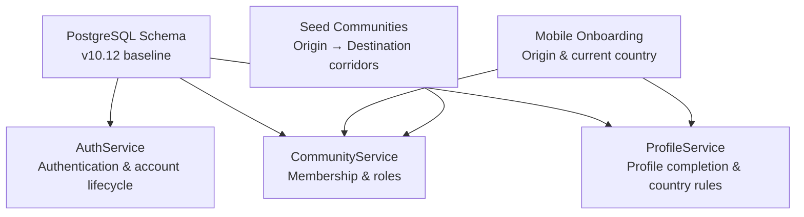
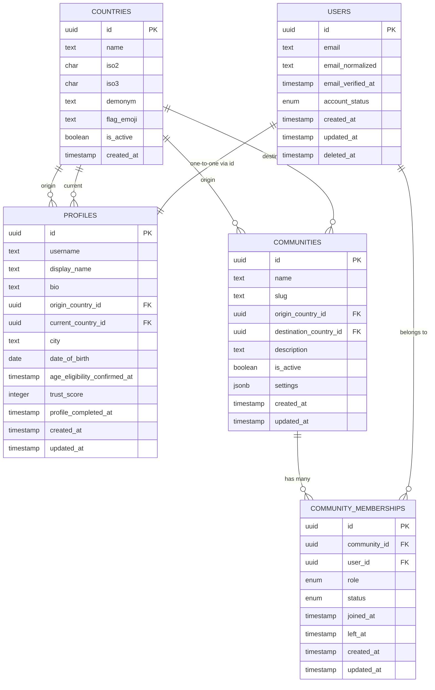
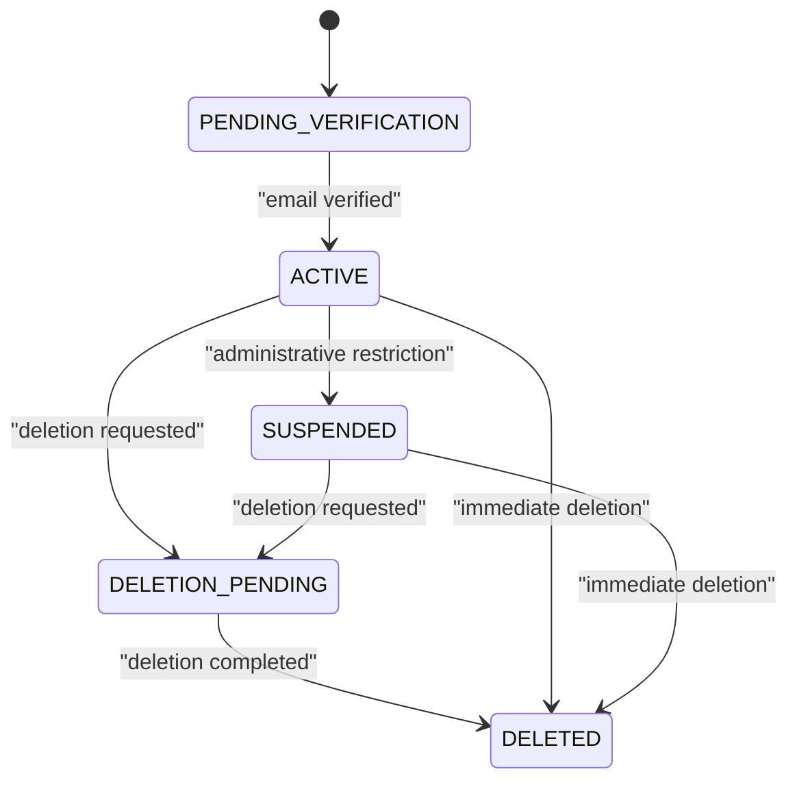
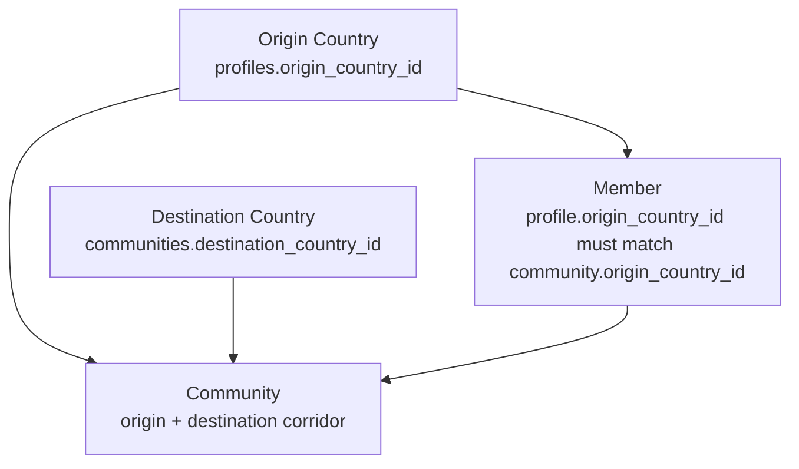
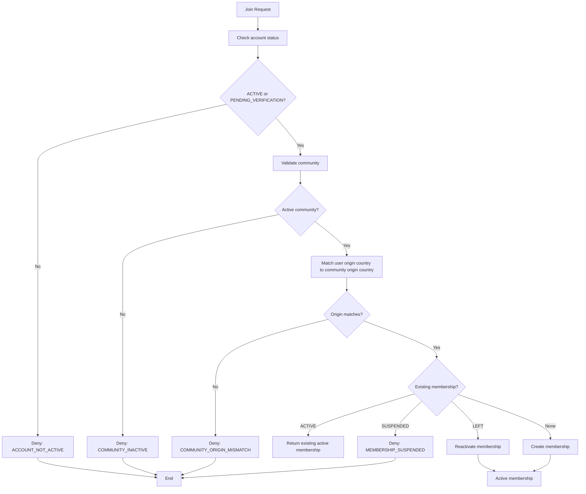
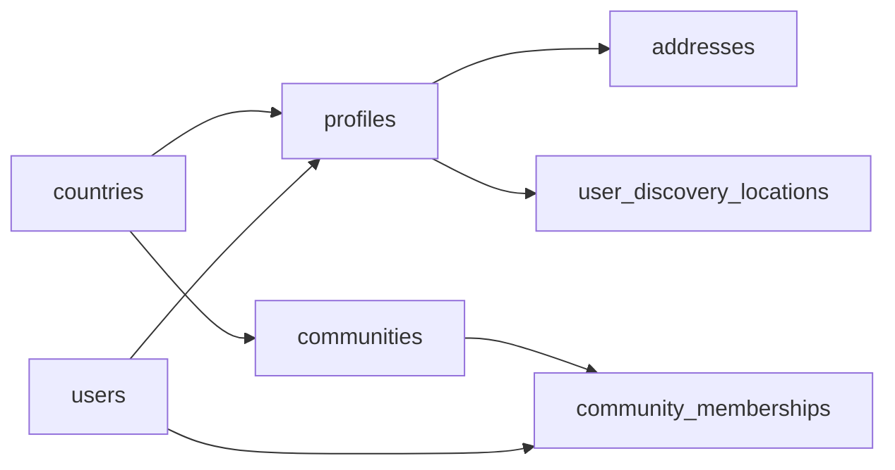
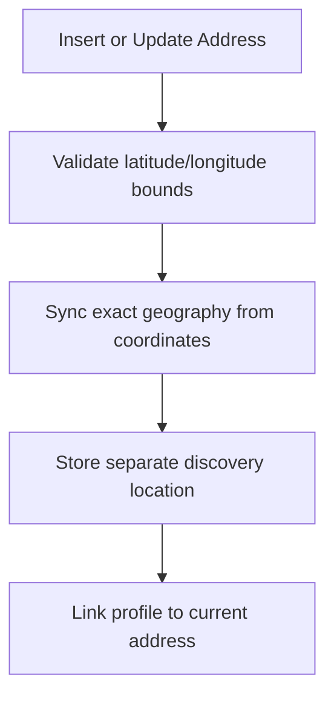
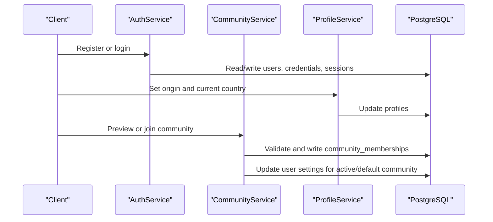
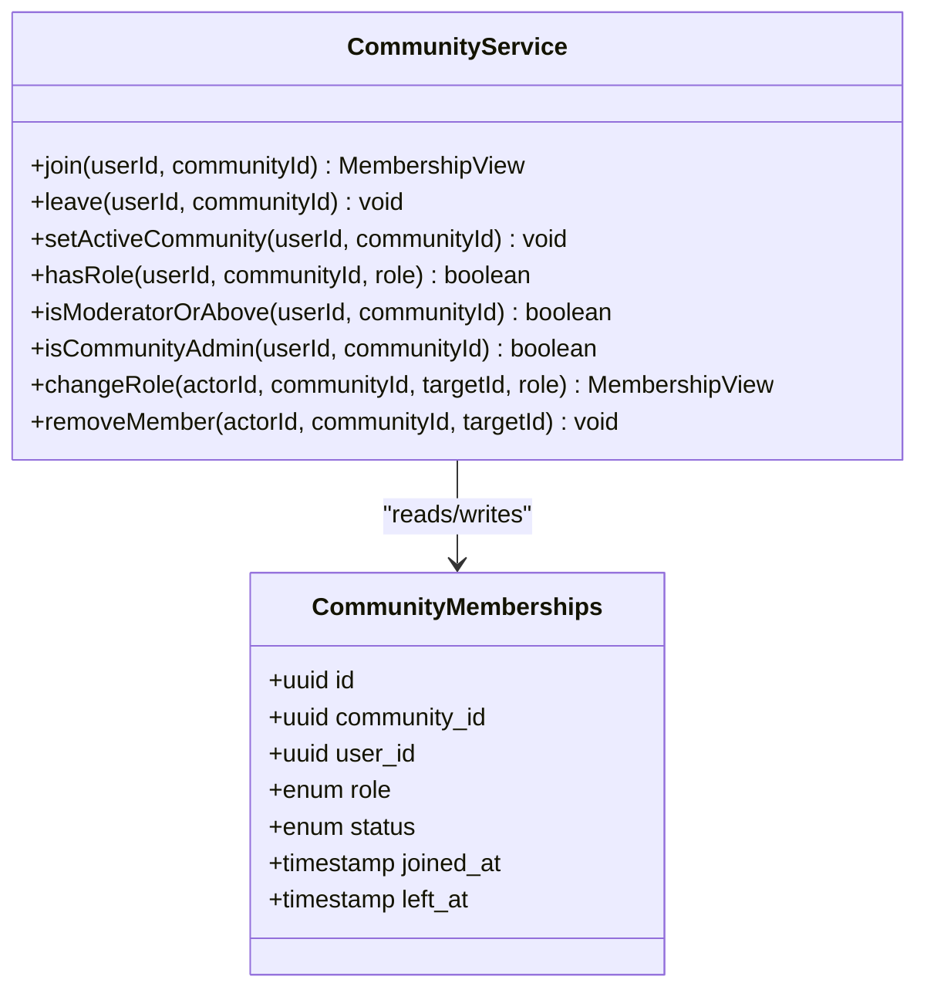
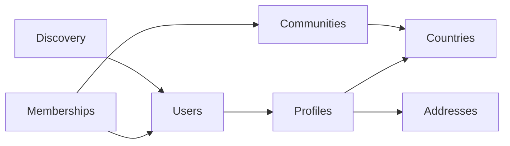

# Core Entities

<cite>
**Referenced Files in This Document**   
- [V1__baseline_v10_12.sql](file://diasporum-backend/src/main/resources/db/migration/V1__baseline_v10_12.sql)
- [Diasporum_PostgreSQL_Schema_v10_12.sql](file://Diasporum_v10.12/Diasporum_PostgreSQL_Schema_v10_12.sql)
- [AuthService.java](file://diasporum-backend/src/main/java/com/diasporum/backend/identity/internal/application/AuthService.java)
- [CommunityService.java](file://diasporum-backend/src/main/java/com/diasporum/backend/community/internal/application/CommunityService.java)
- [CommunityApiImpl.java](file://diasporum-backend/src/main/java/com/diasporum/backend/community/internal/application/CommunityApiImpl.java)
- [ProfileService.java](file://diasporum-backend/src/main/java/com/diasporum/backend/identity/internal/application/ProfileService.java)
- [country-origin.tsx](file://diasporum-mobile/src/app/(onboarding)/country-origin.tsx)
- [country-current.tsx](file://diasporum-mobile/src/app/(onboarding)/country-current.tsx)
- [seed_communities.sql](file://seed_communities.sql)
</cite>

## Table of Contents
1. [Introduction](#introduction)
2. [Project Structure](#project-structure)
3. [Core Data Model](#core-data-model)
4. [User Account Lifecycle](#user-account-lifecycle)
5. [Country and Community Relationship Model](#country-and-community-relationship-model)
6. [Community Membership and Role-Based Access Control](#community-membership-and-role-based-access-control)
7. [Geographic Relationships and Location Data Flow](#geographic-relationships-and-location-data-flow)
8. [Indexes, Constraints, and Database-Level Business Rules](#indexes-constraints-and-database-level-business-rules)
9. [Architecture Overview](#architecture-overview)
10. [Detailed Component Analysis](#detailed-component-analysis)
11. [Dependency Analysis](#dependency-analysis)
12. [Performance Considerations](#performance-considerations)
13. [Troubleshooting Guide](#troubleshooting-guide)
14. [Conclusion](#conclusion)

## Introduction
This document describes the core data model for DIASPORUM’s identity, geography, and community domains. It focuses on:

- Users as authentication and account entities.
- Profiles as optional, profile-facing extensions of users.
- Countries as reference geography.
- Communities as diaspora connections between an origin country and a destination country.
- Community memberships with role-based access control and membership status management.
- Geographic relationships that connect users, profiles, communities, and shared addresses.

The documentation is grounded in the PostgreSQL schema baseline, Flyway migration, backend application services, and mobile onboarding screens.

## Project Structure
The relevant codebase areas are:

| Area | Purpose | Key Files |
|---|---|---|
| Database schema | Clean-install PostgreSQL baseline with enums, tables, triggers, and indexes | `V1__baseline_v10_12.sql`, `Diasporum_PostgreSQL_Schema_v10_12.sql` |
| Identity and authentication | User registration, login, email verification, session and token handling | `AuthService.java` |
| Community domain | Membership lifecycle, active community selection, member listing, role checks | `CommunityService.java`, `CommunityApiImpl.java` |
| Profile domain | Profile completion, country validation, display name and username rules | `ProfileService.java` |
| Mobile onboarding | Origin and current country selection during user onboarding | `country-origin.tsx`, `country-current.tsx` |
| Seed data | Diaspora corridor communities linking origin and destination countries | `seed_communities.sql` |



**Diagram sources**
- [V1__baseline_v10_12.sql:62-155](file://diasporum-backend/src/main/resources/db/migration/V1__baseline_v10_12.sql#L62-L155)
- [AuthService.java:45-131](file://diasporum-backend/src/main/java/com/diasporum/backend/identity/internal/application/AuthService.java#L45-L131)
- [CommunityService.java:89-187](file://diasporum-backend/src/main/java/com/diasporum/backend/community/internal/application/CommunityService.java#L89-L187)
- [ProfileService.java:167-182](file://diasporum-backend/src/main/java/com/diasporum/backend/identity/internal/application/ProfileService.java#L167-L182)
- [country-origin.tsx:31-66](file://diasporum-mobile/src/app/(onboarding)/country-origin.tsx#L31-L66)
- [country-current.tsx:27-67](file://diasporum-mobile/src/app/(onboarding)/country-current.tsx#L27-L67)
- [seed_communities.sql:1-65](file://seed_communities.sql#L1-L65)

**Section sources**
- [V1__baseline_v10_12.sql:1-106](file://diasporum-backend/src/main/resources/db/migration/V1__baseline_v10_12.sql#L1-L106)
- [Diasporum_PostgreSQL_Schema_v10_12.sql:1-106](file://Diasporum_v10.12/Diasporum_PostgreSQL_Schema_v10_12.sql#L1-L106)

## Core Data Model
The core entities are:

| Entity | Responsibility | Primary Keys | Important Foreign Keys | Notes |
|---|---|---|---|---|
| `countries` | Reference geography for origin and destination | `id` | None | Canonical country list with ISO codes and display metadata |
| `users` | Authentication, account identity, lifecycle state | `id` | None | Email-normalized uniqueness; account status controls access |
| `profiles` | Optional profile-facing extension of a user | `id` | `origin_country_id`, `current_country_id`, optional `current_address_id` | Shares UUID with `users.id`; stores display and geographic profile fields |
| `communities` | Diaspora connection between origin and destination countries | `id` | `origin_country_id`, `destination_country_id` | One community per active origin-destination pair |
| `community_memberships` | User membership in a community | `id` | `community_id`, `user_id` | Role and status define access and lifecycle |



**Diagram sources**
- [V1__baseline_v10_12.sql:108-155](file://diasporum-backend/src/main/resources/db/migration/V1__baseline_v10_12.sql#L108-L155)
- [V1__baseline_v10_12.sql:369-397](file://diasporum-backend/src/main/resources/db/migration/V1__baseline_v10_12.sql#L369-L397)

**Section sources**
- [V1__baseline_v10_12.sql:108-155](file://diasporum-backend/src/main/resources/db/migration/V1__baseline_v10_12.sql#L108-L155)
- [V1__baseline_v10_12.sql:369-397](file://diasporum-backend/src/main/resources/db/migration/V1__baseline_v10_12.sql#L369-L397)

## User Account Lifecycle
The `account_status` enum defines the authoritative lifecycle states:

| State | Meaning | System Behavior |
|---|---|---|
| `PENDING_VERIFICATION` | Registration completed but email verification is pending or deferred | Login may be allowed depending on service logic; email verification can transition to `ACTIVE` |
| `ACTIVE` | Fully active account | Can log in, join communities, and use platform features |
| `SUSPENDED` | Account restricted by moderation or administrative action | Cannot authenticate; sessions are revoked |
| `DELETION_PENDING` | Account deletion workflow initiated | Cannot authenticate; sessions are revoked |
| `DELETED` | Account removed | Cannot authenticate; sessions are revoked |

### Lifecycle Transitions

| Transition | Trigger | Result |
|---|---|---|
| Registration | `AuthService.register` | Creates `users` row with `ACTIVE` in current implementation; schema default is `PENDING_VERIFICATION` |
| Email verification | `AuthService.verifyEmail` | Sets `email_verified_at` and transitions `PENDING_VERIFICATION` to `ACTIVE` without resurrecting restricted accounts |
| Suspension | Administrative or moderation action updating `users.account_status` | Revokes all active sessions and refresh tokens |
| Deletion pending | Administrative or moderation action updating `users.account_status` | Revokes all active sessions and refresh tokens |
| Deleted | Administrative or moderation action updating `users.account_status` or setting `deleted_at` | Revokes all active sessions and refresh tokens |



**Diagram sources**
- [V1__baseline_v10_12.sql:62-133](file://diasporum-backend/src/main/resources/db/migration/V1__baseline_v10_12.sql#L62-L133)
- [AuthService.java:45-131](file://diasporum-backend/src/main/java/com/diasporum/backend/identity/internal/application/AuthService.java#L45-L131)
- [V1__baseline_v10_12.sql:245-265](file://diasporum-backend/src/main/resources/db/migration/V1__baseline_v10_12.sql#L245-L265)

### Separation Between Authentication Data and Profile Information
- `users` holds authentication and account lifecycle data: email, normalized email, verification timestamp, account status, creation/update timestamps, and soft delete timestamp.
- `profiles` holds profile-facing information: username, display name, bio, origin country, current country, city, date of birth, eligibility confirmation, trust score, and profile completion timestamp.
- The profile ID is the same UUID as the user ID, enforcing a one-to-zero-or-one relationship.
- Optional password credentials live in `user_credentials`, so external-identity-only accounts may exist without local password data.

**Section sources**
- [V1__baseline_v10_12.sql:119-165](file://diasporum-backend/src/main/resources/db/migration/V1__baseline_v10_12.sql#L119-L165)
- [AuthService.java:12-15](file://diasporum-backend/src/main/java/com/diasporum/backend/identity/internal/application/AuthService.java#L12-L15)

## Country and Community Relationship Model
Countries are reference entities used throughout the system. Communities represent diaspora corridors by linking:

- `origin_country_id`: The user’s cultural or national origin country.
- `destination_country_id`: The country where the diaspora community resides.

The schema enforces:

- A unique combination of `origin_country_id` and `destination_country_id`.
- Both country references must exist in `countries`.
- Seed data creates diaspora corridors such as Ethiopian communities in the UK, US, Germany, Canada, Australia, and Sweden.



**Diagram sources**
- [V1__baseline_v10_12.sql:108-155](file://diasporum-backend/src/main/resources/db/migration/V1__baseline_v10_12.sql#L108-L155)
- [V1__baseline_v10_12.sql:369-381](file://diasporum-backend/src/main/resources/db/migration/V1__baseline_v10_12.sql#L369-L381)
- [seed_communities.sql:1-65](file://seed_communities.sql#L1-L65)

**Section sources**
- [V1__baseline_v10_12.sql:108-117](file://diasporum-backend/src/main/resources/db/migration/V1__baseline_v10_12.sql#L108-L117)
- [V1__baseline_v10_12.sql:369-381](file://diasporum-backend/src/main/resources/db/migration/V1__baseline_v10_12.sql#L369-L381)
- [seed_communities.sql:1-65](file://seed_communities.sql#L1-L65)

## Community Membership and Role-Based Access Control
Community membership is stored in `community_memberships` with:

| Field | Meaning |
|---|---|
| `role` | Role-based access control value |
| `status` | Membership lifecycle state |
| `joined_at` | When membership became active |
| `left_at` | When membership was explicitly left or removed |

### Roles
| Role | Permissions |
|---|---|
| `MEMBER` | Standard community participant |
| `TRUSTED_HELPER` | Trusted helper role defined by the schema |
| `MODERATOR` | Moderation authority within the community |
| `COMMUNITY_ADMIN` | Highest community authority; can manage members and roles |

### Membership Statuses
| Status | Meaning |
|---|---|
| `ACTIVE` | Active member |
| `SUSPENDED` | Suspended member; cannot rejoin through normal join flow |
| `LEFT` | Left or removed; history preserved |

### Membership Lifecycle Rules
- Joining requires an active or pending-verification account.
- Joining requires the user’s origin country to match the community’s origin country.
- Rejoining a `LEFT` membership resets status to `ACTIVE`.
- Leaving sets status to `LEFT` and clears the active community if it was selected.
- Only `COMMUNITY_ADMIN` can change roles or remove members.
- The last `COMMUNITY_ADMIN` cannot be demoted.



**Diagram sources**
- [CommunityService.java:147-187](file://diasporum-backend/src/main/java/com/diasporum/backend/community/internal/application/CommunityService.java#L147-L187)
- [V1__baseline_v10_12.sql:384-413](file://diasporum-backend/src/main/resources/db/migration/V1__baseline_v10_12.sql#L384-L413)

**Section sources**
- [V1__baseline_v10_12.sql:65-66](file://diasporum-backend/src/main/resources/db/migration/V1__baseline_v10_12.sql#L65-L66)
- [V1__baseline_v10_12.sql:384-413](file://diasporum-backend/src/main/resources/db/migration/V1__baseline_v10_12.sql#L384-L413)
- [CommunityService.java:147-187](file://diasporum-backend/src/main/java/com/diasporum/backend/community/internal/application/CommunityService.java#L147-L187)
- [CommunityService.java:250-331](file://diasporum-backend/src/main/java/com/diasporum/backend/community/internal/application/CommunityService.java#L250-L331)

## Geographic Relationships and Location Data Flow
Location data flows through several layers:

1. **Reference geography**: `countries` provides canonical origin and destination countries.
2. **Profile geography**: `profiles.origin_country_id` and `profiles.current_country_id` describe a user’s diaspora context.
3. **Shared addresses**: `addresses` store structured location data, including coordinates and PostGIS geography.
4. **Profile current address**: `profiles.current_address_id` links a profile to a shared address.
5. **Discovery locations**: `user_discovery_locations` stores opt-in approximate discovery points.
6. **Community geography**: `communities.origin_country_id` and `communities.destination_country_id` define diaspora corridors.



**Diagram sources**
- [V1__baseline_v10_12.sql:108-155](file://diasporum-backend/src/main/resources/db/migration/V1__baseline_v10_12.sql#L108-L155)
- [V1__baseline_v10_12.sql:270-337](file://diasporum-backend/src/main/resources/db/migration/V1__baseline_v10_12.sql#L270-L337)
- [V1__baseline_v10_12.sql:369-397](file://diasporum-backend/src/main/resources/db/migration/V1__baseline_v10_12.sql#L369-L397)

### Profile Completion and Country Validation
Profile completion is tracked by requiring:

- `display_name`
- `username`
- `origin_country_id`
- `current_country_id`

The mobile onboarding screens collect origin and current country values before completing onboarding and auto-joining the matching community.

**Section sources**
- [ProfileService.java:167-182](file://diasporum-backend/src/main/java/com/diasporum/backend/identity/internal/application/ProfileService.java#L167-L182)
- [country-origin.tsx:31-66](file://diasporum-mobile/src/app/(onboarding)/country-origin.tsx#L31-L66)
- [country-current.tsx:27-67](file://diasporum-mobile/src/app/(onboarding)/country-current.tsx#L27-L67)
- [V1__baseline_v10_12.sql:138-155](file://diasporum-backend/src/main/resources/db/migration/V1__baseline_v10_12.sql#L138-L155)

## Indexes, Constraints, and Database-Level Business Rules
The schema enforces business rules at the database level using constraints, generated columns, and triggers.

### Users
| Rule | Implementation |
|---|---|
| Email format validation | `CHECK` on trimmed length and presence of `@` |
| Normalized email uniqueness | Generated column `email_normalized` with partial unique index excluding deleted accounts |
| Account status enforcement | Enum type `account_status` |
| Session revocation on restriction | Trigger updates `user_sessions` and `user_refresh_tokens` when account becomes suspended, deletion-pending, or deleted |

### Profiles
| Rule | Implementation |
|---|---|
| One-to-one with users | `id` references `users(id)` with cascade delete |
| Username uniqueness | Case-insensitive unique index on lowercased username |
| Display name length | `CHECK` constraint |
| Bio length | `CHECK` constraint |
| Country references | Foreign keys to `countries` |
| City length | `CHECK` constraint |
| Trust score non-negative | `CHECK` constraint |
| Origin/current country index | Composite index for queries filtering by both countries |
| Current city index | Partial index for non-null cities |

### Communities
| Rule | Implementation |
|---|---|
| Unique corridor | Unique constraint on `origin_country_id`, `destination_country_id` |
| Country references | Foreign keys to `countries` |
| Active destination lookup | Index on `destination_country_id`, `is_active` |

### Community Memberships
| Rule | Implementation |
|---|---|
| One membership per user-community | Unique constraint on `community_id`, `user_id` |
| Role enforcement | Enum type `community_role` |
| Status enforcement | Enum type `membership_status` |
| Origin-country match | Trigger validates that user’s profile origin country matches the community’s origin country |
| Query performance | Indexes on `user_id,status` and `community_id,status,role` |

### Addresses and Geography
| Rule | Implementation |
|---|---|
| Coordinate bounds | `CHECK` constraints for latitude and longitude |
| Coordinate consistency | Latitude and longitude must both be null or both present |
| Address completeness | At least one of address line, city, or formatted address must be present |
| Exact geography derivation | Trigger derives `location` from `latitude` and `longitude` |
| Spatial discovery | Separate `discovery_location` with GIST index |
| Profile current address | Nullable foreign key with RESTRICT delete behavior |



**Diagram sources**
- [V1__baseline_v10_12.sql:270-324](file://diasporum-backend/src/main/resources/db/migration/V1__baseline_v10_12.sql#L270-L324)

**Section sources**
- [V1__baseline_v10_12.sql:122-155](file://diasporum-backend/src/main/resources/db/migration/V1__baseline_v10_12.sql#L122-L155)
- [V1__baseline_v10_12.sql:245-265](file://diasporum-backend/src/main/resources/db/migration/V1__baseline_v10_12.sql#L245-L265)
- [V1__baseline_v10_12.sql:270-337](file://diasporum-backend/src/main/resources/db/migration/V1__baseline_v10_12.sql#L270-L337)
- [V1__baseline_v10_12.sql:369-413](file://diasporum-backend/src/main/resources/db/migration/V1__baseline_v10_12.sql#L369-L413)

## Architecture Overview
At the application layer, the core entities are accessed through:

- `AuthService`: Manages user registration, login, email verification, password reset, and session/token operations.
- `CommunityService`: Manages community membership, role checks, active community selection, and onboarding integration.
- `ProfileService`: Manages profile completion and country validation.
- Mobile onboarding screens: Collect origin and current country data and drive community preview and joining.



**Diagram sources**
- [AuthService.java:45-131](file://diasporum-backend/src/main/java/com/diasporum/backend/identity/internal/application/AuthService.java#L45-L131)
- [CommunityService.java:127-187](file://diasporum-backend/src/main/java/com/diasporum/backend/community/internal/application/CommunityService.java#L127-L187)
- [ProfileService.java:167-182](file://diasporum-backend/src/main/java/com/diasporum/backend/identity/internal/application/ProfileService.java#L167-L182)

## Detailed Component Analysis

### User and Profile Domain
The user domain separates authentication concerns from profile concerns:

- `users` owns email, verification state, account status, and lifecycle timestamps.
- `profiles` owns display identity and geographic profile data.
- `user_credentials` is optional and only exists for accounts with local passwords.
- `user_sessions` and `user_refresh_tokens` support first-party authentication.

Key behaviors:

- Registration currently inserts an `ACTIVE` account in the service layer, while the schema default remains `PENDING_VERIFICATION`.
- Email verification updates `email_verified_at` and transitions `PENDING_VERIFICATION` to `ACTIVE`.
- Restricted account statuses revoke sessions and refresh tokens through a database trigger.

```mermaid
classDiagram
class Users {
+uuid id
+text email
+text email_normalized
+timestamp email_verified_at
+enum account_status
+timestamp created_at
+timestamp updated_at
+timestamp deleted_at
}
class Profiles {
+uuid id
+text username
+text display_name
+text bio
+uuid origin_country_id
+uuid current_country_id
+text city
+date date_of_birth
+timestamp profile_completed_at
}
class UserCredentials {
+uuid user_id
+text password_hash
+timestamp password_changed_at
}
class UserSessions {
+uuid id
+uuid user_id
+text client_type
+text authentication_method
+timestamp absolute_expires_at
+timestamp revoked_at
}
class UserRefreshTokens {
+uuid id
+uuid session_id
+uuid token_family_id
+bytea token_hash
+timestamp expires_at
+timestamp consumed_at
+timestamp revoked_at
}
Users ||--|| Profiles : "id"
Users ||--o{ UserCredentials : "optional"
Users ||--o{ UserSessions : "owns"
UserSessions ||--o{ UserRefreshTokens : "owns"
```

**Diagram sources**
- [V1__baseline_v10_12.sql:122-209](file://diasporum-backend/src/main/resources/db/migration/V1__baseline_v10_12.sql#L122-L209)

**Section sources**
- [V1__baseline_v10_12.sql:119-209](file://diasporum-backend/src/main/resources/db/migration/V1__baseline_v10_12.sql#L119-L209)
- [AuthService.java:45-131](file://diasporum-backend/src/main/java/com/diasporum/backend/identity/internal/application/AuthService.java#L45-L131)

### Community Membership Domain
Community membership combines application-layer authorization with database-level safety checks:

- Application layer validates account status, community activity, origin-country match, and role permissions.
- Database trigger enforces that a user’s profile origin country matches the community’s origin country.
- Role changes and member removals are restricted to `COMMUNITY_ADMIN`.
- The last `COMMUNITY_ADMIN` cannot be demoted.



**Diagram sources**
- [CommunityService.java:147-331](file://diasporum-backend/src/main/java/com/diasporum/backend/community/internal/application/CommunityService.java#L147-L331)
- [V1__baseline_v10_12.sql:384-413](file://diasporum-backend/src/main/resources/db/migration/V1__baseline_v10_12.sql#L384-L413)

**Section sources**
- [CommunityService.java:147-331](file://diasporum-backend/src/main/java/com/diasporum/backend/community/internal/application/CommunityService.java#L147-L331)
- [CommunityApiImpl.java:42-72](file://diasporum-backend/src/main/java/com/diasporum/backend/community/internal/application/CommunityApiImpl.java#L42-L72)

## Dependency Analysis
The core dependencies are:

| Dependency | Direction | Reason |
|---|---|---|
| `users` → `profiles` | One-to-zero-or-one | Profile extends user identity |
| `profiles` → `countries` | Many-to-one | Origin and current country references |
| `communities` → `countries` | Two foreign keys | Origin and destination country references |
| `community_memberships` → `users` | Many-to-one | Membership belongs to a user |
| `community_memberships` → `communities` | Many-to-one | Membership belongs to a community |
| `profiles` → `addresses` | Optional one-to-one | Current address reference |
| `user_discovery_locations` → `users` | One-to-one | Opt-in discovery location per user |



**Diagram sources**
- [V1__baseline_v10_12.sql:122-155](file://diasporum-backend/src/main/resources/db/migration/V1__baseline_v10_12.sql#L122-L155)
- [V1__baseline_v10_12.sql:270-337](file://diasporum-backend/src/main/resources/db/migration/V1__baseline_v10_12.sql#L270-L337)
- [V1__baseline_v10_12.sql:369-397](file://diasporum-backend/src/main/resources/db/migration/V1__baseline_v10_12.sql#L369-L397)

**Section sources**
- [V1__baseline_v10_12.sql:122-155](file://diasporum-backend/src/main/resources/db/migration/V1__baseline_v10_12.sql#L122-L155)
- [V1__baseline_v10_12.sql:369-397](file://diasporum-backend/src/main/resources/db/migration/V1__baseline_v10_12.sql#L369-L397)

## Performance Considerations
The schema includes several performance-oriented design choices:

- Partial indexes reduce index size for active records, such as active sessions, pending tokens, and non-deleted users.
- Composite indexes support common query patterns like membership lookups by user and status.
- Generated columns avoid redundant normalization logic in application code.
- PostGIS geography types enable spatial queries while keeping exact coordinates separated from public discovery data.
- Enum types provide efficient storage and validation for status and role fields.

Recommendations:

- Keep queries filtered by `deleted_at`, `revoked_at`, and `status` to leverage partial indexes.
- Avoid exposing exact `location` coordinates to clients; use `discovery_location` for discovery.
- Monitor trigger overhead for session revocation and geography synchronization under high-volume account restriction events.

[No sources needed since this section provides general guidance]

## Troubleshooting Guide
Common issues and their likely causes:

| Symptom | Likely Cause | Resolution |
|---|---|---|
| Registration succeeds but account appears restricted | Current service inserts `ACTIVE`, but schema default is `PENDING_VERIFICATION`; verify service vs schema alignment | Review `AuthService.register` and schema defaults |
| Email verification does not activate account | Account is not `PENDING_VERIFICATION` or token is expired/consumed/revoked | Check `email_verification_tokens` and `users.account_status` |
| Join community fails with origin mismatch | User’s `origin_country_id` does not match community’s `origin_country_id` | Verify profile and community country references |
| Join community fails because membership is suspended | Existing membership has `SUSPENDED` status | Admin review required; normal join is blocked |
| Role change fails with invalid role | Invalid enum value or inactive membership | Use valid `community_role` and ensure membership is `ACTIVE` |
| Last admin cannot be demoted | Protection against removing the final `COMMUNITY_ADMIN` | Promote another admin first or retain the last admin |
| Sessions remain active after suspension | Trigger should revoke sessions; check trigger execution | Inspect `user_sessions.revoked_at` and trigger logs |

**Section sources**
- [AuthService.java:45-131](file://diasporum-backend/src/main/java/com/diasporum/backend/identity/internal/application/AuthService.java#L45-L131)
- [CommunityService.java:147-187](file://diasporum-backend/src/main/java/com/diasporum/backend/community/internal/application/CommunityService.java#L147-L187)
- [CommunityService.java:297-331](file://diasporum-backend/src/main/java/com/diasporum/backend/community/internal/application/CommunityService.java#L297-L331)
- [V1__baseline_v10_12.sql:245-265](file://diasporum-backend/src/main/resources/db/migration/V1__baseline_v10_12.sql#L245-L265)

## Conclusion
DIASPORUM’s core data model cleanly separates authentication identity from profile information, models diaspora geography through country and community relationships, and enforces community membership rules both in application code and at the database level. The `users` table owns authentication and lifecycle state, while `profiles` owns display and geographic profile data. Communities represent diaspora corridors between origin and destination countries, and memberships enforce role-based access control with strict origin-country validation. Geographic data is carefully separated into reference geography, profile geography, shared addresses, and opt-in discovery locations to balance functionality with privacy and performance.