# Database Design

<cite>
**Referenced Files in This Document**   
- [Diasporum_PostgreSQL_Schema_v10_12.sql](file://Diasporum_v10.12/Diasporum_PostgreSQL_Schema_v10_12.sql)
- [V1__baseline_v10_12.sql](file://diasporum-backend/src/main/resources/db/migration/V1__baseline_v10_12.sql)
- [V2__drop_keycloak_authentication_method.sql](file://diasporum-backend/src/main/resources/db/migration/V2__drop_keycloak_authentication_method.sql)
- [V3__relax_profile_not_null_for_onboarding.sql](file://diasporum-backend/src/main/resources/db/migration/V3__relax_profile_not_null_for_onboarding.sql)
- [README.md](file://diasporum-backend/src/main/resources/db/migration/README.md)
- [DIASPORUM_DATABASE_VALIDATION_REPORT.md](file://DIASPORUM_DATABASE_VALIDATION_REPORT.md)
- [DIASPORUM_IDENTITY_PERSISTENCE_DESIGN.md](file://DIASPORUM_IDENTITY_PERSISTENCE_DESIGN.md)
- [package-info.java](file://diasporum-backend/src/main/java/com/diasporum/backend/platform/geospatial/package-info.java)
</cite>

## Table of Contents
1. [Introduction](#introduction)
2. [Project Structure](#project-structure)
3. [Core Components](#core-components)
4. [Architecture Overview](#architecture-overview)
5. [Detailed Component Analysis](#detailed-component-analysis)
6. [Dependency Analysis](#dependency-analysis)
7. [Performance Considerations](#performance-considerations)
8. [Troubleshooting Guide](#troubleshooting-guide)
9. [Conclusion](#conclusion)
10. [Appendices](#appendices)

## Introduction
This document describes the DIASPORUM database design at version 10.12. It focuses on:
- Core entities for users, profiles, communities, and content such as feed posts, events, jobs, business listings, voice rooms, direct messages, and matchmaking.
- The geospatial data model using PostgreSQL PostGIS for shared addresses, discovery locations, matchmaking distances, and Nearby Reels ranking.
- Migration strategy using Flyway, including baseline and forward-only migrations.
- Data lifecycle management through soft deletes, status enums, audit logs, outbox events, and privacy/data-rights workflows.
- Validation rules, referential integrity, indexing strategies, and security considerations enforced at the database level.

The canonical schema is a clean-install baseline intended for a greenfield PostgreSQL 15+ database with PostGIS enabled. Application authentication is first-party; external providers are identity-linking sources only.

**Section sources**
- [Diasporum_PostgreSQL_Schema_v10_12.sql:1-56](file://Diasporum_v10.12/Diasporum_PostgreSQL_Schema_v10_12.sql#L1-L56)
- [DIASPORUM_DATABASE_VALIDATION_REPORT.md:108-120](file://DIASPORUM_DATABASE_VALIDATION_REPORT.md#L108-L120)

## Project Structure
The database design is represented by:
- A canonical PostgreSQL schema file for v10.12.
- A Flyway-managed baseline migration that embeds the same schema body.
- Two follow-up migrations that adjust session authentication constraints and profile onboarding requirements.
- A migration directory README documenting the approved migration strategy.
- Backend documentation describing Flyway adoption and validation state.
- A backend package declaration indicating reusable geospatial primitives live outside the schema but depend on PostGIS.

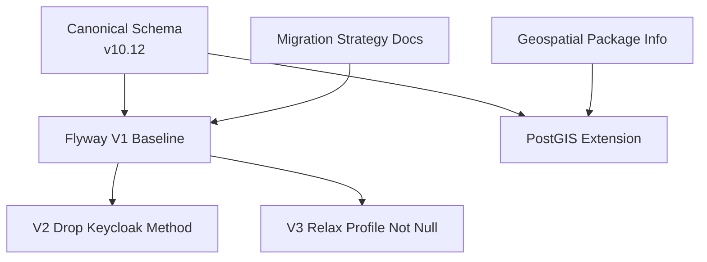

**Diagram sources**
- [Diasporum_PostgreSQL_Schema_v10_12.sql:1-58](file://Diasporum_v10.12/Diasporum_PostgreSQL_Schema_v10_12.sql#L1-L58)
- [V1__baseline_v10_12.sql:1-60](file://diasporum-backend/src/main/resources/db/migration/V1__baseline_v10_12.sql#L1-L60)
- [V2__drop_keycloak_authentication_method.sql:1-13](file://diasporum-backend/src/main/resources/db/migration/V2__drop_keycloak_authentication_method.sql#L1-L13)
- [V3__relax_profile_not_null_for_onboarding.sql:1-14](file://diasporum-backend/src/main/resources/db/migration/V3__relax_profile_not_null_for_onboarding.sql#L1-L14)
- [README.md:1-16](file://diasporum-backend/src/main/resources/db/migration/README.md#L1-L16)
- [package-info.java:1-4](file://diasporum-backend/src/main/java/com/diasporum/backend/platform/geospatial/package-info.java#L1-L4)

**Section sources**
- [Diasporum_PostgreSQL_Schema_v10_12.sql:1-58](file://Diasporum_v10.12/Diasporum_PostgreSQL_Schema_v10_12.sql#L1-L58)
- [V1__baseline_v10_12.sql:1-60](file://diasporum-backend/src/main/resources/db/migration/V1__baseline_v10_12.sql#L1-L60)
- [README.md:1-16](file://diasporum-backend/src/main/resources/db/migration/README.md#L1-L16)
- [DIASPORUM_IDENTITY_PERSISTENCE_DESIGN.md:1-14](file://DIASPORUM_IDENTITY_PERSISTENCE_DESIGN.md#L1-L14)

## Core Components
At a high level, the schema models:
- Identity and accounts: countries, users, profiles, credentials, sessions, refresh tokens, email verification and password reset tokens, external identities, and platform roles.
- Communities and memberships: community definitions, membership roles/status, user settings, privacy settings, policy documents and acceptances.
- Content and social graph: feed posts, comments, reactions, saves, shares, polls, featured items, interests, languages, follows, blocks, mutes.
- Messaging: general chat rooms/messages, direct conversations/messages, message requests, read cursors, mentions, and media attachments.
- Voice rooms: persistent room definitions, live sessions, participants, seats, speaker requests, invites, moderation actions, and ephemeral room messages.
- Business directory: categories, listings, locations, hours, media, reviews, and business account workspaces with member roles and audit events.
- Events and jobs: event categories/events with optional voice-room linkage, job categories/listings/applications/media/saves.
- Spare Bag marketplace: airports, parcel categories, sender/passenger listings, contact requests, and category/media associations.
- Matchmaking: gender/religion reference tables, profiles, preferences, swipes/history, matches, and eligibility/discovery functions.
- Notifications and operations: notifications, device tokens, delivery tracking, reports, moderation actions, audit logs, feature flags, access rules, app settings, idempotency keys, outbox events, media processing jobs, analytics events.

Key relationships include:
- Users own profiles, credentials, sessions, tokens, and content.
- Profiles link to countries, current address, and optional matchmaking location.
- Communities contain members, feed posts, chat rooms, voice rooms, and scoped listings.
- Feed posts connect to categories, media, comments, reactions, saves, shares, and polls.
- Direct conversations connect two participant identities (user or business account) and carry durable messages.
- Voice rooms define persistent topics; sessions represent live instances with capacity controls.
- Business listings use shared addresses and can be owned by users or business accounts.
- Jobs and events reference country taxonomies and may reference addresses or voice rooms.
- Matchmaking uses profiles, preferences, swipes, and matches, with strong age and privacy checks.

**Section sources**
- [Diasporum_PostgreSQL_Schema_v10_12.sql:107-155](file://Diasporum_v10.12/Diasporum_PostgreSQL_Schema_v10_12.sql#L107-L155)
- [Diasporum_PostgreSQL_Schema_v10_12.sql:369-437](file://Diasporum_v10.12/Diasporum_PostgreSQL_Schema_v10_12.sql#L369-L437)
- [Diasporum_PostgreSQL_Schema_v10_12.sql:734-870](file://Diasporum_v10.12/Diasporum_PostgreSQL_Schema_v10_12.sql#L734-L870)
- [Diasporum_PostgreSQL_Schema_v10_12.sql:973-1307](file://Diasporum_v10.12/Diasporum_PostgreSQL_Schema_v10_12.sql#L973-L1307)
- [Diasporum_PostgreSQL_Schema_v10_12.sql:1323-1855](file://Diasporum_v10.12/Diasporum_PostgreSQL_Schema_v10_12.sql#L1323-L1855)
- [Diasporum_PostgreSQL_Schema_v10_12.sql:1858-2137](file://Diasporum_v10.12/Diasporum_PostgreSQL_Schema_v10_12.sql#L1858-L2137)
- [Diasporum_PostgreSQL_Schema_v10_12.sql:2142-2389](file://Diasporum_v10.12/Diasporum_PostgreSQL_Schema_v10_12.sql#L2142-L2389)
- [Diasporum_PostgreSQL_Schema_v10_12.sql:2415-2857](file://Diasporum_v10.12/Diasporum_PostgreSQL_Schema_v10_12.sql#L2415-L2857)
- [Diasporum_PostgreSQL_Schema_v10_12.sql:2862-3155](file://Diasporum_v10.12/Diasporum_PostgreSQL_Schema_v10_12.sql#L2862-L3155)

## Architecture Overview
The database architecture centers on PostgreSQL with PostGIS. The application owns accounts and sessions; external OIDC providers are linked identities rather than session authorities. Shared structured addresses provide both exact geography and approximate discovery geography. Feature modules consume these primitives while enforcing their own authorization and privacy rules.

```mermaid
graph TB
subgraph "Identity"
Users["users"]
Profiles["profiles"]
Credentials["user_credentials"]
Sessions["user_sessions"]
RefreshTokens["user_refresh_tokens"]
ExternalIdentities["external_identities"]
Roles["global_user_roles"]
end
subgraph "Communities"
Countries["countries"]
Communities["communities"]
Memberships["community_memberships"]
Settings["user_settings"]
Privacy["user_privacy_settings"]
end
subgraph "Content"
FeedPosts["feed_posts"]
Comments["feed_post_comments"]
Reactions["feed_post_reactions"]
Polls["feed_polls / options / votes"]
Featured["featured_items"]
end
subgraph "Messaging"
ChatRooms["chat_rooms"]
ChatMessages["chat_messages"]
DMConversations["direct_conversations"]
DMMessages["direct_messages"]
MessageRequests["message_requests"]
end
subgraph "Voice"
VoiceRooms["voice_rooms"]
VoiceSessions["voice_room_sessions"]
VoiceParticipants["voice_room_participants"]
Seats["voice_room_seats"]
SpeakerRequests["voice_room_speaker_requests"]
end
subgraph "Business"
BusinessListings["business_listings"]
BusinessLocations["business_locations"]
BusinessReviews["business_reviews"]
BusinessAccounts["business_accounts"]
end
subgraph "Marketplaces"
Events["events"]
Jobs["job_listings"]
SpareBag["spare_bag_listings"]
Airports["airports"]
end
subgraph "Matchmaking"
MatchProfiles["matchmaking_profiles"]
MatchPrefs["matchmaking_preferences"]
Swipes["matchmaking_swipes"]
Matches["matchmaking_matches"]
end
subgraph "Operations"
Addresses["addresses"]
Media["media_objects"]
Notifications["notifications"]
Deliveries["notification_deliveries"]
Audit["audit_logs"]
Outbox["outbox_events"]
end
Users --> Profiles
Profiles --> Countries
Profiles --> Addresses
Users --> Credentials
Users --> Sessions
Sessions --> RefreshTokens
Users --> ExternalIdentities
Users --> Roles
Countries --> Communities
Communities --> Memberships
Users --> Memberships
Users --> Settings
Users --> Privacy
Countries --> FeedPosts
Communities --> FeedPosts
Users --> FeedPosts
FeedPosts --> Comments
FeedPosts --> Reactions
FeedPosts --> Polls
FeedPosts --> Featured
Communities --> ChatRooms
ChatRooms --> ChatMessages
Users --> DMConversations
DMConversations --> DMMessages
DMConversations --> MessageRequests
Countries --> VoiceRooms
Communities --> VoiceRooms
VoiceRooms --> VoiceSessions
VoiceSessions --> VoiceParticipants
VoiceSessions --> Seats
VoiceSessions --> SpeakerRequests
Countries --> BusinessListings
BusinessListings --> BusinessLocations
BusinessListings --> BusinessReviews
BusinessAccounts --> BusinessListings
Countries --> Events
Countries --> Jobs
Airports --> SpareBag
Users --> MatchProfiles
MatchProfiles --> MatchPrefs
MatchProfiles --> Swipes
Swipes --> Matches
Addresses --> BusinessLocations
Media --> FeedPosts
Media --> ChatMessages
Media --> DMMessages
Media --> BusinessListings
Media --> Events
Media --> Jobs
Media --> SpareBag
Notifications --> Deliveries
Notifications --> Outbox
Audit --> Moderation["moderation_actions"]
```

**Diagram sources**
- [Diasporum_PostgreSQL_Schema_v10_12.sql:107-155](file://Diasporum_v10.12/Diasporum_PostgreSQL_Schema_v10_12.sql#L107-L155)
- [Diasporum_PostgreSQL_Schema_v10_12.sql:369-437](file://Diasporum_v10.12/Diasporum_PostgreSQL_Schema_v10_12.sql#L369-L437)
- [Diasporum_PostgreSQL_Schema_v10_12.sql:734-870](file://Diasporum_v10.12/Diasporum_PostgreSQL_Schema_v10_12.sql#L734-L870)
- [Diasporum_PostgreSQL_Schema_v10_12.sql:973-1307](file://Diasporum_v10.12/Diasporum_PostgreSQL_Schema_v10_12.sql#L973-L1307)
- [Diasporum_PostgreSQL_Schema_v10_12.sql:1323-1855](file://Diasporum_v10.12/Diasporum_PostgreSQL_Schema_v10_12.sql#L1323-L1855)
- [Diasporum_PostgreSQL_Schema_v10_12.sql:1858-2137](file://Diasporum_v10.12/Diasporum_PostgreSQL_Schema_v10_12.sql#L1858-L2137)
- [Diasporum_PostgreSQL_Schema_v10_12.sql:2142-2389](file://Diasporum_v10.12/Diasporum_PostgreSQL_Schema_v10_12.sql#L2142-L2389)
- [Diasporum_PostgreSQL_Schema_v10_12.sql:2415-2857](file://Diasporum_v10.12/Diasporum_PostgreSQL_Schema_v10_12.sql#L2415-L2857)
- [Diasporum_PostgreSQL_Schema_v10_12.sql:2862-3155](file://Diasporum_v10.12/Diasporum_PostgreSQL_Schema_v10_12.sql#L2862-L3155)

## Detailed Component Analysis

### Identity, Authentication, and Profiles
Users represent Diasporum accounts with normalized email, status, and soft delete. Profiles extend accounts with display name, origin/current country, city, date of birth, trust score, and completion timestamp. Local password credentials are optional; Google/Apple-only accounts have no credential row. Sessions track client type, authentication method, device metadata, IP, user agent, expiry, and revocation. Refresh tokens store SHA-256 digests with family rotation and consumption tracking. Email verification and password reset tokens are hashed, time-bound, and auditable. External identities map issuer and subject to a Diasporum user. Platform roles support global, country, and community scope.

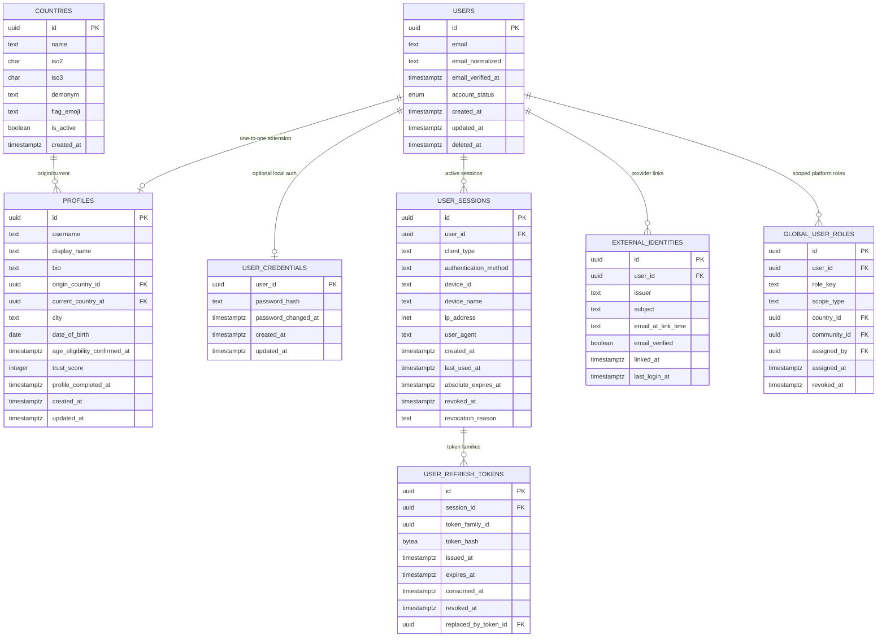

**Diagram sources**
- [Diasporum_PostgreSQL_Schema_v10_12.sql:107-155](file://Diasporum_v10.12/Diasporum_PostgreSQL_Schema_v10_12.sql#L107-L155)
- [Diasporum_PostgreSQL_Schema_v10_12.sql:157-243](file://Diasporum_v10.12/Diasporum_PostgreSQL_Schema_v10_12.sql#L157-L243)
- [Diasporum_PostgreSQL_Schema_v10_12.sql:339-366](file://Diasporum_v10.12/Diasporum_PostgreSQL_Schema_v10_12.sql#L339-L366)
- [Diasporum_PostgreSQL_Schema_v10_12.sql:470-499](file://Diasporum_v10.12/Diasporum_PostgreSQL_Schema_v10_12.sql#L470-L499)

**Section sources**
- [Diasporum_PostgreSQL_Schema_v10_12.sql:107-155](file://Diasporum_v10.12/Diasporum_PostgreSQL_Schema_v10_12.sql#L107-L155)
- [Diasporum_PostgreSQL_Schema_v10_12.sql:157-243](file://Diasporum_v10.12/Diasporum_PostgreSQL_Schema_v10_12.sql#L157-L243)
- [Diasporum_PostgreSQL_Schema_v10_12.sql:339-366](file://Diasporum_v10.12/Diasporum_PostgreSQL_Schema_v10_12.sql#L339-L366)
- [Diasporum_PostgreSQL_Schema_v10_12.sql:470-499](file://Diasporum_v10.12/Diasporum_PostgreSQL_Schema_v10_12.sql#L470-L499)

### Communities, Memberships, and Policy
Communities are tied to origin and destination countries. Membership enforces that a user’s origin country matches an active community’s destination country. User settings and privacy settings are bootstrapped per profile. Policy documents and acceptances record versioned terms acceptance with source and timestamps.

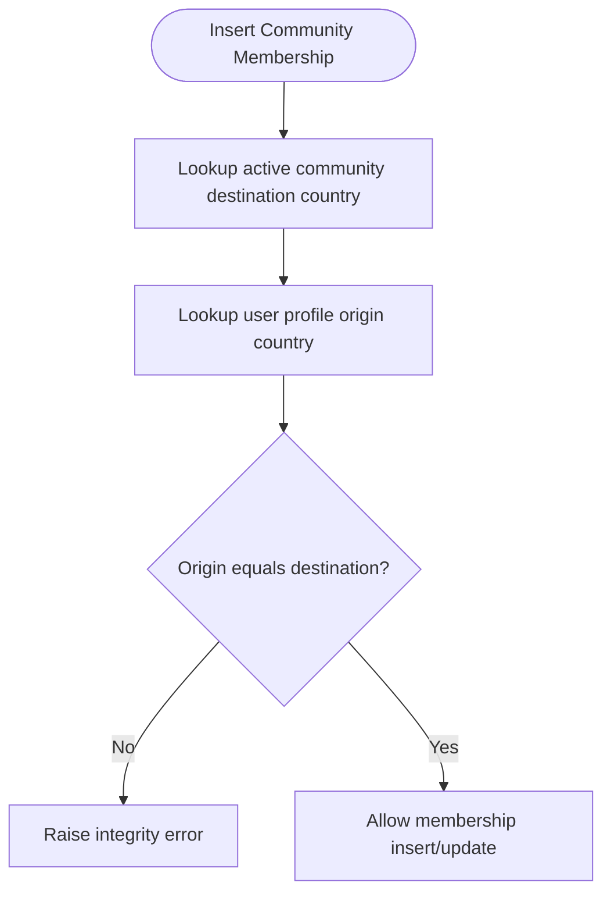

**Diagram sources**
- [Diasporum_PostgreSQL_Schema_v10_12.sql:399-413](file://Diasporum_v10.12/Diasporum_PostgreSQL_Schema_v10_12.sql#L399-L413)

**Section sources**
- [Diasporum_PostgreSQL_Schema_v10_12.sql:369-437](file://Diasporum_v10.12/Diasporum_PostgreSQL_Schema_v10_12.sql#L369-L437)
- [Diasporum_PostgreSQL_Schema_v10_12.sql:501-529](file://Diasporum_v10.12/Diasporum_PostgreSQL_Schema_v10_12.sql#L501-L529)

### Social Graph, Blocks, and Mutes
Follows are directional edges with triggers preventing self-follows, blocked interactions, inactive accounts, and recipient disallowance. Mutual connections are derived from reciprocal follows. Blocks remove follows, close pending message requests, close direct conversations, block matchmaking matches, and remove swipes. Mutes enforce scope-based restrictions for posting, chat, direct messages, voice, or all scopes, with moderator/admin authority checks.

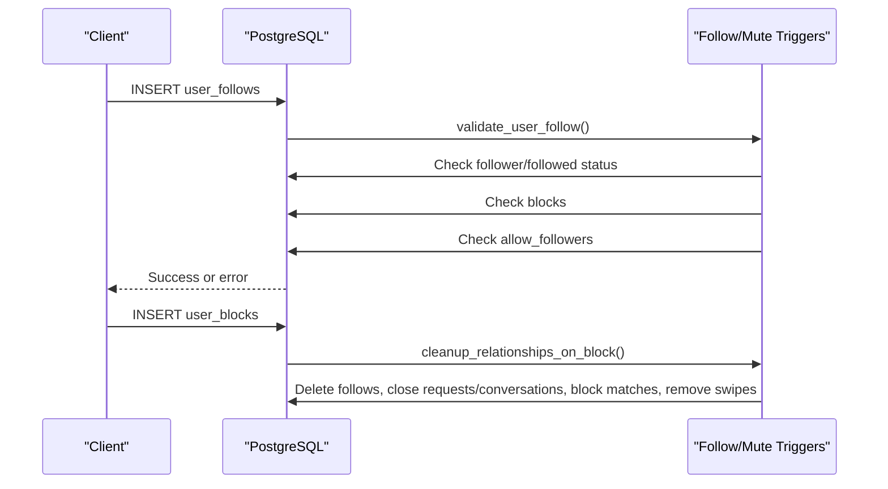

**Diagram sources**
- [Diasporum_PostgreSQL_Schema_v10_12.sql:594-638](file://Diasporum_v10.12/Diasporum_PostgreSQL_Schema_v10_12.sql#L594-L638)
- [Diasporum_PostgreSQL_Schema_v10_12.sql:640-696](file://Diasporum_v10.12/Diasporum_PostgreSQL_Schema_v10_12.sql#L640-L696)
- [Diasporum_PostgreSQL_Schema_v10_12.sql:2998-3027](file://Diasporum_v10.12/Diasporum_PostgreSQL_Schema_v10_12.sql#L2998-L3027)

**Section sources**
- [Diasporum_PostgreSQL_Schema_v10_12.sql:594-696](file://Diasporum_v10.12/Diasporum_PostgreSQL_Schema_v10_12.sql#L594-L696)
- [Diasporum_PostgreSQL_Schema_v10_12.sql:2998-3027](file://Diasporum_v10.12/Diasporum_PostgreSQL_Schema_v10_12.sql#L2998-L3027)

### Feed Posts, Comments, Reactions, Polls, and Featured Items
Feed posts belong to a country and community, with visibility scope and post-type constraints. REEL posts reuse media and engagement structures. Community Help posts require lifecycle metadata. Comments support one reply level. Reactions and shares are tracked. Polls enforce option counts, voting policies, immutability after voting, and closed-state semantics. Featured items use typed polymorphic references and backend-controlled placement rules.

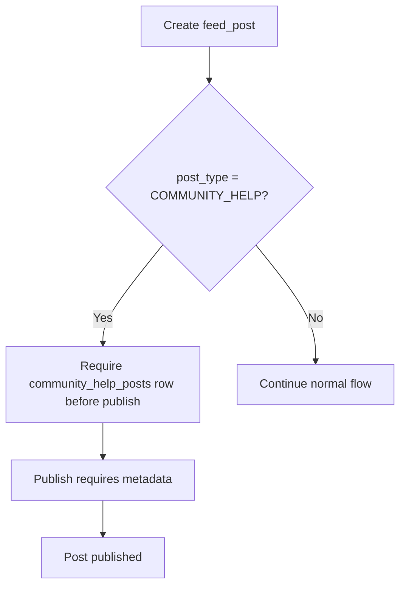

**Diagram sources**
- [Diasporum_PostgreSQL_Schema_v10_12.sql:734-800](file://Diasporum_v10.12/Diasporum_PostgreSQL_Schema_v10_12.sql#L734-L800)
- [Diasporum_PostgreSQL_Schema_v10_12.sql:803-870](file://Diasporum_v10.12/Diasporum_PostgreSQL_Schema_v10_12.sql#L803-L870)
- [Diasporum_PostgreSQL_Schema_v10_12.sql:3200-3226](file://Diasporum_v10.12/Diasporum_PostgreSQL_Schema_v10_12.sql#L3200-L3226)
- [Diasporum_PostgreSQL_Schema_v10_12.sql:889-947](file://Diasporum_v10.12/Diasporum_PostgreSQL_Schema_v10_12.sql#L889-L947)

**Section sources**
- [Diasporum_PostgreSQL_Schema_v10_12.sql:734-870](file://Diasporum_v10.12/Diasporum_PostgreSQL_Schema_v10_12.sql#L734-L870)
- [Diasporum_PostgreSQL_Schema_v10_12.sql:3200-3226](file://Diasporum_v10.12/Diasporum_PostgreSQL_Schema_v10_12.sql#L3200-L3226)
- [Diasporum_PostgreSQL_Schema_v10_12.sql:889-947](file://Diasporum_v10.12/Diasporum_PostgreSQL_Schema_v10_12.sql#L889-L947)

### Chat and Direct Messaging
General chat rooms enforce one General room per community. Messages are sequence-numbered atomically against the parent room. Read cursors are monotonic and bounded by the last-assigned sequence. Direct conversations support person-to-person or business-context conversations, with strict participant validation, immutable pair/context, and initial-message-per-request rules. Inbox activity previews are refreshed from durable messages.

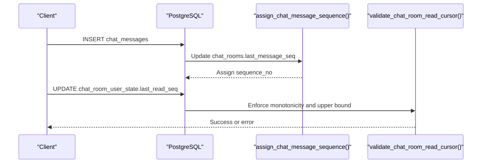

**Diagram sources**
- [Diasporum_PostgreSQL_Schema_v10_12.sql:973-1005](file://Diasporum_v10.12/Diasporum_PostgreSQL_Schema_v10_12.sql#L973-L1005)
- [Diasporum_PostgreSQL_Schema_v10_12.sql:1028-1038](file://Diasporum_v10.12/Diasporum_PostgreSQL_Schema_v10_12.sql#L1028-L1038)
- [Diasporum_PostgreSQL_Schema_v10_12.sql:3844-3855](file://Diasporum_v10.12/Diasporum_PostgreSQL_Schema_v10_12.sql#L3844-L3855)
- [Diasporum_PostgreSQL_Schema_v10_12.sql:3926-3949](file://Diasporum_v10.12/Diasporum_PostgreSQL_Schema_v10_12.sql#L3926-L3949)

**Section sources**
- [Diasporum_PostgreSQL_Schema_v10_12.sql:973-1307](file://Diasporum_v10.12/Diasporum_PostgreSQL_Schema_v10_12.sql#L973-L1307)
- [Diasporum_PostgreSQL_Schema_v10_12.sql:3844-3949](file://Diasporum_v10.12/Diasporum_PostgreSQL_Schema_v10_12.sql#L3844-L3949)

### Voice Rooms, Sessions, Participants, and Seats
Persistent voice rooms define discoverable topics with owner, visibility, capacity, and inactivity timeout. Live sessions attach to a persistent room and track provider, host, grace periods, and lifecycle timestamps. Participants join as listeners and are promoted through controlled workflows; hosts count toward speaker limits. Fixed stage seats are seeded per session and assigned atomically. Speaker requests require active session and host/moderator approval. Ownership and host transfer are transactional and audited.

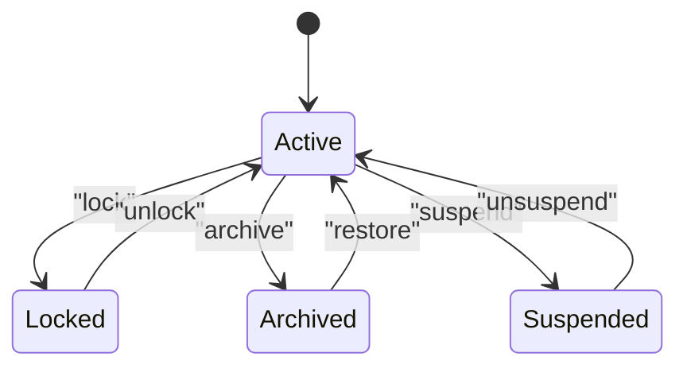

**Diagram sources**
- [Diasporum_PostgreSQL_Schema_v10_12.sql:1323-1365](file://Diasporum_v10.12/Diasporum_PostgreSQL_Schema_v10_12.sql#L1323-L1365)
- [Diasporum_PostgreSQL_Schema_v10_12.sql:1381-1416](file://Diasporum_v10.12/Diasporum_PostgreSQL_Schema_v10_12.sql#L1381-L1416)
- [Diasporum_PostgreSQL_Schema_v10_12.sql:1418-1509](file://Diasporum_v10.12/Diasporum_PostgreSQL_Schema_v10_12.sql#L1418-L1509)
- [Diasporum_PostgreSQL_Schema_v10_12.sql:1511-1709](file://Diasporum_v10.12/Diasporum_PostgreSQL_Schema_v10_12.sql#L1511-L1709)
- [Diasporum_PostgreSQL_Schema_v10_12.sql:1711-1802](file://Diasporum_v10.12/Diasporum_PostgreSQL_Schema_v10_12.sql#L1711-L1802)
- [Diasporum_PostgreSQL_Schema_v10_12.sql:1830-1844](file://Diasporum_v10.12/Diasporum_PostgreSQL_Schema_v10_12.sql#L1830-L1844)

**Section sources**
- [Diasporum_PostgreSQL_Schema_v10_12.sql:1323-1855](file://Diasporum_v10.12/Diasporum_PostgreSQL_Schema_v10_12.sql#L1323-L1855)

### Business Directory and Workspaces
Business categories are separate from country topic categories. Listings store descriptive fields, verification status, ratings, and media. Locations reference shared addresses with public visibility enforcement. Reviews prevent self-rating and maintain summary aggregates. Business accounts are workspaces with fixed roles, invitation lifecycle, owner guarantees, and audit events. Conversations can involve business accounts as participants.

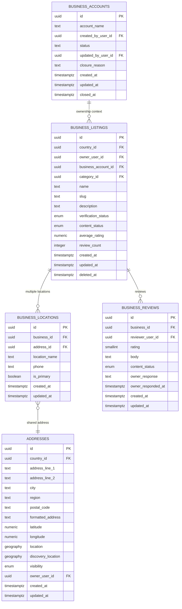

**Diagram sources**
- [Diasporum_PostgreSQL_Schema_v10_12.sql:1858-1945](file://Diasporum_v10.12/Diasporum_PostgreSQL_Schema_v10_12.sql#L1858-L1945)
- [Diasporum_PostgreSQL_Schema_v10_12.sql:4195-4488](file://Diasporum_v10.12/Diasporum_PostgreSQL_Schema_v10_12.sql#L4195-L4488)
- [Diasporum_PostgreSQL_Schema_v10_12.sql:270-324](file://Diasporum_v10.12/Diasporum_PostgreSQL_Schema_v10_12.sql#L270-L324)

**Section sources**
- [Diasporum_PostgreSQL_Schema_v10_12.sql:1858-1945](file://Diasporum_v10.12/Diasporum_PostgreSQL_Schema_v10_12.sql#L1858-L1945)
- [Diasporum_PostgreSQL_Schema_v10.12/Diasporum_PostgreSQL_Schema_v10_12.sql:4195-4488](file://Diasporum_v10.12/Diasporum_PostgreSQL_Schema_v10_12.sql#L4195-L4488)

### Events and Jobs
Events support in-person, online voice, and online external modes, with optional linkage to a persistent voice room. Job listings support multiple sources, internal/external application methods, salary ranges, workplace addresses, and primary categories. Both domains enforce taxonomy validity and country-scoped categories.

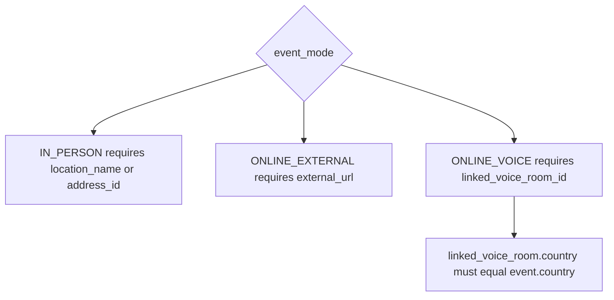

**Diagram sources**
- [Diasporum_PostgreSQL_Schema_v10_12.sql:1965-1992](file://Diasporum_v10.12/Diasporum_PostgreSQL_Schema_v10_12.sql#L1965-L1992)
- [Diasporum_PostgreSQL_Schema_v10_12.sql:3599-3613](file://Diasporum_v10.12/Diasporum_PostgreSQL_Schema_v10_12.sql#L3599-L3613)

**Section sources**
- [Diasporum_PostgreSQL_Schema_v10_12.sql:1949-2137](file://Diasporum_v10.12/Diasporum_PostgreSQL_Schema_v10_12.sql#L1949-L2137)
- [Diasporum_PostgreSQL_Schema_v10_12.sql:3297-3390](file://Diasporum_v10.12/Diasporum_PostgreSQL_Schema_v10_12.sql#L3297-L3390)

### Spare Bag Marketplace
Spare Bag supports sender requests and passenger offers between airports. Listings validate route compatibility, travel dates, pricing units, and visibility scope. Contact requests pair a sender listing with a passenger offer, enforce different owners, overlapping dates, and appropriate conversation linkage. Private collection/handover addresses must be non-public, owned by the listing owner, and located in the correct airport country.

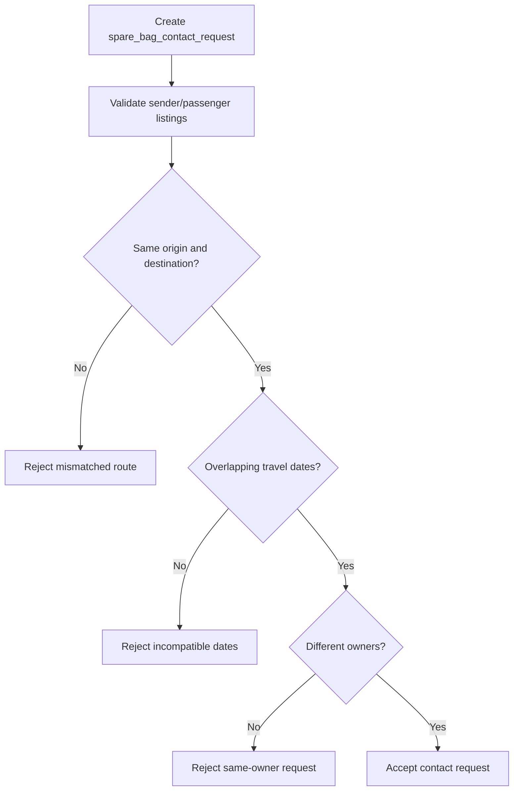

**Diagram sources**
- [Diasporum_PostgreSQL_Schema_v10_12.sql:2142-2226](file://Diasporum_v10.12/Diasporum_PostgreSQL_Schema_v10_12.sql#L2142-L2226)
- [Diasporum_PostgreSQL_Schema_v10_12.sql:2290-2389](file://Diasporum_v10.12/Diasporum_PostgreSQL_Schema_v10_12.sql#L2290-L2389)
- [Diasporum_PostgreSQL_Schema_v10_12.sql:3406-3429](file://Diasporum_v10.12/Diasporum_PostgreSQL_Schema_v10_12.sql#L3406-L3429)

**Section sources**
- [Diasporum_PostgreSQL_Schema_v10_12.sql:2142-2389](file://Diasporum_v10.12/Diasporum_PostgreSQL_Schema_v10_12.sql#L2142-L2389)
- [Diasporum_PostgreSQL_Schema_v10_12.sql:3406-3429](file://Diasporum_v10.12/Diasporum_PostgreSQL_Schema_v10_12.sql#L3406-L3429)

### Matchmaking
Matchmaking profiles store personal attributes, photo visibility, verification status, and status. Preferences constrain age range, distance, children preferences, religion, and language. Swipes are unique and immutable; history records reversals. Mutual LIKEs create matches and open direct conversations. Eligibility requires adult age, confirmation, active profile, and discovery permission. Distance calculations use PostGIS geography.

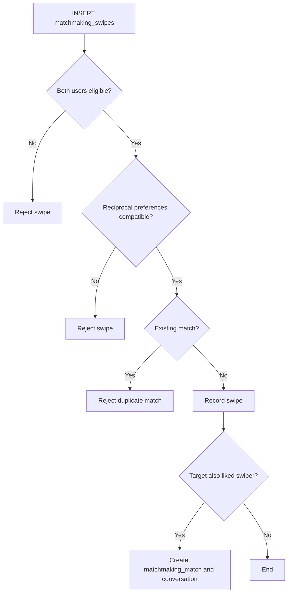

**Diagram sources**
- [Diasporum_PostgreSQL_Schema_v10_12.sql:2415-2483](file://Diasporum_v10.12/Diasporum_PostgreSQL_Schema_v10_12.sql#L2415-L2483)
- [Diasporum_PostgreSQL_Schema_v10_12.sql:2487-2518](file://Diasporum_v10.12/Diasporum_PostgreSQL_Schema_v10_12.sql#L2487-L2518)
- [Diasporum_PostgreSQL_Schema_v10_12.sql:2520-2556](file://Diasporum_v10.12/Diasporum_PostgreSQL_Schema_v10_12.sql#L2520-L2556)
- [Diasporum_PostgreSQL_Schema_v10_12.sql:2719-2817](file://Diasporum_v10.12/Diasporum_PostgreSQL_Schema_v10_12.sql#L2719-L2817)

**Section sources**
- [Diasporum_PostgreSQL_Schema_v10_12.sql:2415-2857](file://Diasporum_v10.12/Diasporum_PostgreSQL_Schema_v10_12.sql#L2415-L2857)

### Notifications, Reports, Moderation, and Audit
Notifications support in-app, push, and email preferences with durable delivery tracking and retry logic. Reports capture target types and reasons; moderation actions record enforcement outcomes. Audit logs capture actor, action, target, request metadata, and timestamps. Outbox events enqueue asynchronous work such as push notifications.

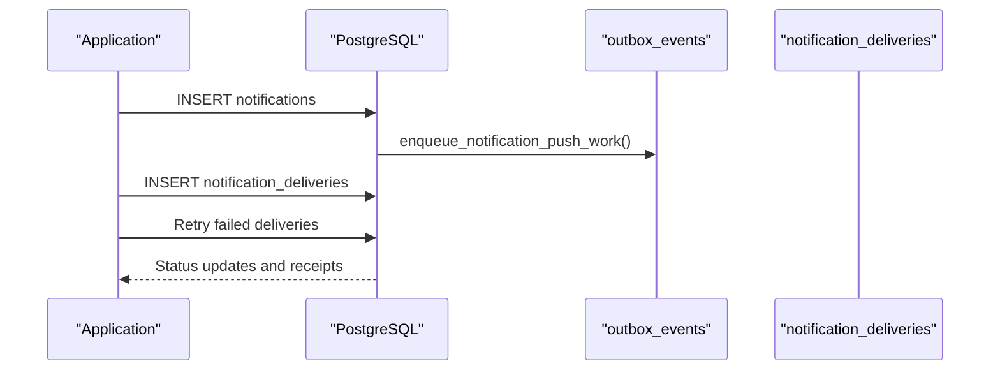

**Diagram sources**
- [Diasporum_PostgreSQL_Schema_v10_12.sql:2862-2929](file://Diasporum_v10.12/Diasporum_PostgreSQL_Schema_v10_12.sql#L2862-L2929)
- [Diasporum_PostgreSQL_Schema_v10_12.sql:2931-2995](file://Diasporum_v10.12/Diasporum_PostgreSQL_Schema_v10_12.sql#L2931-L2995)
- [Diasporum_PostgreSQL_Schema_v10_12.sql:3096-3125](file://Diasporum_v10.12/Diasporum_PostgreSQL_Schema_v10_12.sql#L3096-L3125)

**Section sources**
- [Diasporum_PostgreSQL_Schema_v10_12.sql:2862-3155](file://Diasporum_v10.12/Diasporum_PostgreSQL_Schema_v10_12.sql#L2862-L3155)

## Dependency Analysis
The schema exhibits clear layering:
- Foundational layers: countries, addresses, media_objects, taxonomies.
- Identity and governance: users, profiles, sessions, roles, policy documents.
- Community and content: communities, feed_posts, comments, reactions, polls.
- Communication: chat_rooms/messages, direct_conversations/messages, voice_rooms/sessions/participants/seats.
- Marketplaces: business_listings, events, job_listings, spare_bag_listings, airports.
- Matchmaking: profiles, preferences, swipes, matches.
- Operations: notifications, deliveries, reports, moderation, audit, outbox, analytics.

Coupling is primarily through foreign keys and trigger-enforced business rules. Cohesion is maintained by module-specific taxonomies and entity-specific lifecycle tables. Circular dependencies are avoided by separating persistent definitions from ephemeral session state and by using typed polymorphic references where appropriate.

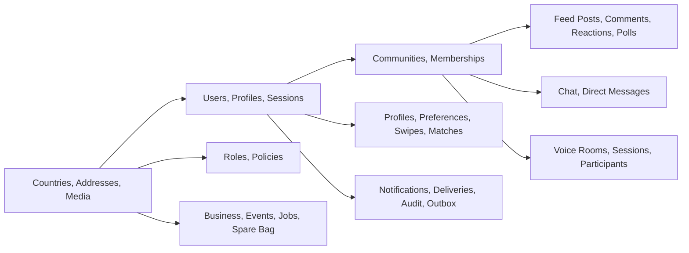

**Diagram sources**
- [Diasporum_PostgreSQL_Schema_v10_12.sql:107-155](file://Diasporum_v10.12/Diasporum_PostgreSQL_Schema_v10_12.sql#L107-L155)
- [Diasporum_PostgreSQL_Schema_v10_12.sql:369-437](file://Diasporum_v10.12/Diasporum_PostgreSQL_Schema_v10_12.sql#L369-L437)
- [Diasporum_PostgreSQL_Schema_v10_12.sql:734-870](file://Diasporum_v10.12/Diasporum_PostgreSQL_Schema_v10_12.sql#L734-L870)
- [Diasporum_PostgreSQL_Schema_v10_12.sql:973-1307](file://Diasporum_v10.12/Diasporum_PostgreSQL_Schema_v10_12.sql#L973-L1307)
- [Diasporum_PostgreSQL_Schema_v10_12.sql:1323-1855](file://Diasporum_v10.12/Diasporum_PostgreSQL_Schema_v10_12.sql#L1323-L1855)
- [Diasporum_PostgreSQL_Schema_v10_12.sql:1858-2389](file://Diasporum_v10.12/Diasporum_PostgreSQL_Schema_v10_12.sql#L1858-L2389)
- [Diasporum_PostgreSQL_Schema_v10_12.sql:2415-2857](file://Diasporum_v10.12/Diasporum_PostgreSQL_Schema_v10_12.sql#L2415-L2857)
- [Diasporum_PostgreSQL_Schema_v10_12.sql:2862-3155](file://Diasporum_v10.12/Diasporum_PostgreSQL_Schema_v10_12.sql#L2862-L3155)

**Section sources**
- [Diasporum_PostgreSQL_Schema_v10_12.sql:107-3155](file://Diasporum_v10.12/Diasporum_PostgreSQL_Schema_v10_12.sql#L107-L3155)

## Performance Considerations
Indexing strategy emphasizes:
- Unique indexes for normalized emails, usernames, and token digests.
- Partial indexes for active sessions, pending tokens, and unread/read cursor queries.
- GIN full-text search indexes on titles, descriptions, employer names, and searchable text.
- GIST spatial indexes on discovery_location and location for radius queries.
- Composite indexes for community/country feeds, recent activity, and status filtering.
- Monotonic sequence allocation for chat and direct messages to avoid contention.
- Denormalized counters for comments, reactions, and shares maintained by triggers.

Recommendations:
- Partition high-volume tables such as featured_item_impressions, analytics_events, and notification_deliveries based on retention and query patterns.
- Monitor GIST index size and performance for large address datasets.
- Use partial indexes judiciously to reduce write overhead.
- Keep JSONB columns small and indexed only when necessary.
- Avoid exposing exact coordinates or distances to clients; compute server-side for Nearby Reels and matchmaking.

[No sources needed since this section provides general guidance]

## Troubleshooting Guide
Common issues and resolutions:
- Account restriction revokes sessions and refresh tokens automatically; check account_status and deleted_at if authentication fails unexpectedly.
- Community membership requires matching origin/destination countries; verify profiles.origin_country_id and communities.destination_country_id.
- Chat messages fail if the sender is muted or banned; inspect user_mutes and chat room/community scope.
- Direct message sequence assignment fails if the conversation is not accepted or the initial message rule is violated; verify direct_conversations.status and message_request linkage.
- Read cursor errors occur if last_read_seq exceeds last_message_seq or moves backwards; ensure monotonic updates.
- Matchmaking swipes fail if users are ineligible, blocked, or incompatible; check age, privacy settings, blocks, and preference compatibility.
- Address privacy violations occur when linking private/public addresses to inappropriate contexts; verify addresses.visibility and ownership.
- Flyway migration conflicts arise if extensions or baseline assumptions differ; confirm PostGIS availability and migration strategy.

**Section sources**
- [Diasporum_PostgreSQL_Schema_v10_12.sql:245-265](file://Diasporum_v10.12/Diasporum_PostgreSQL_Schema_v10_12.sql#L245-L265)
- [Diasporum_PostgreSQL_Schema_v10_12.sql:399-413](file://Diasporum_v10.12/Diasporum_PostgreSQL_Schema_v10_12.sql#L399-L413)
- [Diasporum_PostgreSQL_Schema_v10_12.sql:1006-1025](file://Diasporum_v10.12/Diasporum_PostgreSQL_Schema_v10_12.sql#L1006-L1025)
- [Diasporum_PostgreSQL_Schema_v10_12.sql:3857-3885](file://Diasporum_v10.12/Diasporum_PostgreSQL_Schema_v10_12.sql#L3857-L3885)
- [Diasporum_PostgreSQL_Schema_v10_12.sql:3926-3974](file://Diasporum_v10.12/Diasporum_PostgreSQL_Schema_v10_12.sql#L3926-L3974)
- [Diasporum_PostgreSQL_Schema_v10_12.sql:2719-2817](file://Diasporum_v10.12/Diasporum_PostgreSQL_Schema_v10_12.sql#L2719-L2817)
- [Diasporum_PostgreSQL_Schema_v10_12.sql:3406-3429](file://Diasporum_v10.12/Diasporum_PostgreSQL_Schema_v10_12.sql#L3406-L3429)
- [DIASPORUM_DATABASE_VALIDATION_REPORT.md:108-120](file://DIASPORUM_DATABASE_VALIDATION_REPORT.md#L108-L120)

## Conclusion
The DIASPORUM v10.12 database schema provides a robust, modular foundation for identity, communities, content, messaging, voice, marketplaces, and matchmaking. It enforces strong referential integrity, privacy-aware geospatial handling, and operational durability through triggers, sequences, and outbox events. Flyway manages evolution via a clean-install baseline and forward-only migrations. Production readiness depends on validating PostGIS availability, applying migrations consistently, and ensuring API-level authorization complements database constraints.

[No sources needed since this section summarizes without analyzing specific files]

## Appendices

### Migration Strategy and Version Control
- Canonical schema: `Diasporum_PostgreSQL_Schema_v10_12.sql`.
- Baseline migration: `V1__baseline_v10_12.sql` applies the schema body under Flyway control.
- Follow-up migrations:
  - `V2__drop_keycloak_authentication_method.sql` removes obsolete KEYCLOAK authentication method.
  - `V3__relax_profile_not_null_for_onboarding.sql` allows progressive profile completion during onboarding.
- Migration README documents the approved strategy: do not add migrations until the baseline has been validated against a disposable PostgreSQL/PostGIS instance and the baseline strategy is approved.
- Validation report recommends `V1__baseline.sql` produced from the canonical schema, with Flyway wrapping each migration in its own transaction.

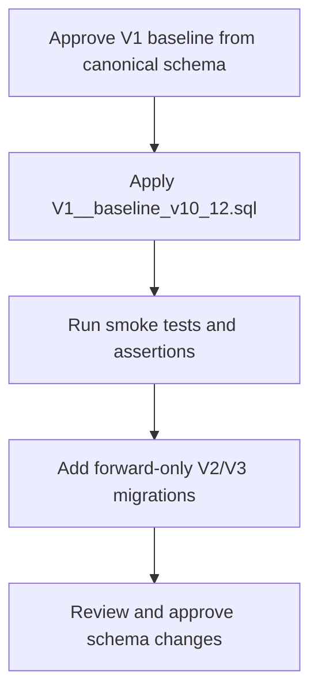

**Diagram sources**
- [README.md:1-16](file://diasporum-backend/src/main/resources/db/migration/README.md#L1-L16)
- [DIASPORUM_DATABASE_VALIDATION_REPORT.md:108-120](file://DIASPORUM_DATABASE_VALIDATION_REPORT.md#L108-L120)
- [V2__drop_keycloak_authentication_method.sql:1-13](file://diasporum-backend/src/main/resources/db/migration/V2__drop_keycloak_authentication_method.sql#L1-L13)
- [V3__relax_profile_not_null_for_onboarding.sql:1-14](file://diasporum-backend/src/main/resources/db/migration/V3__relax_profile_not_null_for_onboarding.sql#L1-L14)

**Section sources**
- [README.md:1-16](file://diasporum-backend/src/main/resources/db/migration/README.md#L1-L16)
- [DIASPORUM_DATABASE_VALIDATION_REPORT.md:108-120](file://DIASPORUM_DATABASE_VALIDATION_REPORT.md#L108-L120)
- [DIASPORUM_IDENTITY_PERSISTENCE_DESIGN.md:1-14](file://DIASPORUM_IDENTITY_PERSISTENCE_DESIGN.md#L1-L14)

### Geospatial Data Model Notes
- PostGIS is required for shared address geography, opt-in people discovery, matchmaking distances, and Nearby Reels ranking.
- Exact coordinates derive from validated latitude/longitude columns; discovery_location is separate and approximate.
- Functions calculate distances in kilometers using geography types.
- Backend geospatial primitives are documented separately and rely on PostGIS configuration.

**Section sources**
- [Diasporum_PostgreSQL_Schema_v10_12.sql:270-337](file://Diasporum_v10.12/Diasporum_PostgreSQL_Schema_v10_12.sql#L270-L337)
- [Diasporum_PostgreSQL_Schema_v10_12.sql:2558-2572](file://Diasporum_v10.12/Diasporum_PostgreSQL_Schema_v10_12.sql#L2558-L2572)
- [package-info.java:1-4](file://diasporum-backend/src/main/java/com/diasporum/backend/platform/geospatial/package-info.java#L1-L4)