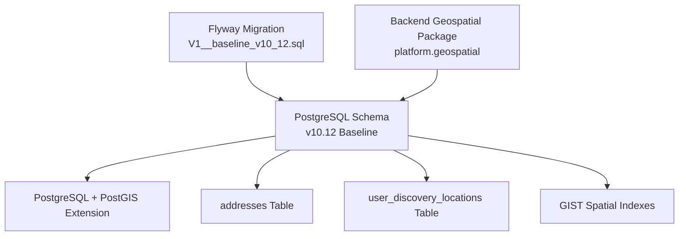
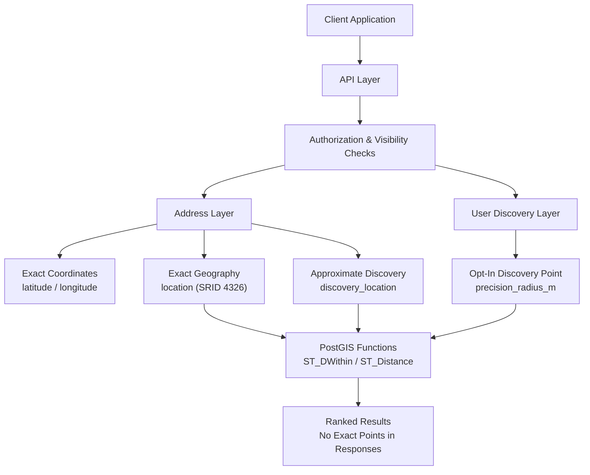
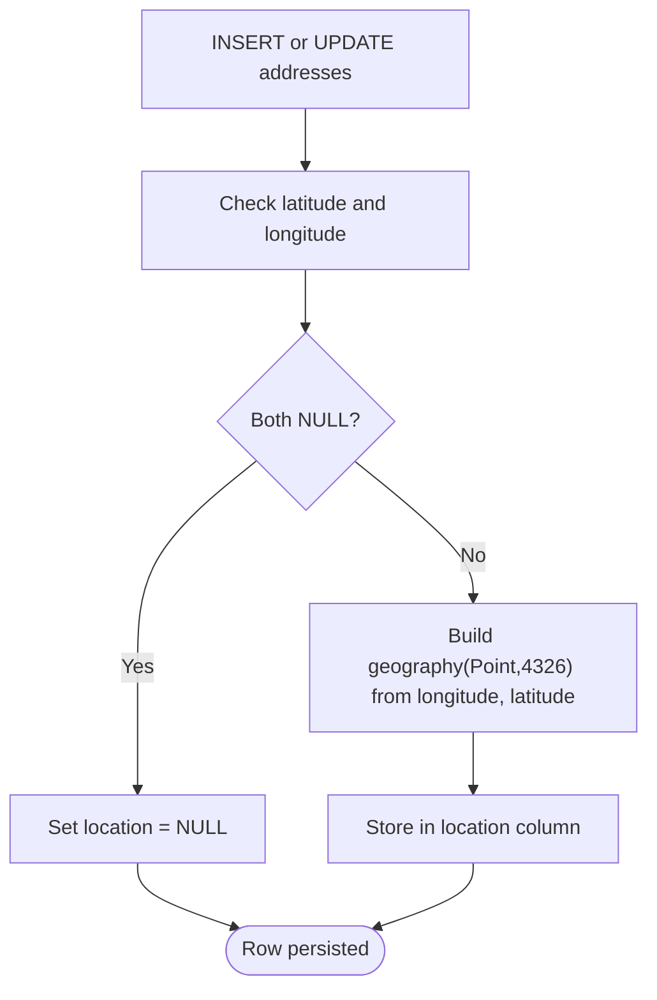
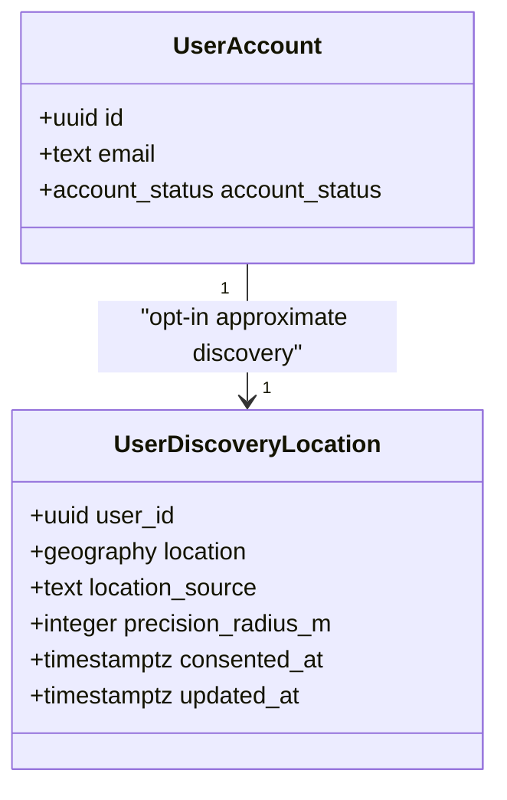
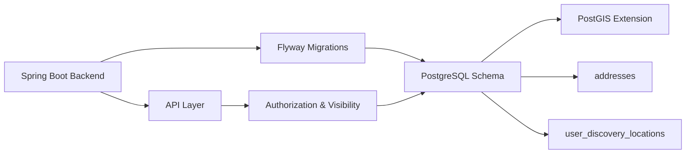

# Geospatial Data Model

<cite>
**Referenced Files in This Document**   
- [Diasporum_PostgreSQL_Schema_v10_12.sql](file://Diasporum_v10.12/Diasporum_PostgreSQL_Schema_v10_12.sql)
- [Diasporum_v10_12_strict_clean_install.sql](file://Diasporum_v10.12/Diasporum_v10_12_strict_clean_install.sql)
- [V1__baseline_v10_12.sql](file://diasporum-backend/src/main/resources/db/migration/V1__baseline_v10_12.sql)
- [package-info.java](file://diasporum-backend/src/main/java/com/diasporum/backend/platform/geospatial/package-info.java)
</cite>

## Table of Contents
1. [Introduction](#introduction)
2. [Project Structure](#project-structure)
3. [Core Components](#core-components)
4. [Architecture Overview](#architecture-overview)
5. [Detailed Component Analysis](#detailed-component-analysis)
6. [Dependency Analysis](#dependency-analysis)
7. [Performance Considerations](#performance-considerations)
8. [Troubleshooting Guide](#troubleshooting-guide)
9. [Conclusion](#conclusion)

## Introduction
This document explains the PostgreSQL PostGIS geospatial data model used by DIASPORUM for location-aware features. It focuses on:

- The `addresses` table, which stores both exact coordinates and derived PostGIS geography points.
- The separation between private exact location data and approximate public discovery locations.
- The opt-in `user_discovery_locations` table for people discovery with precision radius controls.
- GIST spatial indexes that enable proximity searches, distance calculations, and efficient geospatial filtering.
- Privacy and security boundaries around exact versus approximate location exposure.
- Example PostGIS query patterns for nearby-entity discovery, distance calculation, and geospatial filtering.

The schema is defined in the v10.12 baseline and migration files, and the backend includes a dedicated geospatial package marker indicating reusable geospatial primitives are owned by feature modules rather than centralized application logic.

## Project Structure
The geospatial model lives primarily in the PostgreSQL schema definitions:

- The clean-install baseline defines the schema, including PostGIS extension setup, address tables, user discovery locations, and spatial indexes.
- The Flyway migration file mirrors the same structure as part of the backend’s database versioning.
- The backend Java package for geospatial primitives documents that feature modules own their spatial repositories and privacy filters.

**Diagram sources**
- [Diasporum_PostgreSQL_Schema_v10_12.sql:1-58](file://Diasporum_v10.12/Diasporum_PostgreSQL_Schema_v10_12.sql#L1-L58)
- [V1__baseline_v10_12.sql:326-342](file://diasporum-backend/src/main/resources/db/migration/V1__baseline_v10_12.sql#L326-L342)
- [package-info.java:1-4](file://diasporum-backend/src/main/java/com/diasporum/backend/platform/geospatial/package-info.java#L1-L4)

**Section sources**
- [Diasporum_PostgreSQL_Schema_v10_12.sql:1-58](file://Diasporum_v10.12/Diasporum_PostgreSQL_Schema_v10_12.sql#L1-L58)
- [Diasporum_v10_12_strict_clean_install.sql:1-63](file://Diasporum_v10.12/Diasporum_v10_12_strict_clean_install.sql#L1-L63)
- [V1__baseline_v10_12.sql:326-342](file://diasporum-backend/src/main/resources/db/migration/V1__baseline_v10_12.sql#L326-L342)
- [package-info.java:1-4](file://diasporum-backend/src/main/java/com/diasporum/backend/platform/geospatial/package-info.java#L1-L4)

## Core Components
The geospatial core consists of three main elements:

1. **Shared addresses table**: Stores structured address text, numeric latitude/longitude, an exact derived geography point, and a separate approximate discovery point.
2. **Opt-in user discovery locations table**: Stores one approximate geography point per user, with source metadata and a precision radius.
3. **Spatial indexes**: GIST indexes on geography columns to support proximity queries and distance-based ranking.

Key design rules from the schema:

- Exact coordinates (`latitude`, `longitude`) are validated and synchronized into a `geography(Point,4326)` column named `location`.
- Public or approximate discovery uses `discovery_location`, which can be null when no discoverable point exists.
- The `user_discovery_locations.location` is distinct from address rows and deliberately does not reuse a home address.
- Both geography columns use SRID 4326 (WGS 84).
- GIST indexes exist on `discovery_location` and `location` where non-null, plus a GIST index on `user_discovery_locations.location`.

**Section sources**
- [Diasporum_PostgreSQL_Schema_v10_12.sql:268-337](file://Diasporum_v10.12/Diasporum_PostgreSQL_Schema_v10_12.sql#L268-L337)
- [Diasporum_v10_12_strict_clean_install.sql:273-342](file://Diasporum_v10.12/Diasporum_v10_12_strict_clean_install.sql#L273-L342)
- [V1__baseline_v10_12.sql:326-342](file://diasporum-backend/src/main/resources/db/migration/V1__baseline_v10_12.sql#L326-L342)

## Architecture Overview
At a high level, DIASPORUM separates location data by sensitivity and purpose:

| Data Type | Storage | Purpose | Exposure Boundary |
|---|---|---|---|
| Exact coordinates | `addresses.latitude`, `addresses.longitude` | Server-side calculations and internal ranking | Never serialized to ordinary discovery clients |
| Exact geography point | `addresses.location` | Internal PostGIS operations using SRID 4326 | Used internally; not returned in public responses |
| Approximate discovery point | `addresses.discovery_location` | Public or shared spatial discovery | Controlled by API visibility and authorization |
| Opt-in user discovery point | `user_discovery_locations.location` | People discovery with consent and precision radius | Never exposed raw; used for proximity matching |

**Diagram sources**
- [Diasporum_PostgreSQL_Schema_v10_12.sql:268-337](file://Diasporum_v10.12/Diasporum_PostgreSQL_Schema_v10_12.sql#L268-L337)
- [Diasporum_v10_12_strict_clean_install.sql:273-342](file://Diasporum_v10.12/Diasporum_v10_12_strict_clean_install.sql#L273-L342)

## Detailed Component Analysis

### Addresses Table
The `addresses` table is the central entity for structured location data. It supports:

- Textual address fields such as country, lines, city, region, postal code, and formatted address.
- Numeric latitude and longitude with validation ranges and paired null semantics.
- A derived exact geography point using SRID 4326.
- A separate approximate discovery geography point.
- An `address_visibility` enum controlling whether an address is public, private, or authorized-user-only.
- Ownership linkage to a user.

#### Key Fields and Constraints
- `latitude`: Numeric coordinate with range validation.
- `longitude`: Numeric coordinate with range validation.
- `location`: Derived `geography(Point,4326)` synchronized from latitude/longitude.
- `discovery_location`: Optional `geography(Point,4326)` for approximate public discovery.
- `visibility`: Enum controlling access scope.
- `owner_user_id`: Optional owner reference.

#### Synchronization Trigger
A trigger ensures `location` stays consistent with `latitude` and `longitude`. When either coordinate is null, `location` becomes null; otherwise it constructs a PostGIS geography point with SRID 4326.

**Diagram sources**
- [Diasporum_PostgreSQL_Schema_v10_12.sql:307-324](file://Diasporum_v10.12/Diasporum_PostgreSQL_Schema_v10_12.sql#L307-L324)
- [Diasporum_v10_12_strict_clean_install.sql:312-329](file://Diasporum_v10.12/Diasporum_v10_12_strict_clean_install.sql#L312-L329)

**Section sources**
- [Diasporum_PostgreSQL_Schema_v10_12.sql:268-324](file://Diasporum_v10.12/Diasporum_PostgreSQL_Schema_v10_12.sql#L268-L324)
- [Diasporum_v10_12_strict_clean_install.sql:273-329](file://Diasporum_v10.12/Diasporum_v10_12_strict_clean_install.sql#L273-L329)

### Discovery Location Field
The `discovery_location` field is intentionally separate from the exact `location` field. Its purpose is to store an approved approximate point suitable for spatial discovery without exposing precise coordinates.

Design characteristics:

- Nullable: entities may have no discoverable point.
- Uses `geography(Point,4326)`, enabling PostGIS distance and proximity functions.
- Indexed with a partial GIST index only when non-null.
- Intended for general public spatial discovery, while exact `location` is reserved for authenticated server-side ranking.

Privacy implication:

- APIs must enforce `address_visibility` and entity-level authorization.
- Exact points and coordinates must not be serialized to ordinary discovery clients.

**Section sources**
- [Diasporum_PostgreSQL_Schema_v10_12.sql:281-298](file://Diasporum_v10.12/Diasporum_PostgreSQL_Schema_v10_12.sql#L281-L298)
- [Diasporum_v10_12_strict_clean_install.sql:286-303](file://Diasporum_v10.12/Diasporum_v10_12_strict_clean_install.sql#L286-L303)

### User Discovery Locations Table
The `user_discovery_locations` table stores opt-in approximate location data for people discovery. It is explicitly separated from home addresses.

Key fields:

- `user_id`: Primary key referencing the user account.
- `location`: Required `geography(Point,4326)` representing the approximate discovery point.
- `location_source`: Enum-like text constrained to device-derived approximate, user-selected, or city-centre values.
- `precision_radius_m`: Integer radius in meters, constrained between 100 and 100,000.
- `consented_at` and `updated_at`: Consent and audit timestamps.

Privacy and lifecycle rules:

- The row should be deleted when the user opts out of all location-based discovery.
- The raw point must never be exposed directly.
- The table comment emphasizes retaining data only while a use is enabled.

**Diagram sources**
- [Diasporum_PostgreSQL_Schema_v10_12.sql:326-337](file://Diasporum_v10.12/Diasporum_PostgreSQL_Schema_v10_12.sql#L326-L337)
- [Diasporum_v10_12_strict_clean_install.sql:331-342](file://Diasporum_v10.12/Diasporum_v10_12_strict_clean_install.sql#L331-L342)

**Section sources**
- [Diasporum_PostgreSQL_Schema_v10_12.sql:326-337](file://Diasporum_v10.12/Diasporum_PostgreSQL_Schema_v10_12.sql#L326-L337)
- [Diasporum_v10_12_strict_clean_install.sql:331-342](file://Diasporum_v10.12/Diasporum_v10_12_strict_clean_install.sql#L331-L342)
- [V1__baseline_v10_12.sql:326-342](file://diasporum-backend/src/main/resources/db/migration/V1__baseline_v10_12.sql#L326-L342)

### Spatial Indexes and Proximity Queries
DIASPORUM uses GIST indexes on geography columns to enable efficient PostGIS operations:

- `ix_addresses_discovery_location_gist`: Partial index on `addresses.discovery_location` where non-null.
- `ix_addresses_location_gist`: Partial index on `addresses.location` where non-null.
- `ix_user_discovery_locations_gist`: Index on `user_discovery_locations.location`.

These indexes support:

- Radius-based proximity searches using `ST_DWithin`.
- Distance sorting using `ST_Distance`.
- Efficient filtering of geographic points without full-table scans.

Example query patterns:

1. **Find nearby entities using approximate discovery points**

   Use `ST_DWithin` against `discovery_location` with a radius in meters. This is appropriate for public or shared discovery where approximate precision is intended.

2. **Calculate distances between two geography points**

   Use `ST_Distance` between two `geography(Point,4326)` values. For example, compare viewer and creator current-address points for Nearby Reels ranking.

3. **Filter entities within a bounding radius**

   Combine `ST_DWithin` with additional filters such as country, visibility, status, and publication state.

4. **Sort results by proximity**

   Order by `ST_Distance` after narrowing candidates with a radius filter.

Important constraint:

- Nearby Reels ranking uses exact current-address geography internally but must not return exact coordinates or numeric distance in client response DTOs.

**Section sources**
- [Diasporum_PostgreSQL_Schema_v10_12.sql:294-307](file://Diasporum_v10.12/Diasporum_PostgreSQL_Schema_v10_12.sql#L294-L307)
- [Diasporum_v10_12_strict_clean_install.sql:299-312](file://Diasporum_v10.12/Diasporum_v10_12_strict_clean_install.sql#L299-L312)
- [Diasporum_v10_12_strict_clean_install.sql:2566-2574](file://Diasporum_v10.12/Diasporum_v10_12_strict_clean_install.sql#L2566-L2574)

### Privacy and Security Boundaries
The schema enforces clear boundaries between exact and approximate location data:

| Boundary | Rule |
|---|---|
| Exact coordinates | Stored in `latitude`/`longitude`; synchronized into `location`; never serialized to ordinary discovery clients |
| Exact geography | Used internally for PostGIS operations; not returned in public responses |
| Approximate discovery | Stored in `discovery_location`; controlled by API visibility and authorization |
| Opt-in user discovery | Stored in `user_discovery_locations`; requires explicit consent and precision radius; raw point never exposed |
| Address visibility | Enforced through `address_visibility` and entity-level authorization |
| Nearby Reels | Uses exact current-address geography for ranking only; does not expose coordinates or distance |

The schema comments explicitly warn that APIs must apply address visibility and entity-level authorization and must never expose private or authorized-only addresses merely because a caller knows an address UUID.

**Section sources**
- [Diasporum_PostgreSQL_Schema_v10_12.sql:268-307](file://Diasporum_v10.12/Diasporum_PostgreSQL_Schema_v10_12.sql#L268-L307)
- [Diasporum_v10_12_strict_clean_install.sql:273-312](file://Diasporum_v10.12/Diasporum_v10_12_strict_clean_install.sql#L273-L312)

## Dependency Analysis
The geospatial model depends on several system components:

- **PostgreSQL 15+**: Database platform.
- **PostGIS extension**: Enables geography types, GIST indexes, and spatial functions.
- **Flyway migrations**: Version-controlled schema deployment.
- **Spring Boot backend**: Owns API boundaries, authorization, and serialization; geospatial primitives are documented as reusable but feature-module-owned.

**Diagram sources**
- [Diasporum_PostgreSQL_Schema_v10_12.sql:1-58](file://Diasporum_v10.12/Diasporum_PostgreSQL_Schema_v10_12.sql#L1-L58)
- [V1__baseline_v10_12.sql:326-342](file://diasporum-backend/src/main/resources/db/migration/V1__baseline_v10_12.sql#L326-L342)
- [package-info.java:1-4](file://diasporum-backend/src/main/java/com/diasporum/backend/platform/geospatial/package-info.java#L1-L4)

**Section sources**
- [Diasporum_PostgreSQL_Schema_v10_12.sql:1-58](file://Diasporum_v10.12/Diasporum_PostgreSQL_Schema_v10_12.sql#L1-L58)
- [V1__baseline_v10_12.sql:326-342](file://diasporum-backend/src/main/resources/db/migration/V1__baseline_v10_12.sql#L326-L342)
- [package-info.java:1-4](file://diasporum-backend/src/main/java/com/diasporum/backend/platform/geospatial/package-info.java#L1-L4)

## Performance Considerations
To keep geospatial queries efficient:

- Always rely on GIST indexes on geography columns.
- Use radius filters with `ST_DWithin` before expensive distance calculations.
- Avoid returning exact coordinates or geography objects in public responses.
- Keep `discovery_location` approximate and separate from exact `location`.
- Validate latitude/longitude inputs so the synchronization trigger produces valid geography points.
- Monitor query plans for spatial queries using explain tools to confirm index usage.

The schema already includes partial GIST indexes on geography columns where non-null, reducing index size and improving scan performance for populated rows.

[No sources needed since this section provides general guidance]

## Troubleshooting Guide
Common issues and checks related to the geospatial model:

1. **Missing PostGIS extension**
   - Ensure `CREATE EXTENSION IF NOT EXISTS postgis;` runs successfully.
   - Verify geography columns and GIST indexes exist.

2. **Missing spatial indexes**
   - Smoke tests check for `ix_addresses_discovery_location_gist` and `ix_user_discovery_locations_gist`.
   - Nearby Reels support also checks for `ix_addresses_location_gist`.

3. **Invalid coordinates**
   - Latitude must be between -90 and 90.
   - Longitude must be between -180 and 180.
   - Latitude and longitude must be both null or both present.

4. **Null geography mismatch**
   - If latitude or longitude is null, `location` becomes null due to the synchronization trigger.
   - Queries expecting geography points must handle nulls.

5. **Unauthorized exposure of exact location**
   - API layers must enforce `address_visibility` and entity-level authorization.
   - Exact points and coordinates must not be included in discovery responses.

6. **Opt-out cleanup**
   - When users opt out of all location-based discovery, delete the corresponding `user_discovery_locations` row.

**Section sources**
- [Diasporum_v10_12_strict_clean_install.sql:294-303](file://Diasporum_v10.12/Diasporum_v10_12_strict_clean_install.sql#L294-L303)
- [Diasporum_v10_12_strict_clean_install.sql:312-342](file://Diasporum_v10.12/Diasporum_v10_12_strict_clean_install.sql#L312-L342)

## Conclusion
DIASPORUM’s geospatial data model separates sensitive exact location data from approximate discovery data. The `addresses` table stores validated coordinates and a derived PostGIS geography point, while `discovery_location` provides a safer approximate point for public discovery. The opt-in `user_discovery_locations` table adds another layer of consent and precision control for people discovery. GIST indexes on geography columns enable efficient proximity searches and distance calculations. Privacy and authorization boundaries are enforced at the schema and API levels to prevent accidental exposure of exact location data.

[No sources needed since this section summarizes without analyzing specific files]