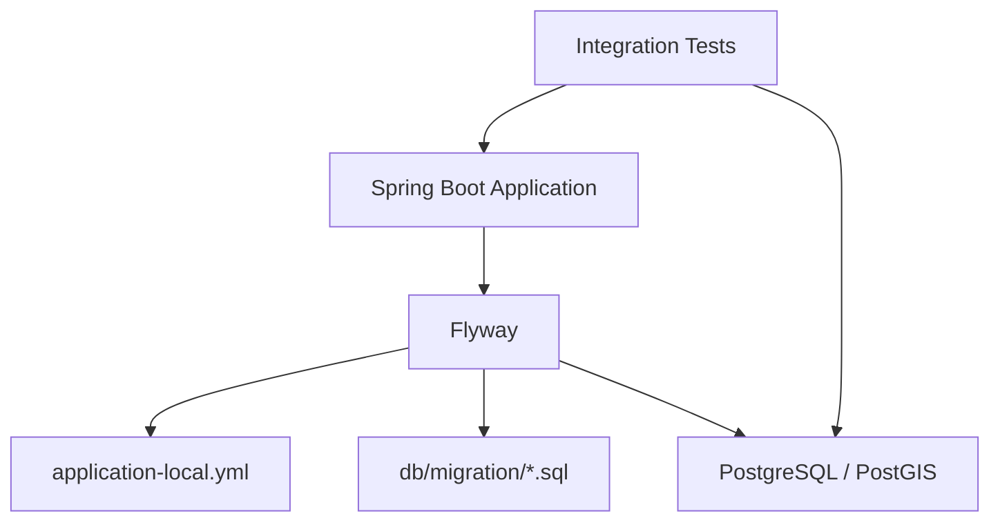
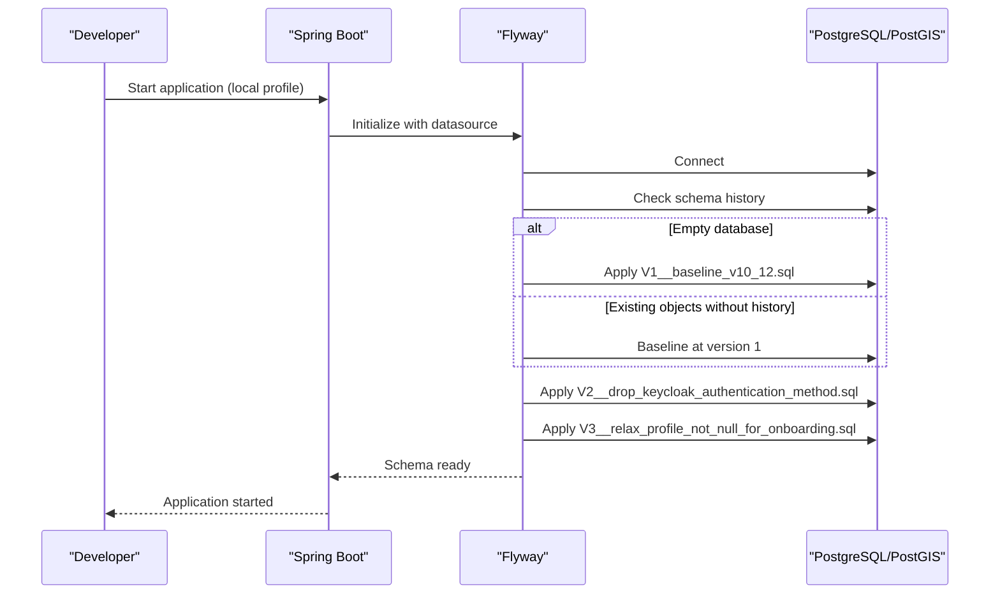
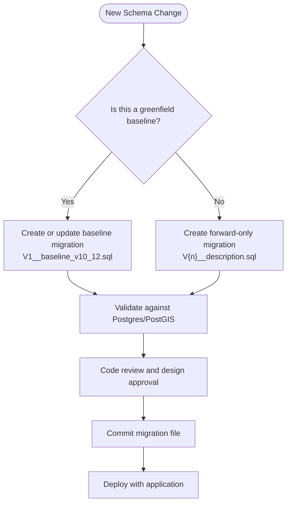
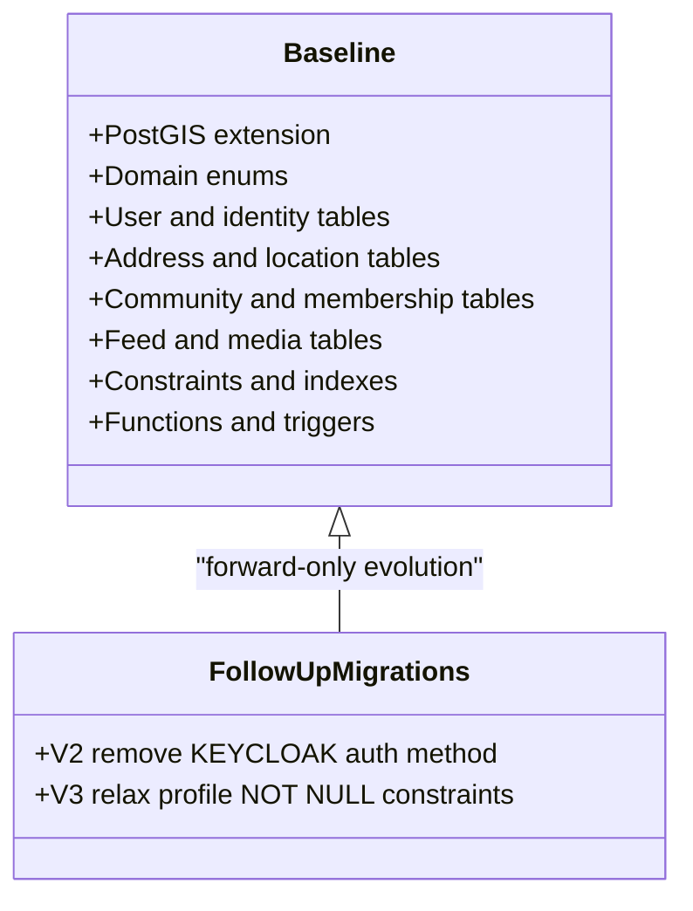
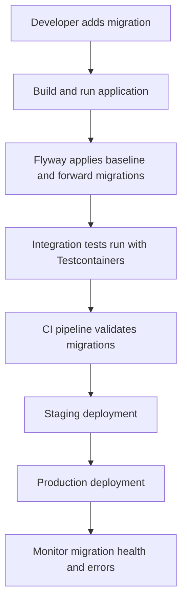
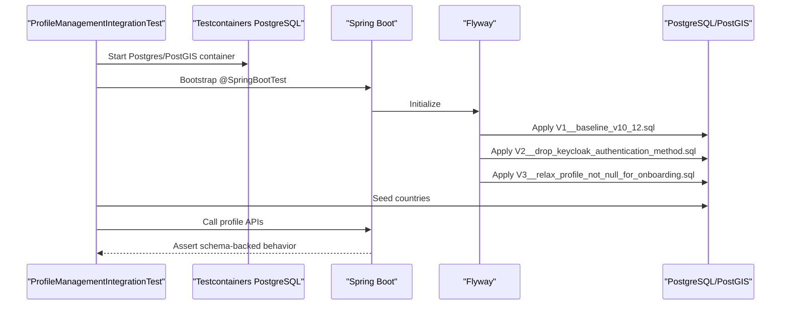
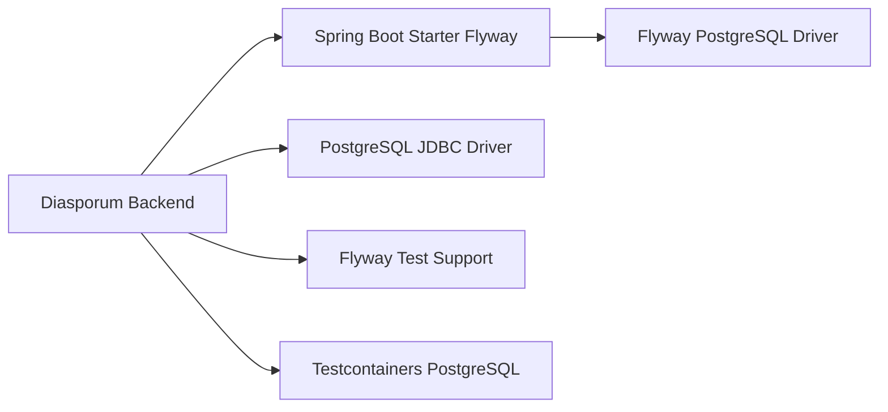

# Migration Management

<cite>
**Referenced Files in This Document**
- [V1__baseline_v10_12.sql](file://diasporum-backend/src/main/resources/db/migration/V1__baseline_v10_12.sql)
- [V2__drop_keycloak_authentication_method.sql](file://diasporum-backend/src/main/resources/db/migration/V2__drop_keycloak_authentication_method.sql)
- [V3__relax_profile_not_null_for_onboarding.sql](file://diasporum-backend/src/main/resources/db/migration/V3__relax_profile_not_null_for_onboarding.sql)
- [README.md](file://diasporum-backend/src/main/resources/db/migration/README.md)
- [application-local.yml](file://diasporum-backend/src/main/resources/application-local.yml)
- [pom.xml](file://diasporum-backend/pom.xml)
- [ProfileManagementIntegrationTest.java](file://diasporum-backend/src/test/java/com/diasporum/backend/identity/ProfileManagementIntegrationTest.java)
- [DIASPORUM_DATABASE_VALIDATION_REPORT.md](file://DIASPORUM_DATABASE_VALIDATION_REPORT.md)
</cite>

## Table of Contents
1. [Introduction](#introduction)
2. [Project Structure](#project-structure)
3. [Core Components](#core-components)
4. [Architecture Overview](#architecture-overview)
5. [Detailed Component Analysis](#detailed-component-analysis)
6. [Dependency Analysis](#dependency-analysis)
7. [Performance Considerations](#performance-considerations)
8. [Troubleshooting Guide](#troubleshooting-guide)
9. [Conclusion](#conclusion)

## Introduction
This document explains how Flyway manages database migrations for the DIASPORUM backend. It focuses on the versioned migration strategy, the baseline approach starting with `V1__baseline_v10_12.sql`, the migration lifecycle from development to production, rollback and testing procedures, naming conventions, deployment integration, common migration patterns, and troubleshooting guidance.

The current codebase uses Spring Boot with Flyway enabled for local development and test execution. The active schema baseline is a consolidated PostgreSQL v10.12 migration that includes PostGIS, domain tables, constraints, functions, triggers, and indexes. Two forward-only follow-up migrations adjust session authentication validation and profile onboarding requirements.

## Project Structure
Flyway-related artifacts are located under the backend module:

- Versioned SQL migrations: `diasporum-backend/src/main/resources/db/migration`
- Local application configuration enabling Flyway: `diasporum-backend/src/main/resources/application-local.yml`
- Maven dependencies including Flyway and Testcontainers: `diasporum-backend/pom.xml`
- Integration test using a real Postgres/PostGIS container and Flyway: `diasporum-backend/src/test/java/com/diasporum/backend/identity/ProfileManagementIntegrationTest.java`
- Migration directory documentation: `diasporum-backend/src/main/resources/db/migration/README.md`
- Database validation report describing the recommended Flyway strategy: `DIASPORUM_DATABASE_VALIDATION_REPORT.md`

**Diagram sources**
- [application-local.yml:15-23](file://diasporum-backend/src/main/resources/application-local.yml#L15-L23)
- [pom.xml:41-44](file://diasporum-backend/pom.xml#L41-L44)
- [pom.xml:76-78](file://diasporum-backend/pom.xml#L76-L78)
- [ProfileManagementIntegrationTest.java:38-49](file://diasporum-backend/src/test/java/com/diasporum/backend/identity/ProfileManagementIntegrationTest.java#L38-L49)

**Section sources**
- [V1__baseline_v10_12.sql:1-58](file://diasporum-backend/src/main/resources/db/migration/V1__baseline_v10_12.sql#L1-L58)
- [README.md:1-16](file://diasporum-backend/src/main/resources/db/migration/README.md#L1-L16)
- [application-local.yml:15-23](file://diasporum-backend/src/main/resources/application-local.yml#L15-L23)
- [pom.xml:41-44](file://diasporum-backend/pom.xml#L41-L44)
- [pom.xml:76-78](file://diasporum-backend/pom.xml#L76-L78)

## Core Components
The core migration components are:

| Component | Purpose | Current State |
|---|---|---|
| Baseline migration | Creates the full v10.12 schema on an empty database | `V1__baseline_v10_12.sql` |
| Forward-only migration V2 | Removes obsolete Keycloak authentication method value | `V2__drop_keycloak_authentication_method.sql` |
| Forward-only migration V3 | Relaxes profile column constraints for progressive onboarding | `V3__relax_profile_not_null_for_onboarding.sql` |
| Flyway configuration | Enables Flyway and sets baseline behavior for local development | `application-local.yml` |
| Maven dependencies | Adds Flyway, PostgreSQL driver, and test-scoped Flyway/Testcontainers support | `pom.xml` |
| Integration test | Boots Postgres/PostGIS via Testcontainers and runs Flyway migrations | `ProfileManagementIntegrationTest.java` |

**Section sources**
- [V1__baseline_v10_12.sql:1-58](file://diasporum-backend/src/main/resources/db/migration/V1__baseline_v10_12.sql#L1-L58)
- [V2__drop_keycloak_authentication_method.sql:1-13](file://diasporum-backend/src/main/resources/db/migration/V2__drop_keycloak_authentication_method.sql#L1-L13)
- [V3__relax_profile_not_null_for_onboarding.sql:1-14](file://diasporum-backend/src/main/resources/db/migration/V3__relax_profile_not_null_for_onboarding.sql#L1-L14)
- [application-local.yml:15-23](file://diasporum-backend/src/main/resources/application-local.yml#L15-L23)
- [pom.xml:41-44](file://diasporum-backend/pom.xml#L41-L44)
- [pom.xml:76-78](file://diasporum-backend/pom.xml#L76-L78)
- [ProfileManagementIntegrationTest.java:34-49](file://diasporum-backend/src/test/java/com/diasporum/backend/identity/ProfileManagementIntegrationTest.java#L34-L49)

## Architecture Overview
The migration architecture follows a standard Spring Boot + Flyway pattern:

1. Spring Boot starts and loads configuration.
2. Flyway connects to the configured PostgreSQL/PostGIS datasource.
3. Flyway scans `classpath:db/migration`.
4. On an empty database, Flyway applies `V1__baseline_v10_12.sql`.
5. If the database already contains objects but no history table, Flyway baselines at version 1 as configured locally.
6. Subsequent deployments apply only newer numbered migrations (`V2__…`, `V3__…`).
7. Integration tests spin up a disposable Postgres/PostGIS container and run the same migration pipeline.

**Diagram sources**
- [application-local.yml:15-23](file://diasporum-backend/src/main/resources/application-local.yml#L15-L23)
- [V1__baseline_v10_12.sql:1-58](file://diasporum-backend/src/main/resources/db/migration/V1__baseline_v10_12.sql#L1-L58)
- [V2__drop_keycloak_authentication_method.sql:1-13](file://diasporum-backend/src/main/resources/db/migration/V2__drop_keycloak_authentication_method.sql#L1-L13)
- [V3__relax_profile_not_null_for_onboarding.sql:1-14](file://diasporum-backend/src/main/resources/db/migration/V3__relax_profile_not_null_for_onboarding.sql#L1-L14)

## Detailed Component Analysis

### Versioned Migration Strategy
DIASPORUM uses numbered SQL files following the Flyway convention:

- `V1__baseline_v10_12.sql`: Consolidated baseline schema for PostgreSQL v10.12.
- `V2__drop_keycloak_authentication_method.sql`: Removes the obsolete `KEYCLOAK` authentication method value.
- `V3__relax_profile_not_null_for_onboarding.sql`: Allows progressive profile completion during onboarding.

The naming rule is `V{n}__{description}.sql`, where `n` is the migration order number and the description is lowercase and human-readable. Once applied, migrations must not be edited; changes require new numbered migrations.

**Diagram sources**
- [README.md:1-16](file://diasporum-backend/src/main/resources/db/migration/README.md#L1-L16)
- [DIASPORUM_DATABASE_VALIDATION_REPORT.md:108-120](file://DIASPORUM_DATABASE_VALIDATION_REPORT.md#L108-L120)

**Section sources**
- [V1__baseline_v10_12.sql:1-58](file://diasporum-backend/src/main/resources/db/migration/V1__baseline_v10_12.sql#L1-L58)
- [V2__drop_keycloak_authentication_method.sql:1-13](file://diasporum-backend/src/main/resources/db/migration/V2__drop_keycloak_authentication_method.sql#L1-L13)
- [V3__relax_profile_not_null_for_onboarding.sql:1-14](file://diasporum-backend/src/main/resources/db/migration/V3__relax_profile_not_null_for_onboarding.sql#L1-L14)
- [README.md:1-16](file://diasporum-backend/src/main/resources/db/migration/README.md#L1-L16)
- [DIASPORUM_DATABASE_VALIDATION_REPORT.md:108-120](file://DIASPORUM_DATABASE_VALIDATION_REPORT.md#L108-L120)

### Baseline Migration Approach
`V1__baseline_v10_12.sql` is a clean-install baseline. It is intended for brand-new, empty databases rather than in-place upgrades from older schemas. The file:

- Enables PostGIS.
- Defines domain enums such as account status, content status, voice room status, media status, job status, moderation actions, and notification types.
- Creates core tables for countries, users, profiles, credentials, sessions, refresh tokens, email verification tokens, password reset tokens, addresses, external identities, communities, memberships, roles, policies, taxonomy, social graph, blocks, mutes, media, feed posts, and related structures.
- Includes constraints, indexes, functions, and triggers that enforce business rules such as account restriction revocation, address geography synchronization, membership origin validation, follow policy validation, and mute scope validation.

The baseline is applied by Flyway when the target database has no schema history. In local development, Flyway is configured to baseline existing objects at version 1 so it can coexist with a manually provisioned dev database.

**Diagram sources**
- [V1__baseline_v10_12.sql:58-106](file://diasporum-backend/src/main/resources/db/migration/V1__baseline_v10_12.sql#L58-L106)
- [V1__baseline_v10_12.sql:108-800](file://diasporum-backend/src/main/resources/db/migration/V1__baseline_v10_12.sql#L108-L800)
- [V2__drop_keycloak_authentication_method.sql:1-13](file://diasporum-backend/src/main/resources/db/migration/V2__drop_keycloak_authentication_method.sql#L1-L13)
- [V3__relax_profile_not_null_for_onboarding.sql:1-14](file://diasporum-backend/src/main/resources/db/migration/V3__relax_profile_not_null_for_onboarding.sql#L1-L14)

**Section sources**
- [V1__baseline_v10_12.sql:1-58](file://diasporum-backend/src/main/resources/db/migration/V1__baseline_v10_12.sql#L1-L58)
- [V1__baseline_v10_12.sql:58-106](file://diasporum-backend/src/main/resources/db/migration/V1__baseline_v10_12.sql#L58-L106)
- [V1__baseline_v10_12.sql:108-800](file://diasporum-backend/src/main/resources/db/migration/V1__baseline_v10_12.sql#L108-L800)
- [application-local.yml:18-23](file://diasporum-backend/src/main/resources/application-local.yml#L18-L23)
- [DIASPORUM_DATABASE_VALIDATION_REPORT.md:108-120](file://DIASPORUM_DATABASE_VALIDATION_REPORT.md#L108-L120)

### Migration Lifecycle: Development to Production
#### Development
- The local profile enables Flyway and points it to `classpath:db/migration`.
- Because the local dev database was provisioned directly from the approved v10.12 schema, Flyway is configured to baseline at version 1 instead of re-running the baseline DDL.
- New migrations are added as forward-only SQL files and validated through application startup and tests.

#### Testing
- Integration tests use Testcontainers to start a Postgres/PostGIS container.
- Flyway applies the baseline and follow-up migrations inside the disposable container.
- Tests assert API behavior against the migrated schema and seed minimal reference data such as a country row.

#### Production
- Production should use the same migration files as development and staging.
- The baseline strategy depends on whether the production database is greenfield or pre-existing. For greenfield databases, Flyway applies `V1__baseline_v10_12.sql`. For pre-existing databases, a separate baseline mechanism may be required, but the current repository guidance emphasizes greenfield usage.
- Any schema change requires a new numbered migration; existing applied migrations must not be rewritten.

**Diagram sources**
- [application-local.yml:15-23](file://diasporum-backend/src/main/resources/application-local.yml#L15-L23)
- [ProfileManagementIntegrationTest.java:38-49](file://diasporum-backend/src/test/java/com/diasporum/backend/identity/ProfileManagementIntegrationTest.java#L38-L49)
- [DIASPORUM_DATABASE_VALIDATION_REPORT.md:108-120](file://DIASPORUM_DATABASE_VALIDATION_REPORT.md#L108-L120)

**Section sources**
- [application-local.yml:15-23](file://diasporum-backend/src/main/resources/application-local.yml#L15-L23)
- [ProfileManagementIntegrationTest.java:34-71](file://diasporum-backend/src/test/java/com/diasporum/backend/identity/ProfileManagementIntegrationTest.java#L34-L71)
- [DIASPORUM_DATABASE_VALIDATION_REPORT.md:108-120](file://DIASPORUM_DATABASE_VALIDATION_REPORT.md#L108-L120)

### Rollback Strategies
The current migration set is forward-only:

- Do not edit applied migrations.
- Use new numbered migrations to evolve the schema.
- Avoid destructive operations unless they are explicitly designed as safe, reversible steps within a larger migration.
- For critical failures, prefer operational recovery strategies such as restoring from backup, rolling back the application deployment, and isolating the failing environment while investigating.

The repository’s database validation report recommends forward-only migrations and warns against editing applied migrations. This aligns with Flyway best practices for production-safe schema evolution.

**Section sources**
- [DIASPORUM_DATABASE_VALIDATION_REPORT.md:108-120](file://DIASPORUM_DATABASE_VALIDATION_REPORT.md#L108-L120)
- [V2__drop_keycloak_authentication_method.sql:1-13](file://diasporum-backend/src/main/resources/db/migration/V2__drop_keycloak_authentication_method.sql#L1-L13)
- [V3__relax_profile_not_null_for_onboarding.sql:1-14](file://diasporum-backend/src/main/resources/db/migration/V3__relax_profile_not_null_for_onboarding.sql#L1-L14)

### Testing Procedures
Testing integrates Flyway with a real PostgreSQL/PostGIS instance:

- The integration test configures a Postgres/PostGIS container image compatible with PostGIS.
- Spring Boot auto-wires the container as a service connection.
- Flyway applies the migration files during application context initialization.
- The test seeds one country and exercises profile management APIs.
- Assertions cover profile retrieval, updates, completion state, invalid country rejection, username rules, concurrent claim conflicts, transaction rollback behavior, authentication enforcement, and country listing.

**Diagram sources**
- [ProfileManagementIntegrationTest.java:38-49](file://diasporum-backend/src/test/java/com/diasporum/backend/identity/ProfileManagementIntegrationTest.java#L38-L49)
- [ProfileManagementIntegrationTest.java:64-71](file://diasporum-backend/src/test/java/com/diasporum/backend/identity/ProfileManagementIntegrationTest.java#L64-L71)
- [ProfileManagementIntegrationTest.java:78-205](file://diasporum-backend/src/test/java/com/diasporum/backend/identity/ProfileManagementIntegrationTest.java#L78-L205)

**Section sources**
- [ProfileManagementIntegrationTest.java:34-71](file://diasporum-backend/src/test/java/com/diasporum/backend/identity/ProfileManagementIntegrationTest.java#L34-L71)
- [ProfileManagementIntegrationTest.java:78-205](file://diasporum-backend/src/test/java/com/diasporum/backend/identity/ProfileManagementIntegrationTest.java#L78-L205)
- [pom.xml:133-145](file://diasporum-backend/pom.xml#L133-L145)

### Creating New Migrations
Follow these steps when adding a new migration:

1. Determine whether the change belongs in the baseline or as a forward-only migration.
   - Greenfield baseline: update or regenerate the baseline migration if the canonical schema changes before any production baseline is established.
   - Evolving an existing schema: create a new `V{n}__description.sql` file.
2. Name the file using the Flyway convention: `V{n}__description.sql`.
3. Make the migration idempotent where possible and safe for production.
4. Include comments explaining intent, risks, and any prerequisites.
5. Validate against PostgreSQL/PostGIS.
6. Add or update integration tests that exercise the affected schema behavior.
7. Submit for review and merge.

Common migration patterns include:

| Pattern | Guidance |
|---|---|
| Adding columns | Add nullable columns first, populate data if needed, then add constraints or make non-null in a later migration. |
| Creating indexes | Prefer explicit index names and consider partial or functional indexes only when query patterns justify them. |
| Modifying constraints | Drop and recreate constraints carefully; ensure dependent application logic supports the new constraint semantics. |
| Data transformations | Perform data migrations inside the same migration or a dedicated data migration, ensuring idempotency and performance considerations. |
| Renaming columns or tables | Rename in one migration and keep compatibility in subsequent migrations until all application code is updated. |
| Enum changes | Extend enums safely and migrate existing values before removing old values. |

These patterns are general Flyway guidance aligned with the project’s forward-only migration philosophy.

**Section sources**
- [README.md:1-16](file://diasporum-backend/src/main/resources/db/migration/README.md#L1-L16)
- [DIASPORUM_DATABASE_VALIDATION_REPORT.md:108-120](file://DIASPORUM_DATABASE_VALIDATION_REPORT.md#L108-L120)

### Deployment Pipeline Integration
Deployment should treat database migrations as part of the application release:

- Use the same migration files across environments.
- Ensure the deployment user has sufficient privileges to create extensions, tables, indexes, functions, and triggers.
- Run migrations before or during application startup, depending on platform policy.
- Monitor migration logs for failures.
- Keep backups before production migrations.
- Avoid manual schema edits in production; always use versioned migrations.

The local configuration demonstrates Flyway being enabled and pointed at the migration location. The database validation report also notes that `spring.flyway.enabled` should remain true for local and test profiles and that production migrations should run via the same migrations at deploy time.

**Section sources**
- [application-local.yml:15-23](file://diasporum-backend/src/main/resources/application-local.yml#L15-L23)
- [DIASPORUM_DATABASE_VALIDATION_REPORT.md:108-120](file://DIASPORUM_DATABASE_VALIDATION_REPORT.md#L108-L120)

## Dependency Analysis
Flyway is integrated into the backend through Spring Boot starters and the PostgreSQL database driver.

**Diagram sources**
- [pom.xml:41-44](file://diasporum-backend/pom.xml#L41-L44)
- [pom.xml:76-78](file://diasporum-backend/pom.xml#L76-L78)
- [pom.xml:92-95](file://diasporum-backend/pom.xml#L92-L95)
- [pom.xml:106-110](file://diasporum-backend/pom.xml#L106-L110)
- [pom.xml:133-145](file://diasporum-backend/pom.xml#L133-L145)

**Section sources**
- [pom.xml:41-44](file://diasporum-backend/pom.xml#L41-L44)
- [pom.xml:76-78](file://diasporum-backend/pom.xml#L76-L78)
- [pom.xml:92-95](file://diasporum-backend/pom.xml#L92-L95)
- [pom.xml:106-110](file://diasporum-backend/pom.xml#L106-L110)
- [pom.xml:133-145](file://diasporum-backend/pom.xml#L133-L145)

## Performance Considerations
- The baseline migration creates many tables, indexes, functions, and triggers. Large initial migrations can increase startup time and migration duration.
- Prefer incremental forward-only migrations for production to reduce risk and improve deployability.
- Indexes should be justified by query patterns; avoid unnecessary indexes.
- Data migrations should be batched and monitored to avoid long-running transactions in production.
- PostGIS operations involving geographic coordinates and spatial indexes should be tested under realistic data volumes.

[No sources needed since this section provides general guidance]

## Troubleshooting Guide
Common issues and resolutions:

| Issue | Likely Cause | Resolution |
|---|---|---|
| Flyway cannot connect to the database | Missing or incorrect datasource configuration | Verify `spring.datasource.*` properties in the active profile. |
| Context fails to load without a datasource | Default profile lacks datasource configuration | Configure test or local datasource; do not hardcode production credentials. |
| PostGIS extension creation fails | Insufficient privileges on managed PostgreSQL | Ensure the Flyway user has extension privileges or prepare the extension externally. |
| Migration fails because schema already exists | Baseline vs migration mismatch | Use baseline mode for pre-existing schemas or apply baseline migration on empty databases. |
| Tests fail due to missing Postgres/PostGIS | Testcontainers not available or misconfigured | Ensure Docker engine is running and Testcontainers images are accessible. |
| Migration applied twice or history inconsistent | Manual schema changes outside Flyway | Restore from backup, reconcile history, and avoid manual production changes. |

Relevant observations from the repository:

- The local profile enables Flyway and sets baseline behavior for a dev database provisioned directly from the schema.
- The database validation report highlights that `contextLoads` failures occur when no datasource is configured under the default profile.
- The report recommends Testcontainers-based Postgres/PostGIS wiring for meaningful migration validation in tests.

**Section sources**
- [application-local.yml:15-23](file://diasporum-backend/src/main/resources/application-local.yml#L15-L23)
- [DIASPORUM_DATABASE_VALIDATION_REPORT.md:108-136](file://DIASPORUM_DATABASE_VALIDATION_REPORT.md#L108-L136)
- [ProfileManagementIntegrationTest.java:38-49](file://diasporum-backend/src/test/java/com/diasporum/backend/identity/ProfileManagementIntegrationTest.java#L38-L49)

## Conclusion
DIASPORUM’s database migration strategy centers on a clear separation between the consolidated baseline schema and forward-only follow-up migrations. The baseline `V1__baseline_v10_12.sql` establishes the v10.12 PostgreSQL/PostGIS foundation, while `V2__` and `V3__` demonstrate safe, incremental evolution. Local development uses Flyway with baseline mode, and integration tests validate migrations against a real Postgres/PostGIS container.

For future work:

- Treat all production schema changes as forward-only migrations.
- Never edit applied migrations.
- Validate migrations against PostgreSQL/PostGIS in both development and CI.
- Use Testcontainers for integration tests requiring accurate database behavior.
- Coordinate migration deployment with application releases and maintain backups.
- Continue refining test coverage around schema-dependent features.

[No sources needed since this section summarizes without analyzing specific files]