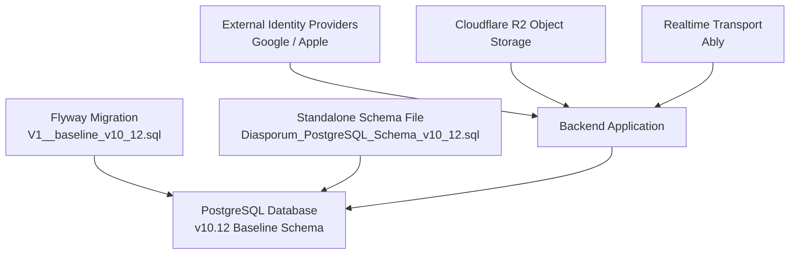
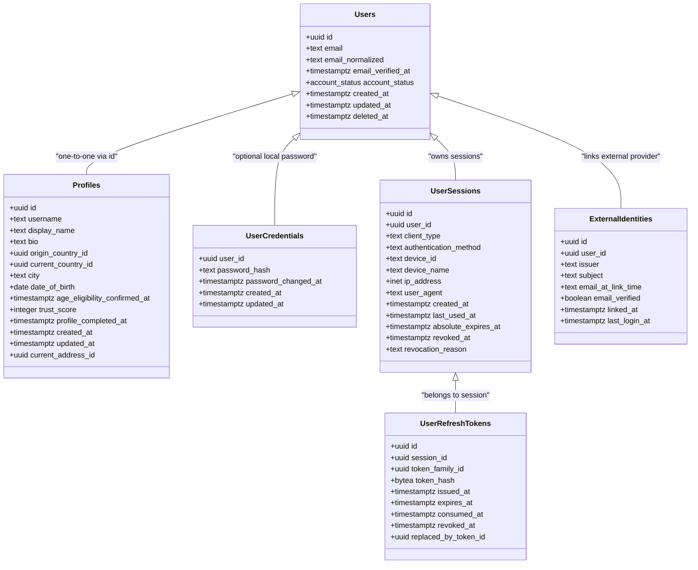
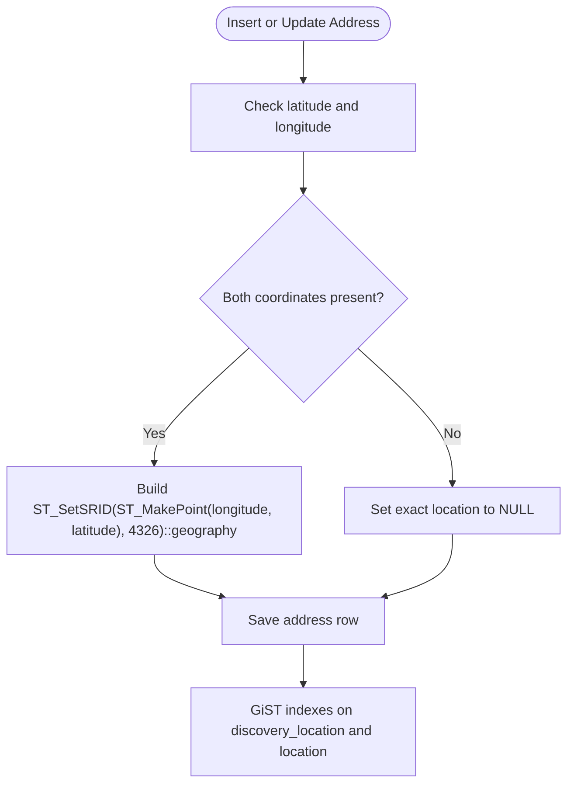
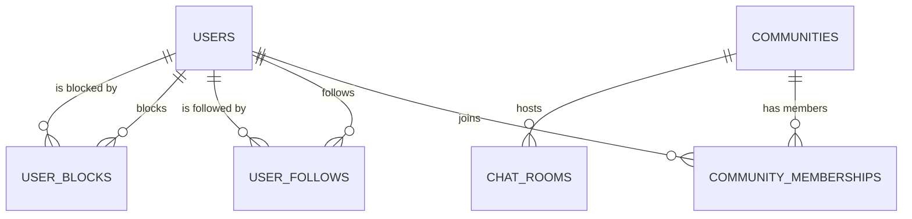
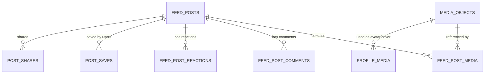
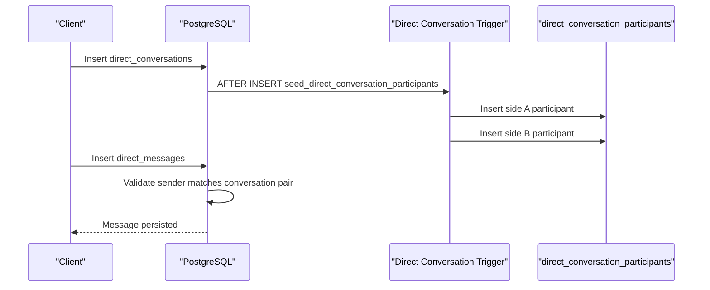
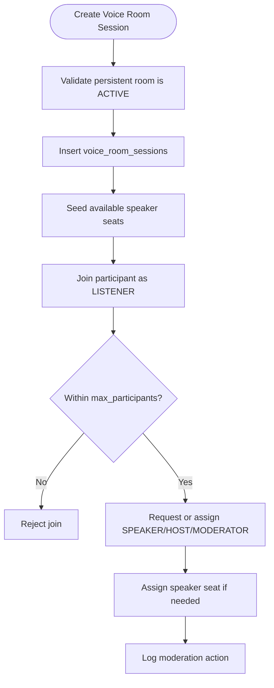
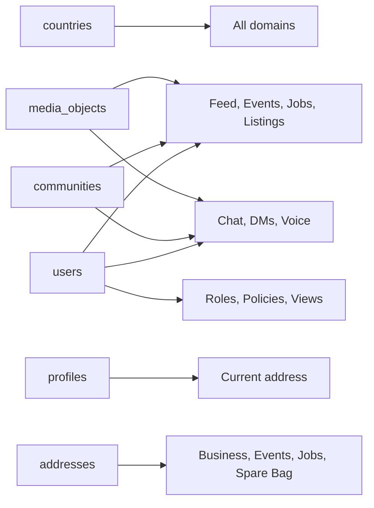

# Schema Overview

<cite>
**Referenced Files in This Document**
- [Diasporum_PostgreSQL_Schema_v10_12.sql](file://Diasporum_v10.12/Diasporum_PostgreSQL_Schema_v10_12.sql)
- [V1__baseline_v10_12.sql](file://diasporum-backend/src/main/resources/db/migration/V1__baseline_v10_12.sql)
- [DIASPORUM_NEARBY_FEED_MIGRATION_PROPOSAL.md](file://DIASPORUM_NEARBY_FEED_MIGRATION_PROPOSAL.md)
- [Diasporum_Spring_Boot_REST_API_Folder_Structure_v10_12.md](file://Diasporum_v10.12/Diasporum_Spring_Boot_REST_API_Folder_Structure_v10_12.md)
</cite>

## Table of Contents
1. [Introduction](#introduction)
2. [Project Structure](#project-structure)
3. [Core Components](#core-components)
4. [Architecture Overview](#architecture-overview)
5. [Detailed Component Analysis](#detailed-component-analysis)
6. [Dependency Analysis](#dependency-analysis)
7. [Performance Considerations](#performance-considerations)
8. [Troubleshooting Guide](#troubleshooting-guide)
9. [Conclusion](#conclusion)

## Introduction
This document describes the DIASPORUM PostgreSQL database schema as represented by the v10.12 baseline. It focuses on high-level entity relationships across core domains: users, profiles, communities, feed posts, media, business entities, events, jobs, spare-bag logistics, matchmaking, chat, voice rooms, and related discovery and moderation features. The schema is designed around modular business domains with clear foreign-key ownership, shared reference tables such as countries and addresses, and strong database-level constraints that enforce business rules.

The schema uses the PostgreSQL PostGIS extension for geospatial data, including shared address geography, opt-in people-discovery locations, matchmaking distance calculations, radius-based searches for listings and jobs, and server-side Nearby Reels ranking. Object storage metadata is modeled separately from application entities, and platform roles, policies, taxonomies, and moderation actions are explicitly represented at the database level.

## Project Structure
The database schema is maintained as a Flyway-managed clean-install baseline. The same SQL definition exists both as a standalone schema file and as the initial migration applied to the backend application database.



**Diagram sources**
- [V1__baseline_v10_12.sql:1-58](file://diasporum-backend/src/main/resources/db/migration/V1__baseline_v10_12.sql#L1-L58)
- [Diasporum_PostgreSQL_Schema_v10_12.sql:1-58](file://Diasporum_v10.12/Diasporum_PostgreSQL_Schema_v10_12.sql#L1-L58)

**Section sources**
- [V1__baseline_v10_12.sql:1-58](file://diasporum-backend/src/main/resources/db/migration/V1__baseline_v10_12.sql#L1-L58)
- [Diasporum_PostgreSQL_Schema_v10_12.sql:1-58](file://Diasporum_v10.12/Diasporum_PostgreSQL_Schema_v10_12.sql#L1-L58)

## Core Components
At a high level, the schema separates identity, social graph, content, communication, business listings, events, jobs, logistics, matchmaking, and platform administration into distinct but connected domains.

| Domain | Primary Entities | Purpose |
|---|---|---|
| Identity and accounts | `users`, `profiles`, `user_credentials`, `user_sessions`, `user_refresh_tokens`, `external_identities` | Owns authentication, sessions, optional local passwords, and external identity linkage. |
| Reference and location | `countries`, `addresses`, `user_discovery_locations` | Shared country and structured address data; PostGIS geography for spatial queries. |
| Communities | `communities`, `community_memberships`, `user_settings`, `user_privacy_settings` | Country-scoped communities, membership roles, and user preferences. |
| Feed and engagement | `feed_posts`, `feed_post_media`, `feed_post_comments`, `feed_post_reactions`, `post_saves`, `post_shares` | Community or country-scoped posts, media, comments, reactions, saves, and shares. |
| Media | `media_objects`, `profile_media` | Cloudflare R2 object metadata and profile media variants. |
| Chat and messaging | `chat_rooms`, `chat_messages`, `direct_conversations`, `direct_messages`, `message_requests` | General chat, mentions, read cursors, and context-aware direct messages. |
| Voice rooms | `voice_rooms`, `voice_room_sessions`, `voice_room_participants`, `voice_room_seats`, `voice_room_moderation_actions` | Persistent rooms, live sessions, role control, seats, and moderation audit. |
| Business directory | `business_listings`, `business_locations`, `business_hours`, `business_reviews`, `business_media` | Verified business entities, locations, hours, reviews, and media. |
| Events | `events`, `event_rsvps`, `event_media` | In-person, online voice, or external online events with optional voice-room linkage. |
| Jobs | `job_listings`, `job_categories`, `job_applications`, `job_media` | Employer, recruiter, community, and aggregator job listings with applications. |
| Spare Bag logistics | `airports`, `spare_bag_listings`, `spare_bag_contact_requests` | Sender requests and passenger offers between airports with contact negotiation. |
| Matchmaking | `matchmaking_profiles`, swipe and match tables (defined later in the schema) | Profile-based mutual-like matchmaking with privacy and safety controls. |
| Platform administration | `global_user_roles`, `policy_documents`, `policy_acceptances`, `featured_items` | Scoped platform roles, policy versions, acceptances, and featured placements. |

**Section sources**
- [Diasporum_PostgreSQL_Schema_v10_12.sql:62-105](file://Diasporum_v10.12/Diasporum_PostgreSQL_Schema_v10_12.sql#L62-L105)
- [Diasporum_PostgreSQL_Schema_v10_12.sql:108-155](file://Diasporum_v10.12/Diasporum_PostgreSQL_Schema_v10_12.sql#L108-L155)
- [Diasporum_PostgreSQL_Schema_v10_12.sql:270-337](file://Diasporum_v10.12/Diasporum_PostgreSQL_Schema_v10_12.sql#L270-L337)
- [Diasporum_PostgreSQL_Schema_v10_12.sql:369-437](file://Diasporum_v10.12/Diasporum_PostgreSQL_Schema_v10_12.sql#L369-L437)
- [Diasporum_PostgreSQL_Schema_v10_12.sql:700-800](file://Diasporum_v10.12/Diasporum_PostgreSQL_Schema_v10_12.sql#L700-L800)
- [Diasporum_PostgreSQL_Schema_v10_12.sql:803-970](file://Diasporum_v10.12/Diasporum_PostgreSQL_Schema_v10_12.sql#L803-L970)
- [Diasporum_PostgreSQL_Schema_v10_12.sql:973-1307](file://Diasporum_v10.12/Diasporum_PostgreSQL_Schema_v10_12.sql#L973-L1307)
- [Diasporum_PostgreSQL_Schema_v10_12.sql:1323-1855](file://Diasporum_v10.12/Diasporum_PostgreSQL_Schema_v10_12.sql#L1323-L1855)
- [Diasporum_PostgreSQL_Schema_v10_12.sql:1869-2137](file://Diasporum_v10.12/Diasporum_PostgreSQL_Schema_v10_12.sql#L1869-L2137)
- [Diasporum_PostgreSQL_Schema_v10_12.sql:2178-2389](file://Diasporum_v10.12/Diasporum_PostgreSQL_Schema_v10_12.sql#L2178-L2389)

## Architecture Overview
The database architecture follows a modular domain design:

- **Shared foundation:** `countries`, `addresses`, and many enums/types provide common reference data and validation.
- **Identity layer:** `users` owns account lifecycle; `profiles` extends it with public-facing fields. Authentication artifacts are separate from profile data.
- **Community layer:** Communities are scoped to origin and destination countries, with membership roles and user settings.
- **Content layer:** Feed posts own author, community, country, category, status, and visibility scope; media, comments, reactions, saves, and shares are linked through explicit foreign keys.
- **Communication layer:** General chat and direct conversations are separated. Direct conversations support personal and business participants and can be tied to business, event, job, property, vehicle, spare bag, or community help contexts.
- **Business and listing layer:** Business listings, events, jobs, property listings, vehicle listings, and spare bag listings all reuse shared addresses and media while keeping their own domain-specific attributes.
- **Discovery and moderation layer:** PostGIS geography, user privacy settings, blocks, mutes, reports, and moderation actions enforce safety and discovery rules at the database level.

```mermaid
graph TB
subgraph "Foundation"
Countries["countries"]
Addresses["addresses"]
Types["Enums and custom types"]
end
subgraph "Identity"
Users["users"]
Profiles["profiles"]
Sessions["user_sessions"]
Tokens["user_refresh_tokens"]
ExternalIdentities["external_identities"]
end
subgraph "Communities"
Communities["communities"]
Memberships["community_memberships"]
UserSettings["user_settings"]
PrivacySettings["user_privacy_settings"]
end
subgraph "Feed"
FeedPosts["feed_posts"]
FeedMedia["feed_post_media"]
Comments["feed_post_comments"]
Reactions["feed_post_reactions"]
Saves["post_saves"]
Shares["post_shares"]
end
subgraph "Media"
MediaObjects["media_objects"]
ProfileMedia["profile_media"]
end
subgraph "Communication"
ChatRooms["chat_rooms"]
ChatMessages["chat_messages"]
DirectConv["direct_conversations"]
DirectMsgs["direct_messages"]
end
subgraph "Business Listings"
Businesses["business_listings"]
Events["events"]
Jobs["job_listings"]
SpareBag["spare_bag_listings"]
end
Countries --> Profiles
Countries --> Communities
Countries --> FeedPosts
Countries --> Businesses
Countries --> Events
Countries --> Jobs
Countries --> SpareBag
Users --> Profiles
Users --> Sessions
Users --> Tokens
Users --> ExternalIdentities
Users --> FeedPosts
Users --> Comments
Users --> Reactions
Users --> Saves
Users --> Shares
Users --> ChatMessages
Users --> DirectMsgs
Communities --> FeedPosts
Communities --> ChatRooms
Communities --> Memberships
FeedPosts --> FeedMedia
FeedMedia --> MediaObjects
Profiles --> ProfileMedia
ProfileMedia --> MediaObjects
ChatRooms --> ChatMessages
DirectConv --> DirectMsgs
Businesses --> Addresses
Events --> Addresses
Jobs --> Addresses
SpareBag --> Addresses
```

**Diagram sources**
- [Diasporum_PostgreSQL_Schema_v10_12.sql:108-155](file://Diasporum_v10.12/Diasporum_PostgreSQL_Schema_v10_12.sql#L108-L155)
- [Diasporum_PostgreSQL_Schema_v10_12.sql:270-337](file://Diasporum_v10.12/Diasporum_PostgreSQL_Schema_v10_12.sql#L270-L337)
- [Diasporum_PostgreSQL_Schema_v10_12.sql:369-437](file://Diasporum_v10.12/Diasporum_PostgreSQL_Schema_v10_12.sql#L369-L437)
- [Diasporum_PostgreSQL_Schema_v10_12.sql:700-800](file://Diasporum_v10.12/Diasporum_PostgreSQL_Schema_v10_12.sql#L700-L800)
- [Diasporum_PostgreSQL_Schema_v10_12.sql:803-970](file://Diasporum_v10.12/Diasporum_PostgreSQL_Schema_v10_12.sql#L803-L970)
- [Diasporum_PostgreSQL_Schema_v10_12.sql:973-1307](file://Diasporum_v10.12/Diasporum_PostgreSQL_Schema_v10_12.sql#L973-L1307)
- [Diasporum_PostgreSQL_Schema_v10_12.sql:1869-2137](file://Diasporum_v10.12/Diasporum_PostgreSQL_Schema_v10_12.sql#L1869-L2137)
- [Diasporum_PostgreSQL_Schema_v10_12.sql:2178-2389](file://Diasporum_v10.12/Diasporum_PostgreSQL_Schema_v10_12.sql#L2178-L2389)

## Detailed Component Analysis

### Identity, Profiles, and Authentication
The identity domain separates account ownership from public profile data. `users` stores email, verification state, account status, and soft-delete timestamps. `profiles` is an optional one-to-one extension keyed by the same UUID as `users.id`. Local password credentials are optional because Google/Apple-only accounts may exist without a local password row. Sessions and refresh tokens model application-owned authentication state, with triggers revoking active sessions when an account is suspended or marked for deletion.



**Diagram sources**
- [Diasporum_PostgreSQL_Schema_v10_12.sql:122-155](file://Diasporum_v10.12/Diasporum_PostgreSQL_Schema_v10_12.sql#L122-L155)
- [Diasporum_PostgreSQL_Schema_v10_12.sql:159-210](file://Diasporum_v10.12/Diasporum_PostgreSQL_Schema_v10_12.sql#L159-L210)
- [Diasporum_PostgreSQL_Schema_v10_12.sql:340-366](file://Diasporum_v10.12/Diasporum_PostgreSQL_Schema_v10_12.sql#L340-L366)

**Section sources**
- [Diasporum_PostgreSQL_Schema_v10_12.sql:122-210](file://Diasporum_v10.12/Diasporum_PostgreSQL_Schema_v10_12.sql#L122-L210)
- [Diasporum_PostgreSQL_Schema_v10_12.sql:245-265](file://Diasporum_v10.12/Diasporum_PostgreSQL_Schema_v10_12.sql#L245-L265)
- [Diasporum_PostgreSQL_Schema_v10_12.sql:340-366](file://Diasporum_v10.12/Diasporum_PostgreSQL_Schema_v10_12.sql#L340-L366)

### Shared Addresses and PostGIS Geography
Addresses are a shared resource used by profiles, businesses, events, jobs, and other entities. Each address includes structured text fields, numeric latitude/longitude, a derived exact `location` geography point, and a separate `discovery_location` geography point used for spatial discovery. Triggers keep the exact geography synchronized with validated coordinates, and GiST indexes optimize spatial queries.



**Diagram sources**
- [Diasporum_PostgreSQL_Schema_v10_12.sql:270-324](file://Diasporum_v10.12/Diasporum_PostgreSQL_Schema_v10_12.sql#L270-L324)

Key design points:
- Exact coordinates are derived and must not be serialized to ordinary discovery clients.
- Discovery locations are separate and may be null when no discoverable point is intended.
- Profiles have an optional `current_address_id` reference used for Nearby Reels and location-aware feeds.
- Opt-in approximate people discovery is stored in `user_discovery_locations`, not reused from home addresses.

**Section sources**
- [Diasporum_PostgreSQL_Schema_v10_12.sql:270-337](file://Diasporum_v10.12/Diasporum_PostgreSQL_Schema_v10_12.sql#L270-L337)
- [DIASPORUM_NEARBY_FEED_MIGRATION_PROPOSAL.md:1-30](file://DIASPORUM_NEARBY_FEED_MIGRATION_PROPOSAL.md#L1-L30)

### Communities and Social Graph
Communities are scoped to origin and destination countries. Membership is enforced by a trigger that requires the user’s origin country to match an active community’s origin country. The social graph uses directional follows, derived mutual connections, blocks, and mutes. Follow creation validates account status, blocking, and recipient privacy settings.



**Diagram sources**
- [Diasporum_PostgreSQL_Schema_v10_12.sql:369-413](file://Diasporum_v10.12/Diasporum_PostgreSQL_Schema_v10_12.sql#L369-L413)
- [Diasporum_PostgreSQL_Schema_v10_12.sql:594-696](file://Diasporum_v10.12/Diasporum_PostgreSQL_Schema_v10_12.sql#L594-L696)
- [Diasporum_PostgreSQL_Schema_v10_12.sql:973-986](file://Diasporum_v10.12/Diasporum_PostgreSQL_Schema_v10_12.sql#L973-L986)

**Section sources**
- [Diasporum_PostgreSQL_Schema_v10_12.sql:369-437](file://Diasporum_v10.12/Diasporum_PostgreSQL_Schema_v10_12.sql#L369-L437)
- [Diasporum_PostgreSQL_Schema_v10_12.sql:594-696](file://Diasporum_v10.12/Diasporum_PostgreSQL_Schema_v10_12.sql#L594-L696)

### Feed Posts, Media, and Engagement
Feed posts are owned by a user, belong to a community, and are scoped to a country or selected community. They support multiple post types, including REEL. Media is decoupled into `media_objects`, which store bucket and object key metadata rather than binary content. Engagement is tracked through comments, reactions, saves, and shares.



**Diagram sources**
- [Diasporum_PostgreSQL_Schema_v10_12.sql:700-800](file://Diasporum_v10.12/Diasporum_PostgreSQL_Schema_v10_12.sql#L700-L800)
- [Diasporum_PostgreSQL_Schema_v10_12.sql:803-840](file://Diasporum_v10.12/Diasporum_PostgreSQL_Schema_v10_12.sql#L803-L840)

**Section sources**
- [Diasporum_PostgreSQL_Schema_v10_12.sql:700-840](file://Diasporum_v10.12/Diasporum_PostgreSQL_Schema_v10_12.sql#L700-L840)

### Chat, Direct Messages, and Contextual Conversations
General chat is organized by community rooms with sequence numbers, mentions, and per-user read cursors. Direct conversations support person-to-person and business-to-person interactions, with optional context linking to property listings, vehicles, business profiles, events, jobs, spare bag contacts, service requests, or community help posts. Triggers validate participant identities, conversation immutability, message sender pairing, and request acceptance flow.



**Diagram sources**
- [Diasporum_PostgreSQL_Schema_v10_12.sql:973-1054](file://Diasporum_v10.12/Diasporum_PostgreSQL_Schema_v10_12.sql#L973-L1054)
- [Diasporum_PostgreSQL_Schema_v10_12.sql:1056-1307](file://Diasporum_v10.12/Diasporum_PostgreSQL_Schema_v10_12.sql#L1056-L1307)

**Section sources**
- [Diasporum_PostgreSQL_Schema_v10_12.sql:973-1307](file://Diasporum_v10.12/Diasporum_PostgreSQL_Schema_v10_12.sql#L973-L1307)

### Voice Rooms and Live Sessions
Voice rooms are persistent community resources with live sessions, participants, speaker seats, speaker requests, invites, and moderation actions. Capacity limits, role transitions, host transfers, and seat assignment are enforced by triggers and functions. Only the backend may assign privileged roles, and room capacity checks prevent over-admission.



**Diagram sources**
- [Diasporum_PostgreSQL_Schema_v10_12.sql:1323-1855](file://Diasporum_v10.12/Diasporum_PostgreSQL_Schema_v10_12.sql#L1323-L1855)

**Section sources**
- [Diasporum_PostgreSQL_Schema_v10_12.sql:1323-1855](file://Diasporum_v10.12/Diasporum_PostgreSQL_Schema_v10_12.sql#L1323-L1855)

### Business Directory, Events, Jobs, and Spare Bag
Business listings, events, jobs, and spare bag listings share common patterns: they are country-scoped, use shared addresses, attach media, and enforce business rules through constraints and triggers.

| Entity | Key Relationships | Notable Constraints |
|---|---|---|
| `business_listings` | References `countries`, `business_categories`, `addresses` | Verification status, slug uniqueness per country, search index. |
| `events` | References `countries`, `communities`, `event_categories`, `addresses`, `voice_rooms` | Mode-specific requirements: in-person needs location, online external needs URL, online voice needs linked room. |
| `job_listings` | References `countries`, `communities`, `job_categories`, `addresses` | Employment type, workplace type, salary range, application method, source type. |
| `spare_bag_listings` | References `airports`, `communities`, `addresses` | Origin/destination airport consistency, travel dates, pricing units, community scope. |

**Section sources**
- [Diasporum_PostgreSQL_Schema_v10_12.sql:1869-2137](file://Diasporum_v10.12/Diasporum_PostgreSQL_Schema_v10_12.sql#L1869-L2137)
- [Diasporum_PostgreSQL_Schema_v10_12.sql:2178-2389](file://Diasporum_v10.12/Diasporum_PostgreSQL_Schema_v10_12.sql#L2178-L2389)

### Matchmaking and Related Domains
Matchmaking is profile-based and relies on reciprocal preferences and mutual likes. The schema defines gender categories and matchmaking-related enums early in the file, and the matchmaking profile table appears later in the schema. Matchmaking integrates with privacy settings, blocks, and direct conversations where applicable.

**Section sources**
- [Diasporum_PostgreSQL_Schema_v10_12.sql:87-94](file://Diasporum_v10.12/Diasporum_PostgreSQL_Schema_v10_12.sql#L87-L94)
- [Diasporum_PostgreSQL_Schema_v10_12.sql:2392-2414](file://Diasporum_v10.12/Diasporum_PostgreSQL_Schema_v10_12.sql#L2392-L2414)

## Dependency Analysis
The schema exhibits clear dependency directionality:

- Foundation tables (`countries`, `addresses`) are referenced by most domains.
- Identity tables (`users`, `profiles`) are referenced by content, communication, business, and administrative domains.
- Content tables (`feed_posts`, `events`, `job_listings`, `spare_bag_listings`) depend on identity, community, taxonomy, and address references.
- Communication tables depend on identity and community, with contextual links to business entities.
- Administrative and measurement tables (`global_user_roles`, `policy_documents`, `featured_items`, `user_content_views`) depend on identity and polymorphic content references.



**Diagram sources**
- [Diasporum_PostgreSQL_Schema_v10_12.sql:108-155](file://Diasporum_v10.12/Diasporum_PostgreSQL_Schema_v10_12.sql#L108-L155)
- [Diasporum_PostgreSQL_Schema_v10_12.sql:270-337](file://Diasporum_v10.12/Diasporum_PostgreSQL_Schema_v10_12.sql#L270-L337)
- [Diasporum_PostgreSQL_Schema_v10_12.sql:369-437](file://Diasporum_v10.12/Diasporum_PostgreSQL_Schema_v10_12.sql#L369-L437)
- [Diasporum_PostgreSQL_Schema_v10_12.sql:700-800](file://Diasporum_v10.12/Diasporum_PostgreSQL_Schema_v10_12.sql#L700-L800)
- [Diasporum_PostgreSQL_Schema_v10_12.sql:803-970](file://Diasporum_v10.12/Diasporum_PostgreSQL_Schema_v10_12.sql#L803-L970)
- [Diasporum_PostgreSQL_Schema_v10_12.sql:973-1307](file://Diasporum_v10.12/Diasporum_PostgreSQL_Schema_v10_12.sql#L973-L1307)
- [Diasporum_PostgreSQL_Schema_v10_12.sql:1869-2137](file://Diasporum_v10.12/Diasporum_PostgreSQL_Schema_v10_12.sql#L1869-L2137)
- [Diasporum_PostgreSQL_Schema_v10_12.sql:2178-2389](file://Diasporum_v10.12/Diasporum_PostgreSQL_Schema_v10_12.sql#L2178-L2389)

**Section sources**
- [Diasporum_PostgreSQL_Schema_v10_12.sql:62-105](file://Diasporum_v10.12/Diasporum_PostgreSQL_Schema_v10_12.sql#L62-L105)
- [Diasporum_PostgreSQL_Schema_v10_12.sql:108-155](file://Diasporum_v10.12/Diasporum_PostgreSQL_Schema_v10_12.sql#L108-L155)
- [Diasporum_PostgreSQL_Schema_v10_12.sql:270-337](file://Diasporum_v10.12/Diasporum_PostgreSQL_Schema_v10_12.sql#L270-L337)

## Performance Considerations
The schema emphasizes query performance through:

- Partial indexes for active rows, such as non-deleted feed posts, active sessions, pending tokens, and published listings.
- GiST indexes on PostGIS geography columns for spatial discovery and distance queries.
- Full-text search indexes using `to_tsvector` on searchable text columns like titles, descriptions, and business/job text.
- Composite indexes optimized for common query patterns, such as community feed pagination, recent messages, and inbox lists.
- Explicit ordering and cursor-friendly columns such as `created_at`, `published_at`, `last_message_at`, and sequence numbers.

Recommended operational considerations:
- Partition high-volume tables such as `featured_item_impressions`, `voice_room_moderation_actions`, or future analytics tables based on retention and volume.
- Monitor GiST index usage for spatial queries and ensure PostGIS is enabled.
- Avoid serializing exact coordinates or distances to clients; use server-side filtering and bucketed results where appropriate.

[No sources needed since this section provides general guidance]

## Troubleshooting Guide
Common schema-level issues and their likely causes include:

| Symptom | Likely Cause | Resolution Approach |
|---|---|---|
| Cannot follow a user | Recipient does not allow followers, users are blocked, or one account is inactive | Check `user_privacy_settings`, `user_blocks`, and `users.account_status`. |
| Cannot join chat | Sender is muted or banned in chat scope | Check `user_mutes` and room/community scope. |
| Cannot create direct message | Sender is not a valid participant for the conversation | Verify `direct_conversations` participant mapping and business member membership. |
| Cannot publish event | Event mode constraints violated | Ensure in-person events have location, online external has URL, online voice has linked room. |
| Cannot publish job | Invalid application method or source URL | Validate `application_method` vs `application_url` and `source_type` vs `source_url`. |
| Cannot create spare bag contact request | Listings mismatched, expired, or not published | Validate listing types, owners, routes, dates, and statuses. |
| Spatial query returns unexpected results | Exact location exposed or wrong geography column used | Use `discovery_location` for public discovery; never serialize exact `location`. |

**Section sources**
- [Diasporum_PostgreSQL_Schema_v10_12.sql:611-696](file://Diasporum_v10.12/Diasporum_PostgreSQL_Schema_v10_12.sql#L611-L696)
- [Diasporum_PostgreSQL_Schema_v10_12.sql:1006-1025](file://Diasporum_v10.12/Diasporum_PostgreSQL_Schema_v10_12.sql#L1006-L1025)
- [Diasporum_PostgreSQL_Schema_v10_12.sql:1200-1223](file://Diasporum_v10.12/Diasporum_PostgreSQL_Schema_v10_12.sql#L1200-L1223)
- [Diasporum_PostgreSQL_Schema_v10_12.sql:1965-1992](file://Diasporum_v10.12/Diasporum_PostgreSQL_Schema_v10_12.sql#L1965-L1992)
- [Diasporum_PostgreSQL_Schema_v10_12.sql:2059-2095](file://Diasporum_v10.12/Diasporum_PostgreSQL_Schema_v10_12.sql#L2059-L2095)
- [Diasporum_PostgreSQL_Schema_v10_12.sql:2233-2263](file://Diasporum_v10.12/Diasporum_PostgreSQL_Schema_v10_12.sql#L2233-L2263)
- [Diasporum_PostgreSQL_Schema_v10_12.sql:2318-2389](file://Diasporum_v10.12/Diasporum_PostgreSQL_Schema_v10_12.sql#L2318-L2389)

## Conclusion
The DIASPORUM v10.12 database schema is a modular, constraint-rich PostgreSQL design. It separates identity, profiles, communities, content, communication, business listings, events, jobs, logistics, matchmaking, and platform administration into coherent domains while sharing foundational reference data. PostGIS enables safe and efficient geospatial features, and database-level triggers and constraints enforce important business rules around membership, moderation, participation, and listing validity. For production use, operators should review secrets, backups, grants, monitoring, and partitioning strategies alongside the schema itself.

[No sources needed since this section summarizes without analyzing specific files]