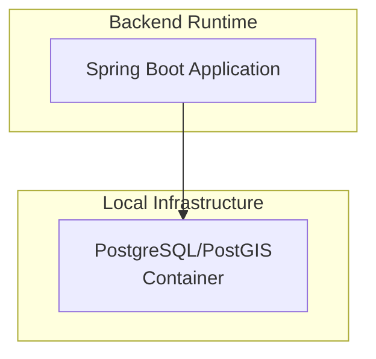
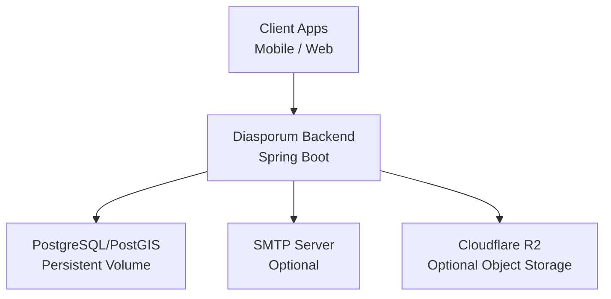
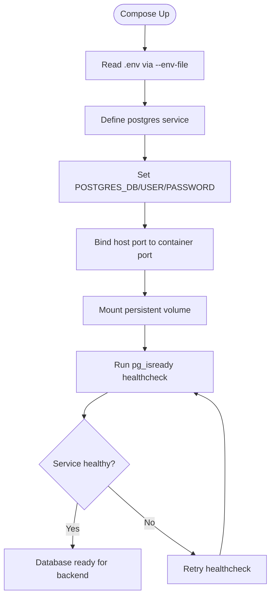
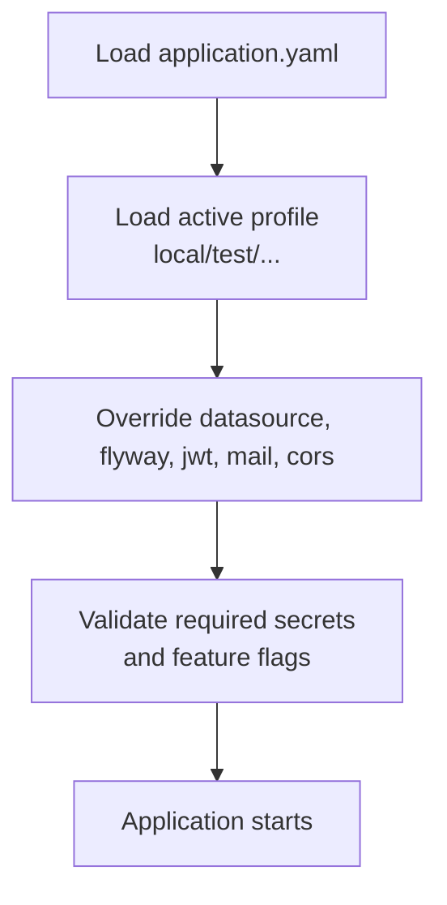
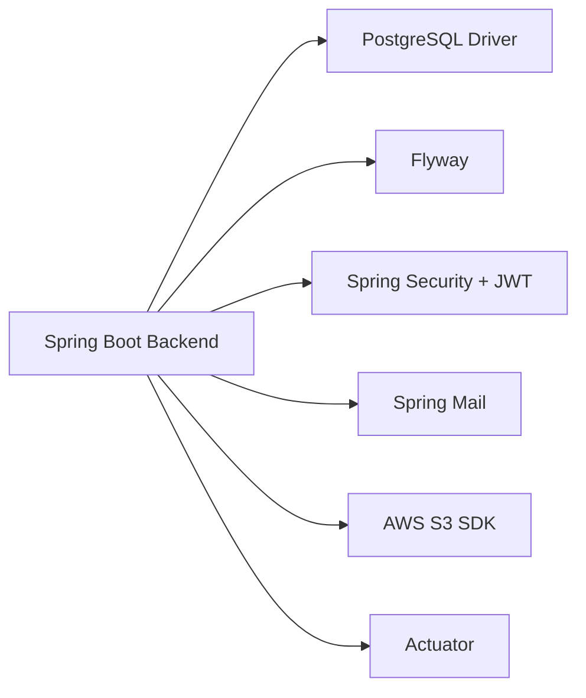

# Deployment and Operations

<cite>
**Referenced Files in This Document**
- [compose.yaml](file://compose.yaml)
- [application.yaml](file://diasporum-backend/src/main/resources/application.yaml)
- [application-local.yml](file://diasporum-backend/src/main/resources/application-local.yml)
- [application-test.yml](file://diasporum-backend/src/test/resources/application-test.yml)
- [pom.xml](file://diasporum-backend/pom.xml)
- [LOCAL_DATABASE_SETUP.md](file://LOCAL_DATABASE_SETUP.md)
- [LOCAL_KEYCLOAK_SETUP.md](file://LOCAL_KEYCLOAK_SETUP.md)
</cite>

## Table of Contents
1. [Introduction](#introduction)
2. [Project Structure](#project-structure)
3. [Core Components](#core-components)
4. [Architecture Overview](#architecture-overview)
5. [Detailed Component Analysis](#detailed-component-analysis)
6. [Dependency Analysis](#dependency-analysis)
7. [Performance Considerations](#performance-considerations)
8. [Troubleshooting Guide](#troubleshooting-guide)
9. [Conclusion](#conclusion)
10. [Appendices](#appendices)

## Introduction
This document provides deployment and operations guidance for the DIASPORUM platform, focusing on container orchestration with Docker Compose, service dependencies, environment configuration management, production readiness considerations, scaling, monitoring, backup and recovery, disaster recovery planning, maintenance tasks, performance tuning, logging strategies, and operational monitoring setup.

The backend is a Spring Boot application that uses PostgreSQL/PostGIS for persistence, Flyway for schema migrations, JWT-based first-party authentication, optional SMTP email delivery, and optional Cloudflare R2-compatible object storage. The current repository includes a development-focused Docker Compose file that provisions PostgreSQL/PostGIS and intentionally excludes Redis, Ably, LiveKit, and other services until explicitly approved. Keycloak is removed from the default compose stack; it remains documented as an optional local OIDC identity provider for development.

## Project Structure
At a high level, the repository contains:
- A root Docker Compose definition for local infrastructure.
- A Spring Boot backend with layered modules and resource-based configuration.
- Mobile and web client projects (not covered by this operations guide).
- Documentation files describing local database and Keycloak setup.

**Diagram sources**
- [compose.yaml:21-41](file://compose.yaml#L21-L41)
- [application.yaml:1-74](file://diasporum-backend/src/main/resources/application.yaml#L1-L74)

**Section sources**
- [compose.yaml:1-50](file://compose.yaml#L1-L50)
- [LOCAL_DATABASE_SETUP.md:1-55](file://LOCAL_DATABASE_SETUP.md#L1-L55)

## Core Components
- PostgreSQL/PostGIS service: persistent development database managed by Docker Compose with health checks and named volume persistence.
- Spring Boot backend:
  - Configuration via `application.yaml` and profile-specific overrides such as `application-local.yml`.
  - Database access through JPA/Hibernate with Flyway migrations.
  - Authentication using RS256 JWTs with configurable issuer, audience, TTLs, and key material.
  - Optional SMTP mail delivery and optional Cloudflare R2 media storage.
  - Actuator dependency available for operational endpoints.

Key operational implications:
- Secrets and runtime values are supplied via environment variables.
- Local development enables ephemeral JWT keys and log-only mail delivery.
- Production must disable ephemeral keys and configure real secrets.

**Section sources**
- [compose.yaml:21-41](file://compose.yaml#L21-L41)
- [application.yaml:1-74](file://diasporum-backend/src/main/resources/application.yaml#L1-L74)
- [application-local.yml:1-45](file://diasporum-backend/src/main/resources/application-local.yml#L1-L45)
- [pom.xml:32-151](file://diasporum-backend/pom.xml#L32-L151)

## Architecture Overview
The operational architecture centers on the backend connecting to a PostgreSQL/PostGIS instance. External identity providers (Google/Apple) are used only for identity verification, not session authority. Keycloak is not part of the default compose stack but can be used locally for OIDC development.

**Diagram sources**
- [compose.yaml:21-41](file://compose.yaml#L21-L41)
- [application.yaml:11-74](file://diasporum-backend/src/main/resources/application.yaml#L11-L74)

## Detailed Component Analysis

### Docker Compose Orchestration
The compose file defines:
- A single PostgreSQL/PostGIS service with:
  - Environment variables for database name, user, and password.
  - Host port binding for local access.
  - Persistent data volume.
  - Health check using `pg_isready`.
- No Keycloak service in the default stack.
- Explicit warnings about data safety when using `down -v`.

Operational notes:
- Use `--env-file` pointing to the backend `.env` for variable interpolation.
- Avoid `down -v` unless you intend to destroy the database volume.
- The approved clean-install SQL is not executed automatically against this database.

**Diagram sources**
- [compose.yaml:1-50](file://compose.yaml#L1-L50)

**Section sources**
- [compose.yaml:1-50](file://compose.yaml#L1-L50)
- [LOCAL_DATABASE_SETUP.md:27-41](file://LOCAL_DATABASE_SETUP.md#L27-L41)

### Spring Boot Configuration and Profiles
Configuration is split between:
- `application.yaml`: base configuration for mail, auth, CORS, and optional media storage.
- `application-local.yml`: local development overrides for datasource, Flyway baseline, actuator mail probe, JWT ephemeral keys, mail provider, and CORS origins.
- `application-test.yml`: placeholder for test profile; integration tests expect Testcontainers PostgreSQL/PostGIS.

Important settings:
- Mail provider defaults to empty; local profile sets it to log-only.
- JWT allows ephemeral keys in local profile; disabled by default in base config.
- CORS allowed origins configured per environment.
- Cloudflare R2 storage is disabled by default and requires explicit enablement plus endpoint credentials.

**Diagram sources**
- [application.yaml:1-74](file://diasporum-backend/src/main/resources/application.yaml#L1-L74)
- [application-local.yml:1-45](file://diasporum-backend/src/main/resources/application-local.yml#L1-L45)
- [application-test.yml:1-6](file://diasporum-backend/src/test/resources/application-test.yml#L1-L6)

**Section sources**
- [application.yaml:1-74](file://diasporum-backend/src/main/resources/application.yaml#L1-L74)
- [application-local.yml:1-45](file://diasporum-backend/src/main/resources/application-local.yml#L1-L45)
- [application-test.yml:1-6](file://diasporum-backend/src/test/resources/application-test.yml#L1-L6)

### Database Migrations and Schema Management
- Flyway is enabled and scans `classpath:db/migration`.
- Local profile sets `baseline-on-migrate=true` and `baseline-version=1`, allowing existing databases provisioned directly from the approved v10.12 schema to coexist with Flyway.
- On an empty schema, V1 applies normally.
- Hibernate DDL auto mode is set to validate, deferring schema changes to Flyway.

Operational guidance:
- Treat Flyway as the source of truth for schema evolution.
- Do not manually alter tables outside migrations.
- For new environments, ensure the baseline migration aligns with the deployed schema version.

**Section sources**
- [application-local.yml:11-23](file://diasporum-backend/src/main/resources/application-local.yml#L11-L23)
- [pom.xml:41-44](file://diasporum-backend/pom.xml#L41-L44)
- [pom.xml:76-78](file://diasporum-backend/pom.xml#L76-L78)

### Authentication and Security Configuration
- First-party RS256 JWT signing with configurable issuer, audience, token TTLs, session TTL, and key material.
- Ephemeral key generation is disabled by default and only enabled in local profile.
- Google and Apple clients are external identity-verification providers only.
- Actuator dependency is present; health endpoints should be secured in production.

Production requirements:
- Provide non-empty private/public keys or integrate with a secret manager.
- Keep `allow-ephemeral-keys` false.
- Configure appropriate issuer and audience values.
- Restrict actuator endpoints behind authentication and network policies.

**Section sources**
- [application.yaml:26-45](file://diasporum-backend/src/main/resources/application.yaml#L26-L45)
- [application-local.yml:33-44](file://diasporum-backend/src/main/resources/application-local.yml#L33-L44)
- [pom.xml:32-36](file://diasporum-backend/pom.xml#L32-L36)

### Email Delivery Configuration
- Mail provider can be set to `local` (log-only) or `smtp`.
- Local profile sets provider to `local`; base config leaves it empty so startup fails if no provider is configured.
- SMTP host, port, username, password, and TLS/SSL options are environment-driven.
- Actuator mail health probe is disabled in local profile due to log-only provider.

Operational guidance:
- In production, set provider to `smtp` and supply valid SMTP credentials.
- Ensure TLS settings match your SMTP server policy.
- Monitor mail delivery failures separately from application logs.

**Section sources**
- [application.yaml:11-25](file://diasporum-backend/src/main/resources/application.yaml#L11-L25)
- [application.yaml:46-53](file://diasporum-backend/src/main/resources/application.yaml#L46-L53)
- [application-local.yml:25-31](file://diasporum-backend/src/main/resources/application-local.yml#L25-L31)
- [application-local.yml:39-41](file://diasporum-backend/src/main/resources/application-local.yml#L39-L41)

### Media Storage Configuration
- Cloudflare R2 support is disabled by default.
- Requires enabling the feature and providing endpoint, region, bucket, and credentials.
- Upload/download URL TTLs and session TTL are configurable.
- Max upload size is configurable.

Operational guidance:
- Only enable R2 when all required fields are provided.
- Rotate credentials regularly and store them securely.
- Tune TTLs based on client behavior and network conditions.

**Section sources**
- [application.yaml:59-74](file://diasporum-backend/src/main/resources/application.yaml#L59-L74)

### Optional Keycloak Development Identity Provider
Keycloak is not included in the default compose stack. It is documented as an optional local OIDC provider for development with:
- Separate environment file for Keycloak bootstrap variables.
- Dedicated database schema within the shared PostgreSQL instance.
- Realm and client configuration steps.
- Clear distinction between development (`start-dev`) and production usage.

Operational guidance:
- Use Keycloak only for local OIDC development where needed.
- Never use Keycloak’s development settings in production.
- Manage realm exports and imports through reviewed processes.

**Section sources**
- [LOCAL_KEYCLOAK_SETUP.md:1-97](file://LOCAL_KEYCLOAK_SETUP.md#L1-L97)

## Dependency Analysis
The backend depends on:
- PostgreSQL JDBC driver for connectivity.
- Flyway for schema migrations.
- Spring Security and JWT libraries for authentication.
- Spring Mail for SMTP delivery.
- AWS S3 SDK for optional R2 storage.
- Spring Boot Actuator for operational endpoints.

**Diagram sources**
- [pom.xml:32-151](file://diasporum-backend/pom.xml#L32-L151)

**Section sources**
- [pom.xml:32-151](file://diasporum-backend/pom.xml#L32-L151)

## Performance Considerations
- Database connection pool sizing should match expected concurrency and PostgreSQL capacity.
- Enable connection pooling and tune JVM heap and GC parameters for sustained workloads.
- Use read replicas for read-heavy workloads if supported by your deployment target.
- Cache static or infrequently changing data at the application layer where appropriate.
- Offload heavy background jobs to dedicated workers or queues if introduced later.
- Monitor query performance and add indexes based on actual workload patterns.
- Avoid unnecessary large payloads; paginate responses and compress where possible.

[No sources needed since this section provides general guidance]

## Troubleshooting Guide
Common issues and resolutions:
- PostgreSQL not healthy:
  - Verify environment variables for database name, user, and password.
  - Check host port conflicts and firewall rules.
  - Inspect container logs and health check status.
- Backend cannot connect to database:
  - Confirm JDBC URL, username, and password.
  - Ensure Flyway baseline matches the existing schema.
  - Validate network reachability from the application container or host.
- JWT validation failures:
  - Ensure private/public keys are correctly loaded.
  - Disable ephemeral keys in production.
  - Verify issuer and audience values.
- Email delivery problems:
  - Set provider to `smtp` and provide valid credentials.
  - Validate TLS/SSL settings with your SMTP server.
- R2 storage errors:
  - Confirm all required fields are set and credentials are valid.
  - Check bucket permissions and network egress.

Operational checks:
- Use `docker inspect` and `docker exec` commands to verify database readiness.
- Review application logs for startup errors and runtime exceptions.
- Secure actuator endpoints and monitor their outputs.

**Section sources**
- [compose.yaml:26-41](file://compose.yaml#L26-L41)
- [application.yaml:26-74](file://diasporum-backend/src/main/resources/application.yaml#L26-L74)
- [LOCAL_DATABASE_SETUP.md:43-55](file://LOCAL_DATABASE_SETUP.md#L43-L55)

## Conclusion
DIASPORUM’s current deployment model centers on a Spring Boot backend backed by PostgreSQL/PostGIS, orchestrated via Docker Compose for local development. Configuration is environment-driven, with clear separation between local and production behaviors. For production, operators must secure secrets, disable ephemeral JWT keys, configure SMTP and optional R2 storage, and harden actuator endpoints. Backup and disaster recovery procedures should focus on the PostgreSQL volume and application configuration, with regular testing of restore processes. Monitoring and logging should be integrated into the deployment target, and performance tuning should be guided by real-world metrics.

[No sources needed since this section summarizes without analyzing specific files]

## Appendices

### Environment Variables Reference
- Database:
  - `DIASPORUM_DB_NAME`, `DIASPORUM_DB_USERNAME`, `DIASPORUM_DB_PASSWORD`, `DIASPORUM_DB_PORT`, `DIASPORUM_DB_URL`
- SMTP:
  - `DIASPORUM_SMTP_HOST`, `DIASPORUM_SMTP_PORT`, `DIASPORUM_SMTP_USERNAME`, `DIASPORUM_SMTP_PASSWORD`, `DIASPORUM_SMTP_AUTH`, `DIASPORUM_SMTP_STARTTLS`, `DIASPORUM_SMTP_STARTTLS_REQUIRED`, `DIASPORUM_SMTP_SSL`
- Auth:
  - `DIASPORUM_JWT_ISSUER`, `DIASPORUM_JWT_AUDIENCE`, `DIASPORUM_ACCESS_TOKEN_TTL`, `DIASPORUM_REFRESH_TOKEN_TTL`, `DIASPORUM_SESSION_TTL`, `DIASPORUM_JWT_PRIVATE_KEY`, `DIASPORUM_JWT_PUBLIC_KEY`, `DIASPORUM_JWT_KID`, `DIASPORUM_JWT_ALLOW_EPHEMERAL_KEYS`
- External Identity Providers:
  - `DIASPORUM_GOOGLE_CLIENT_IDS`, `DIASPORUM_APPLE_CLIENT_ID`
- Mail:
  - `DIASPORUM_MAIL_PROVIDER`, `DIASPORUM_MAIL_FROM`, `DIASPORUM_APP_BASE_URL`
- CORS:
  - `DIASPORUM_CORS_ALLOWED_ORIGINS`
- R2 Storage:
  - `R2_ENABLED`, `CLOUDFLARE_R2_ENDPOINT`, `CLOUDFLARE_R2_REGION`, `CLOUDFLARE_R2_BUCKET`, `CLOUDFLARE_R2_ACCESS_KEY_ID`, `CLOUDFLARE_R2_SECRET_ACCESS_KEY`, `R2_UPLOAD_URL_TTL`, `R2_DOWNLOAD_URL_TTL`, `R2_UPLOAD_SESSION_TTL`, `R2_MAX_UPLOAD_BYTES`

**Section sources**
- [application.yaml:11-74](file://diasporum-backend/src/main/resources/application.yaml#L11-L74)
- [LOCAL_DATABASE_SETUP.md:14-24](file://LOCAL_DATABASE_SETUP.md#L14-L24)

### Backup and Recovery Procedures
- Back up the PostgreSQL data volume used by the compose stack.
- Export application configuration and secrets from your secret manager.
- Periodically test restoring the database and verifying application startup.
- Document runbooks for full cluster restoration and failover scenarios.

[No sources needed since this section provides general guidance]

### Disaster Recovery Planning
- Define RPO and RTO targets aligned with business requirements.
- Maintain offsite backups of database volumes and configuration.
- Automate backup scheduling and retention policies.
- Conduct regular disaster recovery drills and update procedures accordingly.

[No sources needed since this section provides general guidance]

### Maintenance Tasks
- Rotate secrets (JWT keys, SMTP credentials, R2 credentials).
- Apply database migrations through Flyway following change control.
- Update base images and dependencies according to security advisories.
- Review and prune unused configurations and features.

[No sources needed since this section provides general guidance]

### Logging Strategies
- Centralize application logs in your logging platform.
- Include correlation IDs for request tracing.
- Mask sensitive data in logs.
- Configure log levels per environment and rotate logs appropriately.

[No sources needed since this section provides general guidance]

### Operational Monitoring Setup
- Expose actuator endpoints securely and monitor health, metrics, and info.
- Track database connectivity, query latency, and error rates.
- Monitor SMTP delivery success/failure and R2 upload/download metrics.
- Set alerts for critical thresholds and anomalies.

[No sources needed since this section provides general guidance]