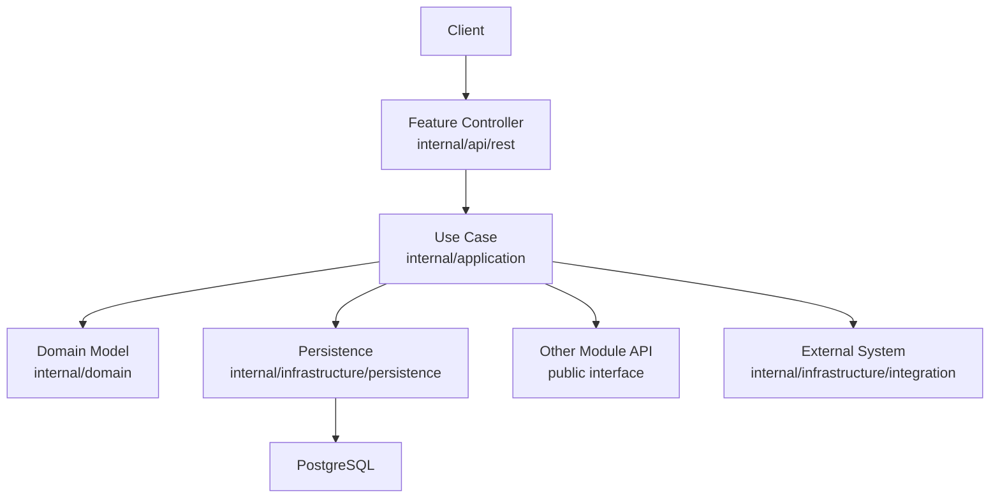
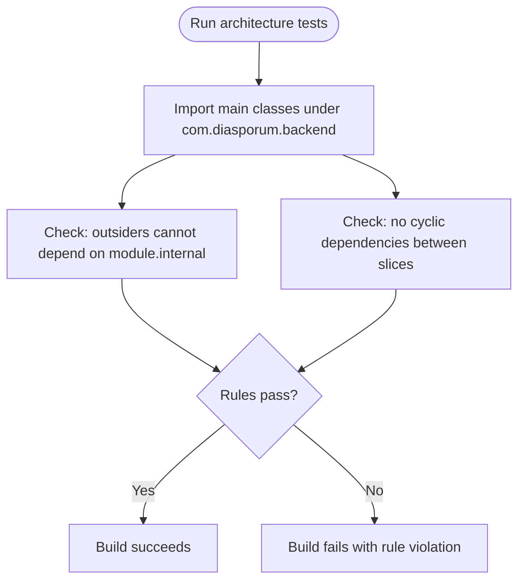
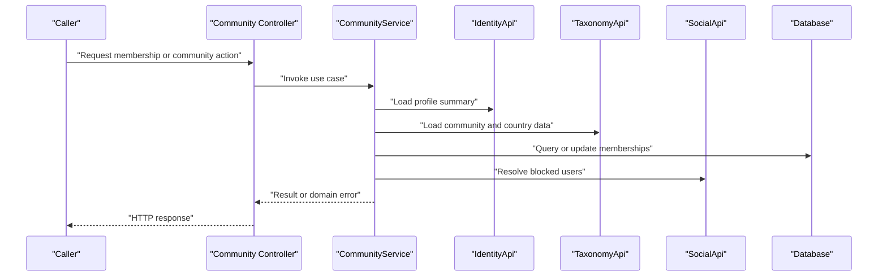
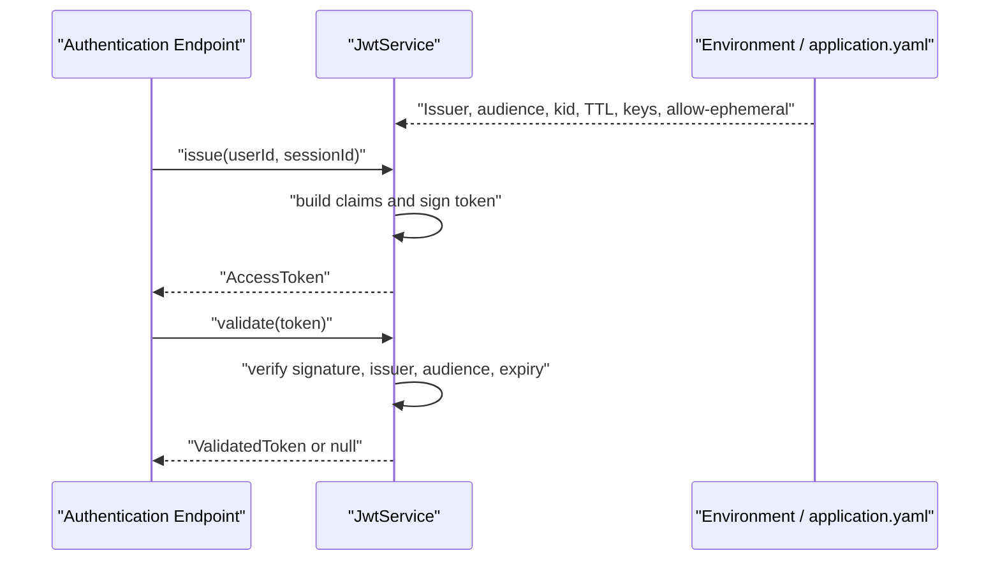
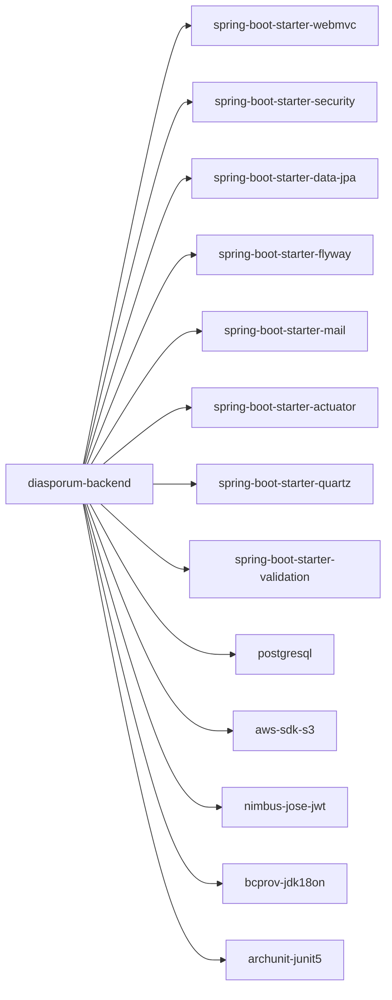

# Development Guidelines

<cite>
**Referenced Files in This Document**
- [pom.xml](file://diasporum-backend/pom.xml)
- [DiasporumBackendApplication.java](file://diasporum-backend/src/main/java/com/diasporum/backend/DiasporumBackendApplication.java)
- [ModuleBoundaryTest.java](file://diasporum-backend/src/test/java/com/diasporum/backend/architecture/ModuleBoundaryTest.java)
- [CommunityApi.java](file://diasporum-backend/src/main/java/com/diasporum/backend/community/CommunityApi.java)
- [CommunityService.java](file://diasporum-backend/src/main/java/com/diasporum/backend/community/internal/application/CommunityService.java)
- [IdentityApi.java](file://diasporum-backend/src/main/java/com/diasporum/backend/identity/IdentityApi.java)
- [JwtService.java](file://diasporum-backend/src/main/java/com/diasporum/backend/security/JwtService.java)
- [application.yaml](file://diasporum-backend/src/main/resources/application.yaml)
- [ApiExceptionHandler.java](file://diasporum-backend/src/main/java/com/diasporum/backend/platform/api/error/ApiExceptionHandler.java)
- [Diasporum_Spring_Boot_REST_API_Folder_Structure_v10_12.md](file://Diasporum_v10.12/Diasporum_Spring_Boot_REST_API_Folder_Structure_v10_12.md)
- [DIASPORUM_BACKEND_STRUCTURE_REPORT.md](file://DIASPORUM_BACKEND_STRUCTURE_REPORT.md)
</cite>

## Table of Contents
1. [Introduction](#introduction)
2. [Project Structure](#project-structure)
3. [Core Components](#core-components)
4. [Architecture Overview](#architecture-overview)
5. [Detailed Component Analysis](#detailed-component-analysis)
6. [Dependency Analysis](#dependency-analysis)
7. [Performance Considerations](#performance-considerations)
8. [Security Best Practices](#security-best-practices)
9. [Accessibility Requirements](#accessibility-requirements)
10. [Pull Request and Code Review Process](#pull-request-and-code-review-process)
11. [Adding New Features and Breaking Changes](#adding-new-features-and-breaking-changes)
12. [Quality Gates and Checklists](#quality-gates-and-checklists)
13. [Troubleshooting Guide](#troubleshooting-guide)
14. [Conclusion](#conclusion)

## Introduction
This document defines the development guidelines for contributing to DIASPORUM. It covers coding standards, naming conventions, package organization, module boundaries, domain-driven design practices, pull request workflow, code review standards, quality gates, security, performance, accessibility, and templates for common tasks.

The backend is a Spring Boot 4.1 application on Java 21 organized as a modular monolith. Each feature module exposes a narrow public API at the module root and keeps implementation details under `internal`. Cross-module communication must go through these public APIs. Architecture rules are enforced by ArchUnit tests.

## Project Structure
The repository contains:
- A Spring Boot backend under `diasporum-backend`.
- A mobile application under `diasporum-mobile`.
- A web application under `diasporum-web`.
- Keycloak configuration under `keycloak`.
- Design and documentation artifacts at the repository root.
- Versioned reference documentation under `Diasporum_v10.11-OLD` and `Diasporum_v10.12`.

The backend follows the approved folder structure for a Spring Boot REST API modular monolith. The approved structure defines module roots with public interfaces, plus `internal/{api/rest, application, domain, infrastructure, config}`. Shared technical capabilities such as global error handling live under `platform.api.error`.

```mermaid
graph TB
Root["com.diasporum.backend"] --> Platform["platform"]
Root --> Security["security"]
Root --> Identity["identity"]
Root --> Community["community"]
Root --> Feed["feed"]
Root --> Social["social"]
Root --> Taxonomy["taxonomy"]
Root --> Media["media"]
Root --> Messaging["messaging"]
Root --> Voice["voice"]
Root --> Billing["billing"]
Root --> Notifications["notifications"]
Root --> Moderation["moderation"]
Root --> Administration["administration"]
Root --> AppConfiguration["appconfiguration"]
Root --> BusinessAccounts["businessaccounts"]
Root --> BusinessDirectory["businessdirectory"]
Root --> Events["events"]
Root --> Jobs["jobs"]
Root --> PropertyListings["propertylistings"]
Root --> VehicleListings["vehiclelistings"]
Root --> Sparebag["sparebag"]
Root --> Matchmaking["matchmaking"]
Root --> ServiceMarketplace["servicemarketplace"]
Community --> Identity
Community --> Taxonomy
Community --> Social
```

**Diagram sources**
- [ModuleBoundaryTest.java:24-30](file://diasporum-backend/src/test/java/com/diasporum/backend/architecture/ModuleBoundaryTest.java#L24-L30)
- [CommunityService.java:3-9](file://diasporum-backend/src/main/java/com/diasporum/backend/community/internal/application/CommunityService.java#L3-L9)

**Section sources**
- [Diasporum_Spring_Boot_REST_API_Folder_Structure_v10_12.md:96-156](file://Diasporum_v10.12/Diasporum_Spring_Boot_REST_API_Folder_Structure_v10_12.md#L96-L156)
- [DIASPORUM_BACKEND_STRUCTURE_REPORT.md:68-75](file://DIASPORUM_BACKEND_STRUCTURE_REPORT.md#L68-L75)

## Core Components
The backend core consists of:
- Application entry point.
- Feature modules with public APIs.
- Security services for JWT issuance and validation.
- Global exception handling.
- Configuration via environment variables.

### Backend Entry Point
The application starts from the Spring Boot main class. Keep this class minimal; do not add business logic here.

**Section sources**
- [DiasporumBackendApplication.java:1-14](file://diasporum-backend/src/main/java/com/diasporum/backend/DiasporumBackendApplication.java#L1-L14)

### Public Module APIs
Each module exposes a public interface at the module root. Examples:
- `CommunityApi`: membership, active community selection, and role checks.
- `IdentityApi`: external identity lookup, profile summary, and user settings accessors.

Other modules must consume only these public interfaces. Direct imports of `module.internal.*` are forbidden.

**Section sources**
- [CommunityApi.java:1-52](file://diasporum-backend/src/main/java/com/diasporum/backend/community/CommunityApi.java#L1-L52)
- [IdentityApi.java:1-62](file://diasporum-backend/src/main/java/com/diasporum/backend/identity/IdentityApi.java#L1-L62)

### Security Service
`JwtService` issues RS256 JWTs, validates signatures, issuer, audience, and expiry, and exposes a JWK set. Keys may be configured PEM pairs or generated per boot only when explicitly allowed for local development.

**Section sources**
- [JwtService.java:20-80](file://diasporum-backend/src/main/java/com/diasporum/backend/security/JwtService.java#L20-L80)
- [JwtService.java:108-161](file://diasporum-backend/src/main/java/com/diasporum/backend/security/JwtService.java#L108-L161)

### Global Error Handling
`ApiExceptionHandler` translates exceptions into a shared `ApiError` envelope. Validation failures, malformed requests, explicit error responses, and unexpected errors are handled centrally.

**Section sources**
- [ApiExceptionHandler.java:16-63](file://diasporum-backend/src/main/java/com/diasporum/backend/platform/api/error/ApiExceptionHandler.java#L16-L63)

### Configuration
`application.yaml` defines defaults for Spring, mail, CORS, media storage, and JWT settings. Sensitive values should be provided via environment variables. Ephemeral JWT keys are disabled by default and must remain disabled outside local development.

**Section sources**
- [application.yaml:1-74](file://diasporum-backend/src/main/resources/application.yaml#L1-L74)

## Architecture Overview
The system follows a modular monolith pattern:
- Modules own their domain, application use cases, persistence, and integration adapters.
- Controllers belong under `internal/api/rest`.
- Use cases belong under `internal/application`.
- Domain models and policies belong under `internal/domain`.
- Persistence belongs under `internal/infrastructure/persistence`.
- External integrations belong under `internal/infrastructure/integration`.
- Public APIs are defined at the module root.

**Diagram sources**
- [Diasporum_Spring_Boot_REST_API_Folder_Structure_v10_12.md:144-156](file://Diasporum_v10.12/Diasporum_Spring_Boot_REST_API_Folder_Structure_v10_12.md#L144-L156)

## Detailed Component Analysis

### Module Boundary Enforcement
The project enforces two key architectural rules using ArchUnit:
1. No class outside a module may depend on that module’s `internal` packages.
2. Feature modules must not form cyclic dependencies.

These rules run against production classes only; test classes are excluded.

**Diagram sources**
- [ModuleBoundaryTest.java:14-20](file://diasporum-backend/src/test/java/com/diasporum/backend/architecture/ModuleBoundaryTest.java#L14-L20)
- [ModuleBoundaryTest.java:42-59](file://diasporum-backend/src/test/java/com/diasporum/backend/architecture/ModuleBoundaryTest.java#L42-L59)

**Section sources**
- [ModuleBoundaryTest.java:14-60](file://diasporum-backend/src/test/java/com/diasporum/backend/architecture/ModuleBoundaryTest.java#L14-L60)

### Community Module Use Case Flow
The community module coordinates membership, eligibility, active community selection, and role authorization. It depends on:
- `IdentityApi` for profile and user settings.
- `TaxonomyApi` for catalogue data.
- `SocialApi` for block relationships.
- JDBC for direct queries where appropriate.

**Diagram sources**
- [CommunityService.java:21-43](file://diasporum-backend/src/main/java/com/diasporum/backend/community/internal/application/CommunityService.java#L21-L43)
- [CommunityService.java:127-187](file://diasporum-backend/src/main/java/com/diasporum/backend/community/internal/application/CommunityService.java#L127-L187)

**Section sources**
- [CommunityService.java:21-333](file://diasporum-backend/src/main/java/com/diasporum/backend/community/internal/application/CommunityService.java#L21-L333)

### JWT Issuance and Validation Flow
JWT operations are centralized in `JwtService`. The service validates configuration at startup, supports persistent PEM keys, and allows ephemeral keys only when explicitly enabled.

**Diagram sources**
- [JwtService.java:41-80](file://diasporum-backend/src/main/java/com/diasporum/backend/security/JwtService.java#L41-L80)
- [JwtService.java:108-154](file://diasporum-backend/src/main/java/com/diasporum/backend/security/JwtService.java#L108-L154)
- [application.yaml:26-41](file://diasporum-backend/src/main/resources/application.yaml#L26-L41)

**Section sources**
- [JwtService.java:20-163](file://diasporum-backend/src/main/java/com/diasporum/backend/security/JwtService.java#L20-L163)
- [application.yaml:26-41](file://diasporum-backend/src/main/resources/application.yaml#L26-L41)

### Naming Conventions
Follow these conventions consistently across all modules:
- Package names: lowercase, dot-separated, matching the approved module names.
- Classes: PascalCase.
- Interfaces: PascalCase, often ending with `Api`, `Service`, `Controller`, `Repository`, `Mapper`, `Policy`, `Exception`.
- Records: PascalCase for DTOs and view types.
- Methods and fields: camelCase.
- Constants: UPPER_SNAKE_CASE.
- Test classes: end with `Test`; integration tests may include descriptive suffixes such as `IntegrationTest`.
- Configuration properties: kebab-case in YAML, mapped to environment variables with uppercase underscores.

**Section sources**
- [CommunityApi.java:13-50](file://diasporum-backend/src/main/java/com/diasporum/backend/community/CommunityApi.java#L13-L50)
- [IdentityApi.java:17-60](file://diasporum-backend/src/main/java/com/diasporum/backend/identity/IdentityApi.java#L17-L60)
- [application.yaml:26-74](file://diasporum-backend/src/main/resources/application.yaml#L26-L74)

### Domain-Driven Design Practices
Apply DDD principles within each module:
- Keep domain logic in `internal/domain`.
- Represent entities, value objects, policies, and domain events separately.
- Use application layer use cases to coordinate commands, queries, and cross-module calls.
- Keep controllers thin: validate input, translate HTTP concerns, delegate to use cases.
- Persist domain state through repositories or persistence mappers.
- Prefer explicit domain exceptions over generic runtime exceptions.

**Section sources**
- [Diasporum_Spring_Boot_REST_API_Folder_Structure_v10_12.md:144-156](file://Diasporum_v10.12/Diasporum_Spring_Boot_REST_API_Folder_Structure_v10_12.md#L144-L156)

## Dependency Analysis
The backend declares Spring Boot starters, security, validation, mail, Flyway, Quartz, PostgreSQL driver, AWS S3 SDK, Nimbus JWT, Bouncy Castle, and ArchUnit for architecture tests.

**Diagram sources**
- [pom.xml:32-151](file://diasporum-backend/pom.xml#L32-L151)

**Section sources**
- [pom.xml:1-164](file://diasporum-backend/pom.xml#L1-L164)

## Performance Considerations
- Prefer batch operations for enrichment, such as batch profile lookups.
- Avoid N+1 queries; use joins or batched reads where possible.
- Keep transaction scopes small and focused on write boundaries.
- Use pagination for list endpoints.
- Cache read-heavy data only when consistency requirements allow it.
- Validate inputs early to fail fast.
- Avoid heavy object creation in hot paths.
- Monitor database query plans for expensive operations.
- Use connection pooling and tune timeouts according to workload.
- For media uploads, respect configured size limits and session TTLs.

[No sources needed since this section provides general guidance]

## Security Best Practices
- Never expose secrets in source control. Use environment variables.
- Configure persistent RSA key pairs for JWT signing in non-local environments.
- Disable ephemeral JWT keys outside local development and tests.
- Validate JWT issuer, audience, signature, and expiry.
- Enforce CORS only for trusted browser origins.
- Apply authentication and authorization at controller boundaries.
- Use least-privilege database credentials.
- Sanitize and validate all inputs.
- Log security-relevant events without sensitive data.
- Rotate JWT keys and audit key usage.
- Protect email verification and reset flows against abuse.

**Section sources**
- [JwtService.java:20-80](file://diasporum-backend/src/main/java/com/diasporum/backend/security/JwtService.java#L20-L80)
- [application.yaml:26-58](file://diasporum-backend/src/main/resources/application.yaml#L26-L58)

## Accessibility Requirements
Accessibility applies primarily to client applications. For the backend:
- Provide consistent, predictable error responses so clients can surface accessible messages.
- Support locale-aware error codes and messages where applicable.
- Avoid exposing sensitive personal data in error payloads.
- Ensure API responses are structured so frontend accessibility tools can render meaningful feedback.

For mobile and web clients:
- Use semantic UI components and labels.
- Support keyboard navigation and screen readers.
- Provide sufficient color contrast and text alternatives for media.
- Announce loading, success, and error states clearly.

[No sources needed since this section provides general guidance]

## Pull Request and Code Review Process
### Workflow
1. Create a feature branch from the current main branch.
2. Implement changes following module boundaries and naming conventions.
3. Add unit tests for new logic and integration tests for cross-module flows.
4. Run architecture tests to ensure module boundaries remain intact.
5. Update documentation if behavior changes.
6. Open a pull request with a clear description, affected modules, and testing notes.
7. Address reviewer feedback before merging.
8. Merge after approvals and passing quality gates.

### Code Review Standards
- Verify adherence to module boundaries.
- Confirm public APIs are stable and documented.
- Check error handling and status codes.
- Review security-sensitive changes carefully.
- Validate configuration and environment variable usage.
- Ensure tests cover happy paths, edge cases, and failure scenarios.
- Confirm backward compatibility or breaking change documentation.

### Quality Gates
- All unit tests pass.
- Integration tests pass.
- ArchUnit module boundary tests pass.
- No new warnings introduced by static analysis.
- Security scan passes.
- Documentation updated for behavioral changes.

[No sources needed since this section describes process rather than analyzing specific files]

## Adding New Features and Breaking Changes
### Adding a New Feature
1. Identify the owning module. If none exists, propose a new module following the approved structure.
2. Define the public API at the module root if other modules need to call it.
3. Implement use cases under `internal/application`.
4. Place domain logic under `internal/domain`.
5. Implement persistence under `internal/infrastructure/persistence`.
6. Expose endpoints under `internal/api/rest`.
7. Add tests under the corresponding test package.
8. Run ArchUnit tests to confirm no unintended cross-module dependencies.

### Maintaining Backward Compatibility
- Do not remove or rename existing public API methods without deprecation.
- Preserve existing response shapes unless a migration plan is in place.
- Use versioned API paths when necessary.
- Document deprecations and provide migration guides.

### Handling Breaking Changes
- Clearly label breaking changes in the pull request.
- Update API contracts and client-facing documentation.
- Provide migration scripts or dual-path support where feasible.
- Coordinate release timing with dependent services.

**Section sources**
- [Diasporum_Spring_Boot_REST_API_Folder_Structure_v10_12.md:96-156](file://Diasporum_v10.12/Diasporum_Spring_Boot_REST_API_Folder_Structure_v10_12.md#L96-L156)
- [ModuleBoundaryTest.java:42-59](file://diasporum-backend/src/test/java/com/diasporum/backend/architecture/ModuleBoundaryTest.java#L42-L59)

## Quality Gates and Checklists

### Pre-Commit Checklist
- Code follows naming conventions.
- Package structure matches the approved module layout.
- Public APIs are stable and documented.
- Input validation is applied.
- Errors map to appropriate HTTP status codes.
- Secrets are not committed.
- Tests are added or updated.

### Pre-Merge Checklist
- Unit tests pass.
- Integration tests pass.
- Architecture tests pass.
- No new lint or static analysis warnings.
- Security scan passes.
- Documentation updated.
- Migration scripts reviewed and tested.
- Backward compatibility verified or breaking change documented.

### Template: New Module Skeleton
- Module root: public interface and optional published events.
- `internal/api/rest`: controllers and request/response DTOs.
- `internal/application`: use cases and command/query handlers.
- `internal/domain`: models, value objects, policies, domain exceptions.
- `internal/infrastructure/persistence`: entities, repositories, mappers.
- `internal/infrastructure/integration`: adapters for other modules and external systems.
- `internal/config`: feature-specific configuration.
- `package-info.java`: module documentation.

**Section sources**
- [Diasporum_Spring_Boot_REST_API_Folder_Structure_v10_12.md:96-156](file://Diasporum_v10.12/Diasporum_Spring_Boot_REST_API_Folder_Structure_v10_12.md#L96-L156)

## Troubleshooting Guide

### Common Issues
- **Module boundary violations**: Fix imports so other modules use only public APIs.
- **Cyclic dependencies**: Refactor shared logic into a lower-level module or extract a port/interface.
- **JWT startup failures**: Ensure private and public keys are configured together or enable ephemeral keys only for local development.
- **Email delivery not working**: Configure the mail provider and required SMTP settings; verify the provider is not left empty in production.
- **Unexpected 500 errors**: Check global exception handler mapping and ensure domain exceptions are translated appropriately.

**Section sources**
- [ModuleBoundaryTest.java:42-59](file://diasporum-backend/src/test/java/com/diasporum/backend/architecture/ModuleBoundaryTest.java#L42-L59)
- [JwtService.java:54-80](file://diasporum-backend/src/main/java/com/diasporum/backend/security/JwtService.java#L54-L80)
- [application.yaml:46-58](file://diasporum-backend/src/main/resources/application.yaml#L46-L58)
- [ApiExceptionHandler.java:28-63](file://diasporum-backend/src/main/java/com/diasporum/backend/platform/api/error/ApiExceptionHandler.java#L28-L63)

## Conclusion
DIASPORUM’s development model centers on strong module boundaries, narrow public APIs, and layered internal structure. Contributions should preserve these boundaries, follow the approved folder structure, enforce architecture rules, and apply security and performance best practices. Use the checklists and templates to keep changes consistent, testable, and maintainable.