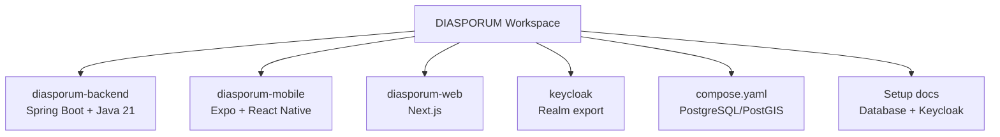
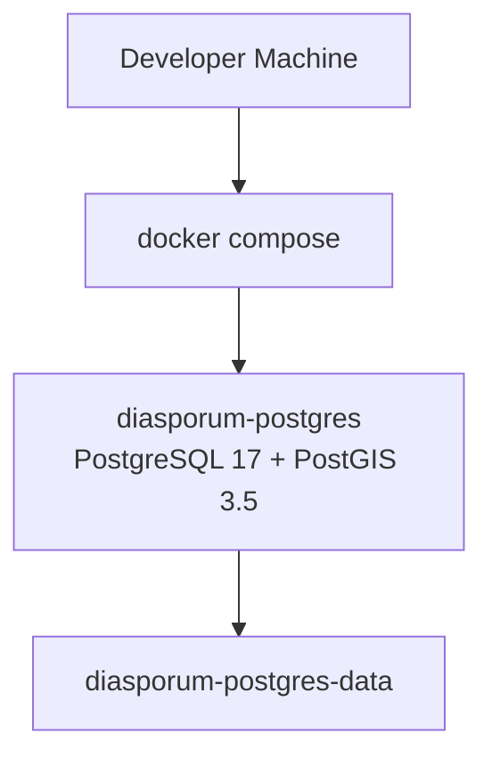
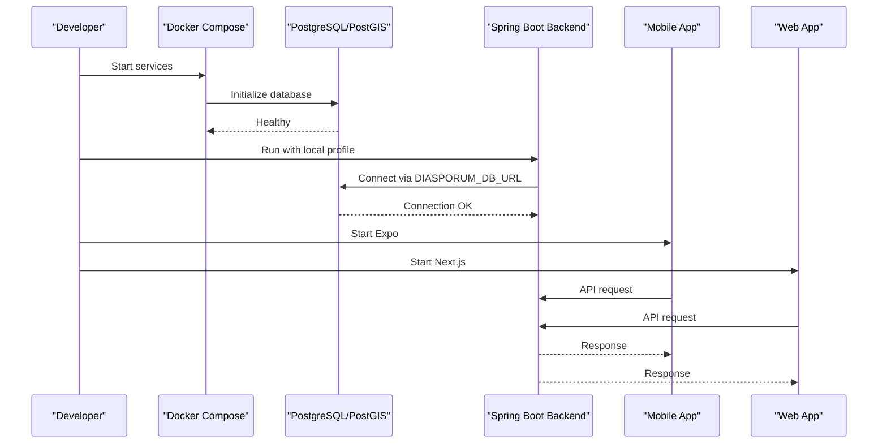

# Getting Started

<cite>
**Referenced Files in This Document**   
- [compose.yaml](file://compose.yaml)
- [LOCAL_DATABASE_SETUP.md](file://LOCAL_DATABASE_SETUP.md)
- [LOCAL_KEYCLOAK_SETUP.md](file://LOCAL_KEYCLOAK_SETUP.md)
- [pom.xml](file://diasporum-backend/pom.xml)
- [application.yaml](file://diasporum-backend/src/main/resources/application.yaml)
- [application-local.yml](file://diasporum-backend/src/main/resources/application-local.yml)
- [package.json](file://diasporum-mobile/package.json)
- [package.json](file://diasporum-web/package.json)
- [realm-diasporum.json](file://keycloak/realm-diasporum.json)
</cite>

## Table of Contents
1. [Introduction](#introduction)
2. [Prerequisites](#prerequisites)
3. [Project Structure](#project-structure)
4. [Environment Configuration](#environment-configuration)
5. [Local Database Setup](#local-database-setup)
6. [Keycloak Authentication Provider](#keycloak-authentication-provider)
7. [Running the Complete System with Docker Compose](#running-the-complete-system-with-docker-compose)
8. [Backend Development Workflow](#backend-development-workflow)
9. [Mobile Application Development Workflow](#mobile-application-development-workflow)
10. [Web Application Development Workflow](#web-application-development-workflow)
11. [Verification and Health Checks](#verification-and-health-checks)
12. [Troubleshooting Guide](#troubleshooting-guide)
13. [Conclusion](#conclusion)

## Introduction

This document explains how to set up a complete local development environment for DIASPORUM. It covers prerequisites, database configuration, authentication provider setup, Docker Compose orchestration, and development workflows for the backend, mobile, and web applications.

The repository contains:

- A Spring Boot 4.1 backend using Java 21, PostgreSQL, PostGIS, Flyway migrations, and first-party JWT authentication.
- An Expo-based React Native mobile application.
- A Next.js web application.
- A Docker Compose file that provisions a persistent PostgreSQL/PostGIS database for local development.
- Keycloak documentation and realm configuration files for OIDC-based authentication.

The current `compose.yaml` intentionally runs only the PostgreSQL/PostGIS service. Keycloak is documented separately because the backend currently uses first-party RS256 JWT signing rather than relying on Keycloak as the session authority.

**Section sources**
- [compose.yaml:1-17](file://compose.yaml#L1-L17)
- [application.yaml:8-10](file://diasporum-backend/src/main/resources/application.yaml#L8-L10)

## Prerequisites

Before starting, install the following tools on your machine.

| Tool | Required Version | Purpose |
|---|---:|---|
| Java | 21 | Backend compilation and runtime |
| Node.js | Compatible with Expo and Next.js tooling | Mobile and web development |
| Docker Desktop or Docker Engine | Running engine required | Containerized PostgreSQL/PostGIS and optional Keycloak |
| `docker compose` plugin | Bundled with Docker Desktop | Service orchestration |
| psql client | Optional | Manual database inspection |

The project explicitly requires Java 21 for the backend. The mobile app uses Expo ~58, React Native 0.88, and React 19. The web app uses Next.js 16.4.3.

For the backend, verify Java availability before proceeding:

```powershell
java -version
```

For the mobile app, you will typically use the Expo CLI through npm scripts. For the web app, you will use the Next.js scripts defined in its package configuration.

**Section sources**
- [pom.xml:29-31](file://diasporum-backend/pom.xml#L29-L31)
- [package.json:5-39](file://diasporum-mobile/package.json#L5-L39)
- [package.json:11-24](file://diasporum-web/package.json#L11-L24)
- [LOCAL_DATABASE_SETUP.md:5-12](file://LOCAL_DATABASE_SETUP.md#L5-L12)

## Project Structure

At the workspace root, the most important directories are:

- `diasporum-backend`: Spring Boot backend with Maven, Flyway migrations, and Spring profiles.
- `diasporum-mobile`: Expo + React Native mobile application.
- `diasporum-web`: Next.js web application.
- `keycloak`: Keycloak realm export and related documentation.
- `compose.yaml`: Local infrastructure definition for PostgreSQL/PostGIS.
- `LOCAL_DATABASE_SETUP.md`: Database setup, environment variables, and commands.
- `LOCAL_KEYCLOAK_SETUP.md`: Keycloak development setup and OIDC configuration.



**Diagram sources**
- [compose.yaml:19-49](file://compose.yaml#L19-L49)
- [LOCAL_DATABASE_SETUP.md:14-23](file://LOCAL_DATABASE_SETUP.md#L14-L23)
- [LOCAL_KEYCLOAK_SETUP.md:15-22](file://LOCAL_KEYCLOAK_SETUP.md#L15-L22)

**Section sources**
- [compose.yaml:19-49](file://compose.yaml#L19-L49)
- [LOCAL_DATABASE_SETUP.md:14-23](file://LOCAL_DATABASE_SETUP.md#L14-L23)

## Environment Configuration

DIASPORUM uses per-project environment files rather than a shared root `.env`. This separation prevents accidental credential leakage between services.

| File | Git Status | Consumed By | Purpose |
|---|---:|---|---|
| `diasporum-backend/.env` | Ignored | Docker Compose interpolation and Spring Boot local profile | Database credentials, Keycloak issuer/audience, mail settings, CORS, media storage |
| `diasporum-backend/.env.example` | Committed | Template | Placeholder values for backend variables |
| `diasporum-mobile/.env` | Ignored | Expo bundle | Client-safe API base URL |
| `diasporum-mobile/.env.example` | Committed | Template | Placeholder values for mobile variables |
| `diasporum-web/.env.local` | Ignored | Next.js | Server-side and public API base URL |
| `diasporum-web/.env.example` | Committed | Template | Placeholder values for web variables |

### Backend Environment Variables

The backend reads database connection details from `application-local.yml`, which resolves variables such as `DIASPORUM_DB_URL`, `DIASPORUM_DB_USERNAME`, and `DIASPORUM_DB_PASSWORD`.

Important backend configuration includes:

- First-party RS256 JWT authentication.
- Google and Apple identity verification providers.
- Mail delivery provider selection.
- CORS allowed origins.
- Cloudflare R2 media storage configuration.

The local profile enables ephemeral JWT keys for development when explicit private/public keys are not provided. Production deployments must disable this behavior.

### Docker Compose Environment Interpolation

The Compose file reads backend environment variables through `--env-file .\diasporum-backend\.env`. Only the three PostgreSQL-related variables (`POSTGRES_DB`, `POSTGRES_USER`, `POSTGRES_PASSWORD`) are injected into the container. Other backend variables are used by Compose interpolation but do not leak into the database container.

**Section sources**
- [LOCAL_DATABASE_SETUP.md:14-29](file://LOCAL_DATABASE_SETUP.md#L14-L29)
- [application-local.yml:6-23](file://diasporum-backend/src/main/resources/application-local.yml#L6-L23)
- [application.yaml:26-74](file://diasporum-backend/src/main/resources/application.yaml#L26-L74)
- [compose.yaml:21-41](file://compose.yaml#L21-L41)

## Local Database Setup

The local database is PostgreSQL 17 with PostGIS 3.5, managed by Docker Compose. The image used is `postgis/postgis:17-3.5`.

### Database Requirements

| Requirement | Details |
|---|---|
| Image | `postgis/postgis:17-3.5` |
| Default database name | `diasporum_dev` |
| Default user | `diasporum` |
| Host port | `5433` by default |
| Internal container port | `5432` |
| Persistent volume | `diasporum-postgres-data` |

### Creating the Backend Environment File

On a new machine, copy the example environment file and choose a local password:

```powershell
copy diasporum-backend\.env.example diasporum-backend\.env
```

Then edit `diasporum-backend/.env` to set at least:

- `DIASPORUM_DB_NAME`
- `DIASPORUM_DB_USERNAME`
- `DIASPORUM_DB_PASSWORD`
- `DIASPORUM_DB_PORT`
- `DIASPORUM_DB_URL`

The database password exists only in the backend environment file. The mobile and web apps never receive database credentials.

### Starting the Database

From the workspace root:

```powershell
docker compose --env-file .\diasporum-backend\.env up -d
```

Check status:

```powershell
docker compose --env-file .\diasporum-backend\.env ps
```

View logs:

```powershell
docker compose --env-file .\diasporum-backend\.env logs -f postgres
```

Stop without deleting data:

```powershell
docker compose --env-file .\diasporum-backend\.env stop
```

Start again:

```powershell
docker compose --env-file .\diasporum-backend\.env start
```

### Important Data Safety Warning

Do not use `docker compose down -v` for routine shutdown. The `-v` flag deletes the named volume `diasporum-postgres-data`, destroying all local database content. Plain `down` removes containers and networks but preserves the volume.

### Connecting the Backend

When running the backend directly on Windows, use:

```text
jdbc:postgresql://localhost:5433/diasporum_dev
```

When running inside the Compose network, use:

```text
jdbc:postgresql://postgres:5432/diasporum_dev
```

The host port is `5433` by default because port `5432` may already be occupied by a native PostgreSQL service on Windows. You can change `DIASPORUM_DB_PORT` and `DIASPORUM_DB_URL` in the backend environment file if needed.

### Schema Management

Flyway manages schema changes under `diasporum-backend/src/main/resources/db/migration`. The baseline migration is applied automatically when the database is empty. If you adopt a pre-populated database instead of an empty one, use the documented Flyway baseline command rather than re-executing the clean-install SQL.

**Section sources**
- [LOCAL_DATABASE_SETUP.md:1-12](file://LOCAL_DATABASE_SETUP.md#L1-L12)
- [LOCAL_DATABASE_SETUP.md:27-41](file://LOCAL_DATABASE_SETUP.md#L27-L41)
- [LOCAL_DATABASE_SETUP.md:50-71](file://LOCAL_DATABASE_SETUP.md#L50-L71)
- [compose.yaml:22-41](file://compose.yaml#L22-L41)

## Keycloak Authentication Provider

Keycloak is documented as a local OIDC identity provider for backend development. However, the current backend uses first-party RS256 JWT signing rather than Keycloak as the session authority. Keycloak remains relevant for external identity verification flows and future OIDC integration.

### Keycloak Overview

| Component | Value |
|---|---|
| Image | `quay.io/keycloak/keycloak:26.2.4` |
| Container name | `diasporum-keycloak` |
| Admin console | `http://localhost:8081` |
| Realm | `diasporum` |
| OIDC issuer | `http://localhost:8081/realms/diasporum` |
| Discovery endpoint | `http://localhost:8081/realms/diasporum/.well-known/openid-configuration` |

### Keycloak Environment Files

Copy the example file before editing:

```powershell
copy keycloak\.env.example keycloak\.env
```

Set local bootstrap admin credentials and database settings. The Keycloak database is isolated from the application database.

### Keycloak Database Isolation

Keycloak uses a separate `keycloak` database on the shared PostgreSQL container. It does not use `diasporum_dev`. A dedicated user owns the Keycloak database and has no grants on the application database.

Create the Keycloak database once:

```sql
CREATE USER keycloak WITH PASSWORD '<KC_DB_PASSWORD>';
CREATE DATABASE keycloak OWNER keycloak;
```

Run these commands against the maintenance database inside the PostgreSQL container.

### Keycloak Commands

Start PostgreSQL and Keycloak:

```powershell
docker compose --env-file .\diasporum-backend\.env up -d
```

Start Keycloak only:

```powershell
docker compose --env-file .\diasporum-backend\.env up -d keycloak
```

Check health:

```powershell
docker inspect -f "{{.State.Health.Status}}" diasporum-keycloak
```

### Realm Bootstrap

The `diasporum` realm is created via `kcadm`. Do not import unreviewed realm exports. The reviewed realm export is available at `keycloak/realm-diasporum.json`, but secrets are masked.

### Clients and Audiences

The realm defines clients for:

- `diasporum-mobile`: Public client with PKCE S256.
- `diasporum-web`: Confidential client with server-side secret.

Both clients include the `diasporum-api` audience scope.

### Backend OIDC Wiring

The backend reads `KEYCLOAK_ISSUER_URI` and `KEYCLOAK_AUDIENCE` from the environment. All endpoints require a bearer token with the expected audience except actuator health and error endpoints.

**Section sources**
- [LOCAL_KEYCLOAK_SETUP.md:1-13](file://LOCAL_KEYCLOAK_SETUP.md#L1-L13)
- [LOCAL_KEYCLOAK_SETUP.md:15-35](file://LOCAL_KEYCLOAK_SETUP.md#L15-L35)
- [LOCAL_KEYCLOAK_SETUP.md:37-47](file://LOCAL_KEYCLOAK_SETUP.md#L37-L47)
- [LOCAL_KEYCLOAK_SETUP.md:49-81](file://LOCAL_KEYCLOAK_SETUP.md#L49-L81)
- [LOCAL_KEYCLOAK_SETUP.md:85-92](file://LOCAL_KEYCLOAK_SETUP.md#L85-L92)
- [realm-diasporum.json:672-768](file://keycloak/realm-diasporum.json#L672-L768)

## Running the Complete System with Docker Compose

The current `compose.yaml` provisions only the PostgreSQL/PostGIS service. It does not run Keycloak, Redis, Ably, LiveKit, or other services unless they are added individually.

### What Runs Now



**Diagram sources**
- [compose.yaml:21-41](file://compose.yaml#L21-L41)
- [compose.yaml:47-49](file://compose.yaml#L47-L49)

### Steps to Start Infrastructure

1. Create `diasporum-backend/.env` from the example file.
2. Set a secure database password.
3. Run from the workspace root:

```powershell
docker compose --env-file .\diasporum-backend\.env up -d
```

4. Wait for the database health check to pass.
5. Start the backend locally using the Spring Boot local profile.

### Why Keycloak Is Not in the Current Compose File

The comment in `compose.yaml` states that Keycloak was removed because the current authentication model uses first-party authentication. Google and Apple remain external identity-verification providers only, not the application session authority.

If you need Keycloak for OIDC testing, follow the separate Keycloak setup documentation rather than expecting it to start automatically with the current Compose file.

**Section sources**
- [compose.yaml:15-17](file://compose.yaml#L15-L17)
- [compose.yaml:43-45](file://compose.yaml#L43-L45)
- [application.yaml:8-10](file://diasporum-backend/src/main/resources/application.yaml#L8-L10)

## Backend Development Workflow

### Backend Stack

The backend is a Spring Boot application built with Maven and Java 21. It uses:

- Spring Security
- JPA
- Flyway
- Quartz
- Validation
- Mail support
- PostgreSQL driver
- Testcontainers for tests

### Install Dependencies

From the backend directory:

```powershell
cd diasporum-backend
.\mvnw clean compile
```

Or build the full artifact:

```powershell
.\mvnw clean package
```

### Configure the Local Profile

Ensure `diasporum-backend/.env` contains valid database variables. Then run the backend with the local profile:

```powershell
.\mvnw spring-boot:run -Dspring-boot.run.profiles=local
```

Alternatively, configure your IDE to:

- Use Java 21.
- Activate the `local` Spring profile.
- Export or inject the backend environment variables.

### How the Backend Connects to the Database

The local profile sets:

- Datasource URL from `DIASPORUM_DB_URL`.
- Username from `DIASPORUM_DB_USERNAME`.
- Password from `DIASPORUM_DB_PASSWORD`.
- Flyway enabled with locations under `classpath:db/migration`.
- Hibernate DDL mode set to validate.

### Build and Test

```powershell
.\mvnw test
```

The backend includes unit and integration tests, including architecture boundary tests, security tests, and module integration tests.

### Verification

After startup:

- Confirm the Spring Boot application starts without database connection errors.
- Confirm Flyway applies or baselines migrations successfully.
- Confirm the application listens on its configured HTTP port.
- Confirm the actuator health endpoint responds if exposed.

**Section sources**
- [pom.xml:32-151](file://diasporum-backend/pom.xml#L32-L151)
- [application-local.yml:6-23](file://diasporum-backend/src/main/resources/application-local.yml#L6-L23)
- [LOCAL_DATABASE_SETUP.md:50-57](file://LOCAL_DATABASE_SETUP.md#L50-L57)

## Mobile Application Development Workflow

### Mobile Stack

The mobile application is built with Expo, React Native, TypeScript, and Jest. It integrates authentication, navigation, feed features, communities, reels, and profile management.

### Install Dependencies

From the mobile directory:

```powershell
cd diasporum-mobile
npm install
```

### Configure the Mobile Environment

Copy the example environment file:

```powershell
copy diasporum-mobile\.env.example diasporum-mobile\.env
```

Set `EXPO_PUBLIC_API_BASE_URL` to point to your running backend API. This variable is client-safe and will be bundled into the Expo app.

### Start the Mobile App

Start Expo:

```powershell
npm start
```

Run on Android:

```powershell
npm run android
```

Run on iOS:

```powershell
npm run ios
```

Run on web:

```powershell
npm run web
```

### Type Checking and Linting

```powershell
npm run typecheck
npm run lint
```

### Testing

```powershell
npm test
```

### Mobile Authentication Flow

The mobile app uses Expo authentication libraries and supports external identity providers. When integrating with Keycloak, the mobile client should use the public client configuration with PKCE S256.

**Section sources**
- [package.json:5-58](file://diasporum-mobile/package.json#L5-L58)
- [LOCAL_DATABASE_SETUP.md:18-21](file://LOCAL_DATABASE_SETUP.md#L18-L21)
- [LOCAL_KEYCLOAK_SETUP.md:66-75](file://LOCAL_KEYCLOAK_SETUP.md#L66-L75)

## Web Application Development Workflow

### Web Stack

The web application is a Next.js project using React, TypeScript, Tailwind CSS, and ESLint.

### Install Dependencies

From the web directory:

```powershell
cd diasporum-web
npm install
```

### Configure the Web Environment

Copy the example environment file:

```powershell
copy diasporum-web\.env.example diasporum-web\.env.local
```

Set:

- `API_BASE_URL` for server-side usage.
- `NEXT_PUBLIC_API_BASE_URL` for client-side usage.

If integrating with Keycloak, store the issuer, client ID, and client secret in the ignored `.env.local` file. These values are server-side only.

### Start the Web App

Development server:

```powershell
npm run dev
```

Build:

```powershell
npm run build
```

Production start:

```powershell
npm run start
```

Lint:

```powershell
npm run lint
```

### Web Authentication Flow

The web client is a confidential client. Its redirect URIs include `http://localhost:3000/api/auth/callback/*` and `http://localhost:3000/`. The client secret must never be exposed to the browser.

**Section sources**
- [package.json:5-24](file://diasporum-web/package.json#L5-L24)
- [LOCAL_DATABASE_SETUP.md:22-23](file://LOCAL_DATABASE_SETUP.md#L22-L23)
- [LOCAL_KEYCLOAK_SETUP.md:66-75](file://LOCAL_KEYCLOAK_SETUP.md#L66-L75)

## Verification and Health Checks

Use these checks to confirm that your environment is properly configured.

### Database Health

```powershell
docker inspect -f "{{.State.Health.Status}}" diasporum-postgres
```

Expected result: `healthy`.

### Database Connectivity

```powershell
docker exec diasporum-postgres pg_isready -U diasporum -d diasporum_dev
```

### Backend Startup

After starting the backend with the local profile:

- Verify no JDBC connection errors.
- Verify Flyway migration or baseline output.
- Verify the application binds to its HTTP port.
- Verify CORS allows your frontend origin if testing cross-origin requests.

### Keycloak Health

```powershell
docker inspect -f "{{.State.Health.Status}}" diasporum-keycloak
```

### API Verification

Once the backend is running:

- Call the health endpoint if exposed.
- Call a protected endpoint with a valid bearer token.
- Confirm unauthorized requests are rejected.
- Confirm tokens contain the expected audience.



**Diagram sources**
- [compose.yaml:21-41](file://compose.yaml#L21-L41)
- [application-local.yml:6-23](file://diasporum-backend/src/main/resources/application-local.yml#L6-L23)
- [package.json:50-58](file://diasporum-mobile/package.json#L50-L58)
- [package.json:5-9](file://diasporum-web/package.json#L5-L9)

**Section sources**
- [LOCAL_DATABASE_SETUP.md:43-48](file://LOCAL_DATABASE_SETUP.md#L43-L48)
- [LOCAL_KEYCLOAK_SETUP.md:43-47](file://LOCAL_KEYCLOAK_SETUP.md#L43-L47)

## Troubleshooting Guide

### PostgreSQL Port Conflict

**Symptom:** The database fails to start or the backend cannot connect.

**Cause:** Port `5432` may already be used by a native PostgreSQL service on Windows.

**Resolution:**

1. Change `DIASPORUM_DB_PORT` in `diasporum-backend/.env`.
2. Update `DIASPORUM_DB_URL` to match the new port.
3. Restart the database:

```powershell
docker compose --env-file .\diasporum-backend\.env restart postgres
```

### Missing or Incorrect Database Credentials

**Symptom:** Backend startup fails with authentication or connection errors.

**Resolution:**

1. Ensure `diasporum-backend/.env` exists.
2. Ensure `DIASPORUM_DB_PASSWORD` is set.
3. Ensure `DIASPORUM_DB_URL`, `DIASPORUM_DB_USERNAME`, and `DIASPORUM_DB_NAME` are consistent.
4. Restart the backend after changing environment variables.

### Flyway Migration Issues

**Symptom:** Flyway reports duplicate migrations, missing history, or baseline conflicts.

**Resolution:**

- On an empty database, Flyway applies V1 normally.
- On a pre-populated database, use the documented baseline command.
- Do not manually delete the schema history table unless you understand the consequences.

### Keycloak Not Starting

**Symptom:** Keycloak container is unhealthy or the admin console is unavailable.

**Resolution:**

1. Ensure `keycloak/.env` exists and contains bootstrap admin credentials.
2. Ensure the `keycloak` database exists on the shared PostgreSQL container.
3. Check logs:

```powershell
docker compose --env-file .\diasporum-backend\.env logs -f keycloak
```

4. Wait for initialization; Keycloak may take 30–60 seconds on first boot.

### CORS Errors from Browser

**Symptom:** Frontend requests to the backend fail due to CORS.

**Resolution:**

1. Add the frontend origin to `DIASPORUM_CORS_ALLOWED_ORIGINS`.
2. The local profile already includes common local origins by default.
3. Restart the backend after changing CORS configuration.

### Mobile App Cannot Reach Backend

**Symptom:** Mobile app shows network errors or login failures.

**Resolution:**

1. Verify `EXPO_PUBLIC_API_BASE_URL` points to the correct backend URL.
2. Ensure the backend is running and reachable from the device or emulator.
3. If using Expo Go, remember that some native modules may require a custom dev client.

### Web App Cannot Reach Backend

**Symptom:** Web app API calls fail or authentication callbacks fail.

**Resolution:**

1. Verify `API_BASE_URL` and `NEXT_PUBLIC_API_BASE_URL`.
2. Verify Keycloak redirect URIs include `http://localhost:3000/api/auth/callback/*`.
3. Ensure the Keycloak client secret is stored only server-side.

### Accidental Data Loss

**Symptom:** Local database data disappears.

**Cause:** Using `docker compose down -v`.

**Resolution:**

- Avoid `-v` for routine operations.
- Recreate the database from backups or re-run migrations if data is lost.
- Remember that `stop`, `start`, and plain `down` preserve the volume.

**Section sources**
- [LOCAL_DATABASE_SETUP.md:41-59](file://LOCAL_DATABASE_SETUP.md#L41-L59)
- [LOCAL_DATABASE_SETUP.md:61-71](file://LOCAL_DATABASE_SETUP.md#L61-L71)
- [LOCAL_KEYCLOAK_SETUP.md:61-64](file://LOCAL_KEYCLOAK_SETUP.md#L61-L64)
- [application-local.yml:42-44](file://diasporum-backend/src/main/resources/application-local.yml#L42-L44)

## Conclusion

To get started with DIASPORUM:

1. Install Java 21, Node.js, and Docker.
2. Create `diasporum-backend/.env` and set database credentials.
3. Start PostgreSQL/PostGIS with Docker Compose.
4. Optionally set up Keycloak for OIDC development.
5. Start the backend with the local Spring profile.
6. Start the mobile and web applications for frontend development.
7. Verify connectivity, migrations, authentication, and API responses.

The repository provides clear separation between infrastructure, backend configuration, and frontend environments. Follow the documented commands and environment files to avoid credential leaks, port conflicts, and accidental data loss.