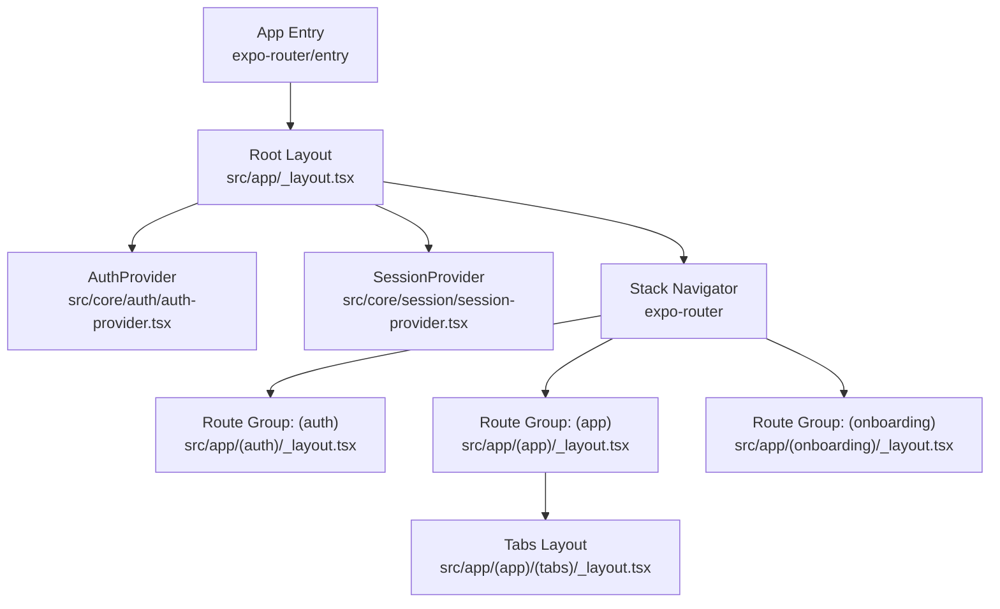
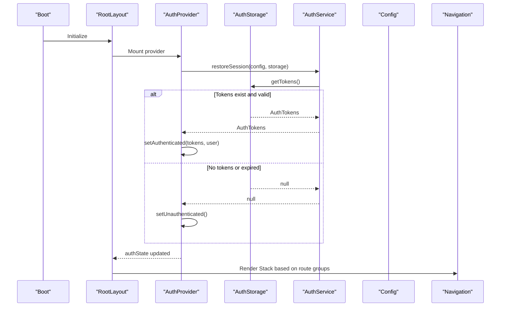
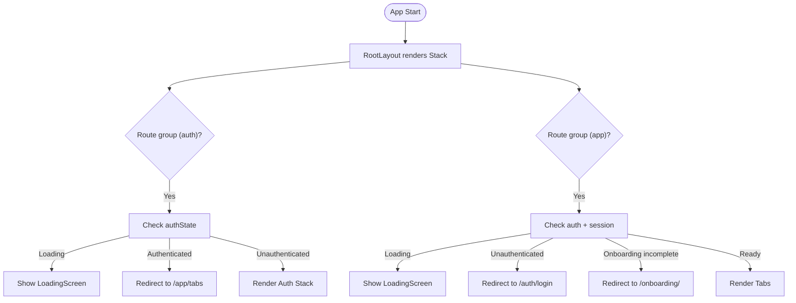
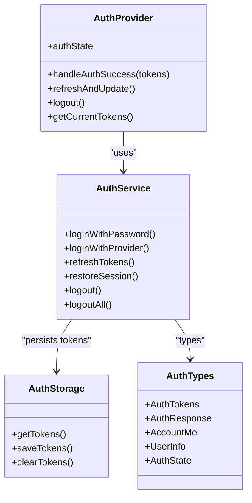
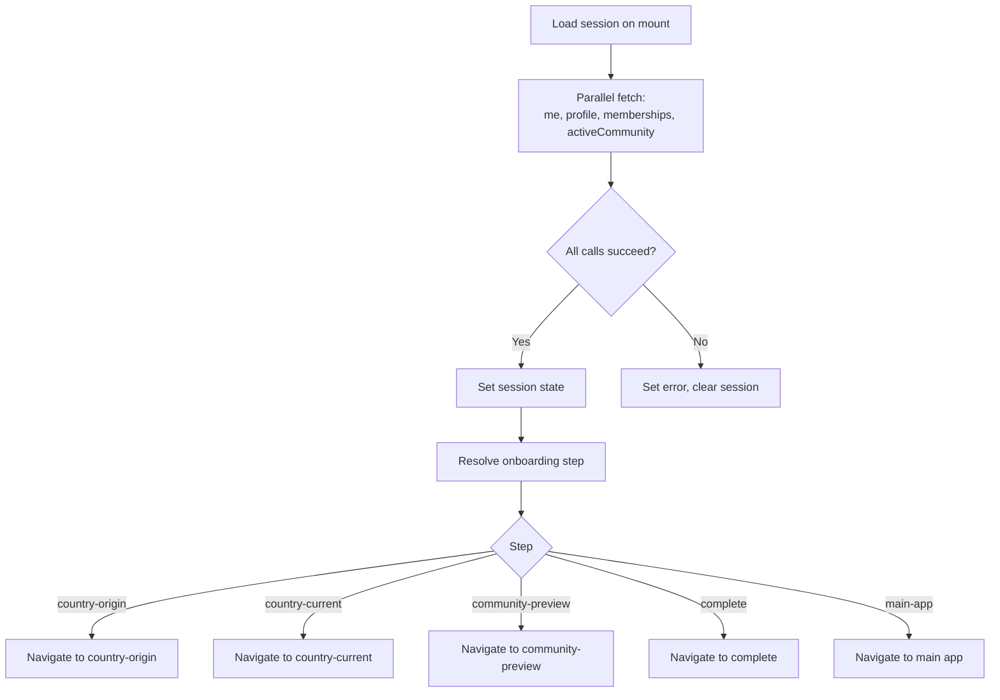
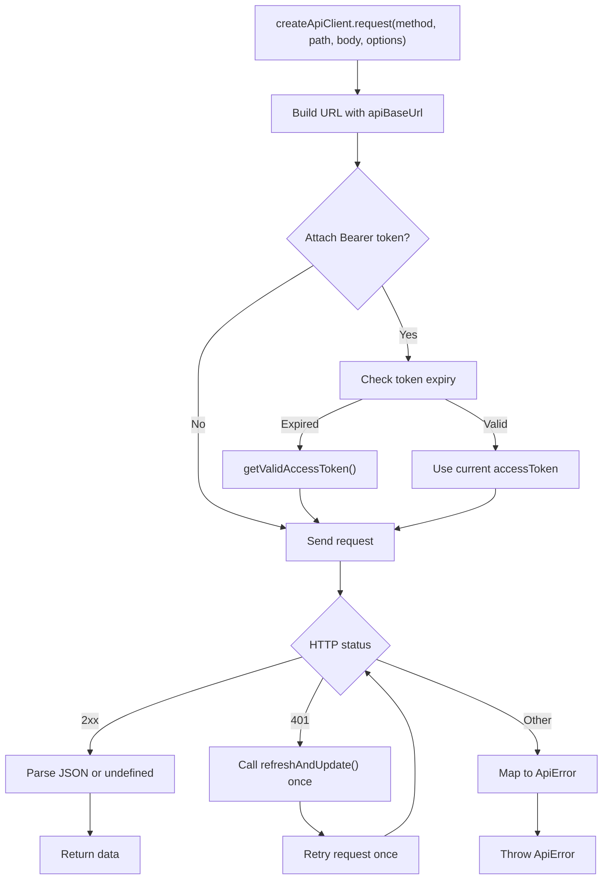
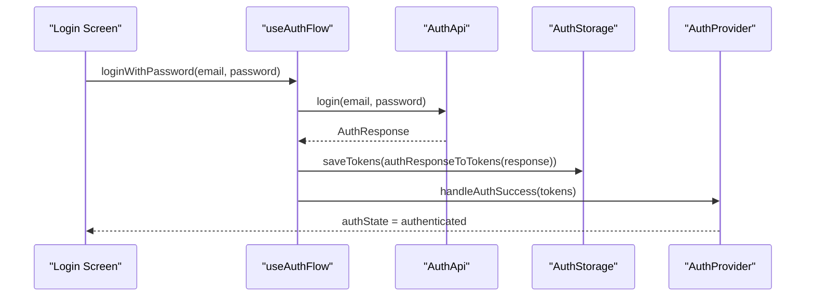
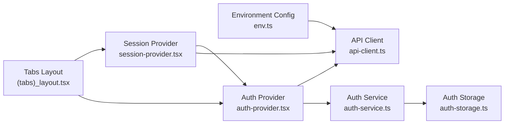

# App Architecture & Structure

<cite>
**Referenced Files in This Document**
- [package.json](file://diasporum-mobile/package.json)
- [app.json](file://diasporum-mobile/app.json)
- [_layout.tsx](file://diasporum-mobile/src/app/_layout.tsx)
- [(auth)_layout.tsx](file://diasporum-mobile/src/app/(auth)/_layout.tsx)
- [(app)_layout.tsx](file://diasporum-mobile/src/app/(app)/_layout.tsx)
- [(tabs)_layout.tsx](file://diasporum-mobile/src/app/(app)/(tabs)/_layout.tsx)
- [app-tabs.tsx](file://diasporum-mobile/src/components/app-tabs.tsx)
- [auth-provider.tsx](file://diasporum-mobile/src/core/auth/auth-provider.tsx)
- [auth-service.ts](file://diasporum-mobile/src/core/auth/auth-service.ts)
- [auth-storage.ts](file://diasporum-mobile/src/core/auth/auth-storage.ts)
- [auth-types.ts](file://diasporum-mobile/src/core/auth/auth-types.ts)
- [session-provider.tsx](file://diasporum-mobile/src/core/session/session-provider.tsx)
- [session-types.ts](file://diasporum-mobile/src/core/session/session-types.ts)
- [api-client.ts](file://diasporum-mobile/src/core/api/api-client.ts)
- [env.ts](file://diasporum-mobile/src/core/config/env.ts)
- [use-auth-flow.ts](file://diasporum-mobile/src/features/authentication/hooks/use-auth-flow.ts)
</cite>

## Table of Contents
1. [Introduction](#introduction)
2. [Project Structure](#project-structure)
3. [Core Components](#core-components)
4. [Architecture Overview](#architecture-overview)
5. [Detailed Component Analysis](#detailed-component-analysis)
6. [Dependency Analysis](#dependency-analysis)
7. [Performance Considerations](#performance-considerations)
8. [Troubleshooting Guide](#troubleshooting-guide)
9. [Conclusion](#conclusion)

## Introduction
This document explains the DIASPORUM mobile application architecture for the Expo/React Native client. It covers file-based routing with expo-router, navigation hierarchy with React Navigation, provider pattern implementation, root layout configuration, authentication providers, session management, app initialization flow, modular organization of screens and services, development workflow, build processes, and platform-specific configurations for iOS and Android.

## Project Structure
The mobile project is an Expo application using expo-router for file-based routing. The entry point is configured to use the expo-router entry module, and the app defines route groups for unauthenticated flows, authenticated flows, onboarding, and a tabbed main experience.

Key structural elements:
- Root layout wraps the app with SafeAreaProvider, AuthProvider, SessionProvider, and a Stack navigator.
- Route groups:
  - (auth): Unauthenticated screens such as login, register, forgot-password, verify-email, welcome.
  - (app): Authenticated screens including tabs, posts, profile, reels, settings.
  - (onboarding): Onboarding steps driven by backend state.
- Tabs define the primary bottom navigation for Home, Explore, Create, Messages, Profile.
- Core modules under src/core provide cross-cutting concerns: API client, auth context/service/storage/types, environment config, and session provider/types.
- Feature modules under src/features encapsulate domain logic, hooks, services, types, and screen components.

**Diagram sources**
- [_layout.tsx:10-30](file://diasporum-mobile/src/app/_layout.tsx#L10-L30)
- [(auth)_layout.tsx:11-23](file://diasporum-mobile/src/app/(auth)/_layout.tsx#L11-L23)
- [(app)_layout.tsx:14-37](file://diasporum-mobile/src/app/(app)/_layout.tsx#L14-L37)
- [(tabs)_layout.tsx:53-124](file://diasporum-mobile/src/app/(app)/(tabs)/_layout.tsx#L53-L124)

**Section sources**
- [package.json:1-72](file://diasporum-mobile/package.json#L1-L72)
- [app.json:1-50](file://diasporum-mobile/app.json#L1-L50)
- [_layout.tsx:1-31](file://diasporum-mobile/src/app/_layout.tsx#L1-L31)

## Core Components
This section summarizes the core building blocks that power navigation, authentication, session management, and networking.

- Root layout and navigation
  - Wraps the app with SafeAreaProvider, AuthProvider, SessionProvider, and a Stack navigator.
  - Prevents splash screen auto-hide and applies theme-aware animations.
- Authentication provider
  - Manages global auth state (loading, unauthenticated, authenticated).
  - Restores sessions on mount, handles token refresh, logout, and exposes getCurrentTokens for live access.
- Session provider
  - Loads user identity, profile, memberships, and active community after authentication.
  - Derives onboarding step and provides methods to update profile, join communities, set active community, and complete onboarding.
- API client
  - Centralized HTTP client with base URL from environment config.
  - Automatic Bearer token injection, proactive refresh before expiry, reactive refresh on 401, single retry after successful refresh, and consistent error mapping.
- Environment configuration
  - Centralizes EXPO_PUBLIC_* variables at build time, validates required values, and exposes AppConfig.

**Section sources**
- [_layout.tsx:10-30](file://diasporum-mobile/src/app/_layout.tsx#L10-L30)
- [auth-provider.tsx:46-143](file://diasporum-mobile/src/core/auth/auth-provider.tsx#L46-L143)
- [session-provider.tsx:59-207](file://diasporum-mobile/src/core/session/session-provider.tsx#L59-L207)
- [api-client.ts:14-225](file://diasporum-mobile/src/core/api/api-client.ts#L14-L225)
- [env.ts:74-87](file://diasporum-mobile/src/core/config/env.ts#L74-L87)

## Architecture Overview
The application initializes by restoring any existing session, then resolves whether the user should see the authentication flow, onboarding flow, or the main app. Once authenticated, the session provider loads full user data and determines the current onboarding step. All network requests go through the API client, which manages tokens and errors centrally.

**Diagram sources**
- [auth-provider.tsx:53-82](file://diasporum-mobile/src/core/auth/auth-provider.tsx#L53-L82)
- [auth-service.ts:148-167](file://diasporum-mobile/src/core/auth/auth-service.ts#L148-L167)
- [auth-storage.ts:34-65](file://diasporum-mobile/src/core/auth/auth-storage.ts#L34-L65)
- [_layout.tsx:12-30](file://diasporum-mobile/src/app/_layout.tsx#L12-L30)

## Detailed Component Analysis

### Root Layout and Navigation Hierarchy
- Root layout sets up SafeAreaProvider, AuthProvider, SessionProvider, and a Stack navigator without headers.
- Route group layouts enforce guards:
  - (auth): Redirects authenticated users away; shows loading while auth state resolves.
  - (app): Requires authentication and completed onboarding; redirects to login or onboarding when needed.
- Tabs layout defines the main bottom navigation with custom icons and a central Create action.

**Diagram sources**
- [_layout.tsx:12-30](file://diasporum-mobile/src/app/_layout.tsx#L12-L30)
- [(auth)_layout.tsx:11-23](file://diasporum-mobile/src/app/(auth)/_layout.tsx#L11-L23)
- [(app)_layout.tsx:14-37](file://diasporum-mobile/src/app/(app)/_layout.tsx#L14-L37)
- [(tabs)_layout.tsx:53-124](file://diasporum-mobile/src/app/(app)/(tabs)/_layout.tsx#L53-L124)

**Section sources**
- [_layout.tsx:10-30](file://diasporum-mobile/src/app/_layout.tsx#L10-L30)
- [(auth)_layout.tsx:11-23](file://diasporum-mobile/src/app/(auth)/_layout.tsx#L11-L23)
- [(app)_layout.tsx:14-37](file://diasporum-mobile/src/app/(app)/_layout.tsx#L14-L37)
- [(tabs)_layout.tsx:53-124](file://diasporum-mobile/src/app/(app)/(tabs)/_layout.tsx#L53-L124)
- [app-tabs.tsx:6-32](file://diasporum-mobile/src/components/app-tabs.tsx#L6-L32)

### Authentication Provider and Service
- Provider maintains authState and exposes handleAuthSuccess, refreshAndUpdate, logout, and getCurrentTokens.
- Service implements:
  - Token refresh with single-flight concurrency.
  - Refresh-token rotation and replay protection.
  - Session restoration from secure storage.
  - Logout and logout-all endpoints.
- Storage abstracts SecureStore with separate keys for access token, refresh token, and metadata.

**Diagram sources**
- [auth-provider.tsx:46-143](file://diasporum-mobile/src/core/auth/auth-provider.tsx#L46-L143)
- [auth-service.ts:76-199](file://diasporum-mobile/src/core/auth/auth-service.ts#L76-L199)
- [auth-storage.ts:24-109](file://diasporum-mobile/src/core/auth/auth-storage.ts#L24-L109)
- [auth-types.ts:6-73](file://diasporum-mobile/src/core/auth/auth-types.ts#L6-L73)

**Section sources**
- [auth-provider.tsx:46-143](file://diasporum-mobile/src/core/auth/auth-provider.tsx#L46-L143)
- [auth-service.ts:76-199](file://diasporum-mobile/src/core/auth/auth-service.ts#L76-L199)
- [auth-storage.ts:24-109](file://diasporum-mobile/src/core/auth/auth-storage.ts#L24-L109)
- [auth-types.ts:6-73](file://diasporum-mobile/src/core/auth/auth-types.ts#L6-L73)

### Session Provider and Onboarding Resolution
- Session provider fetches me, profile, memberships, and active community in parallel when authenticated.
- Exposes refresh, updateProfile, joinCommunity, setActiveCommunity, updatePreferredLanguage, and completeOnboarding.
- Onboarding step resolution determines the next destination based on profile fields and membership state.

**Diagram sources**
- [session-provider.tsx:79-113](file://diasporum-mobile/src/core/session/session-provider.tsx#L79-L113)
- [session-types.ts:54-69](file://diasporum-mobile/src/core/session/session-types.ts#L54-L69)

**Section sources**
- [session-provider.tsx:59-207](file://diasporum-mobile/src/core/session/session-provider.tsx#L59-L207)
- [session-types.ts:13-69](file://diasporum-mobile/src/core/session/session-types.ts#L13-L69)

### API Client and Error Handling
- Centralized HTTP client with automatic Bearer token attachment only for the configured API host.
- Proactive token refresh if near expiry; reactive refresh on 401 with one retry.
- Timeout handling, signal merging, and consistent ApiError mapping.

**Diagram sources**
- [api-client.ts:52-176](file://diasporum-mobile/src/core/api/api-client.ts#L52-L176)
- [auth-provider.tsx:164-181](file://diasporum-mobile/src/core/auth/auth-provider.tsx#L164-L181)

**Section sources**
- [api-client.ts:14-225](file://diasporum-mobile/src/core/api/api-client.ts#L14-L225)

### Authentication Flow Hook
- Shared hook orchestrates email/password login, Google sign-in, Apple sign-in, and registration.
- Converts backend responses to stored tokens, persists them, and updates auth context.
- Normalizes errors into user-friendly messages.

**Diagram sources**
- [use-auth-flow.ts:74-81](file://diasporum-mobile/src/features/authentication/hooks/use-auth-flow.ts#L74-L81)
- [auth-provider.tsx:84-89](file://diasporum-mobile/src/core/auth/auth-provider.tsx#L84-L89)
- [auth-storage.ts:71-90](file://diasporum-mobile/src/core/auth/auth-storage.ts#L71-L90)

**Section sources**
- [use-auth-flow.ts:39-123](file://diasporum-mobile/src/features/authentication/hooks/use-auth-flow.ts#L39-L123)

## Dependency Analysis
High-level dependencies between core modules:

**Diagram sources**
- [env.ts:74-87](file://diasporum-mobile/src/core/config/env.ts#L74-L87)
- [api-client.ts:14-225](file://diasporum-mobile/src/core/api/api-client.ts#L14-L225)
- [auth-provider.tsx:46-143](file://diasporum-mobile/src/core/auth/auth-provider.tsx#L46-L143)
- [auth-service.ts:76-199](file://diasporum-mobile/src/core/auth/auth-service.ts#L76-L199)
- [auth-storage.ts:24-109](file://diasporum-mobile/src/core/auth/auth-storage.ts#L24-L109)
- [session-provider.tsx:59-207](file://diasporum-mobile/src/core/session/session-provider.tsx#L59-L207)
- [(tabs)_layout.tsx:53-124](file://diasporum-mobile/src/app/(app)/(tabs)/_layout.tsx#L53-L124)

**Section sources**
- [env.ts:74-87](file://diasporum-mobile/src/core/config/env.ts#L74-L87)
- [api-client.ts:14-225](file://diasporum-mobile/src/core/api/api-client.ts#L14-L225)
- [auth-provider.tsx:46-143](file://diasporum-mobile/src/core/auth/auth-provider.tsx#L46-L143)
- [auth-service.ts:76-199](file://diasporum-mobile/src/core/auth/auth-service.ts#L76-L199)
- [auth-storage.ts:24-109](file://diasporum-mobile/src/core/auth/auth-storage.ts#L24-L109)
- [session-provider.tsx:59-207](file://diasporum-mobile/src/core/session/session-provider.tsx#L59-L207)
- [(tabs)_layout.tsx:53-124](file://diasporum-mobile/src/app/(app)/(tabs)/_layout.tsx#L53-L124)

## Performance Considerations
- Network efficiency
  - Parallel fetching of session data reduces total latency during authentication handoff.
  - Single-flight token refresh avoids redundant refresh requests.
- Rendering stability
  - Live token access via getCurrentTokens prevents stale snapshots and unnecessary re-renders.
  - Providers are mounted once at the root to minimize overhead.
- Platform optimizations
  - Tab bar styles adapt to platform insets and visual preferences.
  - Splash screen plugin configured for fast startup visuals.

[No sources needed since this section provides general guidance]

## Troubleshooting Guide
Common issues and where to look:
- Session not restored on app start
  - Verify SecureStore reads and restoreSession behavior.
  - Check for missing or corrupted tokens and network errors during refresh.
- Unexpected redirects to login or onboarding
  - Inspect route group guards in (auth) and (app) layouts.
  - Confirm onboarding step resolution logic and backend state.
- API 401 loops or failed retries
  - Review API client refresh logic and single retry behavior.
  - Ensure refreshAndUpdate clears state on permanent failures.
- Environment misconfiguration
  - Validate EXPO_PUBLIC_* variables and URL formats.

**Section sources**
- [auth-service.ts:148-167](file://diasporum-mobile/src/core/auth/auth-service.ts#L148-L167)
- [(auth)_layout.tsx:11-23](file://diasporum-mobile/src/app/(auth)/_layout.tsx#L11-L23)
- [(app)_layout.tsx:14-37](file://diasporum-mobile/src/app/(app)/_layout.tsx#L14-L37)
- [api-client.ts:126-176](file://diasporum-mobile/src/core/api/api-client.ts#L126-L176)
- [env.ts:33-57](file://diasporum-mobile/src/core/config/env.ts#L33-L57)

## Conclusion
The DIASPORUM mobile app uses a clean separation of concerns:
- File-based routing with expo-router organizes screens into logical route groups.
- Providers manage authentication and session state at the root level.
- A centralized API client handles token lifecycle and errors consistently.
- Onboarding is driven by backend state and resolved deterministically.
This structure supports scalable feature development, robust authentication, and smooth navigation across platforms.

[No sources needed since this section summarizes without analyzing specific files]