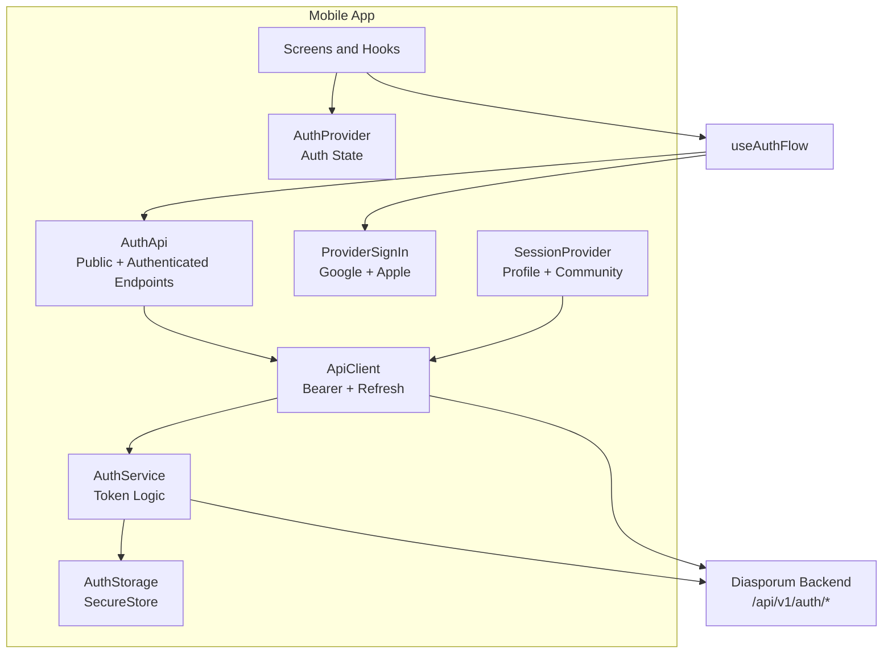
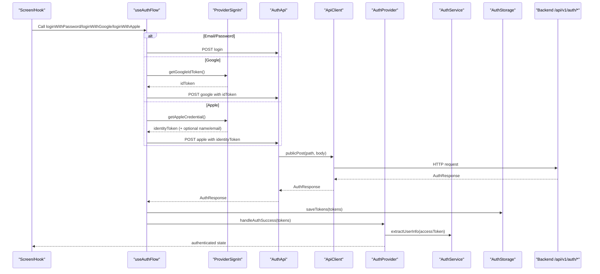
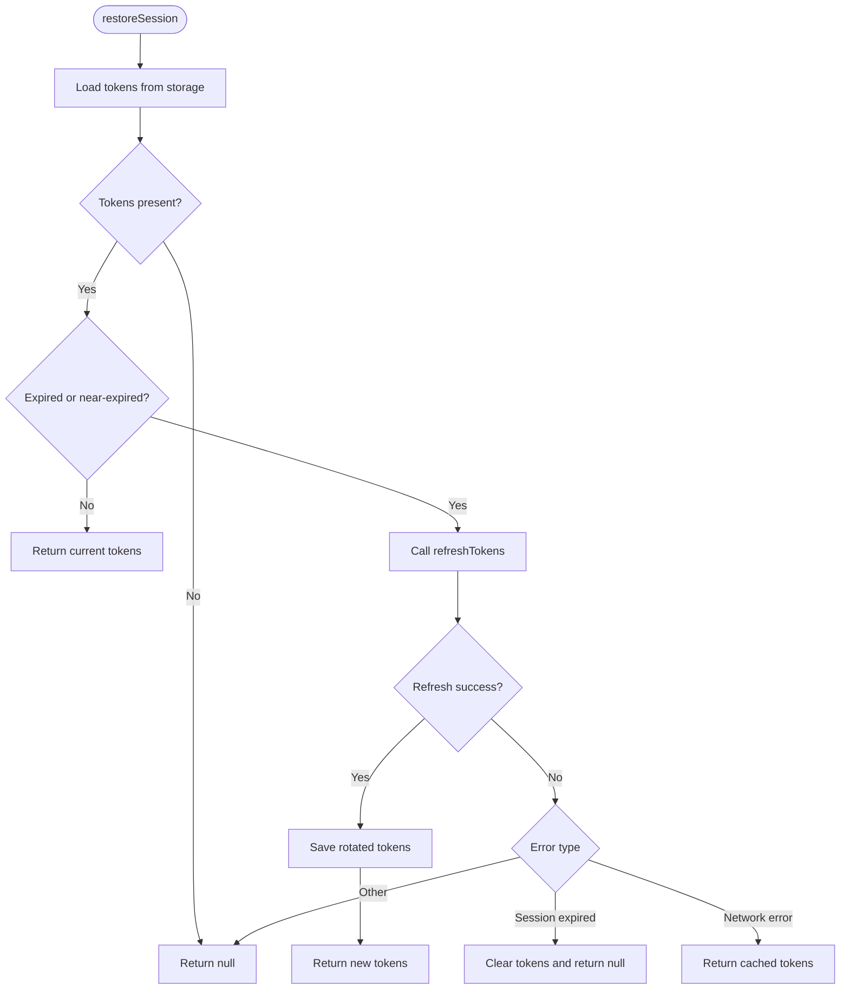
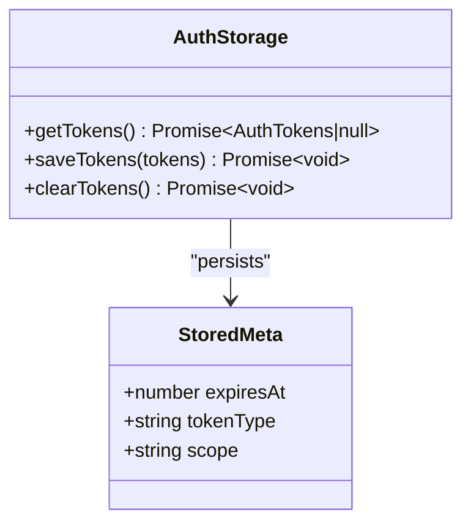
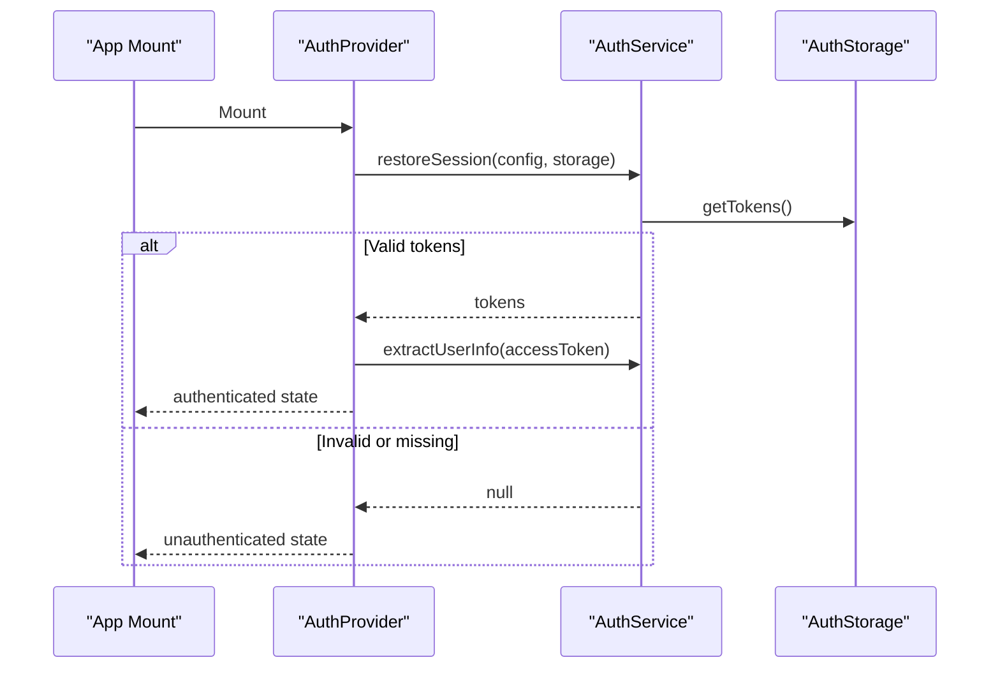
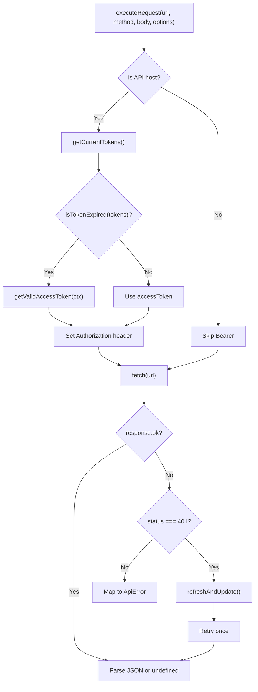
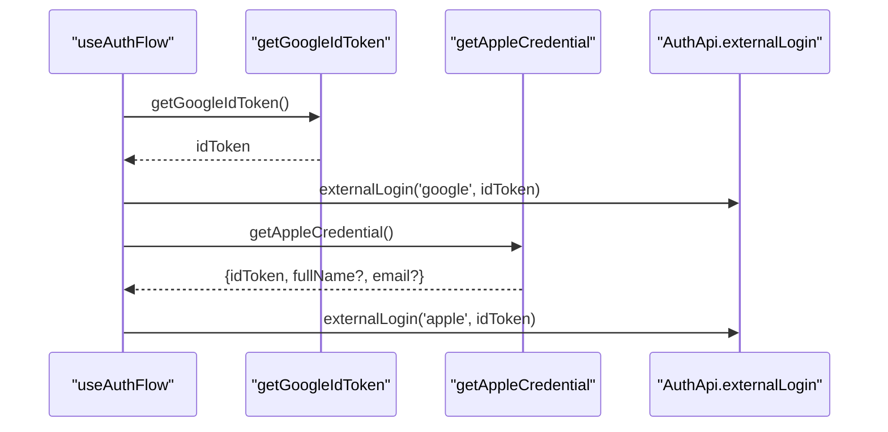
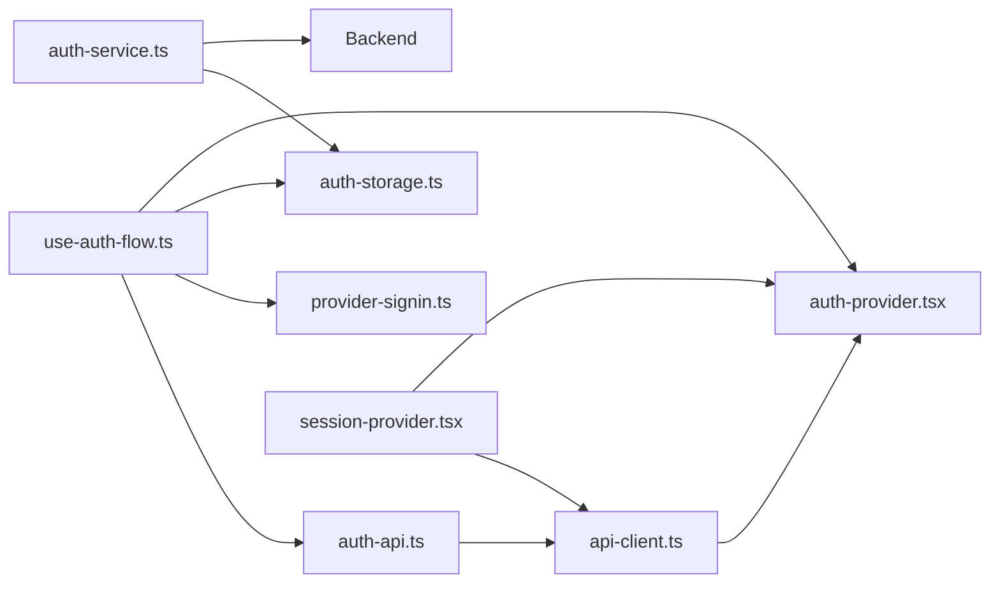

# Authentication System

<cite>
**Referenced Files in This Document**
- [auth-service.ts](file://diasporum-mobile/src/core/auth/auth-service.ts)
- [auth-storage.ts](file://diasporum-mobile/src/core/auth/auth-storage.ts)
- [auth-provider.tsx](file://diasporum-mobile/src/core/auth/auth-provider.tsx)
- [auth-types.ts](file://diasporum-mobile/src/core/auth/auth-types.ts)
- [auth-errors.ts](file://diasporum-mobile/src/core/auth/auth-errors.ts)
- [api-client.ts](file://diasporum-mobile/src/core/api/api-client.ts)
- [session-provider.tsx](file://diasporum-mobile/src/core/session/session-provider.tsx)
- [use-auth-flow.ts](file://diasporum-mobile/src/features/authentication/hooks/use-auth-flow.ts)
- [auth-api.ts](file://diasporum-mobile/src/features/authentication/services/auth-api.ts)
- [provider-signin.ts](file://diasporum-mobile/src/features/authentication/services/provider-signin.ts)
</cite>

## Table of Contents
1. [Introduction](#introduction)
2. [Project Structure](#project-structure)
3. [Core Components](#core-components)
4. [Architecture Overview](#architecture-overview)
5. [Detailed Component Analysis](#detailed-component-analysis)
6. [Dependency Analysis](#dependency-analysis)
7. [Performance Considerations](#performance-considerations)
8. [Troubleshooting Guide](#troubleshooting-guide)
9. [Conclusion](#conclusion)
10. [Appendices](#appendices)

## Introduction
This document explains the DIASPORUM mobile app authentication system. It covers multi-provider sign-in (email/password, Google, Apple), JWT token management, session persistence, automatic token refresh, authentication state management, error handling, logout flows, profile synchronization, and usage patterns for authentication hooks. The implementation is React Native/Expo-based and communicates with a first-party backend over REST.

The system separates concerns into:
- Core authentication logic and storage
- React context for application-wide auth state
- API client with token injection and refresh
- Feature-layer hooks and services for login flows
- Session provider for post-login profile and community data

## Project Structure
The authentication-related code lives under `diasporum-mobile/src`:
- Core authentication: `src/core/auth`
- HTTP client: `src/core/api`
- Post-login session: `src/core/session`
- Authentication feature layer: `src/features/authentication`

**Diagram sources**
- [auth-provider.tsx:1-182](file://diasporum-mobile/src/core/auth/auth-provider.tsx#L1-L182)
- [auth-service.ts:1-200](file://diasporum-mobile/src/core/auth/auth-service.ts#L1-L200)
- [auth-storage.ts:1-110](file://diasporum-mobile/src/core/auth/auth-storage.ts#L1-L110)
- [api-client.ts:1-225](file://diasporum-mobile/src/core/api/api-client.ts#L1-L225)
- [auth-api.ts:1-124](file://diasporum-mobile/src/features/authentication/services/auth-api.ts#L1-L124)
- [provider-signin.ts:1-121](file://diasporum-mobile/src/features/authentication/services/provider-signin.ts#L1-L121)
- [session-provider.tsx:1-207](file://diasporum-mobile/src/core/session/session-provider.tsx#L1-L207)
- [use-auth-flow.ts:1-124](file://diasporum-mobile/src/features/authentication/hooks/use-auth-flow.ts#L1-L124)

**Section sources**
- [auth-provider.tsx:1-182](file://diasporum-mobile/src/core/auth/auth-provider.tsx#L1-L182)
- [auth-service.ts:1-200](file://diasporum-mobile/src/core/auth/auth-service.ts#L1-L200)
- [auth-storage.ts:1-110](file://diasporum-mobile/src/core/auth/auth-storage.ts#L1-L110)
- [api-client.ts:1-225](file://diasporum-mobile/src/core/api/api-client.ts#L1-L225)
- [auth-api.ts:1-124](file://diasporum-mobile/src/features/authentication/services/auth-api.ts#L1-L124)
- [provider-signin.ts:1-121](file://diasporum-mobile/src/features/authentication/services/provider-signin.ts#L1-L121)
- [session-provider.tsx:1-207](file://diasporum-mobile/src/core/session/session-provider.tsx#L1-L207)
- [use-auth-flow.ts:1-124](file://diasporum-mobile/src/features/authentication/hooks/use-auth-flow.ts#L1-L124)

## Core Components
- Authentication service: pure business logic for login, provider exchange, refresh, restore, logout.
- Secure storage abstraction: persists tokens safely using platform secure storage.
- Auth provider: React context exposing loading/unauthenticated/authenticated states, token refresh, and logout.
- API client: centralized HTTP client injecting Bearer tokens, proactive refresh, and reactive retry on 401.
- Auth API service: typed endpoints for public and authenticated auth operations.
- Provider sign-in: native Google and Apple ID token acquisition.
- Session provider: loads account identity, profile, memberships, and active community after authentication.

Key responsibilities:
- Multi-provider authentication flow
- JWT token lifecycle and rotation
- Automatic token refresh before expiry and on 401
- Safe error messages and user-facing feedback
- Profile synchronization via session provider

**Section sources**
- [auth-service.ts:1-200](file://diasporum-mobile/src/core/auth/auth-service.ts#L1-L200)
- [auth-storage.ts:1-110](file://diasporum-mobile/src/core/auth/auth-storage.ts#L1-L110)
- [auth-provider.tsx:1-182](file://diasporum-mobile/src/core/auth/auth-provider.tsx#L1-L182)
- [api-client.ts:1-225](file://diasporum-mobile/src/core/api/api-client.ts#L1-L225)
- [auth-api.ts:1-124](file://diasporum-mobile/src/features/authentication/services/auth-api.ts#L1-L124)
- [provider-signin.ts:1-121](file://diasporum-mobile/src/features/authentication/services/provider-signin.ts#L1-L121)
- [session-provider.tsx:1-207](file://diasporum-mobile/src/core/session/session-provider.tsx#L1-L207)

## Architecture Overview
The authentication architecture follows a layered approach:
- UI screens call hooks from `use-auth-flow`.
- Hooks use `AuthApi` for public endpoints and `ApiClient` for authenticated endpoints.
- `AuthProvider` manages global auth state and exposes token refresh.
- `AuthService` handles token refresh, rotation, and session restoration.
- `AuthStorage` persists tokens securely.
- `SessionProvider` fetches profile and community data after authentication.

**Diagram sources**
- [use-auth-flow.ts:1-124](file://diasporum-mobile/src/features/authentication/hooks/use-auth-flow.ts#L1-L124)
- [auth-api.ts:1-124](file://diasporum-mobile/src/features/authentication/services/auth-api.ts#L1-L124)
- [provider-signin.ts:1-121](file://diasporum-mobile/src/features/authentication/services/provider-signin.ts#L1-L121)
- [auth-provider.tsx:1-182](file://diasporum-mobile/src/core/auth/auth-provider.tsx#L1-L182)
- [auth-service.ts:1-200](file://diasporum-mobile/src/core/auth/auth-service.ts#L1-L200)
- [auth-storage.ts:1-110](file://diasporum-mobile/src/core/auth/auth-storage.ts#L1-L110)

## Detailed Component Analysis

### Authentication Service
Responsibilities:
- Login with email/password
- Exchange provider ID tokens for backend tokens
- Refresh tokens with single-flight deduplication
- Restore sessions on app start
- Logout and logout-all with server-side revocation

Key behaviors:
- Token expiration check uses an expiry buffer to proactively refresh.
- Decode-only JWT payload extraction is for UX; never authoritative.
- Refresh endpoint rotates refresh tokens atomically.
- Network errors during restore return cached tokens when possible.

**Diagram sources**
- [auth-service.ts:114-167](file://diasporum-mobile/src/core/auth/auth-service.ts#L114-L167)

**Section sources**
- [auth-service.ts:1-200](file://diasporum-mobile/src/core/auth/auth-service.ts#L1-L200)

### Secure Token Storage
Responsibilities:
- Persist access token, refresh token, and metadata separately to avoid size limits.
- Provide atomic read/write/clear operations.
- Throw safe storage errors on failure.

Security notes:
- Tokens are never stored in plain AsyncStorage or files.
- Metadata includes expiration time, token type, and scope.

**Diagram sources**
- [auth-storage.ts:1-110](file://diasporum-mobile/src/core/auth/auth-storage.ts#L1-L110)

**Section sources**
- [auth-storage.ts:1-110](file://diasporum-mobile/src/core/auth/auth-storage.ts#L1-L110)

### Authentication Provider
Responsibilities:
- Manage global auth state: loading, unauthenticated, authenticated.
- Restore session on mount.
- Update state on successful login.
- Expose refreshAndUpdate for API client.
- Provide getCurrentTokens for live token access without re-renders.
- Logout clears local state and attempts server-side revocation.

**Diagram sources**
- [auth-provider.tsx:46-82](file://diasporum-mobile/src/core/auth/auth-provider.tsx#L46-L82)
- [auth-service.ts:148-167](file://diasporum-mobile/src/core/auth/auth-service.ts#L148-L167)

**Section sources**
- [auth-provider.tsx:1-182](file://diasporum-mobile/src/core/auth/auth-provider.tsx#L1-L182)

### API Client
Responsibilities:
- Centralized base URL and headers.
- Attach Bearer tokens only to configured API host.
- Proactive refresh if token is expired or near-expired.
- Reactive refresh on 401 with one retry.
- Consistent error mapping to ApiError.
- Request timeout support.

**Diagram sources**
- [api-client.ts:52-176](file://diasporum-mobile/src/core/api/api-client.ts#L52-L176)
- [auth-provider.tsx:164-181](file://diasporum-mobile/src/core/auth/auth-provider.tsx#L164-L181)
- [auth-service.ts:27-29](file://diasporum-mobile/src/core/auth/auth-service.ts#L27-L29)

**Section sources**
- [api-client.ts:1-225](file://diasporum-mobile/src/core/api/api-client.ts#L1-L225)

### Authentication API Service
Responsibilities:
- Define all `/api/v1/auth/**` endpoints.
- Public endpoints use plain fetch; authenticated endpoints go through ApiClient.
- Methods include register, login, external login, verify email, password reset, me, sessions, revoke session, logout, logout-all, change password, link/unlink identities.

Usage:
- Public flows call `register`, `login`, `externalLogin`.
- Authenticated flows call `me`, `sessions`, `revokeSession`, `logout`, `logoutAll`, `changePassword`, `linkIdentity`, `unlinkIdentity`.

**Section sources**
- [auth-api.ts:1-124](file://diasporum-mobile/src/features/authentication/services/auth-api.ts#L1-L124)

### Provider Sign-In Integration
Responsibilities:
- Acquire native provider ID tokens without WebViews.
- Validate configuration and availability per platform.
- Map provider-specific errors to safe `AuthError` codes.

Google:
- Requires web client ID configured on backend.
- Uses native Google Sign-In SDK.
- Throws specific errors for cancellation, Play Services issues, and invalid tokens.

Apple:
- Available on iOS/macOS.
- Requests full name and email scopes on first authorization.
- Generates nonce for security.

**Diagram sources**
- [provider-signin.ts:37-66](file://diasporum-mobile/src/features/authentication/services/provider-signin.ts#L37-L66)
- [provider-signin.ts:88-120](file://diasporum-mobile/src/features/authentication/services/provider-signin.ts#L88-L120)
- [auth-api.ts:67-73](file://diasporum-mobile/src/features/authentication/services/auth-api.ts#L67-L73)

**Section sources**
- [provider-signin.ts:1-121](file://diasporum-mobile/src/features/authentication/services/provider-signin.ts#L1-L121)

### Authentication Flow Hook
Responsibilities:
- Orchestrate login, registration, and provider sign-in.
- Normalize errors to user-friendly messages.
- Persist tokens and update auth context on success.

Usage examples:
- `loginWithPassword(email, password)`
- `loginWithGoogle()`
- `loginWithApple()`
- `register(email, password)`

The hook composes `AuthApi` and `ProviderSignIn`, then calls `auth.handleAuthSuccess` after storing tokens.

**Section sources**
- [use-auth-flow.ts:1-124](file://diasporum-mobile/src/features/authentication/hooks/use-auth-flow.ts#L1-L124)

### Session Provider and Profile Synchronization
Responsibilities:
- Load account identity (`/api/v1/auth/me`), profile, memberships, and active community in parallel.
- Derive onboarding step from backend state.
- Provide methods to update profile, join communities, set active community, and complete onboarding.
- Re-fetch session data when access token changes.

Behavior:
- Only mounted when authenticated.
- Resets session state on logout.
- Handles 404 for missing profiles gracefully to route to onboarding.

**Section sources**
- [session-provider.tsx:1-207](file://diasporum-mobile/src/core/session/session-provider.tsx#L1-L207)

## Dependency Analysis
High-level dependencies:
- `use-auth-flow` depends on `AuthApi`, `ProviderSignIn`, `AuthStorage`, `AuthContext`, and `ApiClient`.
- `AuthApi` depends on `ApiClient` for authenticated endpoints.
- `ApiClient` depends on `AuthContext` for token access and refresh.
- `AuthService` depends on `AuthStorage` and backend endpoints.
- `SessionProvider` depends on `AuthContext`, `ProfileApi`, `CommunityApi`, and `AuthApi`.

**Diagram sources**
- [use-auth-flow.ts:1-124](file://diasporum-mobile/src/features/authentication/hooks/use-auth-flow.ts#L1-L124)
- [auth-api.ts:1-124](file://diasporum-mobile/src/features/authentication/services/auth-api.ts#L1-L124)
- [provider-signin.ts:1-121](file://diasporum-mobile/src/features/authentication/services/provider-signin.ts#L1-L121)
- [auth-storage.ts:1-110](file://diasporum-mobile/src/core/auth/auth-storage.ts#L1-L110)
- [auth-provider.tsx:1-182](file://diasporum-mobile/src/core/auth/auth-provider.tsx#L1-L182)
- [api-client.ts:1-225](file://diasporum-mobile/src/core/api/api-client.ts#L1-L225)
- [auth-service.ts:1-200](file://diasporum-mobile/src/core/auth/auth-service.ts#L1-L200)
- [session-provider.tsx:1-207](file://diasporum-mobile/src/core/session/session-provider.tsx#L1-L207)

**Section sources**
- [use-auth-flow.ts:1-124](file://diasporum-mobile/src/features/authentication/hooks/use-auth-flow.ts#L1-L124)
- [auth-api.ts:1-124](file://diasporum-mobile/src/features/authentication/services/auth-api.ts#L1-L124)
- [provider-signin.ts:1-121](file://diasporum-mobile/src/features/authentication/services/provider-signin.ts#L1-L121)
- [auth-storage.ts:1-110](file://diasporum-mobile/src/core/auth/auth-storage.ts#L1-L110)
- [auth-provider.tsx:1-182](file://diasporum-mobile/src/core/auth/auth-provider.tsx#L1-L182)
- [api-client.ts:1-225](file://diasporum-mobile/src/core/api/api-client.ts#L1-L225)
- [auth-service.ts:1-200](file://diasporum-mobile/src/core/auth/auth-service.ts#L1-L200)
- [session-provider.tsx:1-207](file://diasporum-mobile/src/core/session/session-provider.tsx#L1-L207)

## Performance Considerations
- Single-flight refresh: concurrent refresh requests share one in-flight promise to reduce network load.
- Proactive token refresh: API client checks token expiration before sending requests to minimize 401 retries.
- Parallel session loading: profile, memberships, and active community are fetched concurrently to reduce total load time.
- Secure storage separation: tokens and metadata are stored separately to respect platform storage limits and improve reliability.
- Best-effort logout: local logout completes immediately; server-side revocation is attempted but does not block UI.

[No sources needed since this section provides general guidance]

## Troubleshooting Guide
Common errors and strategies:
- Invalid credentials: mapped to a safe message; do not expose internal codes.
- Account restricted: indicates backend restriction; prompt user to contact support.
- Provider token invalid: ensure correct client IDs and platform configuration.
- Token refresh failed: clear session and require re-authentication.
- Session expired: clear tokens and redirect to login.
- Storage error: indicate secure storage failure; suggest retrying or reinstalling.
- Network error: advise checking connectivity; may fall back to cached tokens during restore.

Logout troubleshooting:
- Local logout always clears tokens; server-side revocation failures are logged but do not prevent logout.
- For logout-all, ensure the current access token is valid; otherwise, rely on local cleanup.

Profile synchronization troubleshooting:
- If profile is missing, expect 404 from profile endpoint; route to onboarding rather than treating it as an error.
- Onboarding step derivation should be treated as pure logic for predictable routing.

**Section sources**
- [auth-errors.ts:1-57](file://diasporum-mobile/src/core/auth/auth-errors.ts#L1-L57)
- [auth-service.ts:169-195](file://diasporum-mobile/src/core/auth/auth-service.ts#L169-L195)
- [session-provider.tsx:79-113](file://diasporum-mobile/src/core/session/session-provider.tsx#L79-L113)

## Conclusion
The DIASPORUM mobile authentication system provides a robust, secure, and user-friendly experience across email/password, Google, and Apple sign-in. It centralizes token management, enforces secure storage, and integrates seamlessly with the backend’s session model. The layered architecture ensures clear separation of concerns, reliable error handling, and smooth profile synchronization after authentication.

[No sources needed since this section summarizes without analyzing specific files]

## Appendices

### Authentication Types and Models
- `AuthTokens`: stored tokens including access token, refresh token, expiration, type, and scope.
- `AuthResponse`: backend response shape for login and provider exchange.
- `AccountMe`: account-level identity used by `/api/v1/auth/me`.
- `SessionView`: representation of active sessions returned by `/api/v1/auth/sessions`.
- `UserInfo`: lightweight identity exposed to UI derived from JWT payload.

**Section sources**
- [auth-types.ts:1-74](file://diasporum-mobile/src/core/auth/auth-types.ts#L1-L74)

### Example Usage Patterns
- Email/password login:
  - Call `useAuthFlow().loginWithPassword(email, password)`.
  - On success, tokens are persisted and auth state becomes authenticated.
- Google sign-in:
  - Call `useAuthFlow().loginWithGoogle()`.
  - Native SDK obtains idToken; backend verifies and returns tokens.
- Apple sign-in:
  - Call `useAuthFlow().loginWithApple()`.
  - Native SDK obtains identityToken; backend verifies and returns tokens.
- Profile synchronization:
  - After authentication, `SessionProvider` loads account identity, profile, memberships, and active community.
  - Use `updateProfile`, `joinCommunity`, `setActiveCommunity`, and `completeOnboarding` to manage session state.

**Section sources**
- [use-auth-flow.ts:74-122](file://diasporum-mobile/src/features/authentication/hooks/use-auth-flow.ts#L74-L122)
- [session-provider.tsx:141-177](file://diasporum-mobile/src/core/session/session-provider.tsx#L141-L177)