# Community Management

<cite>
**Referenced Files in This Document**   
- [CommunityApi.java](file://diasporum-backend/src/main/java/com/diasporum/backend/community/CommunityApi.java)
- [CommunityController.java](file://diasporum-backend/src/main/java/com/diasporum/backend/community/internal/api/rest/CommunityController.java)
- [CommunityService.java](file://diasporum-backend/src/main/java/com/diasporum/backend/community/internal/application/CommunityService.java)
- [CommunityApiImpl.java](file://diasporum-backend/src/main/java/com/diasporum/backend/community/internal/application/CommunityApiImpl.java)
- [community-api.ts](file://diasporum-mobile/src/features/communities/services/community-api.ts)
- [community-types.ts](file://diasporum-mobile/src/features/communities/types/community-types.ts)
- [communities.tsx](file://diasporum-mobile/src/app/(app)/(tabs)/communities.tsx)
- [explore-screen.tsx](file://diasporum-mobile/src/features/feed/screens/explore-screen.tsx)
- [TaxonomyApi.java](file://diasporum-backend/src/main/java/com/diasporum/backend/taxonomy/TaxonomyApi.java)
- [V1__baseline_v10_12.sql](file://diasporum-backend/src\main\resources\db\migration\V1__baseline_v10_12.sql)
</cite>

## Table of Contents
1. [Introduction](#introduction)
2. [Project Structure](#project-structure)
3. [Core Components](#core-components)
4. [Architecture Overview](#architecture-overview)
5. [Detailed Component Analysis](#detailed-component-analysis)
6. [Dependency Analysis](#dependency-analysis)
7. [Performance Considerations](#performance-considerations)
8. [Troubleshooting Guide](#troubleshooting-guide)
9. [Conclusion](#conclusion)

## Introduction
This document explains the community management features that power the DIASPORUM mobile app’s community discovery, membership operations, role-based permissions, and community-specific content filtering. It covers:

- How communities are discovered through taxonomy data and origin-country eligibility.
- How users join, leave, preview, and complete onboarding into a community.
- How active-community context is managed and used to scope content.
- How member lists, roles, and moderation actions are enforced.
- How PostGIS supports geographic discovery across the platform, including nearby feeds and location-scoped features.
- The mobile API layer, state flow, and UI components for browsing and switching communities.

The backend separates catalogue ownership (taxonomy) from participation ownership (community), while the mobile app exposes screens for joining communities, switching the active community, and exploring people, posts, and reels within the selected community.

## Project Structure
The community feature spans both backend and mobile layers:

- Backend module `community` exposes a public interface (`CommunityApi`) and an internal REST controller (`CommunityController`) backed by `CommunityService`.
- Membership, roles, and active-community state are persisted against PostgreSQL with explicit enums and indexes.
- Mobile app code under `features/communities` provides typed API clients and types; the `Communities` tab and Explore screen drive user interactions.

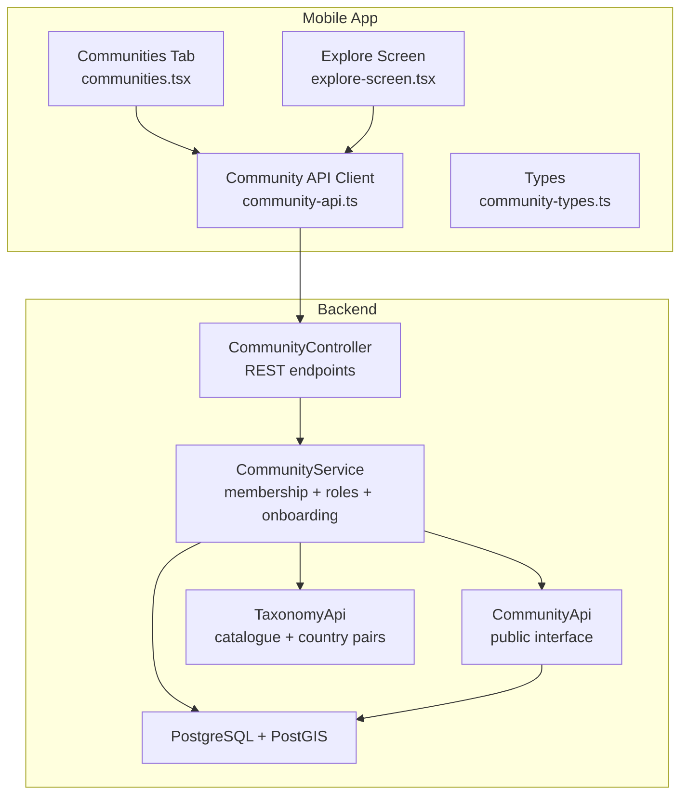

**Diagram sources**
- [CommunityController.java:28-182](file://diasporum-backend/src/main/java/com/diasporum/backend/community/internal/api/rest/CommunityController.java#L28-L182)
- [CommunityService.java:29-332](file://diasporum-backend/src/main/java/com/diasporum/backend/community/internal/application/CommunityService.java#L29-L332)
- [CommunityApi.java:7-50](file://diasporum-backend/src/main/java/com/diasporum/backend/community/CommunityApi.java#L7-L50)
- [TaxonomyApi.java:7-39](file://diasporum-backend/src/main/java/com/diasporum/backend/taxonomy/TaxonomyApi.java#L7-L39)
- [community-api.ts:13-89](file://diasporum-mobile/src/features/communities/services/community-api.ts#L13-L89)
- [communities.tsx:25-50](file://diasporum-mobile/src/app/(app)/(tabs)/communities.tsx#L25-L50)
- [explore-screen.tsx:31-77](file://diasporum-mobile/src/features/feed/screens/explore-screen.tsx#L31-L77)

**Section sources**
- [CommunityController.java:28-182](file://diasporum-backend/src/main/java/com/diasporum/backend/community/internal/api/rest/CommunityController.java#L28-L182)
- [CommunityService.java:29-332](file://diasporum-backend/src/main/java/com/diasporum/backend/community/internal/application/CommunityService.java#L29-L332)
- [community-api.ts:13-89](file://diasporum-mobile/src/features/communities/services/community-api.ts#L13-L89)
- [communities.tsx:25-50](file://diasporum-mobile/src/app/(app)/(tabs)/communities.tsx#L25-L50)
- [explore-screen.tsx:31-77](file://diasporum-mobile/src/features/feed/screens/explore-screen.tsx#L31-L77)

## Core Components
The core backend components are:

| Component | Responsibility | Key Behaviors |
|---|---|---|
| `CommunityApi` | Public contract for other modules | Active membership checks, role checks, access control, active-community selection |
| `CommunityController` | REST endpoints | My communities, available communities, join/leave, members, admin role changes, onboarding preview/complete |
| `CommunityService` | Business logic | Eligibility, membership lifecycle, active-community persistence, member listing, role enforcement |
| `CommunityApiImpl` | Delegating implementation | Exposes service methods plus taxonomy-aware access checks |
| Mobile `community-api.ts` | Typed client | Wraps `/api/v1/me/*` and `/api/v1/communities/*` calls |
| Mobile `community-types.ts` | Shared DTOs | `MembershipView`, `CommunityView`, `CountryView`, preview/onboarding responses |

**Section sources**
- [CommunityApi.java:7-50](file://diasporum-backend/src/main/java/com/diasporum/backend/community/CommunityApi.java#L7-L50)
- [CommunityController.java:28-182](file://diasporum-backend/src/main/java/com/diasporum/backend/community/internal/api/rest/CommunityController.java#L28-L182)
- [CommunityService.java:29-332](file://diasporum-backend/src/main/java/com/diasporum/backend/community/internal/application/CommunityService.java#L29-L332)
- [CommunityApiImpl.java:10-72](file://diasporum-backend/src/main/java/com/diasporum/backend/community/internal/application/CommunityApiImpl.java#L10-L72)
- [community-api.ts:13-89](file://diasporum-mobile/src/features/communities/services/community-api.ts#L13-L89)
- [community-types.ts:5-64](file://diasporum-mobile/src/features/communities/types/community-types.ts#L5-L64)

## Architecture Overview
The community architecture follows a layered design:

- Controllers expose HTTP endpoints scoped to authenticated users.
- Services enforce business rules, including account status, origin-country eligibility, and role constraints.
- Other modules consume `CommunityApi` rather than internal implementation details.
- Catalogue data (countries, languages, communities) is owned by the taxonomy module.
- Social relationships (blocking/muting) influence member visibility.
- PostGIS is enabled at the database level and used by multiple features for geographic discovery.

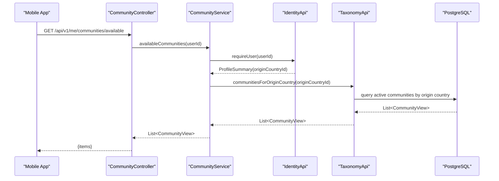

**Diagram sources**
- [CommunityController.java:61-65](file://diasporum-backend/src/main/java/com/diasporum/backend/community/internal/api/rest/CommunityController.java#L61-L65)
- [CommunityService.java:89-97](file://diasporum-backend/src/main/java/com/diasporum/backend/community/internal/application/CommunityService.java#L89-L97)
- [TaxonomyApi.java:31-39](file://diasporum-backend/src/main/java/com/diasporum/backend/taxonomy/TaxonomyApi.java#L31-L39)

## Detailed Component Analysis

### Community Discovery
Community discovery is split between catalogue browsing and eligibility:

- **Catalogue browsing**: The taxonomy module owns community records and exposes queries such as `communitiesForOriginCountry` and `findCommunityByPair`.
- **Eligibility**: A user can only join communities whose `origin_country_id` matches their profile’s `origin_country_id`.
- **Preview**: Onboarding preview resolves the exact community for the user’s origin and current country pair without creating membership.
- **Completion**: Onboarding completion creates membership, sets default community, and sets active community in one transaction.

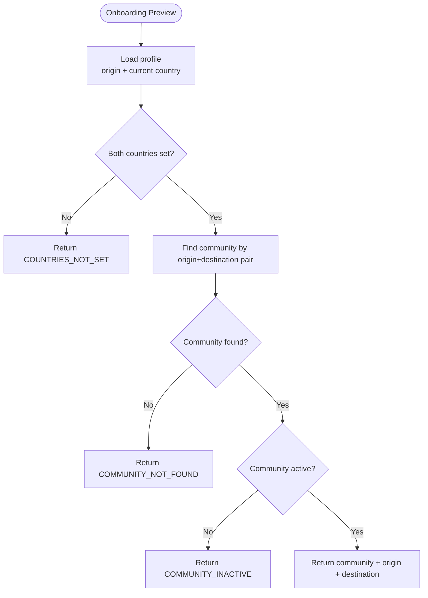

**Diagram sources**
- [CommunityService.java:104-125](file://diasporum-backend/src/main/java/com/diasporum/backend/community/internal/application/CommunityService.java#L104-L125)

**Section sources**
- [CommunityService.java:89-138](file://diasporum-backend/src/main/java/com/diasporum/backend/community/internal/application/CommunityService.java#L89-L138)
- [CommunityController.java:93-112](file://diasporum-backend/src/main/java/com/diasporum/backend/community/internal/api/rest/CommunityController.java#L93-L112)
- [TaxonomyApi.java:31-39](file://diasporum-backend/src/main/java/com/diasporum/backend/taxonomy/TaxonomyApi.java#L31-L39)

### Membership Operations
Membership operations include joining, leaving, checking membership, and listing members:

- **Join**: Validates account status, community activity, and origin-country match. It is idempotent and handles reactivation from LEFT.
- **Leave**: Marks membership LEFT and clears active community if it was the active one.
- **Members list**: Requires viewer to be an active member, returns ACTIVE members, and filters out blocked users.
- **Member detail**: Requires viewer to be an active member and returns the target membership.

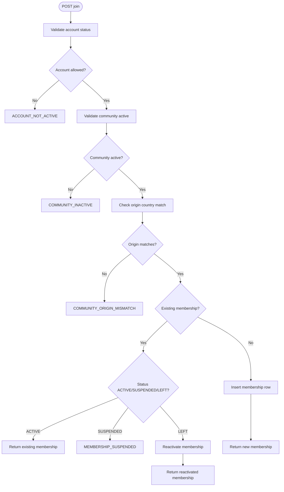

**Diagram sources**
- [CommunityService.java:147-187](file://diasporum-backend/src/main/java/com/diasporum/backend/community/internal/application/CommunityService.java#L147-L187)

**Section sources**
- [CommunityController.java:116-162](file://diasporum-backend/src/main/java/com/diasporum/backend/community/internal/api/rest/CommunityController.java#L116-L162)
- [CommunityService.java:147-248](file://diasporum-backend/src/main/java/com/diasporum/backend/community/internal/application/CommunityService.java#L147-L248)

### Community-Specific Content Filtering
Community-specific content filtering relies on active-community context and membership:

- **Active community**: Users select an active community; this selection is persisted and validated before being accepted.
- **Access check**: Other modules use `canAccess`, which requires active membership and an active community.
- **Content scoping**: Feed and explore flows read the active community ID from session/state and request community-scoped posts and reels.

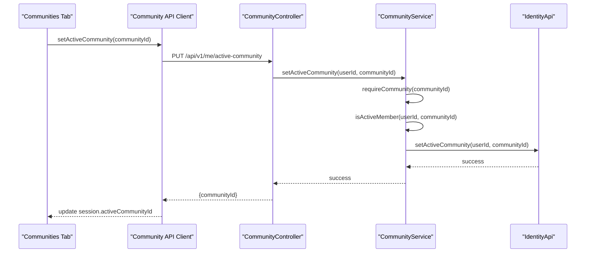

**Diagram sources**
- [CommunityController.java:82-89](file://diasporum-backend/src/main/java/com/diasporum/backend/community/internal/api/rest/CommunityController.java#L82-L89)
- [CommunityService.java:210-222](file://diasporum-backend/src/main/java/com/diasporum/backend/community/internal/application/CommunityService.java#L210-L222)
- [CommunityApiImpl.java:47-56](file://diasporum-backend/src/main/java/com/diasporum/backend/community/internal/application/CommunityApiImpl.java#L47-L56)

**Section sources**
- [CommunityController.java:75-89](file://diasporum-backend/src/main/java/com/diasporum/backend/community/internal/api/rest/CommunityController.java#L75-L89)
- [CommunityService.java:204-222](file://diasporum-backend/src/main/java/com/diasporum/backend/community/internal/application/CommunityService.java#L204-L222)
- [CommunityApiImpl.java:47-56](file://diasporum-backend/src/main/java/com/diasporum/backend/community/internal/application/CommunityApiImpl.java#L47-L56)
- [explore-screen.tsx:52-66](file://diasporum-mobile/src/features/feed/screens/explore-screen.tsx#L52-L66)

### Role-Based Permissions and Settings Management
Roles and permissions are enforced at the service layer:

- **Roles**: MEMBER, TRUSTED_HELPER, MODERATOR, COMMUNITY_ADMIN.
- **Admin-only actions**: Remove member and change role require COMMUNITY_ADMIN.
- **Safety guards**: The last COMMUNITY_ADMIN cannot be removed or demoted.
- **Settings integration**: Default and active community settings are updated via IdentityApi during onboarding and when leaving the active community.

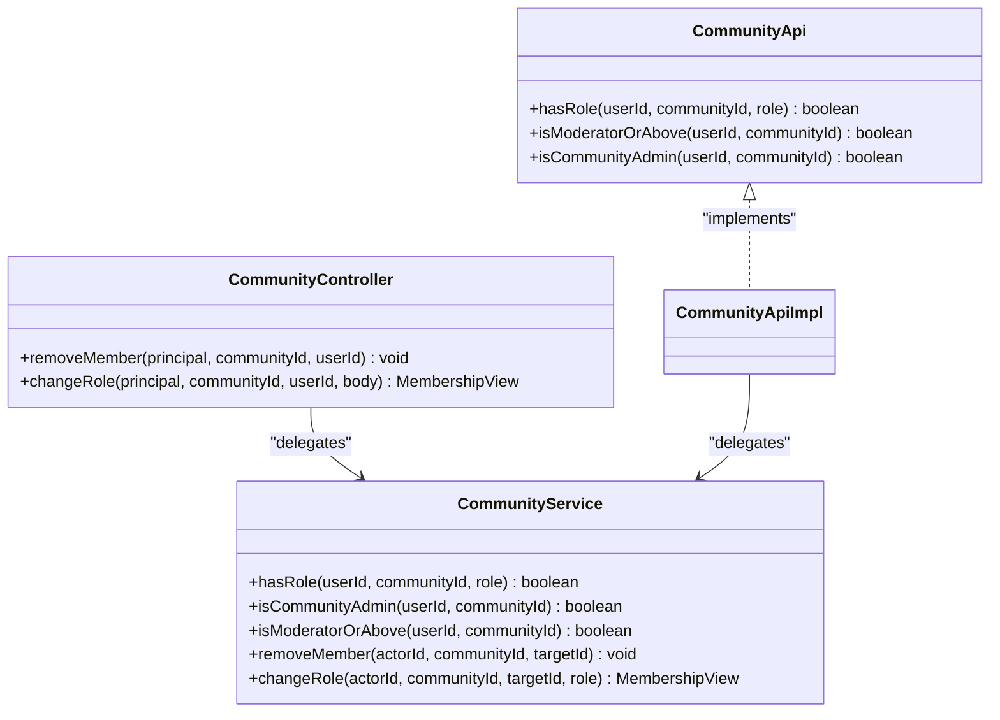

**Diagram sources**
- [CommunityService.java:250-331](file://diasporum-backend/src/main/java/com/diasporum/backend/community/internal/application/CommunityService.java#L250-L331)
- [CommunityController.java:166-181](file://diasporum-backend/src/main/java/com/diasporum/backend/community/internal/api/rest/CommunityController.java#L166-L181)
- [CommunityApi.java:40-45](file://diasporum-backend/src/main/java/com/diasporum/backend/community/CommunityApi.java#L40-L45)

**Section sources**
- [CommunityService.java:250-331](file://diasporum-backend/src/main/java/com/diasporum/backend/community/internal/application/CommunityService.java#L250-L331)
- [CommunityController.java:166-181](file://diasporum-backend/src/main/java/com/diasporum/backend/community/internal/api/rest/CommunityController.java#L166-L181)
- [V1__baseline_v10_12.sql:65-66](file://diasporum-backend/src/main/resources/db/migration/V1__baseline_v10_12.sql#L65-L66)

### Geographic Discovery Using PostGIS
PostGIS is enabled at the database baseline and used for geographic discovery across multiple features:

- **Extension**: PostGIS extension is created at schema initialization.
- **Address geography**: Addresses store both `location` (derived from coordinates) and `discovery_location` (approximate/public point).
- **Indexes**: GiST indexes support radius and distance queries without exposing raw coordinates to ordinary discovery clients.
- **Community relevance**: While community membership itself is not spatial, community-scoped content may combine membership filters with PostGIS-based proximity filters in other modules.

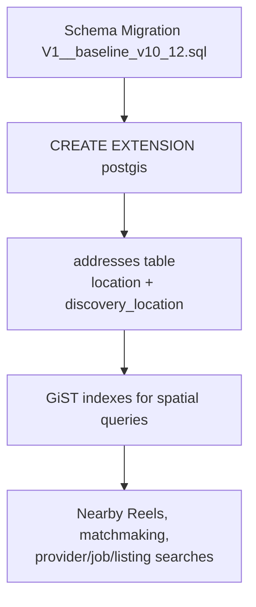

**Diagram sources**
- [V1__baseline_v10_12.sql:58-58](file://diasporum-backend/src/main/resources/db/migration/V1__baseline_v10_12.sql#L58-L58)
- [V1__baseline_v10_12.sql:270-298](file://diasporum-backend/src/main/resources/db/migration/V1__baseline_v10_12.sql#L270-L298)

**Section sources**
- [V1__baseline_v10_12.sql:58-58](file://diasporum-backend/src/main/resources/db/migration/V1__baseline_v10_12.sql#L58-L58)
- [V1__baseline_v10_12.sql:270-337](file://diasporum-backend/src/main/resources/db/migration/V1__baseline_v10_12.sql#L270-L337)

### Community Search Functionality
Community search is primarily driven by taxonomy catalogue APIs and mobile UI:

- **Server-side**: Taxonomy supports searching communities by name/slug and filtering by active status and origin country.
- **Mobile**: The Explore screen allows searching people, communities, posts, and reels; the Communities tab loads available communities and full catalogue details.

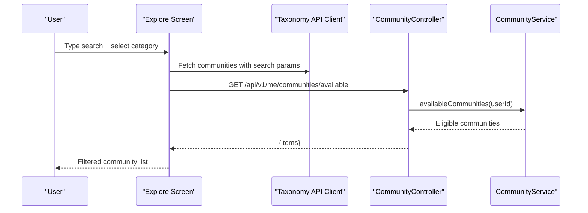

**Diagram sources**
- [explore-screen.tsx:56-77](file://diasporum-mobile/src/features/feed/screens/explore-screen.tsx#L56-L77)
- [CommunityController.java:61-65](file://diasporum-backend/src/main/java/com/diasporum/backend/community/internal/api/rest/CommunityController.java#L61-L65)
- [CommunityService.java:89-97](file://diasporum-backend/src/main/java/com/diasporum/backend/community/internal/application/CommunityService.java#L89-L97)

**Section sources**
- [explore-screen.tsx:56-77](file://diasporum-mobile/src/features/feed/screens/explore-screen.tsx#L56-L77)
- [communities.tsx:35-50](file://diasporum-mobile/src/app/(app)/(tabs)/communities.tsx#L35-L50)
- [TaxonomyApi.java:31-39](file://diasporum-backend/src/main/java/com/diasporum/backend/taxonomy/TaxonomyApi.java#L31-L39)

### Member Interaction Patterns
Member interaction patterns include:

- **Listing members**: Only active members can view the member list; blocked users are hidden.
- **Viewing a specific member**: Requires the viewer to be an active member.
- **Blocking influence**: Social blocking affects visibility but does not remove membership.

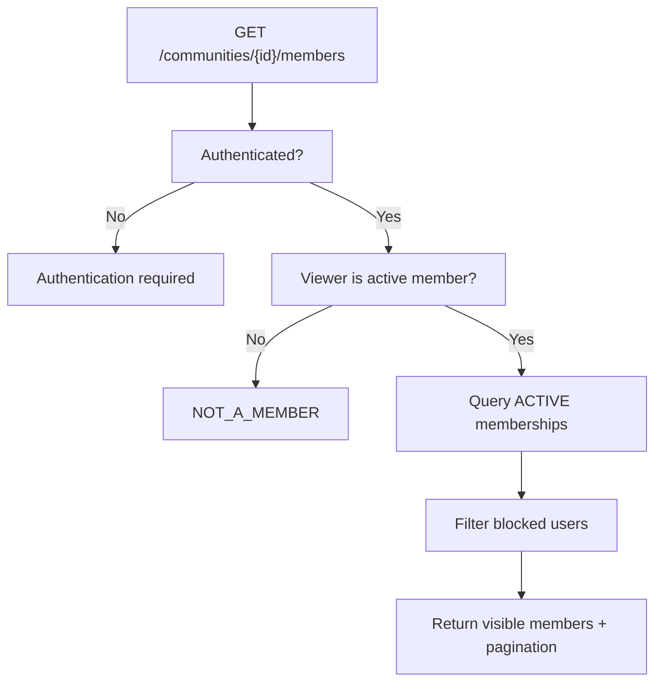

**Diagram sources**
- [CommunityController.java:137-151](file://diasporum-backend/src/main/java/com/diasporum/backend/community/internal/api/rest/CommunityController.java#L137-L151)
- [CommunityService.java:233-248](file://diasporum-backend/src/main/java/com/diasporum/backend/community/internal/application/CommunityService.java#L233-L248)

**Section sources**
- [CommunityController.java:137-162](file://diasporum-backend/src/main/java/com/diasporum/backend/community/internal/api/rest/CommunityController.java#L137-L162)
- [CommunityService.java:233-248](file://diasporum-backend/src/main/java/com/diasporum/backend/community/internal/application/CommunityService.java#L233-L248)

### Community API Usage Examples
The mobile `community-api.ts` client wraps these backend endpoints:

| Operation | Mobile Method | Backend Endpoint | Notes |
|---|---|---|---|
| Get joined communities | `myCommunities()` | `GET /api/v1/me/communities` | Returns ACTIVE memberships |
| Get eligible communities | `availableCommunities()` | `GET /api/v1/me/communities/available` | Server-side origin-country filter |
| Get active community | `activeCommunity()` | `GET /api/v1/me/active-community` | Returns null if unset |
| Set active community | `setActiveCommunity(id)` | `PUT /api/v1/me/active-community` | Requires active membership |
| Join community | `join(id)` | `POST /api/v1/communities/{id}/join` | Idempotent |
| Leave community | `leave(id)` | `DELETE /api/v1/communities/{id}/membership` | Clears active community if needed |
| Get membership | `membership(id)` | `GET /api/v1/communities/{id}/membership` | Returns membership record |
| Preview auto-assigned community | `communityPreview()` | `GET /api/v1/me/community-preview` | No membership created |
| Complete onboarding | `completeOnboarding()` | `POST /api/v1/me/onboarding/complete` | Creates membership + sets defaults |

**Section sources**
- [community-api.ts:13-89](file://diasporum-mobile/src/features/communities/services/community-api.ts#L13-L89)
- [CommunityController.java:56-112](file://diasporum-backend/src/main/java/com/diasporum/backend/community/internal/api/rest/CommunityController.java#L56-L112)

### State Management for Community Data
State management combines mobile session state and backend persistence:

- **Session state**: The mobile session holds `activeCommunityId` and updates it after successful active-community changes.
- **Backend persistence**: Active community is stored via IdentityApi; leaving the active community clears it.
- **UI state**: The Communities tab displays joined communities, highlights the active community, and allows switching.

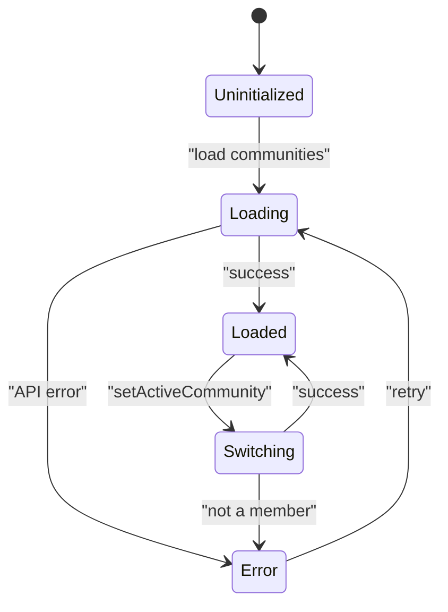

**Diagram sources**
- [communities.tsx:25-50](file://diasporum-mobile/src/app/(app)/(tabs)/communities.tsx#L25-L50)
- [CommunityController.java:82-89](file://diasporum-backend/src/main/java/com/diasporum/backend/community/internal/api/rest/CommunityController.java#L82-L89)
- [CommunityService.java:210-222](file://diasporum-backend/src/main/java/com/diasporum/backend/community/internal/application/CommunityService.java#L210-L222)

**Section sources**
- [communities.tsx:25-50](file://diasporum-mobile/src/app/(app)/(tabs)/communities.tsx#L25-L50)
- [CommunityService.java:189-222](file://diasporum-backend/src/main/java/com/diasporum/backend/community/internal/application/CommunityService.java#L189-L222)

### UI Components for Community Browsing
The main UI components involved in community browsing are:

- **Communities tab**: Loads available communities and full catalogue details, shows joined communities, and allows switching the active community.
- **Explore screen**: Provides a unified search experience across people, communities, posts, and reels, with community-specific data loading based on the active community.

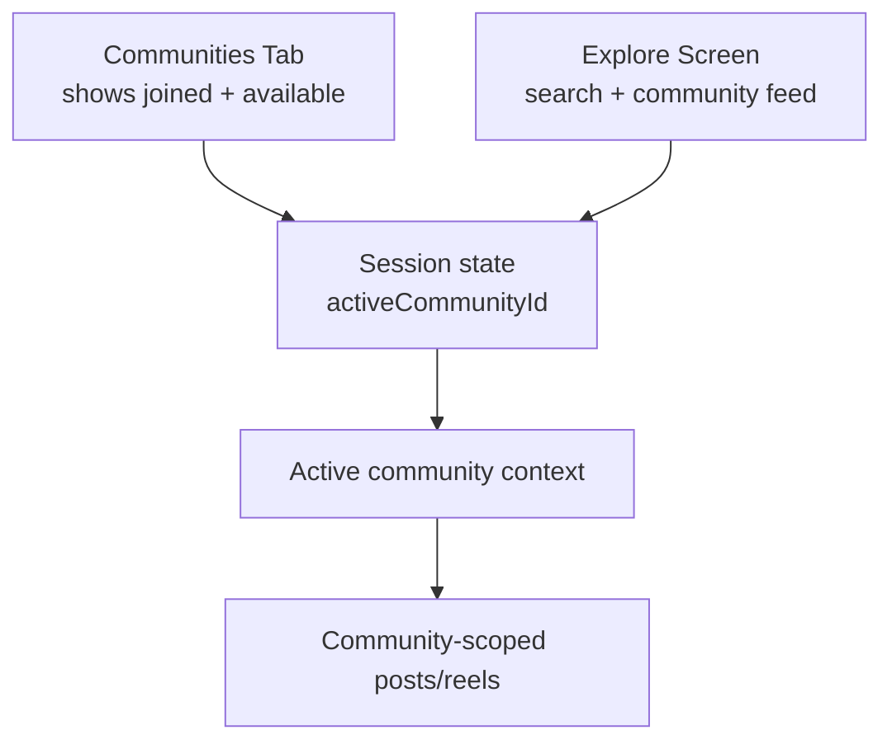

**Diagram sources**
- [communities.tsx:25-50](file://diasporum-mobile/src/app/(app)/(tabs)/communities.tsx#L25-L50)
- [explore-screen.tsx:52-66](file://diasporum-mobile/src/features/feed/screens/explore-screen.tsx#L52-L66)

**Section sources**
- [communities.tsx:25-105](file://diasporum-mobile/src/app/(app)/(tabs)/communities.tsx#L25-L105)
- [explore-screen.tsx:31-77](file://diasporum-mobile/src/features/feed/screens/explore-screen.tsx#L31-L77)

## Dependency Analysis
The community module depends on several external services and shared infrastructure:

- **IdentityApi**: Resolves profiles, default community, and active community.
- **TaxonomyApi**: Provides community catalogue, country data, and eligibility queries.
- **SocialApi**: Provides blocking relationships to filter member visibility.
- **JdbcTemplate**: Executes direct SQL against `community_memberships` and related tables.
- **PostgreSQL + PostGIS**: Stores structured addresses and enables geographic discovery.

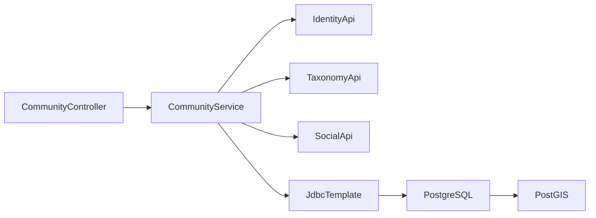

**Diagram sources**
- [CommunityController.java:35-41](file://diasporum-backend/src/main/java/com/diasporum/backend/community/internal/api/rest/CommunityController.java#L35-L41)
- [CommunityService.java:32-43](file://diasporum-backend/src/main/java/com/diasporum/backend/community/internal/application/CommunityService.java#L32-L43)
- [V1__baseline_v10_12.sql:58-58](file://diasporum-backend/src/main/resources/db/migration/V1__baseline_v10_12.sql#L58-L58)

**Section sources**
- [CommunityService.java:32-43](file://diasporum-backend/src/main/java/com/diasporum/backend/community/internal/application/CommunityService.java#L32-L43)
- [V1__baseline_v10_12.sql:58-58](file://diasporum-backend/src/main/resources/db/migration/V1__baseline_v10_12.sql#L58-L58)

## Performance Considerations
- **Pagination**: Member listing uses page and size parameters with server-side limits to prevent large payloads.
- **Indexing**: Database indexes on country, city, and spatial columns optimize discovery queries.
- **Idempotency**: Join operations are idempotent, reducing retry overhead and race conditions.
- **Filtered results**: Blocking relationships are applied server-side to avoid unnecessary client-side filtering.
- **Spatial queries**: PostGIS GiST indexes enable efficient radius and distance queries without exposing raw coordinates.

[No sources needed since this section provides general guidance]

## Troubleshooting Guide
Common issues and their causes:

| Symptom | Likely Cause | Resolution |
|---|---|---|
| Cannot join community | Account not active or pending verification | Verify account status and complete email verification if required |
| Join fails with origin mismatch | User’s origin country does not match community’s origin country | Update profile origin country or join a matching community |
| Cannot set active community | Not an active member of the community | Join the community first |
| Member list forbidden | Viewer is not an active member | Join the community or verify membership |
| Admin actions fail | Actor lacks COMMUNITY_ADMIN role | Assign COMMUNITY_ADMIN role or use another admin |
| Last admin removal blocked | Preventing orphaned community administration | Keep at least one COMMUNITY_ADMIN |
| Onboarding preview fails | Missing origin/current country or no matching community | Complete profile country setup and ensure community exists |

**Section sources**
- [CommunityService.java:147-187](file://diasporum-backend/src/main/java/com/diasporum/backend/community/internal/application/CommunityService.java#L147-L187)
- [CommunityService.java:210-222](file://diasporum-backend/src/main/java/com/diasporum/backend/community/internal/application/CommunityService.java#L210-L222)
- [CommunityService.java:272-324](file://diasporum-backend/src/main/java/com/diasporum/backend/community/internal/application/CommunityService.java#L272-L324)

## Conclusion
The DIASPORUM community management system provides a clear separation between catalogue ownership and participation, robust membership lifecycle controls, and strong role-based permissions. Community discovery is grounded in taxonomy data and origin-country eligibility, while PostGIS enables geographic discovery across the platform. The mobile app integrates tightly with the backend through typed API clients and screens that manage active-community context, allowing users to discover, join, and interact within communities effectively.

[No sources needed since this section summarizes without analyzing specific files]