# Feed & Social Features

<cite>
**Referenced Files in This Document**
- [feed-api.ts](file://diasporum-mobile/src/features/feed/services/feed-api.ts)
- [use-feed.ts](file://diasporum-mobile/src/features/feed/hooks/use-feed.ts)
- [home-feed-screen.tsx](file://diasporum-mobile/src/features/feed/screens/home-feed-screen.tsx)
- [community-selector.tsx](file://diasporum-mobile/src/features/feed/components/community-selector.tsx)
- [feed-controls.tsx](file://diasporum-mobile/src/features/feed/components/feed-controls.tsx)
- [post-item.tsx](file://diasporum-mobile/src/features/feed/components/post-item.tsx)
- [create-post-screen.tsx](file://diasporum-mobile/src/features/feed/screens/create-post-screen.tsx)
- [composer-bar.tsx](file://diasporum-mobile/src/features/feed/components/composer-bar.tsx)
- [media-cache.ts](file://diasporum-mobile/src/features/feed/utils/media-cache.ts)
- [feed-types.ts](file://diasporum-mobile/src/features/feed/types/feed-types.ts)
- [FeedController.java](file://diasporum-backend/src/main/java/com/diasporum/backend/feed/internal/api/rest/FeedController.java)
</cite>

## Table of Contents
1. [Introduction](#introduction)
2. [Project Structure](#project-structure)
3. [Core Components](#core-components)
4. [Architecture Overview](#architecture-overview)
5. [Detailed Component Analysis](#detailed-component-analysis)
6. [Dependency Analysis](#dependency-analysis)
7. [Performance Considerations](#performance-considerations)
8. [Troubleshooting Guide](#troubleshooting-guide)
9. [Conclusion](#conclusion)

## Introduction
This document explains the feed and social networking features in the DIASPORUM mobile application. It covers how feed data is fetched, filtered, paginated, and rendered; how posts are created; how media is uploaded and displayed; and how social interactions such as reactions, saves, comments, and view tracking work. It also documents community selector integration, feed filtering options, performance optimizations like cursor pagination and media caching, infinite scrolling behavior, and error handling for network failures.

## Project Structure
The feed feature lives under the mobile app’s `features/feed` directory and follows a clear separation:
- Services: API wrappers around backend endpoints.
- Hooks: Stateful logic for fetching, filtering, mutations, and optimistic updates.
- Screens: User-facing pages for the home feed, post creation, and post detail.
- Components: Reusable UI pieces for post items, composer bar, community selector, and feed controls.
- Types: Shared TypeScript types mirroring backend models.
- Utils: Performance helpers such as signed media URL caching.

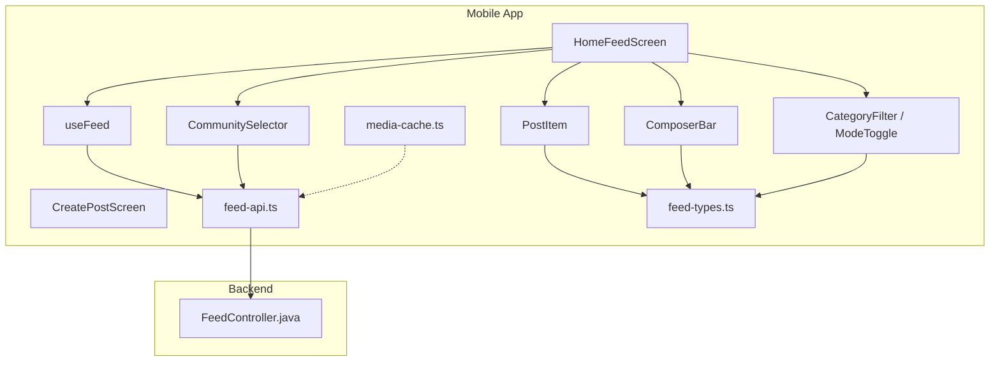

**Diagram sources**
- [home-feed-screen.tsx:35-154](file://diasporum-mobile/src/features/feed/screens/home-feed-screen.tsx#L35-L154)
- [create-post-screen.tsx:30-93](file://diasporum-mobile/src/features/feed/screens/create-post-screen.tsx#L30-L93)
- [composer-bar.tsx:19-48](file://diasporum-mobile/src/features/feed/components/composer-bar.tsx#L19-L48)
- [feed-controls.tsx:13-99](file://diasporum-mobile/src/features/feed/components/feed-controls.tsx#L13-L99)
- [community-selector.tsx:19-69](file://diasporum-mobile/src/features/feed/components/community-selector.tsx#L19-L69)
- [post-item.tsx:100-367](file://diasporum-mobile/src/features/feed/components/post-item.tsx#L100-L367)
- [use-feed.ts:28-150](file://diasporum-mobile/src/features/feed/hooks/use-feed.ts#L28-L150)
- [feed-api.ts:13-125](file://diasporum-mobile/src/features/feed/services/feed-api.ts#L13-L125)
- [feed-types.ts:17-108](file://diasporum-mobile/src/features/feed/types/feed-types.ts#L17-L108)
- [media-cache.ts:19-35](file://diasporum-mobile/src/features/feed/utils/media-cache.ts#L19-L35)
- [FeedController.java:28-245](file://diasporum-backend/src/main/java/com/diasporum/backend/feed/internal/api/rest/FeedController.java#L28-L245)

**Section sources**
- [home-feed-screen.tsx:35-154](file://diasporum-mobile/src/features/feed/screens/home-feed-screen.tsx#L35-L154)
- [feed-api.ts:13-125](file://diasporum-mobile/src/features/feed/services/feed-api.ts#L13-L125)
- [use-feed.ts:28-150](file://diasporum-mobile/src/features/feed/hooks/use-feed.ts#L28-L150)
- [feed-types.ts:17-108](file://diasporum-mobile/src/features/feed/types/feed-types.ts#L17-L108)

## Core Components
- Feed API service: Wraps all `/api/v1/feed/*` endpoints with authenticated requests. It exposes methods for community and following feeds, post CRUD, reactions, saves, views, comments, help posts, author summaries, and polls.
- Feed hook (`useFeed`): Central state manager for the community feed. It handles cursor pagination, mode switching (For you/Latest), category filtering, community switching, optimistic reactions and saves, and in-place item updates.
- Home feed screen: Renders the timeline using `FlatList`, integrates composer bar, community selector, mode toggle, category chips, skeleton/empty states, pull-to-refresh, and infinite scroll.
- Post item: Displays author info, title/body, media gallery, type labels, share, reactions, comments, save, edit/delete menu.
- Community selector: Shows current community name and member count; opens switcher on tap.
- Feed controls: Horizontal category chips and For you/Latest pill toggle.
- Create post screen: Supports general posts, polls, and community help posts; restricts announcements to moderators/admins.
- Media cache: Expiry-aware signed URL cache with in-flight deduplication for media downloads.

**Section sources**
- [feed-api.ts:13-125](file://diasporum-mobile/src/features/feed/services/feed-api.ts#L13-L125)
- [use-feed.ts:28-150](file://diasporum-mobile/src/features/feed/hooks/use-feed.ts#L28-L150)
- [home-feed-screen.tsx:35-154](file://diasporum-mobile/src/features/feed/screens/home-feed-screen.tsx#L35-L154)
- [post-item.tsx:100-367](file://diasporum-mobile/src/features/feed/components/post-item.tsx#L100-L367)
- [community-selector.tsx:19-69](file://diasporum-mobile/src/features/feed/components/community-selector.tsx#L19-L69)
- [feed-controls.tsx:13-99](file://diasporum-mobile/src/features/feed/components/feed-controls.tsx#L13-L99)
- [create-post-screen.tsx:30-93](file://diasporum-mobile/src/features/feed/screens/create-post-screen.tsx#L30-L93)
- [media-cache.ts:19-35](file://diasporum-mobile/src/features/feed/utils/media-cache.ts#L19-L35)

## Architecture Overview
The feed architecture separates concerns between UI, state, API, and backend:
- The home feed screen composes UI components and delegates data operations to `useFeed`.
- `useFeed` calls `feed-api` methods that wrap authenticated HTTP requests.
- The backend `FeedController` exposes REST endpoints for feed retrieval, post management, engagement, comments, help posts, polls, and author resolution.
- Media assets use signed URLs obtained via a separate media endpoint and cached client-side.

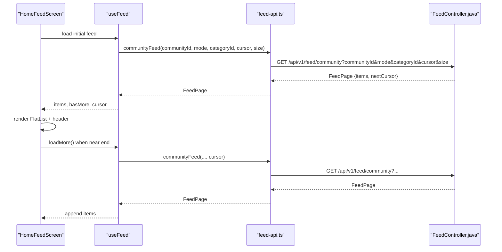

**Diagram sources**
- [home-feed-screen.tsx:106-150](file://diasporum-mobile/src/features/feed/screens/home-feed-screen.tsx#L106-L150)
- [use-feed.ts:35-58](file://diasporum-mobile/src/features/feed/hooks/use-feed.ts#L35-L58)
- [feed-api.ts:16-20](file://diasporum-mobile/src/features/feed/services/feed-api.ts#L16-L20)
- [FeedController.java:94-103](file://diasporum-backend/src/main/java/com/diasporum/backend/feed/internal/api/rest/FeedController.java#L94-L103)

## Detailed Component Analysis

### Feed Data Fetching and Pagination
- The community feed endpoint supports:
  - Cursor-based pagination via `nextCursor`.
  - Filtering by feed mode (`FOR_YOU` or `LATEST`) and optional category.
  - Default page size of 20.
- The mobile hook maintains:
  - A list of feed items.
  - Current cursor and `hasMore` flag.
  - Loading states for initial load, refresh, and appending more.
  - Error state surfaced to the UI footer.

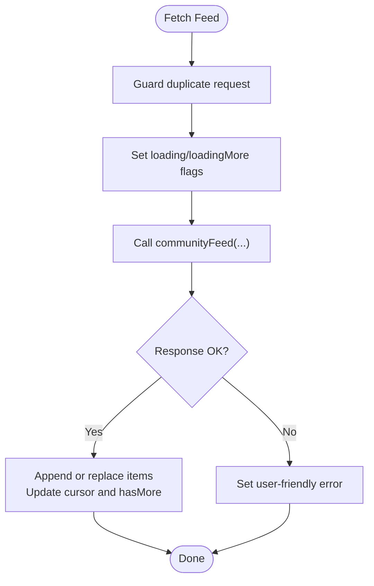

**Diagram sources**
- [use-feed.ts:35-54](file://diasporum-mobile/src/features/feed/hooks/use-feed.ts#L35-L54)
- [feed-api.ts:16-20](file://diasporum-mobile/src/features/feed/services/feed-api.ts#L16-L20)
- [FeedController.java:94-103](file://diasporum-backend/src/main/java/com/diasporum/backend/feed/internal/api/rest/FeedController.java#L94-L103)

**Section sources**
- [use-feed.ts:35-58](file://diasporum-mobile/src/features/feed/hooks/use-feed.ts#L35-L58)
- [feed-api.ts:16-20](file://diasporum-mobile/src/features/feed/services/feed-api.ts#L16-L20)
- [FeedController.java:94-103](file://diasporum-backend/src/main/java/com/diasporum/backend/feed/internal/api/rest/FeedController.java#L94-L103)

### Real-Time Updates and Optimistic Interactions
- Reactions and saves are updated optimistically in local state before server confirmation. If the server call fails, the hook rolls back the change.
- View tracking is performed asynchronously and silently so it does not block rendering.

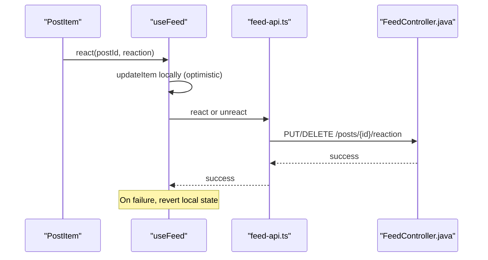

**Diagram sources**
- [use-feed.ts:115-127](file://diasporum-mobile/src/features/feed/hooks/use-feed.ts#L115-L127)
- [feed-api.ts:70-74](file://diasporum-mobile/src/features/feed/services/feed-api.ts#L70-L74)
- [FeedController.java:122-131](file://diasporum-backend/src/main/java/com/diasporum/backend/feed/internal/api/rest/FeedController.java#L122-L131)

**Section sources**
- [use-feed.ts:115-144](file://diasporum-mobile/src/features/feed/hooks/use-feed.ts#L115-L144)
- [feed-api.ts:70-84](file://diasporum-mobile/src/features/feed/services/feed-api.ts#L70-L84)
- [FeedController.java:122-148](file://diasporum-backend/src/main/java/com/diasporum/backend/feed/internal/api/rest/FeedController.java#L122-L148)

### Content Rendering and Infinite Scrolling
- The home feed uses `FlatList` with:
  - `onEndReached` and threshold to trigger `loadMore`.
  - `RefreshControl` for pull-to-refresh.
  - `ListHeaderComponent` containing composer bar, mode toggle, and category chips.
  - Skeleton and empty states based on loading and filter context.
  - Footer showing loading spinner or error message with retry prompt.

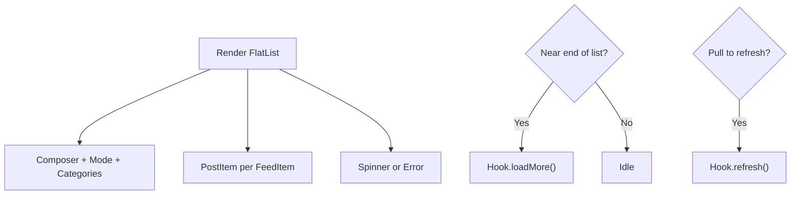

**Diagram sources**
- [home-feed-screen.tsx:106-150](file://diasporum-mobile/src/features/feed/screens/home-feed-screen.tsx#L106-L150)
- [use-feed.ts:56-63](file://diasporum-mobile/src/features/feed/hooks/use-feed.ts#L56-L63)

**Section sources**
- [home-feed-screen.tsx:79-150](file://diasporum-mobile/src/features/feed/screens/home-feed-screen.tsx#L79-L150)
- [use-feed.ts:56-63](file://diasporum-mobile/src/features/feed/hooks/use-feed.ts#L56-L63)

### Post Creation Workflow
- Supported modes:
  - General post.
  - Poll with multiple options.
  - Community help (request/offering).
  - Announcement (restricted to moderators/admins).
- Validation ensures required fields per mode.
- Submission routes to the appropriate backend endpoint:
  - `/api/v1/feed/posts` for general/announcement.
  - `/api/v1/feed/polls` for polls.
  - `/api/v1/feed/community-help` for help posts.

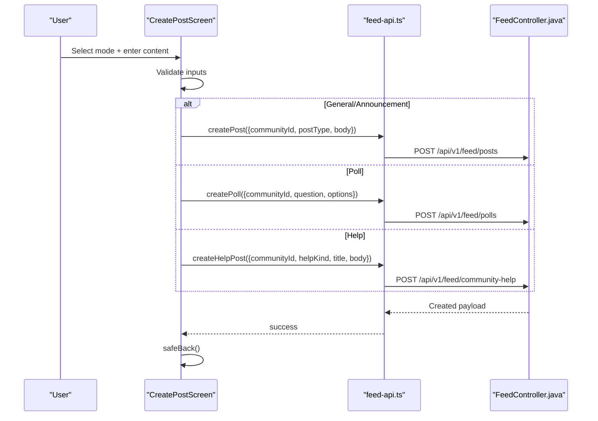

**Diagram sources**
- [create-post-screen.tsx:64-93](file://diasporum-mobile/src/features/feed/screens/create-post-screen.tsx#L64-L93)
- [feed-api.ts:57-106](file://diasporum-mobile/src/features/feed/services/feed-api.ts#L57-L106)
- [FeedController.java:64-73](file://diasporum-backend/src/main/java/com/diasporum/backend/feed/internal/api/rest/FeedController.java#L64-L73)
- [FeedController.java:214-224](file://diasporum-backend/src/main/java/com/diasporum/backend/feed/internal/api/rest/FeedController.java#L214-L224)
- [FeedController.java:183-193](file://diasporum-backend/src/main/java/com/diasporum/backend/feed/internal/api/rest/FeedController.java#L183-L193)

**Section sources**
- [create-post-screen.tsx:30-93](file://diasporum-mobile/src/features/feed/screens/create-post-screen.tsx#L30-L93)
- [feed-api.ts:57-106](file://diasporum-mobile/src/features/feed/services/feed-api.ts#L57-L106)
- [FeedController.java:64-73](file://diasporum-backend/src/main/java/com/diasporum/backend/feed/internal/api/rest/FeedController.java#L64-L73)
- [FeedController.java:183-224](file://diasporum-backend/src/main/java/com/diasporum/backend/feed/internal/api/rest/FeedController.java#L183-L224)

### Media Upload and Display
- Media IDs are included in feed items and post payloads.
- Signed download URLs are requested via `/api/v1/media/{mediaId}/download-url` and cached with expiry.
- In-flight deduplication prevents concurrent requests for the same media ID.
- Post item renders single images sized to natural aspect ratio and horizontal galleries for multiple images.

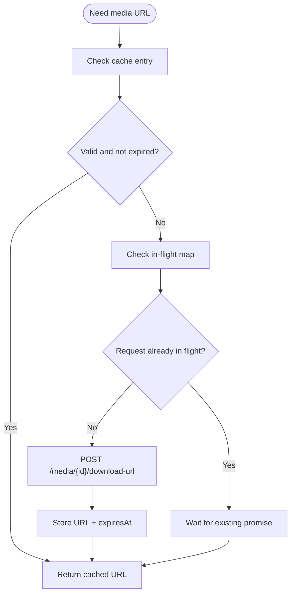

**Diagram sources**
- [media-cache.ts:19-35](file://diasporum-mobile/src/features/feed/utils/media-cache.ts#L19-L35)
- [post-item.tsx:52-98](file://diasporum-mobile/src/features/feed/components/post-item.tsx#L52-L98)

**Section sources**
- [media-cache.ts:1-42](file://diasporum-mobile/src/features/feed/utils/media-cache.ts#L1-42)
- [post-item.tsx:52-98](file://diasporum-mobile/src/features/feed/components/post-item.tsx#L52-L98)

### Social Interactions: Comments and Reactions
- Reactions:
  - Optimistic update in local state.
  - Toggle between like/love/helpful/insightful/thanks.
  - Unreact removes the reaction.
- Saves:
  - Optimistic toggle with server confirmation.
- Comments:
  - Create nested comments via `parentCommentId`.
  - Paginated comment listing.
  - Edit and delete comments supported.

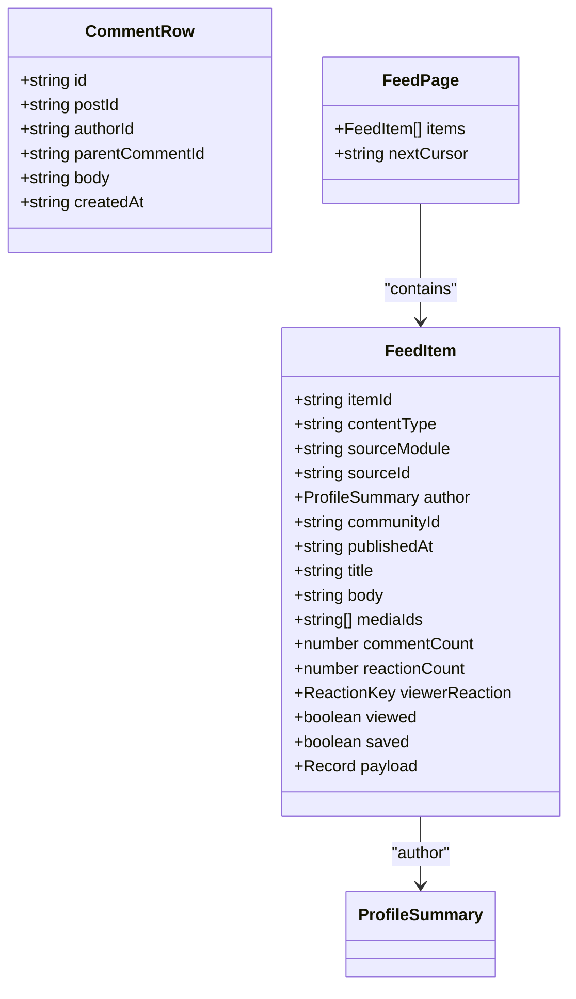

**Diagram sources**
- [feed-types.ts:17-108](file://diasporum-mobile/src/features/feed/types/feed-types.ts#L17-L108)

**Section sources**
- [use-feed.ts:115-144](file://diasporum-mobile/src/features/feed/hooks/use-feed.ts#L115-L144)
- [feed-api.ts:70-99](file://diasporum-mobile/src/features/feed/services/feed-api.ts#L70-L99)
- [FeedController.java:122-179](file://diasporum-backend/src/main/java/com/diasporum/backend/feed/internal/api/rest/FeedController.java#L122-L179)
- [feed-types.ts:72-108](file://diasporum-mobile/src/features/feed/types/feed-types.ts#L72-L108)

### Community Selector Integration
- Displays the active community name and member count.
- Fetches community details and member count from taxonomy and communities APIs.
- Tapping opens the community drawer/switcher.

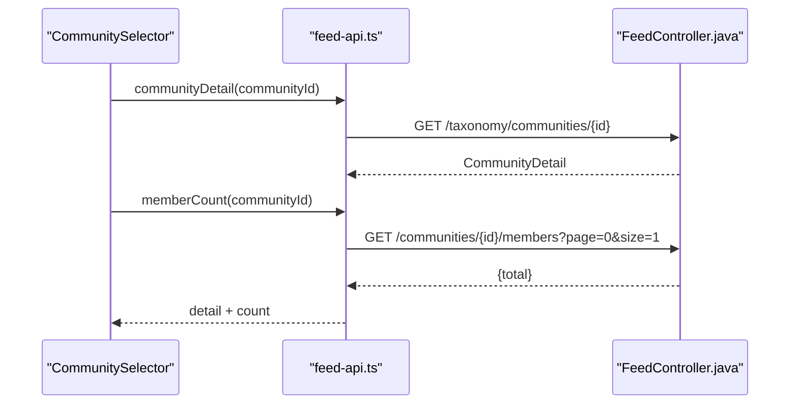

**Diagram sources**
- [community-selector.tsx:27-45](file://diasporum-mobile/src/features/feed/components/community-selector.tsx#L27-L45)
- [feed-api.ts:29-48](file://diasporum-mobile/src/features/feed/services/feed-api.ts#L29-L48)

**Section sources**
- [community-selector.tsx:19-69](file://diasporum-mobile/src/features/feed/components/community-selector.tsx#L19-L69)
- [feed-api.ts:29-48](file://diasporum-mobile/src/features/feed/services/feed-api.ts#L29-L48)

### Feed Filtering Options
- Mode toggle: Switch between “For you” and “Latest”.
- Category chips: Horizontal scrollable chips driven by backend categories for the destination country.
- Changing either resets pagination and reloads the feed.

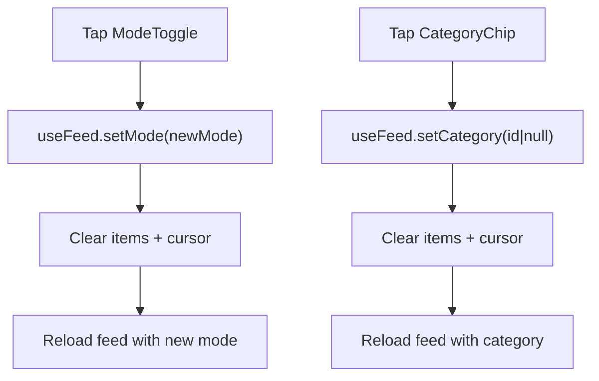

**Diagram sources**
- [feed-controls.tsx:70-99](file://diasporum-mobile/src/features/feed/components/feed-controls.tsx#L70-L99)
- [use-feed.ts:65-74](file://diasporum-mobile/src/features/feed/hooks/use-feed.ts#L65-L74)

**Section sources**
- [feed-controls.tsx:13-99](file://diasporum-mobile/src/features/feed/components/feed-controls.tsx#L13-L99)
- [use-feed.ts:65-94](file://diasporum-mobile/src/features/feed/hooks/use-feed.ts#L65-L94)

### Performance Optimization Techniques
- Cursor pagination reduces payload size and enables smooth infinite scrolling.
- Optimistic updates improve perceived responsiveness for reactions and saves.
- View tracking is fire-and-forget to avoid blocking UI.
- Signed media URL caching avoids repeated token fetches and deduplicates concurrent requests.
- Author summaries are batched via a single endpoint instead of per-post lookups.

**Section sources**
- [use-feed.ts:35-54](file://diasporum-mobile/src/features/feed/hooks/use-feed.ts#L35-L54)
- [use-feed.ts:115-144](file://diasporum-mobile/src/features/feed/hooks/use-feed.ts#L115-L144)
- [feed-api.ts:82-84](file://diasporum-mobile/src/features/feed/services/feed-api.ts#L82-L84)
- [media-cache.ts:1-42](file://diasporum-mobile/src/features/feed/utils/media-cache.ts#L1-42)
- [feed-api.ts:109-114](file://diasporum-mobile/src/features/feed/services/feed-api.ts#L109-L114)

### Examples of Feed Customization
- Change default page size by adjusting the `size` parameter in `communityFeed`.
- Add additional filters (e.g., author, date range) by extending query parameters and corresponding backend endpoints.
- Customize category chips appearance and behavior through `CategoryFilter` props and styles.

[No sources needed since this section provides general guidance]

## Dependency Analysis
The feed feature depends on session context, shared API client, and backend controllers.

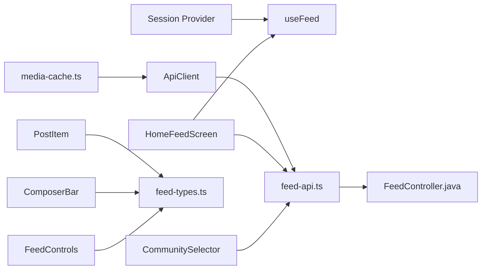

**Diagram sources**
- [use-feed.ts:28-34](file://diasporum-mobile/src/features/feed/hooks/use-feed.ts#L28-L34)
- [feed-api.ts:13-125](file://diasporum-mobile/src/features/feed/services/feed-api.ts#L13-L125)
- [home-feed-screen.tsx:35-41](file://diasporum-mobile/src/features/feed/screens/home-feed-screen.tsx#L35-L41)
- [post-item.tsx:100-118](file://diasporum-mobile/src/features/feed/components/post-item.tsx#L100-L118)
- [composer-bar.tsx:19-48](file://diasporum-mobile/src/features/feed/components/composer-bar.tsx#L19-L48)
- [feed-controls.tsx:13-99](file://diasporum-mobile/src/features/feed/components/feed-controls.tsx#L13-L99)
- [community-selector.tsx:19-45](file://diasporum-mobile/src/features/feed/components/community-selector.tsx#L19-L45)
- [media-cache.ts:19-35](file://diasporum-mobile/src/features/feed/utils/media-cache.ts#L19-L35)

**Section sources**
- [use-feed.ts:28-34](file://diasporum-mobile/src/features/feed/hooks/use-feed.ts#L28-L34)
- [feed-api.ts:13-125](file://diasporum-mobile/src/features/feed/services/feed-api.ts#L13-L125)
- [home-feed-screen.tsx:35-41](file://diasporum-mobile/src/features/feed/screens/home-feed-screen.tsx#L35-L41)

## Performance Considerations
- Prefer cursor pagination over offset-based pagination to maintain stable ordering and reduce memory pressure.
- Batch author profile lookups to minimize round trips.
- Use optimistic UI for non-critical actions like reactions and saves; roll back on failure.
- Cache signed media URLs with short TTL and deduplicate in-flight requests.
- Debounce or throttle expensive operations if adding search or live filters.
- Keep image dimensions constrained and lazy-load offscreen media where possible.

[No sources needed since this section provides general guidance]

## Troubleshooting Guide
Common issues and resolutions:
- Network failures during feed load:
  - The hook sets an error state; the footer displays a message prompting pull-to-retry.
  - Ensure the API client handles authentication and retries appropriately.
- Expired or invalid media URLs:
  - Invalidate and refetch the signed URL using the cache helper.
- Duplicate reactions or votes:
  - Backend may return conflict errors; handle gracefully and keep local state consistent.
- Empty feed after filtering:
  - Clear selected category or adjust filters to show results.

**Section sources**
- [home-feed-screen.tsx:134-149](file://diasporum-mobile/src/features/feed/screens/home-feed-screen.tsx#L134-L149)
- [use-feed.ts:50-53](file://diasporum-mobile/src/features/feed/hooks/use-feed.ts#L50-L53)
- [media-cache.ts:37-41](file://diasporum-mobile/src/features/feed/utils/media-cache.ts#L37-L41)
- [FeedController.java:232-243](file://diasporum-backend/src/main/java/com/diasporum/backend/feed/internal/api/rest/FeedController.java#L232-L243)

## Conclusion
The DIASPORUM mobile feed combines a clean, responsive UI with robust backend integration. It delivers efficient data fetching through cursor pagination, supports rich social interactions with optimistic updates, and provides flexible customization via community selection and category filtering. Performance is optimized through batching, caching, and careful state management, while error handling ensures resilience against network issues.

[No sources needed since this section summarizes without analyzing specific files]