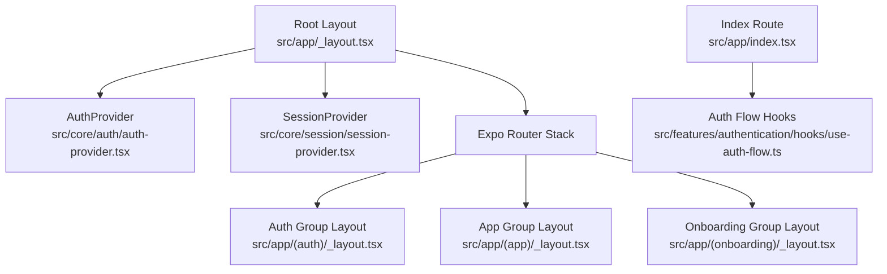
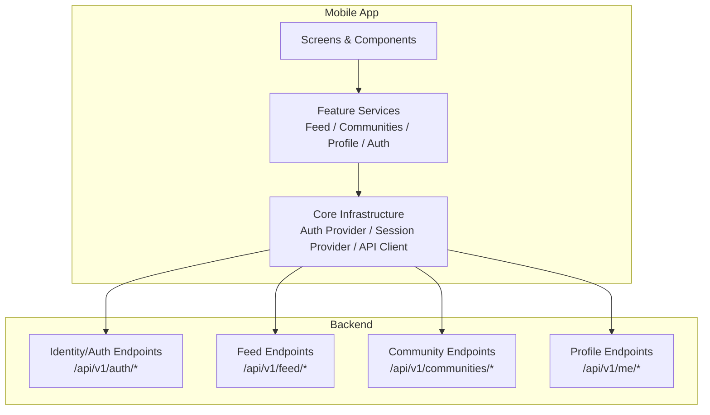
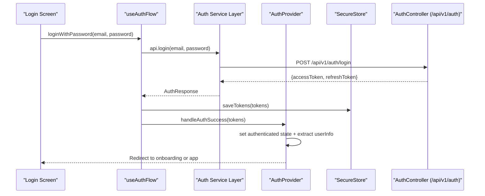
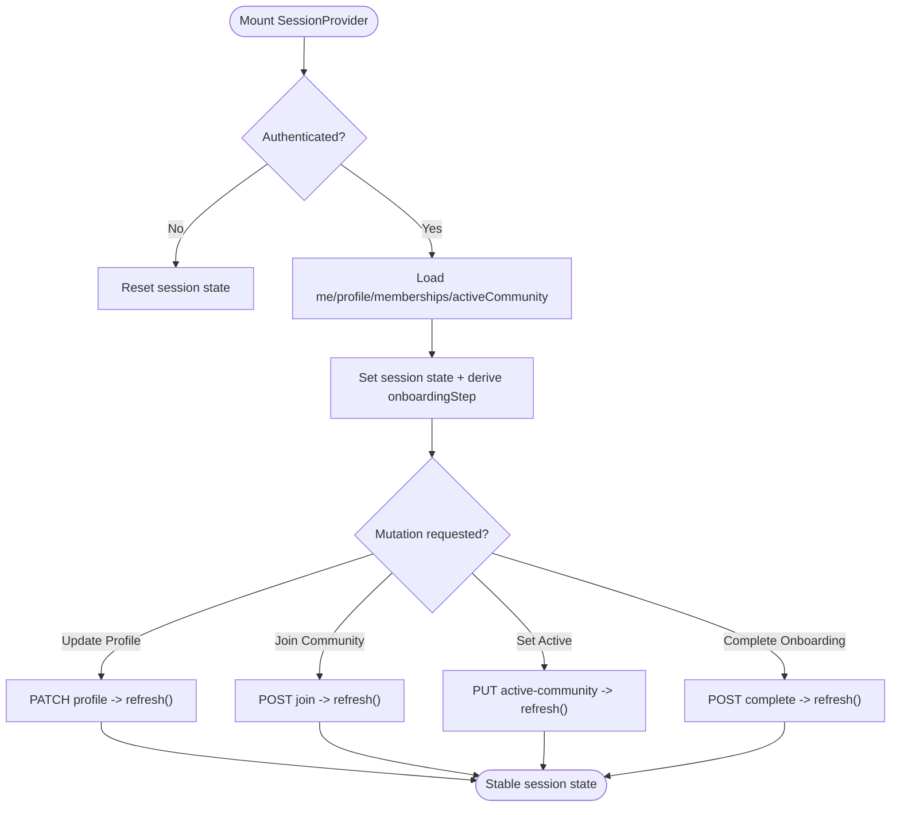
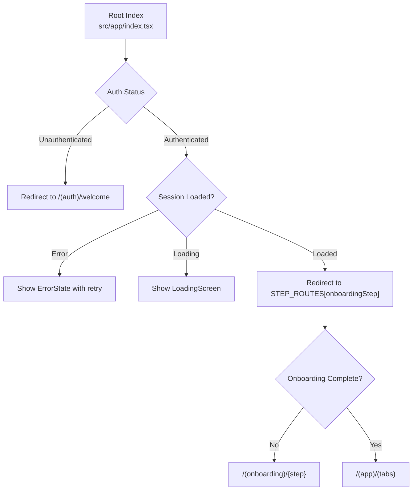
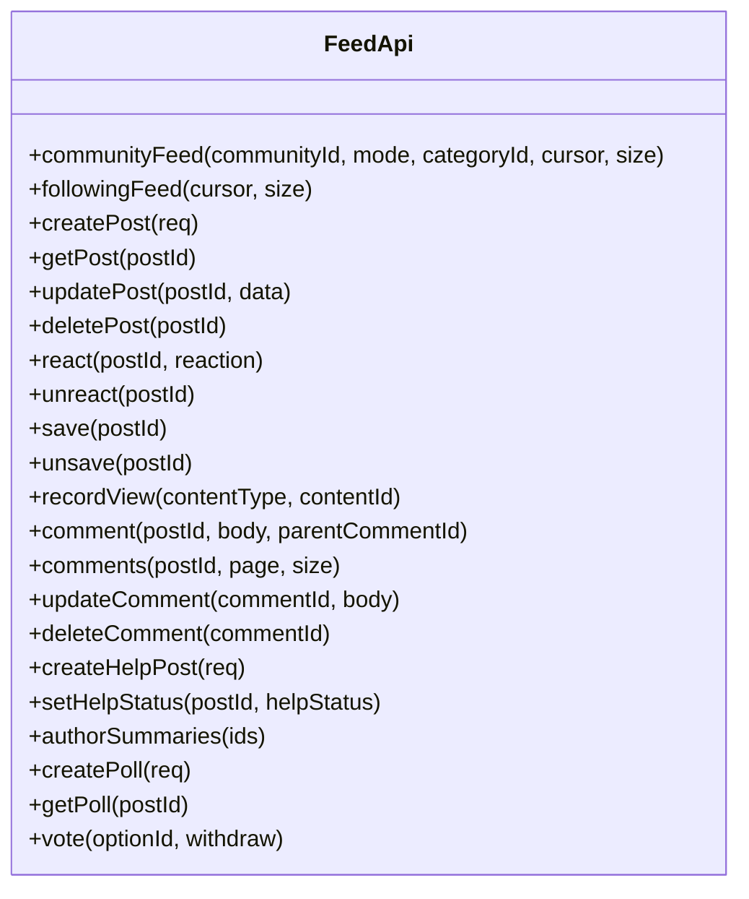
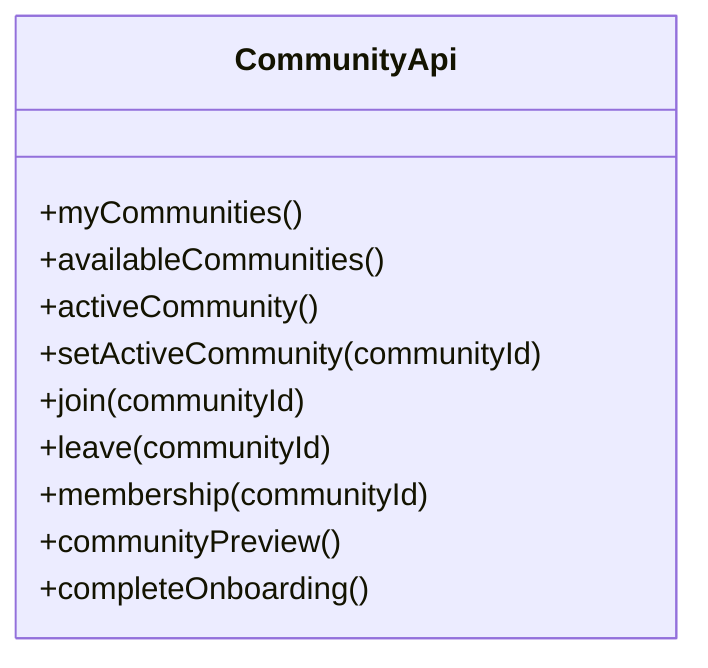
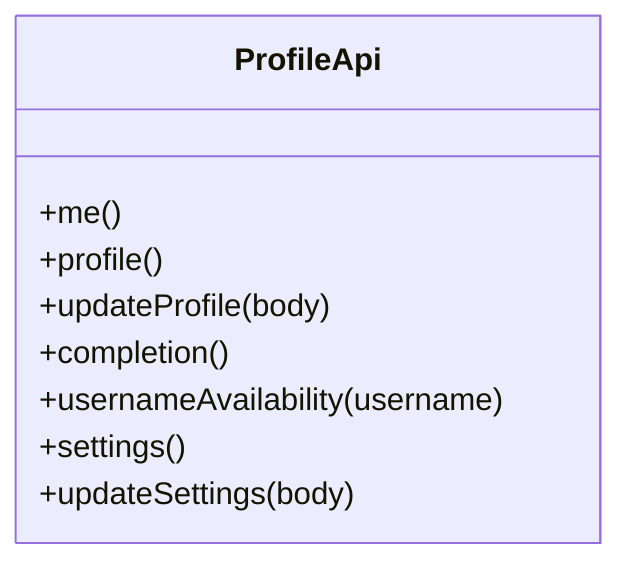
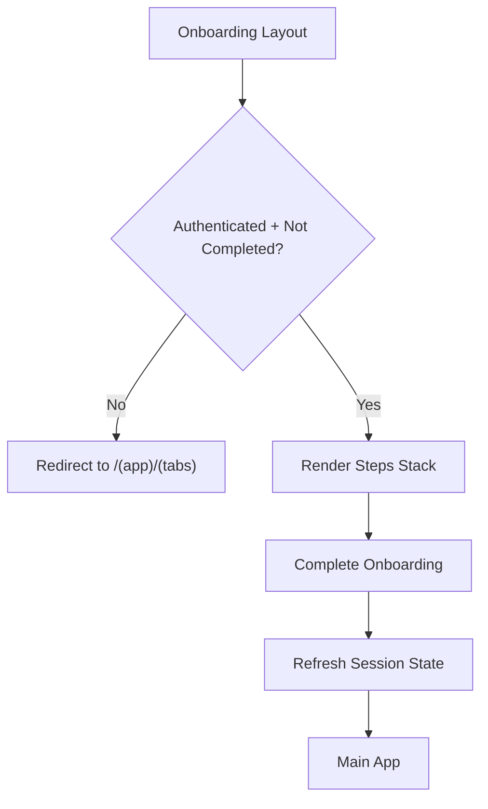
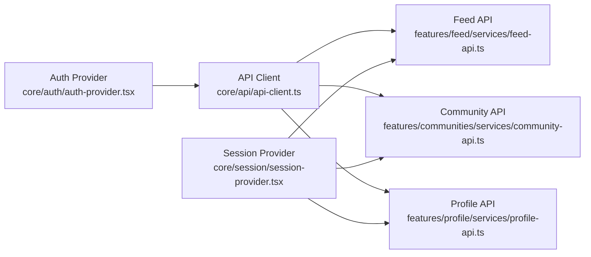

# Mobile Application

<cite>
**Referenced Files in This Document**
- [package.json](file://diasporum-mobile/package.json)
- [app.json](file://diasporum-mobile/app.json)
- [_layout.tsx](file://diasporum-mobile/src/app/_layout.tsx)
- [index.tsx](file://diasporum-mobile/src/app/index.tsx)
- [auth-provider.tsx](file://diasporum-mobile/src/core/auth/auth-provider.tsx)
- [auth-service.ts](file://diasporum-mobile/src/core/auth/auth-service.ts)
- [api-client.ts](file://diasporum-mobile/src/core/api/api-client.ts)
- [session-provider.tsx](file://diasporum-mobile/src/core/session/session-provider.tsx)
- [safe-back.ts](file://diasporum-mobile/src/core/navigation/safe-back.ts)
- [use-auth-flow.ts](file://diasporum-mobile/src/features/authentication/hooks/use-auth-flow.ts)
- [_layout.tsx (auth)](file://diasporum-mobile/src/app/(auth)/_layout.tsx)
- [_layout.tsx (app)](file://diasporum-mobile/src/app/(app)/_layout.tsx)
- [_layout.tsx (onboarding)](file://diasporum-mobile/src/app/(onboarding)/_layout.tsx)
- [feed-api.ts](file://diasporum-mobile/src/features/feed/services/feed-api.ts)
- [community-api.ts](file://diasporum-mobile/src/features/communities/services/community-api.ts)
- [profile-api.ts](file://diasporum-mobile/src/features/profile/services/profile-api.ts)
- [AuthController.java](file://diasporum-backend/src/main/java/com/diasporum/backend/identity/internal/api/rest/AuthController.java)
- [AuthService.java](file://diasporum-backend/src/main/java/com/diasporum/backend/identity/internal/application/AuthService.java)
</cite>

## Table of Contents
1. [Introduction](#introduction)
2. [Project Structure](#project-structure)
3. [Core Components](#core-components)
4. [Architecture Overview](#architecture-overview)
5. [Detailed Component Analysis](#detailed-component-analysis)
6. [Dependency Analysis](#dependency-analysis)
7. [Performance Considerations](#performance-considerations)
8. [Troubleshooting Guide](#troubleshooting-guide)
9. [Conclusion](#conclusion)
10. [Appendices](#appendices)

## Introduction
This document describes the DIASPORUM mobile application built with Expo and React Native. It explains the file-based routing, navigation architecture using Expo Router, state management patterns for authentication and session data, and the organization of feature modules including feed/social features, community management, profile management, and onboarding flows. It also documents the UI component system, theming approach, responsive design patterns, development workflow, testing strategies, and deployment processes for iOS and Android.

## Project Structure
The mobile app is an Expo Router project where routes are defined by files under src/app. The root layout wraps the app with providers for safe areas, authentication, and session state. The index route resolves the initial destination based on authentication and onboarding status. Feature modules live under src/features and share core infrastructure under src/core. Shared UI components and theme tokens live under src/shared and src/constants.

**Diagram sources**
- [_layout.tsx:12-30](file://diasporum-mobile/src/app/_layout.tsx#L12-L30)
- [index.tsx:14-35](file://diasporum-mobile/src/app/index.tsx#L14-L35)
- [_layout.tsx (auth):11-23](file://diasporum-mobile/src/app/(auth)/_layout.tsx#L11-L23)
- [_layout.tsx (app):14-37](file://diasporum-mobile/src/app/(app)/_layout.tsx#L14-L37)
- [_layout.tsx (onboarding):15-44](file://diasporum-mobile/src/app/(onboarding)/_layout.tsx#L15-L44)

**Section sources**
- [_layout.tsx:1-31](file://diasporum-mobile/src/app/_layout.tsx#L1-L31)
- [index.tsx:1-36](file://diasporum-mobile/src/app/index.tsx#L1-L36)
- [_layout.tsx (auth):1-24](file://diasporum-mobile/src/app/(auth)/_layout.tsx#L1-L24)
- [_layout.tsx (app):1-38](file://diasporum-mobile/src/app/(app)/_layout.tsx#L1-L38)
- [_layout.tsx (onboarding):1-45](file://diasporum-mobile/src/app/(onboarding)/_layout.tsx#L1-L45)

## Core Components
- Authentication provider manages global auth state, token refresh, and logout. It restores sessions on mount and exposes helpers to get a valid access token.
- API client centralizes HTTP requests, enforces host restrictions for bearer tokens, performs proactive and reactive token refresh, and maps errors consistently.
- Session provider loads user identity, profile, memberships, and active community after authentication, derives onboarding step, and provides mutation helpers that refresh state atomically.
- Navigation guards in route group layouts enforce authentication and onboarding completion before rendering protected screens.

Key responsibilities:
- Auth provider: restore session, handle login success, refresh tokens, logout, expose current tokens safely.
- API client: base URL from config, Bearer injection only to configured host, timeout handling, single retry after refresh, consistent ApiError mapping.
- Session provider: parallel fetches for me/profile/memberships/active community, error handling, onboarding step derivation, atomic updates.
- Navigation guards: redirect unauthenticated users to login; redirect incomplete onboarding to onboarding flow; render main app when fully onboarded.

**Section sources**
- [auth-provider.tsx:14-182](file://diasporum-mobile/src/core/auth/auth-provider.tsx#L14-L182)
- [api-client.ts:1-225](file://diasporum-mobile/src/core/api/api-client.ts#L1-L225)
- [session-provider.tsx:1-207](file://diasporum-mobile/src/core/session/session-provider.tsx#L1-L207)
- [_layout.tsx (auth):11-23](file://diasporum-mobile/src/app/(auth)/_layout.tsx#L11-L23)
- [_layout.tsx (app):14-37](file://diasporum-mobile/src/app/(app)/_layout.tsx#L14-L37)
- [_layout.tsx (onboarding):15-44](file://diasporum-mobile/src/app/(onboarding)/_layout.tsx#L15-L44)

## Architecture Overview
The app uses a layered architecture:
- Presentation layer: Expo Router screens and shared UI components.
- Feature services: domain-specific API wrappers for feed, communities, profile, and authentication.
- Core infrastructure: authentication context, session context, centralized API client, environment configuration, and navigation utilities.
- Backend integration: first-party REST endpoints under /api/v1, including identity/auth endpoints exposed by the Spring Boot backend.

**Diagram sources**
- [api-client.ts:1-225](file://diasporum-mobile/src/core/api/api-client.ts#L1-L225)
- [feed-api.ts:1-120](file://diasporum-mobile/src/features/feed/services/feed-api.ts#L1-L120)
- [community-api.ts:1-93](file://diasporum-mobile/src/features/communities/services/community-api.ts#L1-L93)
- [profile-api.ts:1-65](file://diasporum-mobile/src/features/profile/services/profile-api.ts#L1-L65)
- [AuthController.java:19-118](file://diasporum-backend/src/main/java/com/diasporum/backend/identity/internal/api/rest/AuthController.java#L19-L118)

## Detailed Component Analysis

### Authentication Flow
The authentication flow integrates with the backend’s first-party auth endpoints. It supports email/password login, Google sign-in, and Apple sign-in. After successful authentication, tokens are persisted securely and the auth provider updates global state. Token refresh is handled centrally with single-flight deduplication and rotation support. Logout revokes the session server-side and clears local state.

**Diagram sources**
- [use-auth-flow.ts:39-123](file://diasporum-mobile/src/features/authentication/hooks/use-auth-flow.ts#L39-L123)
- [auth-service.ts:76-112](file://diasporum-mobile/src/core/auth/auth-service.ts#L76-L112)
- [auth-provider.tsx:84-89](file://diasporum-mobile/src/core/auth/auth-provider.tsx#L84-L89)
- [AuthController.java:105-118](file://diasporum-backend/src/main/java/com/diasporum/backend/identity/internal/api/rest/AuthController.java#L105-L118)

**Section sources**
- [use-auth-flow.ts:1-124](file://diasporum-mobile/src/features/authentication/hooks/use-auth-flow.ts#L1-L124)
- [auth-service.ts:1-200](file://diasporum-mobile/src/core/auth/auth-service.ts#L1-L200)
- [auth-provider.tsx:14-182](file://diasporum-mobile/src/core/auth/auth-provider.tsx#L14-L182)
- [AuthController.java:19-118](file://diasporum-backend/src/main/java/com/diasporum/backend/identity/internal/api/rest/AuthController.java#L19-L118)

### Session Management and Token Handling
The session provider constructs an API client bound to the current auth context and loads user identity, profile, memberships, and active community in parallel. It derives the onboarding step and exposes methods to update profile, join communities, set active community, update preferred language, and complete onboarding. Token refresh is coordinated through the auth provider and API client, ensuring a single in-flight refresh request and rotation of refresh tokens.

**Diagram sources**
- [session-provider.tsx:59-207](file://diasporum-mobile/src/core/session/session-provider.tsx#L59-L207)
- [auth-service.ts:114-167](file://diasporum-mobile/src/core/auth/auth-service.ts#L114-L167)
- [api-client.ts:126-176](file://diasporum-mobile/src/core/api/api-client.ts#L126-L176)

**Section sources**
- [session-provider.tsx:1-207](file://diasporum-mobile/src/core/session/session-provider.tsx#L1-L207)
- [auth-service.ts:114-167](file://diasporum-mobile/src/core/auth/auth-service.ts#L114-L167)
- [api-client.ts:126-176](file://diasporum-mobile/src/core/api/api-client.ts#L126-L176)

### Navigation Architecture
Navigation is implemented via Expo Router with file-based routing. Route groups separate unauthenticated, authenticated, and onboarding flows. The root index route resolves the initial destination based on auth state and onboarding step. Safe back navigation prevents invalid back actions.

**Diagram sources**
- [index.tsx:14-35](file://diasporum-mobile/src/app/index.tsx#L14-L35)
- [_layout.tsx (auth):11-23](file://diasporum-mobile/src/app/(auth)/_layout.tsx#L11-L23)
- [_layout.tsx (app):14-37](file://diasporum-mobile/src/app/(app)/_layout.tsx#L14-L37)
- [_layout.tsx (onboarding):15-44](file://diasporum-mobile/src/app/(onboarding)/_layout.tsx#L15-L44)
- [safe-back.ts:1-10](file://diasporum-mobile/src/core/navigation/safe-back.ts#L1-L10)

**Section sources**
- [index.tsx:1-36](file://diasporum-mobile/src/app/index.tsx#L1-L36)
- [_layout.tsx (auth):1-24](file://diasporum-mobile/src/app/(auth)/_layout.tsx#L1-L24)
- [_layout.tsx (app):1-38](file://diasporum-mobile/src/app/(app)/_layout.tsx#L1-L38)
- [_layout.tsx (onboarding):1-45](file://diasporum-mobile/src/app/(onboarding)/_layout.tsx#L1-L45)
- [safe-back.ts:1-10](file://diasporum-mobile/src/core/navigation/safe-back.ts#L1-L10)

### Feature Modules

#### Feed and Social Features
The feed service wraps backend endpoints for community feeds, following feeds, posts, comments, reactions, saves, view tracking, help posts, polls, and author summaries. All calls use the shared API client with bearer authentication and automatic error handling.

**Diagram sources**
- [feed-api.ts:13-119](file://diasporum-mobile/src/features/feed/services/feed-api.ts#L13-L119)

**Section sources**
- [feed-api.ts:1-120](file://diasporum-mobile/src/features/feed/services/feed-api.ts#L1-L120)

#### Community Management
The community service handles memberships, available communities, active community selection, joining/leaving, membership details, preview, and onboarding completion. These operations update session state via the session provider’s refresh method.

**Diagram sources**
- [community-api.ts:13-89](file://diasporum-mobile/src/features/communities/services/community-api.ts#L13-L89)

**Section sources**
- [community-api.ts:1-93](file://diasporum-mobile/src/features/communities/services/community-api.ts#L1-L93)

#### Profile Management
The profile service provides endpoints for reading own identity and profile, updating profile fields, checking username availability, retrieving/updating settings, and checking profile completion.

**Diagram sources**
- [profile-api.ts:17-61](file://diasporum-mobile/src/features/profile/services/profile-api.ts#L17-L61)

**Section sources**
- [profile-api.ts:1-65](file://diasporum-mobile/src/features/profile/services/profile-api.ts#L1-L65)

#### Onboarding Flows
Onboarding is driven by the session provider’s derived onboarding step. The onboarding route group enforces authentication and redirects completed onboarding to the main app. The session provider exposes completeOnboarding to finalize setup.

**Diagram sources**
- [_layout.tsx (onboarding):15-44](file://diasporum-mobile/src/app/(onboarding)/_layout.tsx#L15-L44)
- [session-provider.tsx:174-177](file://diasporum-mobile/src/core/session/session-provider.tsx#L174-L177)

**Section sources**
- [_layout.tsx (onboarding):1-45](file://diasporum-mobile/src/app/(onboarding)/_layout.tsx#L1-L45)
- [session-provider.tsx:174-177](file://diasporum-mobile/src/core/session/session-provider.tsx#L174-L177)

### UI Component System and Theming
Shared UI components include form inputs, primary buttons, loading screens, error states, searchable lists, and onboarding headers. Theme tokens define colors, spacing, and typography. A color scheme hook and theme hook provide adaptive styling across platforms.

- Shared components: reusable building blocks for forms, feedback, and onboarding UX.
- Theme tokens: centralized design system values for consistency.
- Responsive patterns: hooks for color scheme and theme enable dark/light modes and platform differences.

**Section sources**
- [shared/components/form-input.tsx](file://diasporum-mobile/src/shared/components/form-input.tsx)
- [shared/components/primary-button.tsx](file://diasporum-mobile/src/shared/components/primary-button.tsx)
- [shared/components/loading-screen.tsx](file://diasporum-mobile/src/shared/components/loading-screen.tsx)
- [shared/components/error-state.tsx](file://diasporum-mobile/src/shared/components/error-state.tsx)
- [shared/components/searchable-list.tsx](file://diasporum-mobile/src/shared/components/searchable-list.tsx)
- [shared/components/onboarding-header.tsx](file://diasporum-mobile/src/shared/components/onboarding-header.tsx)
- [shared/theme/colors.ts](file://diasporum-mobile/src/shared/theme/colors.ts)
- [shared/theme/spacing.ts](file://diasporum-mobile/src/shared/theme/spacing.ts)
- [shared/theme/typography.ts](file://diasporum-mobile/src/shared/theme/typography.ts)
- [hooks/use-color-scheme.ts](file://diasporum-mobile/src/hooks/use-color-scheme.ts)
- [hooks/use-theme.ts](file://diasporum-mobile/src/hooks/use-theme.ts)

## Dependency Analysis
The mobile app depends on the backend’s REST APIs. The API client enforces host restrictions and token lifecycle management. Feature services depend on the API client and types. The session provider composes multiple feature APIs to build the full session state.

**Diagram sources**
- [api-client.ts:187-225](file://diasporum-mobile/src/core/api/api-client.ts#L187-L225)
- [feed-api.ts:13-119](file://diasporum-mobile/src/features/feed/services/feed-api.ts#L13-L119)
- [community-api.ts:13-89](file://diasporum-mobile/src/features/communities/services/community-api.ts#L13-L89)
- [profile-api.ts:17-61](file://diasporum-mobile/src/features/profile/services/profile-api.ts#L17-L61)
- [session-provider.tsx:67-77](file://diasporum-mobile/src/core/session/session-provider.tsx#L67-L77)
- [auth-provider.tsx:130-143](file://diasporum-mobile/src/core/auth/auth-provider.tsx#L130-L143)

**Section sources**
- [api-client.ts:1-225](file://diasporum-mobile/src/core/api/api-client.ts#L1-L225)
- [session-provider.tsx:67-77](file://diasporum-mobile/src/core/session/session-provider.tsx#L67-L77)

## Performance Considerations
- Proactive token refresh: the API client checks token expiry before sending requests and refreshes if needed.
- Single-flight refresh: concurrent refresh requests are deduplicated to avoid redundant network calls.
- Parallel session loading: the session provider fetches identity, profile, memberships, and active community concurrently to reduce total load time.
- Host restriction: bearer tokens are only attached to the configured API host to prevent accidental leakage.
- Timeout handling: default request timeout prevents hanging requests.

[No sources needed since this section provides general guidance]

## Troubleshooting Guide
Common issues and resolutions:
- Network errors: the API client maps network failures to ApiError; ensure correct API base URL and connectivity.
- Token expiration: if refresh fails, the auth provider clears state and navigates to login; verify backend refresh endpoint and token rotation.
- Unauthenticated access: protected routes redirect to login; confirm auth state and session restoration.
- Onboarding loops: if onboarding does not complete, verify completeOnboarding call and session refresh.

Operational tips:
- Use Metro logs to inspect auth flow warnings and API errors.
- Validate backend responses against expected schemas in feature services.
- Test token refresh scenarios locally by expiring tokens and observing recovery behavior.

**Section sources**
- [api-client.ts:96-101](file://diasporum-mobile/src/core/api/api-client.ts#L96-L101)
- [api-client.ts:142-176](file://diasporum-mobile/src/core/api/api-client.ts#L142-L176)
- [auth-service.ts:114-167](file://diasporum-mobile/src/core/auth/auth-service.ts#L114-L167)
- [auth-provider.tsx:91-115](file://diasporum-mobile/src/core/auth/auth-provider.tsx#L91-L115)

## Conclusion
The DIASPORUM mobile application implements a robust, modular architecture using Expo Router for navigation, React Context for state management, and a centralized API client for secure and resilient backend communication. Authentication integrates seamlessly with the backend’s identity endpoints, while session management drives onboarding and feature access. The codebase is organized into clear feature modules with well-defined responsibilities, enabling maintainability and scalability across iOS and Android platforms.

[No sources needed since this section summarizes without analyzing specific files]

## Appendices

### Development Workflow
- Install dependencies and start the dev client:
  - npm install
  - npm start
- Run on platforms:
  - Android: npm run android
  - iOS: npm run ios
  - Web: npm run web
- Lint and typecheck:
  - npm run lint
  - npm run typecheck
- Testing:
  - npm test (Jest with jest-expo preset)

Configuration highlights:
- Expo Router entry point and plugins are defined in package.json and app.json.
- Secure store, video, Google Sign-In, and Apple Authentication plugins are enabled.

**Section sources**
- [package.json:50-69](file://diasporum-mobile/package.json#L50-L69)
- [app.json:1-49](file://diasporum-mobile/app.json#L1-L49)

### Deployment Processes
- Build and distribute iOS and Android apps using Expo EAS or native toolchains.
- Ensure app identifiers and signing configurations match app.json settings.
- Verify plugins like expo-secure-store, expo-video, Google Sign-In, and Apple Authentication are correctly configured for production builds.

**Section sources**
- [app.json:10-43](file://diasporum-mobile/app.json#L10-L43)