# Onboarding Flow

<cite>
**Referenced Files in This Document**
- [index.tsx](file://diasporum-mobile/src/app/index.tsx)
- [_layout.tsx](file://diasporum-mobile/src/app/(onboarding)/_layout.tsx)
- [country-origin.tsx](file://diasporum-mobile/src/app/(onboarding)/country-origin.tsx)
- [country-current.tsx](file://diasporum-mobile/src/app/(onboarding)/country-current.tsx)
- [community-preview.tsx](file://diasporum-mobile/src/app/(onboarding)/community-preview.tsx)
- [profile.tsx](file://diasporum-mobile/src/app/(onboarding)/profile.tsx)
- [complete.tsx](file://diasporum-mobile/src/app/(onboarding)/complete.tsx)
- [use-onboarding.ts](file://diasporum-mobile/src/features/onboarding/hooks/use-onboarding.ts)
- [session-provider.tsx](file://diasporum-mobile/src/core/session/session-provider.tsx)
- [session-types.ts](file://diasporum-mobile/src/core/session/session-types.ts)
- [taxonomy-api.ts](file://diasporum-mobile/src/features/onboarding/services/taxonomy-api.ts)
- [community-api.ts](file://diasporum-mobile/src/features/communities/services/community-api.ts)
- [onboarding-progress.tsx](file://diasporum-mobile/src/shared/components/onboarding-progress.tsx)
</cite>

## Table of Contents
1. [Introduction](#introduction)
2. [Project Structure](#project-structure)
3. [Core Components](#core-components)
4. [Architecture Overview](#architecture-overview)
5. [Detailed Component Analysis](#detailed-component-analysis)
6. [Dependency Analysis](#dependency-analysis)
7. [Performance Considerations](#performance-considerations)
8. [Troubleshooting Guide](#troubleshooting-guide)
9. [Conclusion](#conclusion)
10. [Appendices](#appendices)

## Introduction
This document explains the user onboarding experience in the DIASPORUM mobile application. It covers the complete step-by-step flow: country-of-origin selection, current-country selection, community preview, profile completion, and onboarding completion. It also documents how the app integrates with the taxonomy service for cultural categories, how progress is tracked, how navigation is conditionally controlled by backend state, and how session state is persisted during the flow. Finally, it provides guidance for customizing steps and integrating additional onboarding logic.

## Project Structure
The onboarding experience lives under the Expo Router route group `(onboarding)` and is coordinated by a root index resolver, an onboarding layout guard, a session provider, and feature-specific screens.

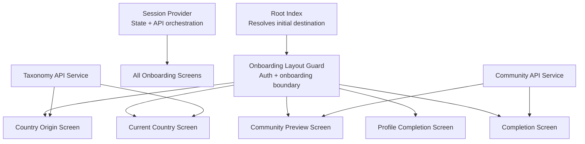

**Diagram sources**
- [index.tsx:14-34](file://diasporum-mobile/src/app/index.tsx#L14-L34)
- [_layout.tsx:15-43](file://diasporum-mobile/src/app/(onboarding)/_layout.tsx#L15-L43)
- [country-origin.tsx:26-82](file://diasporum-mobile/src/app/(onboarding)/country-origin.tsx#L26-L82)
- [country-current.tsx:27-83](file://diasporum-mobile/src/app/(onboarding)/country-current.tsx#L27-L83)
- [community-preview.tsx:30-68](file://diasporum-mobile/src/app/(onboarding)/community-preview.tsx#L30-L68)
- [profile.tsx:39-181](file://diasporum-mobile/src/app/(onboarding)/profile.tsx#L39-L181)
- [complete.tsx:36-82](file://diasporum-mobile/src/app/(onboarding)/complete.tsx#L36-L82)
- [session-provider.tsx:59-199](file://diasporum-mobile/src/core/session/session-provider.tsx#L59-L199)
- [taxonomy-api.ts:14-63](file://diasporum-mobile/src/features/onboarding/services/taxonomy-api.ts#L14-L63)
- [community-api.ts:13-88](file://diasporum-mobile/src/features/communities/services/community-api.ts#L13-L88)

**Section sources**
- [index.tsx:1-34](file://diasporum-mobile/src/app/index.tsx#L1-L34)
- [_layout.tsx:1-44](file://diasporum-mobile/src/app/(onboarding)/_layout.tsx#L1-L44)

## Core Components
- Root index resolver: decides whether to show authentication, onboarding, or main tabs based on auth state and resolved onboarding step.
- Onboarding layout guard: ensures users are authenticated and not already fully onboarded; redirects unauthenticated users to login and completed users to the main app.
- Session provider: loads identity, profile, memberships, and active community; exposes refresh, update operations, and derives the current onboarding step.
- Onboarding hook: centralizes step routing constants and safe navigation helpers.
- Taxonomy API service: fetches countries, languages, and communities from the taxonomy layer.
- Community API service: manages memberships, active community, community preview, and onboarding completion.
- Progress component: renders a segmented progress bar and “N of M” counter across onboarding screens.

**Section sources**
- [index.tsx:14-34](file://diasporum-mobile/src/app/index.tsx#L14-L34)
- [_layout.tsx:15-43](file://diasporum-mobile/src/app/(onboarding)/_layout.tsx#L15-L43)
- [session-provider.tsx:59-199](file://diasporum-mobile/src/core/session/session-provider.tsx#L59-L199)
- [use-onboarding.ts:16-61](file://diasporum-mobile/src/features/onboarding/hooks/use-onboarding.ts#L16-L61)
- [taxonomy-api.ts:14-63](file://diasporum-mobile/src/features/onboarding/services/taxonomy-api.ts#L14-L63)
- [community-api.ts:13-88](file://diasporum-mobile/src/features/communities/services/community-api.ts#L13-L88)
- [onboarding-progress.tsx:14-36](file://diasporum-mobile/src/shared/components/onboarding-progress.tsx#L14-L36)

## Architecture Overview
The onboarding architecture separates UI screens from state management and API concerns:

- Routing decisions are centralized in `resolveOnboardingStep`, which maps backend session state to a single `OnboardingStep`.
- The session provider owns the authoritative session snapshot and re-fetches it after mutations.
- Each screen performs its own mutation (if any), then navigates explicitly to the next step using the shared hook.
- The onboarding layout guard enforces global constraints: authentication required, and if onboarding is complete, redirect to the main app.

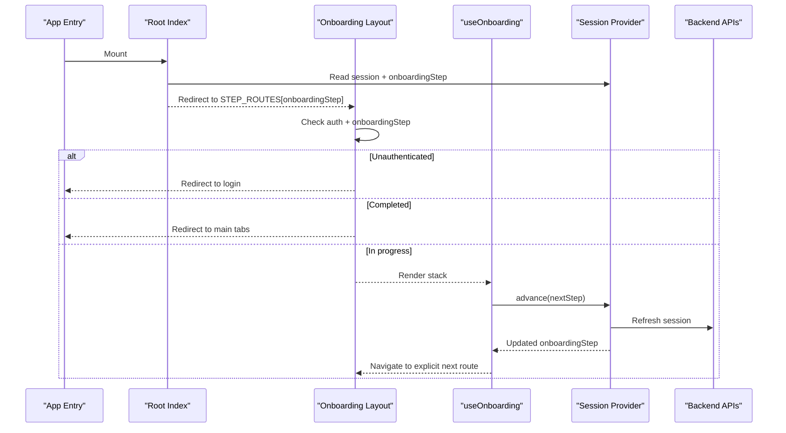

**Diagram sources**
- [index.tsx:14-34](file://diasporum-mobile/src/app/index.tsx#L14-L34)
- [_layout.tsx:15-43](file://diasporum-mobile/src/app/(onboarding)/_layout.tsx#L15-L43)
- [use-onboarding.ts:25-45](file://diasporum-mobile/src/features/onboarding/hooks/use-onboarding.ts#L25-L45)
- [session-provider.tsx:135-177](file://diasporum-mobile/src/core/session/session-provider.tsx#L135-L177)

## Detailed Component Analysis

### Step-by-Step Onboarding Flow

#### Step 1: Country of Origin
- Purpose: Capture the user’s heritage country.
- Data source: Taxonomy API returns active countries.
- Persistence: Updates profile via session provider; saves origin country identifier.
- Navigation: Moves to current-country selection after successful save.

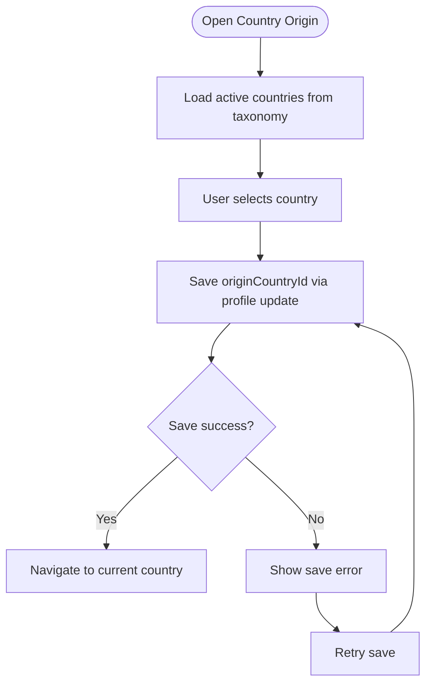

**Diagram sources**
- [country-origin.tsx:40-82](file://diasporum-mobile/src/app/(onboarding)/country-origin.tsx#L40-L82)
- [taxonomy-api.ts:14-25](file://diasporum-mobile/src/features/onboarding/services/taxonomy-api.ts#L14-L25)
- [session-provider.tsx:141-148](file://diasporum-mobile/src/core/session/session-provider.tsx#L141-L148)

**Section sources**
- [country-origin.tsx:26-82](file://diasporum-mobile/src/app/(onboarding)/country-origin.tsx#L26-L82)
- [taxonomy-api.ts:14-25](file://diasporum-mobile/src/features/onboarding/services/taxonomy-api.ts#L14-L25)

#### Step 2: Current Country
- Purpose: Capture where the user currently resides.
- Data source: Taxonomy API returns active countries.
- Persistence: Updates profile via session provider; saves current country identifier.
- Navigation: Moves to community preview after successful save.

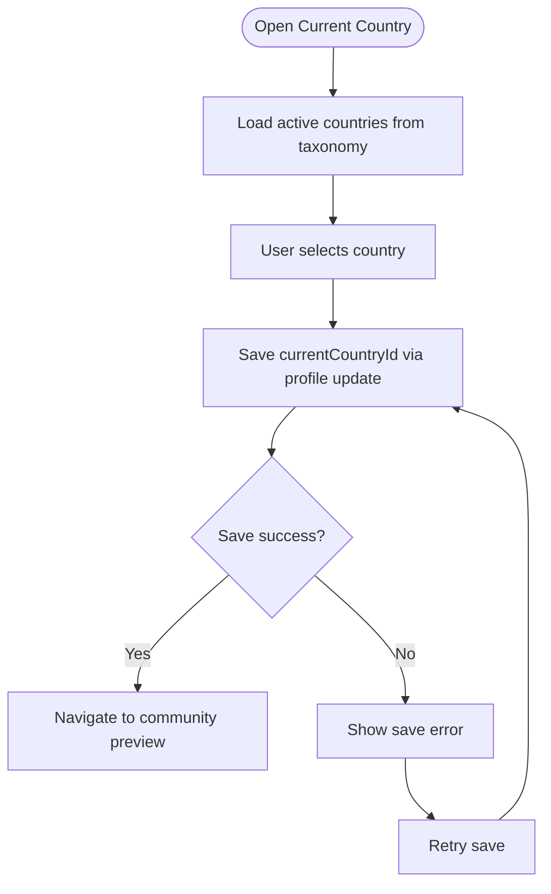

**Diagram sources**
- [country-current.tsx:41-83](file://diasporum-mobile/src/app/(onboarding)/country-current.tsx#L41-L83)
- [taxonomy-api.ts:14-25](file://diasporum-mobile/src/features/onboarding/services/taxonomy-api.ts#L14-L25)
- [session-provider.tsx:141-148](file://diasporum-mobile/src/core/session/session-provider.tsx#L141-L148)

**Section sources**
- [country-current.tsx:27-83](file://diasporum-mobile/src/app/(onboarding)/country-current.tsx#L27-L83)
- [taxonomy-api.ts:14-25](file://diasporum-mobile/src/features/onboarding/services/taxonomy-api.ts#L14-L25)

#### Step 3: Community Preview
- Purpose: Explain which community will be automatically joined based on origin and current country.
- Behavior: Informational only; membership is created later on completion.
- Conditional navigation: If profile is already complete, skip directly to completion; otherwise go to profile completion.
- Error handling: Handles missing community configuration and incomplete country selections.

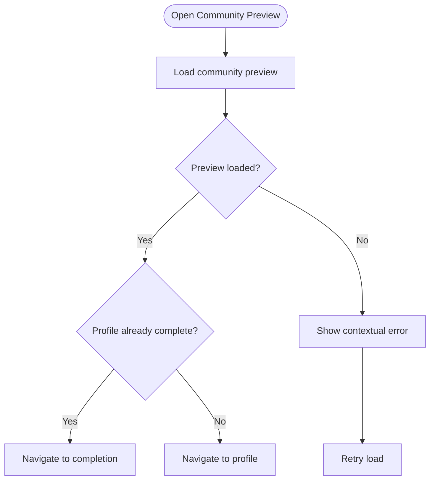

**Diagram sources**
- [community-preview.tsx:42-68](file://diasporum-mobile/src/app/(onboarding)/community-preview.tsx#L42-L68)
- [community-api.ts:73-79](file://diasporum-mobile/src/features/communities/services/community-api.ts#L73-L79)

**Section sources**
- [community-preview.tsx:30-68](file://diasporum-mobile/src/app/(onboarding)/community-preview.tsx#L30-L68)
- [community-api.ts:73-79](file://diasporum-mobile/src/features/communities/services/community-api.ts#L73-L79)

#### Step 4: Profile Completion
- Purpose: Collect display name, username, optional bio, and optional avatar photo.
- Validation: Local validation plus debounced availability check for username.
- Persistence: Uploads avatar through media upload endpoints, then updates profile fields atomically via session provider.
- Navigation: Proceeds to completion screen after successful save.

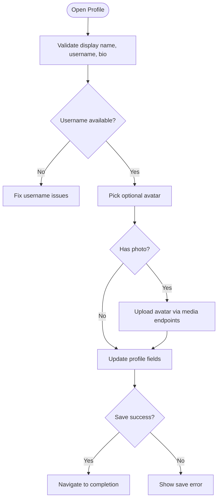

**Diagram sources**
- [profile.tsx:64-94](file://diasporum-mobile/src/app/(onboarding)/profile.tsx#L64-L94)
- [profile.tsx:100-141](file://diasporum-mobile/src/app/(onboarding)/profile.tsx#L100-L141)
- [profile.tsx:143-181](file://diasporum-mobile/src/app/(onboarding)/profile.tsx#L143-L181)
- [session-provider.tsx:141-148](file://diasporum-mobile/src/core/session/session-provider.tsx#L141-L148)

**Section sources**
- [profile.tsx:39-181](file://diasporum-mobile/src/app/(onboarding)/profile.tsx#L39-L181)

#### Step 5: Onboarding Completion
- Purpose: Finalize onboarding by creating the default community membership and setting the active community.
- Behavior: Calls completion endpoint once on mount; idempotent backend operation.
- Navigation: Refreshes session state and replaces route with main app tabs.

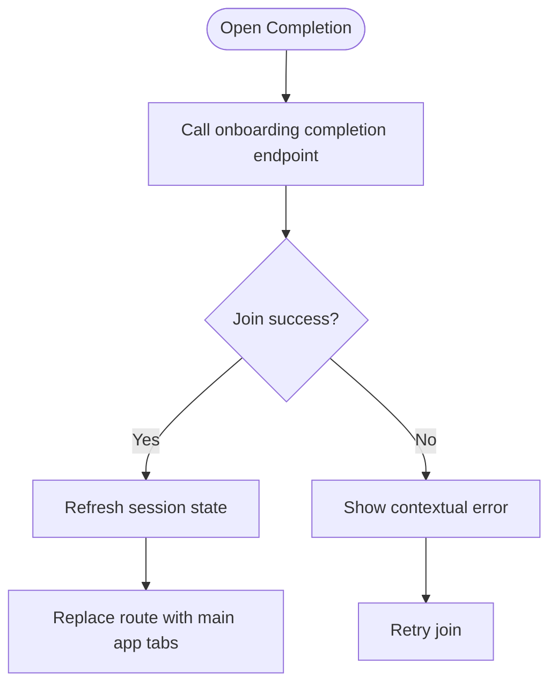

**Diagram sources**
- [complete.tsx:47-82](file://diasporum-mobile/src/app/(onboarding)/complete.tsx#L47-L82)
- [community-api.ts:81-88](file://diasporum-mobile/src/features/communities/services/community-api.ts#L81-L88)

**Section sources**
- [complete.tsx:36-82](file://diasporum-mobile/src/app/(onboarding)/complete.tsx#L36-L82)
- [community-api.ts:81-88](file://diasporum-mobile/src/features/communities/services/community-api.ts#L81-L88)

### Onboarding State Management and Data Persistence
- Session state includes account identity, profile, memberships, and active community.
- On mount, the session provider fetches all relevant data in parallel and caches it locally for the current session.
- Mutations such as profile updates, joining communities, setting active community, updating language preferences, and completing onboarding trigger a refresh to keep the local snapshot consistent with the backend.
- The onboarding step is derived purely from this session snapshot, ensuring a single source of truth for routing.

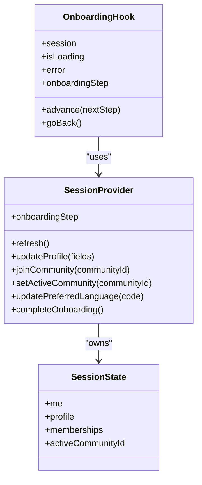

**Diagram sources**
- [session-types.ts:35-42](file://diasporum-mobile/src/core/session/session-types.ts#L35-L42)
- [session-provider.tsx:59-199](file://diasporum-mobile/src/core/session/session-provider.tsx#L59-L199)
- [use-onboarding.ts:25-61](file://diasporum-mobile/src/features/onboarding/hooks/use-onboarding.ts#L25-L61)

**Section sources**
- [session-provider.tsx:59-199](file://diasporum-mobile/src/core/session/session-provider.tsx#L59-L199)
- [session-types.ts:35-69](file://diasporum-mobile/src/core/session/session-types.ts#L35-L69)
- [use-onboarding.ts:25-61](file://diasporum-mobile/src/features/onboarding/hooks/use-onboarding.ts#L25-L61)

### Conditional Navigation Based on User Responses
- The root index resolves the initial destination using the current onboarding step.
- The onboarding layout guard prevents access when unauthenticated and redirects completed users to the main app.
- The community preview screen chooses between profile completion and completion depending on whether the profile is already done.
- The session provider computes the authoritative step using `resolveOnboardingStep`, which checks profile completeness and community membership status.

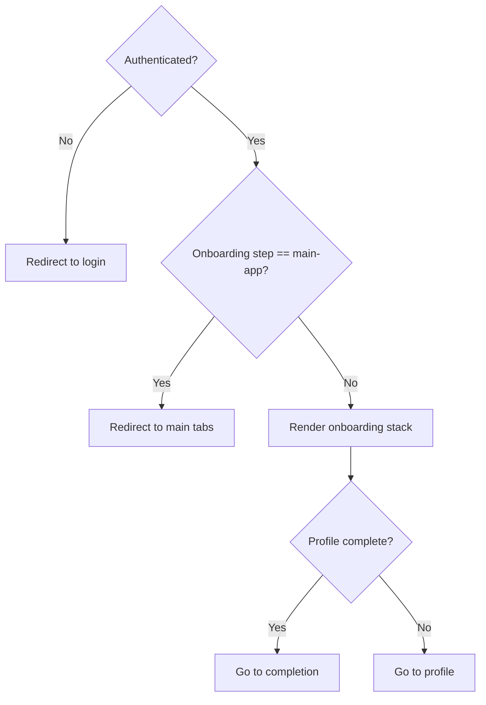

**Diagram sources**
- [index.tsx:14-34](file://diasporum-mobile/src/app/index.tsx#L14-L34)
- [_layout.tsx:15-43](file://diasporum-mobile/src/app/(onboarding)/_layout.tsx#L15-L43)
- [community-preview.tsx:66-68](file://diasporum-mobile/src/app/(onboarding)/community-preview.tsx#L66-L68)
- [session-types.ts:54-69](file://diasporum-mobile/src/core/session/session-types.ts#L54-L69)

**Section sources**
- [index.tsx:14-34](file://diasporum-mobile/src/app/index.tsx#L14-L34)
- [_layout.tsx:15-43](file://diasporum-mobile/src/app/(onboarding)/_layout.tsx#L15-L43)
- [community-preview.tsx:66-68](file://diasporum-mobile/src/app/(onboarding)/community-preview.tsx#L66-L68)
- [session-types.ts:54-69](file://diasporum-mobile/src/core/session/session-types.ts#L54-L69)

### Progress Tracking
- A reusable progress component shows a segmented track and a “N of M” counter.
- It uses the ordered list of onboarding steps and highlights segments up to the current step.
- Accessibility attributes indicate progress role and values.

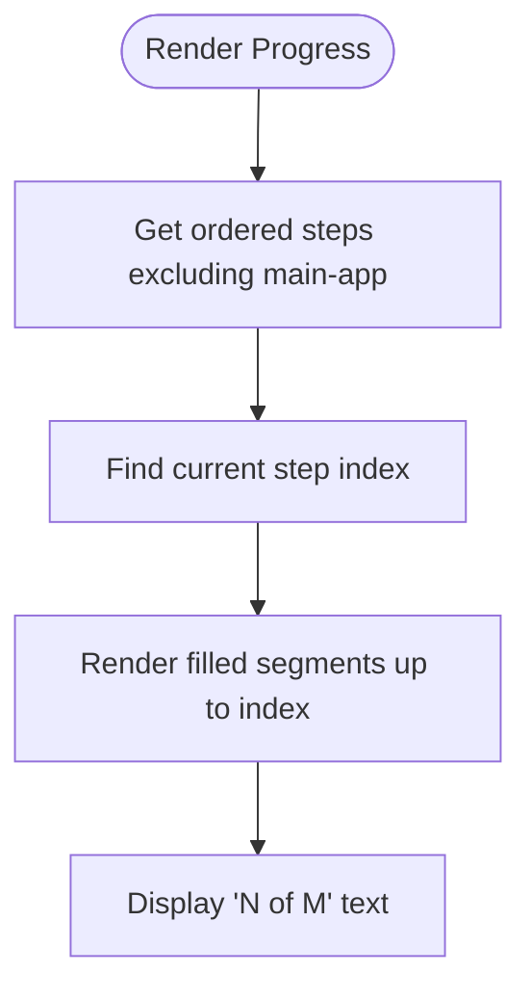

**Diagram sources**
- [onboarding-progress.tsx:14-36](file://diasporum-mobile/src/shared/components/onboarding-progress.tsx#L14-L36)
- [session-types.ts:22-29](file://diasporum-mobile/src/core/session/session-types.ts#L22-L29)

**Section sources**
- [onboarding-progress.tsx:14-36](file://diasporum-mobile/src/shared/components/onboarding-progress.tsx#L14-L36)
- [session-types.ts:22-29](file://diasporum-mobile/src/core/session/session-types.ts#L22-L29)

### Taxonomy Integration for Cultural Categories
- Countries and languages are fetched from the taxonomy service, supporting search and active filters.
- Communities catalogue can be filtered by origin country and search terms.
- Onboarding screens use these endpoints to populate searchable lists and derive the default community preview.

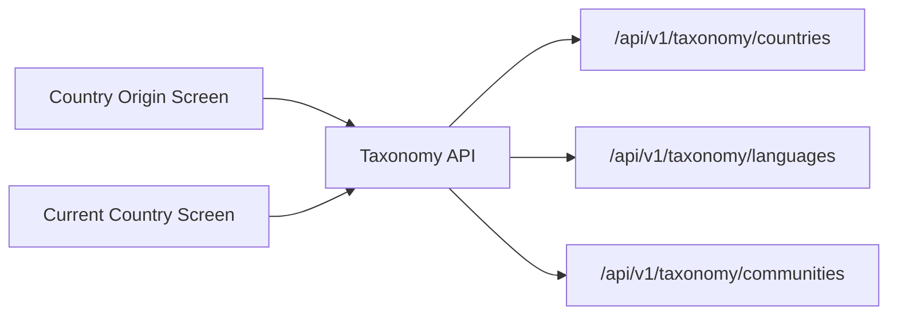

**Diagram sources**
- [taxonomy-api.ts:14-63](file://diasporum-mobile/src/features/onboarding/services/taxonomy-api.ts#L14-L63)
- [country-origin.tsx:40-51](file://diasporum-mobile/src/app/(onboarding)/country-origin.tsx#L40-L51)
- [country-current.tsx:41-52](file://diasporum-mobile/src/app/(onboarding)/country-current.tsx#L41-L52)

**Section sources**
- [taxonomy-api.ts:14-63](file://diasporum-mobile/src/features/onboarding/services/taxonomy-api.ts#L14-L63)

### Completion Workflows
- Completion calls the backend to create the default community membership and set the active community.
- After success, the app refreshes session state so the main app reflects the new active community.
- The completion screen displays next-step suggestions and allows the user to enter the main app.

**Section sources**
- [complete.tsx:47-82](file://diasporum-mobile/src/app/(onboarding)/complete.tsx#L47-L82)
- [community-api.ts:81-88](file://diasporum-mobile/src/features/communities/services/community-api.ts#L81-L88)

## Dependency Analysis
The onboarding flow depends on several layers:

- UI screens depend on the onboarding hook for navigation and session methods.
- The onboarding hook depends on the session provider for state and API orchestration.
- The session provider depends on feature APIs for profile, community, and authentication operations.
- Feature APIs depend on the centralized API client for authenticated requests.
- Taxonomy and community services encapsulate backend endpoints used by onboarding screens.

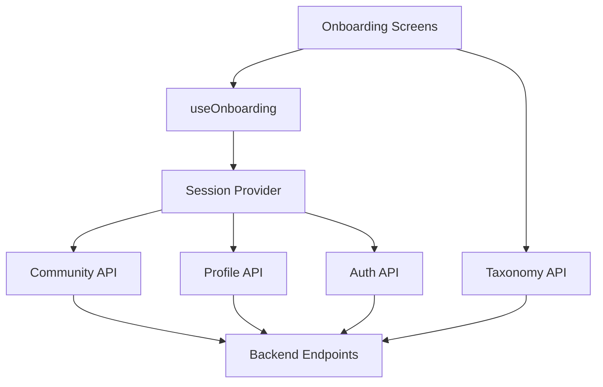

**Diagram sources**
- [use-onboarding.ts:25-61](file://diasporum-mobile/src/features/onboarding/hooks/use-onboarding.ts#L25-L61)
- [session-provider.tsx:75-77](file://diasporum-mobile/src/core/session/session-provider.tsx#L75-L77)
- [taxonomy-api.ts:14-63](file://diasporum-mobile/src/features/onboarding/services/taxonomy-api.ts#L14-L63)
- [community-api.ts:13-88](file://diasporum-mobile/src/features/communities/services/community-api.ts#L13-L88)

**Section sources**
- [use-onboarding.ts:25-61](file://diasporum-mobile/src/features/onboarding/hooks/use-onboarding.ts#L25-L61)
- [session-provider.tsx:75-77](file://diasporum-mobile/src/core/session/session-provider.tsx#L75-L77)
- [taxonomy-api.ts:14-63](file://diasporum-mobile/src/features/onboarding/services/taxonomy-api.ts#L14-L63)
- [community-api.ts:13-88](file://diasporum-mobile/src/features/communities/services/community-api.ts#L13-L88)

## Performance Considerations
- Parallel session loading reduces latency by fetching identity, profile, memberships, and active community concurrently.
- Debounced username availability checks prevent excessive network calls while typing.
- Explicit navigation after refresh avoids redundant re-renders caused by reactive step changes.
- Reusable components like progress and header reduce duplication and improve rendering consistency.

## Troubleshooting Guide
Common issues and their likely causes:

- Stuck on loading:
  - Check whether authentication is still loading or session refresh is pending.
  - Verify that the access token is present and valid.
- Redirect loops:
  - Ensure the onboarding step is correctly derived from session state.
  - Confirm that the layout guard is not bypassed by direct navigation.
- Community preview errors:
  - Missing community may occur if country combination is invalid.
  - Incomplete country selections require returning to previous steps.
- Profile save failures:
  - Username conflicts or reserved names cause validation errors.
  - Avatar upload failures should be retried after confirming permissions and network connectivity.
- Completion failures:
  - Backend may return not found if no eligible community exists.
  - Retry completion and refresh session state before entering the main app.

**Section sources**
- [community-preview.tsx:42-59](file://diasporum-mobile/src/app/(onboarding)/community-preview.tsx#L42-L59)
- [profile.tsx:143-181](file://diasporum-mobile/src/app/(onboarding)/profile.tsx#L143-L181)
- [complete.tsx:47-64](file://diasporum-mobile/src/app/(onboarding)/complete.tsx#L47-L64)

## Conclusion
The DIASPORUM mobile onboarding flow is a structured, state-driven process that guides users through country selection, community preview, profile completion, and finalization. It relies on a centralized session provider for authoritative state, a pure resolver for routing decisions, and dedicated API services for taxonomy and community operations. The design emphasizes explicit navigation, clear error handling, and progressive disclosure of complexity, making it straightforward to customize steps and integrate additional logic.

## Appendices

### Customizing Onboarding Steps
To add or modify steps:

- Extend the ordered step list and type definitions in the session types file.
- Add a new route under the onboarding layout and implement the screen logic.
- Update the step routes mapping in the onboarding hook to include the new route.
- Adjust `resolveOnboardingStep` to compute the correct step based on new domain conditions.
- Wire the new step into existing flows where appropriate (for example, branching from community preview or completion).

**Section sources**
- [session-types.ts:13-29](file://diasporum-mobile/src/core/session/session-types.ts#L13-L29)
- [use-onboarding.ts:16-23](file://diasporum-mobile/src/features/onboarding/hooks/use-onboarding.ts#L16-L23)
- [session-types.ts:54-69](file://diasporum-mobile/src/core/session/session-types.ts#L54-L69)

### Integrating Additional Onboarding Logic
Recommended patterns:

- Keep business rules out of screens; put them in the session resolver or a dedicated orchestrator.
- Use the session provider’s mutation methods to ensure state consistency after each step.
- Prefer explicit navigation via the onboarding hook rather than reacting to step changes.
- Handle backend errors at the screen level and provide retry actions.
- For new taxonomy-driven features, extend the taxonomy API service and reuse the searchable list component.

**Section sources**
- [session-provider.tsx:135-177](file://diasporum-mobile/src/core/session/session-provider.tsx#L135-L177)
- [use-onboarding.ts:25-45](file://diasporum-mobile/src/features/onboarding/hooks/use-onboarding.ts#L25-L45)
- [taxonomy-api.ts:14-63](file://diasporum-mobile/src/features/onboarding/services/taxonomy-api.ts#L14-L63)