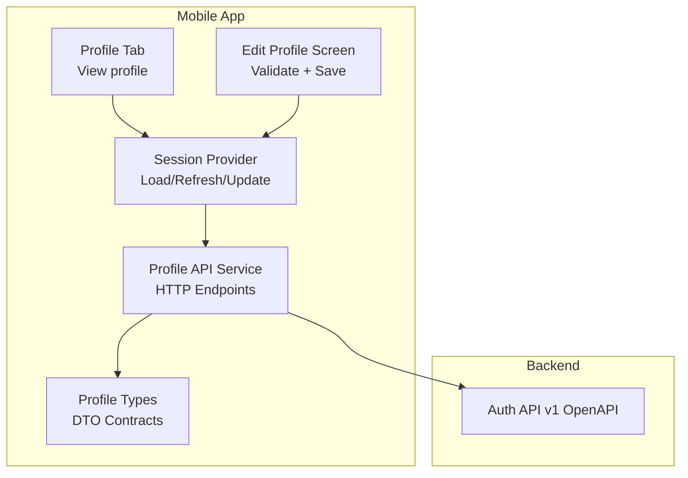
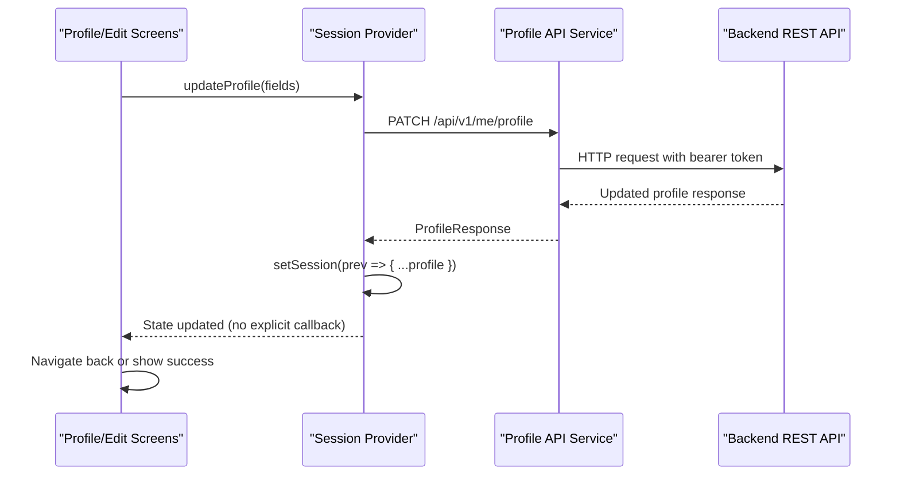
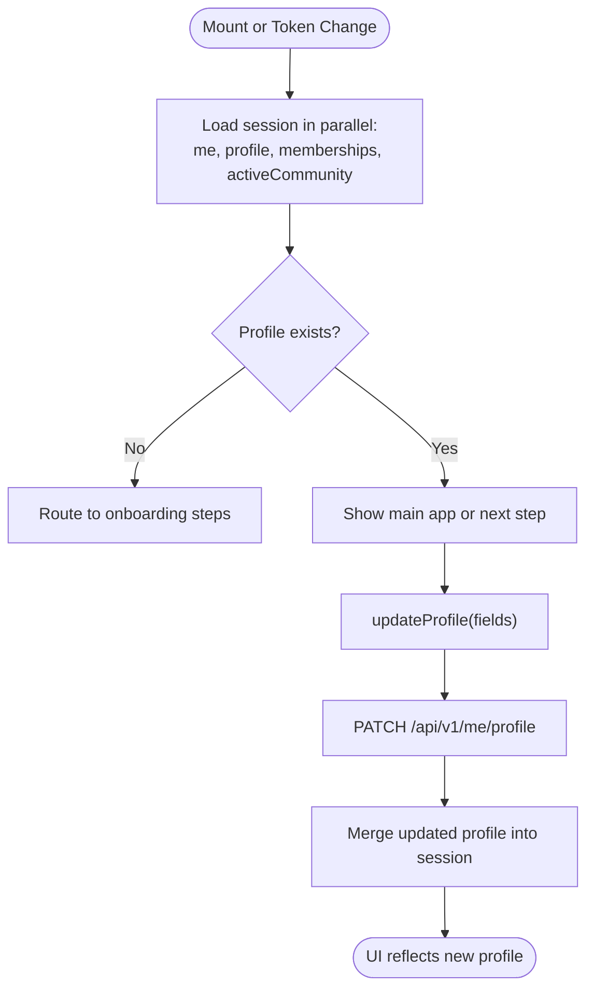
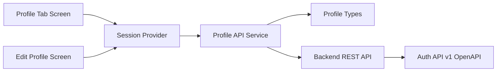

# Profile Management

<cite>
**Referenced Files in This Document**
- [profile.tsx](file://diasporum-mobile/src/app/(app)/(tabs)/profile.tsx)
- [edit.tsx](file://diasporum-mobile/src/app/(app)/profile/edit.tsx)
- [profile-api.ts](file://diasporum-mobile/src/features/profile/services/profile-api.ts)
- [profile-types.ts](file://diasporum-mobile/src/features/profile/types/profile-types.ts)
- [session-provider.tsx](file://diasporum-mobile/src/core/session/session-provider.tsx)
- [session-types.ts](file://diasporum-mobile/src/core/session/session-types.ts)
- [auth-api-v1.yaml](file://diasporum-backend/docs/auth-api-v1.yaml)
</cite>

## Table of Contents
1. [Introduction](#introduction)
2. [Project Structure](#project-structure)
3. [Core Components](#core-components)
4. [Architecture Overview](#architecture-overview)
5. [Detailed Component Analysis](#detailed-component-analysis)
6. [Dependency Analysis](#dependency-analysis)
7. [Performance Considerations](#performance-considerations)
8. [Troubleshooting Guide](#troubleshooting-guide)
9. [Conclusion](#conclusion)

## Introduction
This document explains the user profile management system in the DIASPORUM mobile application. It covers how profiles are displayed, created and edited, validated, synchronized with the backend, and how avatar assets are represented. It also documents privacy-related settings endpoints, external identity provider linking, and the session-based caching strategy used by the app.

The mobile implementation is backed by a Spring Boot backend that exposes authenticated REST endpoints for account identity, profile data, profile completion, username availability, and user settings. External identity providers such as Google and Apple are supported through dedicated authentication endpoints.

## Project Structure
Profile-related functionality in the mobile app is organized into:
- App screens under `src/app/(app)` for viewing and editing the profile.
- Feature services under `src/features/profile` for API calls and type contracts.
- Core session state under `src/core/session` for loading, refreshing, and updating profile data.

**Diagram sources**
- [profile.tsx:21-113](file://diasporum-mobile/src/app/(app)/(tabs)/profile.tsx#L21-L113)
- [edit.tsx:30-154](file://diasporum-mobile/src/app/(app)/profile/edit.tsx#L30-L154)
- [session-provider.tsx:59-206](file://diasporum-mobile/src/core/session/session-provider.tsx#L59-L206)
- [profile-api.ts:17-65](file://diasporum-mobile/src/features/profile/services/profile-api.ts#L17-L65)
- [profile-types.ts:7-70](file://diasporum-mobile/src/features/profile/types/profile-types.ts#L7-L70)
- [auth-api-v1.yaml:224-335](file://diasporum-backend/docs/auth-api-v1.yaml#L224-L335)

**Section sources**
- [profile.tsx:21-113](file://diasporum-mobile/src/app/(app)/(tabs)/profile.tsx#L21-L113)
- [edit.tsx:30-154](file://diasporum-mobile/src/app/(app)/profile/edit.tsx#L30-L154)
- [session-provider.tsx:59-206](file://diasporum-mobile/src/core/session/session-provider.tsx#L59-L206)
- [profile-api.ts:17-65](file://diasporum-mobile/src/features/profile/services/profile-api.ts#L17-L65)
- [profile-types.ts:7-70](file://diasporum-mobile/src/features/profile/types/profile-types.ts#L7-L70)
- [auth-api-v1.yaml:224-335](file://diasporum-backend/docs/auth-api-v1.yaml#L224-L335)

## Core Components
- Profile tab screen: Displays current profile information from session state and navigates to edit.
- Edit profile screen: Validates inputs, calls update profile via session provider, and handles errors.
- Session provider: Loads me, profile, memberships, and active community; updates profile atomically; derives onboarding step.
- Profile API service: Encapsulates HTTP calls for profile read/update/completion/settings and username availability.
- Profile types: Strongly typed DTOs mirroring backend responses and requests.
- Auth API OpenAPI: Documents authentication, session, and external identity provider endpoints.

Key responsibilities:
- Display and navigation: Profile tab shows avatar initials, display name, username, bio, city, origin/current country flags, and profile completion status.
- Validation: Edit screen enforces required fields, length limits, and username format.
- Synchronization: Session provider fetches and refreshes profile data and updates local state after successful PATCH.
- Privacy and settings: Settings endpoints allow theme and language preferences.
- External identities: Backend supports linking/unlinking Google and Apple identities.

**Section sources**
- [profile.tsx:21-113](file://diasporum-mobile/src/app/(app)/(tabs)/profile.tsx#L21-L113)
- [edit.tsx:30-154](file://diasporum-mobile/src/app/(app)/profile/edit.tsx#L30-L154)
- [session-provider.tsx:59-206](file://diasporum-mobile/src/core/session/session-provider.tsx#L59-L206)
- [profile-api.ts:17-65](file://diasporum-mobile/src/features/profile/services/profile-api.ts#L17-L65)
- [profile-types.ts:7-70](file://diasporum-mobile/src/features/profile/types/profile-types.ts#L7-L70)
- [auth-api-v1.yaml:224-335](file://diasporum-backend/docs/auth-api-v1.yaml#L224-L335)

## Architecture Overview
The profile flow uses React context for session state and a feature-scoped API client. Screens do not call HTTP directly; they use the session provider, which composes the profile API service.

**Diagram sources**
- [edit.tsx:57-81](file://diasporum-mobile/src/app/(app)/profile/edit.tsx#L57-L81)
- [session-provider.tsx:141-148](file://diasporum-mobile/src/core/session/session-provider.tsx#L141-L148)
- [profile-api.ts:29-33](file://diasporum-mobile/src/features/profile/services/profile-api.ts#L29-L33)

## Detailed Component Analysis

### Profile View Screen
- Reads profile from session context.
- Shows avatar initials derived from display name or username.
- Displays optional bio and details card with city, date of birth, origin/current country flags, and profile completion status.
- Provides navigation to edit profile and account security settings.

Responsive considerations:
- Uses safe area insets and scrollable content.
- Themed text and spacing tokens ensure consistent appearance across devices.

**Section sources**
- [profile.tsx:21-113](file://diasporum-mobile/src/app/(app)/(tabs)/profile.tsx#L21-L113)

### Edit Profile Screen
- Initializes form state from session profile.
- Validates:
  - Display name required and max length.
  - Username required, lowercase alphanumeric plus underscores, fixed length range.
  - Bio and city length limits.
- Submits via session provider’s updateProfile method.
- Handles:
  - 409 conflict for duplicate username.
  - Generic API error messages.
  - Success feedback and auto-navigation back.

Form handling patterns:
- Local controlled state per field.
- Centralized validation function returning an error map.
- Disabled submit while saving.

**Section sources**
- [edit.tsx:30-154](file://diasporum-mobile/src/app/(app)/profile/edit.tsx#L30-L154)

### Session Provider
Responsibilities:
- Creates an API client bound to the current access token.
- Loads session data in parallel:
  - Account identity (/api/v1/auth/me).
  - Profile (/api/v1/me/profile), treating missing profile as null rather than error.
  - User communities and active community.
- Exposes:
  - refresh() to reload all session data.
  - updateProfile() to PATCH profile and update local state atomically.
  - Community join and active community setters.
  - Language preference update.
  - Onboarding completion helper.
- Derives onboarding step based on profile and membership state.

Caching strategy:
- Session state is held in memory for the current app session.
- Refresh triggers full re-fetch from backend.
- No persistent cache beyond React state; persistence is handled by auth storage elsewhere.

Onboarding routing logic:
- Missing origin country → origin step.
- Missing current country → current step.
- Incomplete profile → community preview step.
- Complete profile without membership → completion step.
- Otherwise → main app.

**Section sources**
- [session-provider.tsx:59-206](file://diasporum-mobile/src/core/session/session-provider.tsx#L59-L206)
- [session-types.ts:13-69](file://diasporum-mobile/src/core/session/session-types.ts#L13-L69)

### Profile API Service
Endpoints exposed:
- GET /api/v1/me — account identity.
- GET /api/v1/me/profile — profile data.
- PATCH /api/v1/me/profile — update profile.
- GET /api/v1/me/profile/completion — completion status and missing fields.
- GET /api/v1/usernames/availability?username= — check username availability.
- GET /api/v1/me/settings — user settings.
- PATCH /api/v1/me/settings — update settings.

All calls require authentication via bearer token.

**Section sources**
- [profile-api.ts:17-65](file://diasporum-mobile/src/features/profile/services/profile-api.ts#L17-L65)

### Profile Types
Contracts mirror backend DTOs:
- MeResponse: account-level identity fields including accountStatus and profileCompleted flag.
- ProfileResponse: profile fields including avatarMediaId and completion flag.
- UpdateProfileRequest: whitelisted patchable fields including avatarMediaId.
- ProfileCompletionResponse: completion boolean and missing fields list.
- UsernameAvailabilityResponse: availability result and reason.
- SettingsResponse and UpdateSettingsRequest: theme, preferred language, and community defaults.

These types enforce strict mapping between frontend and backend payloads.

**Section sources**
- [profile-types.ts:7-70](file://diasporum-mobile/src/features/profile/types/profile-types.ts#L7-L70)

### Avatar Management
- The profile model includes avatarMediaId, representing a linked media asset.
- The mobile types include avatarMediaId in both response and update request.
- Current edit flow does not upload or link avatars; this is deferred until the backend allows PATCH of avatarMediaId.
- Other parts of the app consume avatarMediaId for rendering avatars where available.

Operational notes:
- When avatarMediaId is present, clients should render the associated image.
- Until backend enables PATCH of avatarMediaId, avatar upload must be coordinated separately and linked later.

**Section sources**
- [profile-types.ts:14-40](file://diasporum-mobile/src/features/profile/types/profile-types.ts#L14-L40)

### Privacy Settings Configuration
User settings endpoint supports:
- Theme selection.
- Preferred language code.
- Default and active community identifiers.

These settings are separate from profile data and can be updated independently.

**Section sources**
- [profile-api.ts:50-60](file://diasporum-mobile/src/features/profile/services/profile-api.ts#L50-L60)
- [profile-types.ts:55-69](file://diasporum-mobile/src/features/profile/types/profile-types.ts#L55-L69)

### External Identity Provider Linking
Backend supports:
- Linking Google and Apple identities to the current authenticated account.
- Unlinking external identities, with protection against removing the last sign-in method.

These operations require authentication and return standard error shapes.

**Section sources**
- [auth-api-v1.yaml:289-335](file://diasporum-backend/docs/auth-api-v1.yaml#L289-L335)

### Profile Synchronization with Backend
- Initial load fetches account identity, profile, memberships, and active community concurrently.
- Missing profile is treated as null to route users to onboarding.
- After successful profile update, session state is patched locally without additional network calls.
- Refresh forces a full reload from backend.

**Diagram sources**
- [session-provider.tsx:79-113](file://diasporum-mobile/src/core/session/session-provider.tsx#L79-L113)
- [session-provider.tsx:141-148](file://diasporum-mobile/src/core/session/session-provider.tsx#L141-L148)

## Dependency Analysis

**Diagram sources**
- [profile.tsx:21-113](file://diasporum-mobile/src/app/(app)/(tabs)/profile.tsx#L21-L113)
- [edit.tsx:30-154](file://diasporum-mobile/src/app/(app)/profile/edit.tsx#L30-L154)
- [session-provider.tsx:59-206](file://diasporum-mobile/src/core/session/session-provider.tsx#L59-L206)
- [profile-api.ts:17-65](file://diasporum-mobile/src/features/profile/services/profile-api.ts#L17-L65)
- [profile-types.ts:7-70](file://diasporum-mobile/src/features/profile/types/profile-types.ts#L7-L70)
- [auth-api-v1.yaml:224-335](file://diasporum-backend/docs/auth-api-v1.yaml#L224-L335)

**Section sources**
- [profile.tsx:21-113](file://diasporum-mobile/src/app/(app)/(tabs)/profile.tsx#L21-L113)
- [edit.tsx:30-154](file://diasporum-mobile/src/app/(app)/profile/edit.tsx#L30-L154)
- [session-provider.tsx:59-206](file://diasporum-mobile/src/core/session/session-provider.tsx#L59-L206)
- [profile-api.ts:17-65](file://diasporum-mobile/src/features/profile/services/profile-api.ts#L17-L65)
- [profile-types.ts:7-70](file://diasporum-mobile/src/features/profile/types/profile-types.ts#L7-L70)
- [auth-api-v1.yaml:224-335](file://diasporum-backend/docs/auth-api-v1.yaml#L224-L335)

## Performance Considerations
- Parallel session loading reduces initial latency by fetching independent resources concurrently.
- Local session state avoids repeated network calls during normal UI interactions.
- Avoid unnecessary refreshes; trigger refresh only after meaningful mutations (e.g., onboarding completion).
- Keep payload minimal by using whitelisted PATCH fields.

[No sources needed since this section provides general guidance]

## Troubleshooting Guide
Common issues and resolutions:
- Duplicate username on save:
  - The edit screen maps HTTP 409 to a field-specific error message for username.
  - Ensure the username follows the allowed pattern and is unique.
- Missing profile after login:
  - A 404 from profile endpoint is treated as null profile and routes to onboarding.
  - Verify backend provisioning and migration state.
- Settings not applying:
  - Confirm PATCH /api/v1/me/settings is called with correct fields.
  - Validate that the client sends authenticated requests.
- Avatar not appearing:
  - avatarMediaId must be linked to the profile.
  - Until backend allows PATCH of avatarMediaId, coordinate upload and linking separately.

Error handling patterns:
- Use ApiError helpers to surface user-friendly messages.
- Distinguish between validation conflicts and server errors.

**Section sources**
- [edit.tsx:57-81](file://diasporum-mobile/src/app/(app)/profile/edit.tsx#L57-L81)
- [session-provider.tsx:88-113](file://diasporum-mobile/src/core/session/session-provider.tsx#L88-L113)

## Conclusion
The DIASPORUM mobile profile management system centers around a clean separation of concerns: screens handle presentation and input, the session provider manages state synchronization, and the profile API service encapsulates backend communication. Validation is enforced at the UI layer, while the backend remains authoritative. Avatar support is modeled but deferred pending backend enablement. Privacy settings and external identity linking are supported through documented backend endpoints. The design emphasizes predictable state transitions, clear error handling, and maintainable contracts between frontend and backend.

[No sources needed since this section summarizes without analyzing specific files]