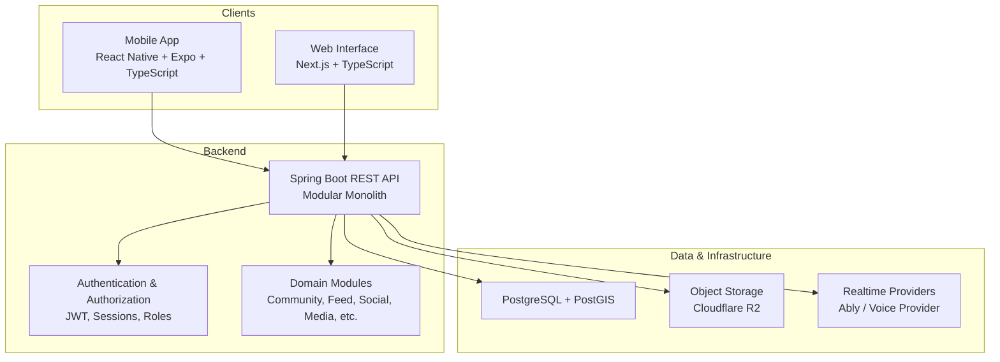
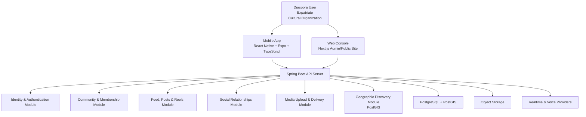
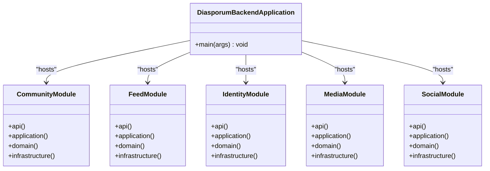
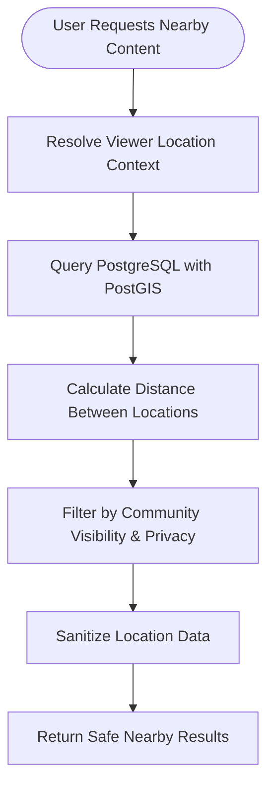
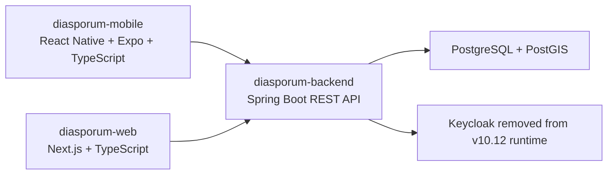

# Project Overview

<cite>
**Referenced Files in This Document**
- [Diasporum_Project_Context_v10_12.md](file://Diasporum_v10.12/Diasporum_Project_Context_v10_12.md)
- [pom.xml](file://diasporum-backend/pom.xml)
- [DiasporumBackendApplication.java](file://diasporum-backend/src/main/java/com/diasporum/backend/DiasporumBackendApplication.java)
- [package.json (mobile)](file://diasporum-mobile/package.json)
- [README.md (mobile)](file://diasporum-mobile/README.md)
- [package.json (web)](file://diasporum-web/package.json)
- [README.md (web)](file://diasporum-web/README.md)
- [compose.yaml](file://compose.yaml)
</cite>

## Table of Contents
1. [Introduction](#introduction)
2. [Project Structure](#project-structure)
3. [Core Components](#core-components)
4. [Architecture Overview](#architecture-overview)
5. [Detailed Component Analysis](#detailed-component-analysis)
6. [Dependency Analysis](#dependency-analysis)
7. [Performance Considerations](#performance-considerations)
8. [Troubleshooting Guide](#troubleshooting-guide)
9. [Conclusion](#conclusion)

## Introduction
Diasporum is a community and practical-support platform designed for diaspora communities. Its purpose is to connect people across geographical boundaries by enabling cultural exchange, local discovery, community participation, and practical support such as services, events, listings, and informal help. Users identify their country of origin and current location, join relevant communities, share content, discover opportunities, and interact with others who share similar backgrounds or live nearby.

The platform targets:
- Diaspora communities seeking connection, cultural continuity, and mutual support.
- Expatriates and newcomers navigating life in a new country.
- Cultural organizations, community leaders, and service providers serving diaspora populations.
- Individuals looking for local opportunities, language practice, volunteering, housing, vehicles, jobs, and trusted services.

At its core, Diasporum combines social networking, community management, media sharing, geographic discovery, and practical marketplace features into one mobile-first ecosystem.

**Section sources**
- [Diasporum_Project_Context_v10_12.md:14-35](file://Diasporum_v10.12/Diasporum_Project_Context_v10_12.md#L14-L35)

## Project Structure
The repository contains three primary codebases plus shared infrastructure documentation and configuration:

| Area | Responsibility | Key Technologies |
|---|---|---|
| Backend API | Core business logic, authentication, authorization, data persistence, and domain modules | Java 21, Spring Boot, PostgreSQL with PostGIS, Flyway, Spring Security, Quartz |
| Mobile App | Primary user experience for diaspora networking, feed, communities, onboarding, and media | React Native, Expo SDK, TypeScript, Expo Router |
| Web Interface | Admin/moderation console shell and informational public website | Next.js, TypeScript, Tailwind CSS |
| Infrastructure | Local development database and environment setup | Docker Compose, PostgreSQL/PostGIS |

**Diagram sources**
- [Diasporum_Project_Context_v10_12.md:22-35](file://Diasporum_v10.12/Diasporum_Project_Context_v10_12.md#L22-L35)
- [compose.yaml:1-17](file://compose.yaml#L1-L17)

**Section sources**
- [Diasporum_Project_Context_v10_12.md:22-35](file://Diasporum_v10.12/Diasporum_Project_Context_v10_12.md#L22-L35)
- [compose.yaml:1-17](file://compose.yaml#L1-L17)

## Core Components
Diasporum is organized around three main components:

### Spring Boot Backend API
- Serves as the central application backend exposing REST APIs.
- Implements domain-driven modular monolith architecture with clear module boundaries.
- Handles identity, profiles, communities, feed, social relationships, messaging, media, taxonomy, moderation, billing, and operational concerns.
- Uses PostgreSQL with PostGIS for durable state and geographic queries.
- Enforces server-side authorization, privacy, community visibility, and entitlements.

Key backend characteristics:
- Modular monolith rather than microservices at this stage.
- First-party authentication with Diasporum-issued JWTs and session management.
- External identity verification through Google and Apple without making them the session authority.
- Versioned database migrations via Flyway.
- Background processing where required.

**Section sources**
- [Diasporum_Project_Context_v10_12.md:22-35](file://Diasporum_v10.12/Diasporum_Project_Context_v10_12.md#L22-L35)
- [Diasporum_Project_Context_v10_12.md:41-56](file://Diasporum_v10.12/Diasporum_Project_Context_v10_12.md#L41-L56)
- [Diasporum_Project_Context_v10_12.md:82-94](file://Diasporum_v10.12/Diasporum_Project_Context_v10_12.md#L82-L94)
- [DiasporumBackendApplication.java:1-14](file://diasporum-backend/src/main/java/com/diasporum/backend/DiasporumBackendApplication.java#L1-L14)

### Expo/React Native Mobile App
- The primary user experience for diaspora users.
- Built with React Native, Expo SDK, and TypeScript.
- Provides onboarding, authentication, community selection, feed browsing, media sharing, reels, messaging, and profile management.
- Uses secure platform-appropriate token storage and integrates with the backend API.

Key mobile characteristics:
- File-based routing through Expo Router.
- Development workflow using `npm install` and `npx expo start`.
- Separate from other Expo projects; maintains its own SDK and dependencies.

**Section sources**
- [Diasporum_Project_Context_v10_12.md:22-35](file://Diasporum_v10.12/Diasporum_Project_Context_v10_12.md#L22-L35)
- [Diasporum_Project_Context_v10_12.md:69-80](file://Diasporum_v10.12/Diasporum_Project_Context_v10_12.md#L69-L80)
- [package.json (mobile):1-72](file://diasporum-mobile/package.json#L1-L72)
- [README.md (mobile):1-57](file://diasporum-mobile/README.md#L1-L57)

### Next.js Web Interface
- Limited-scope web application.
- Intended for an admin/moderation console and an informational public-facing static website.
- Not the main consumer social-network experience; it does not duplicate the full mobile app.

Key web characteristics:
- Next.js with TypeScript.
- Tailwind CSS when selected.
- Admin access should be protected by backend roles, not only client-side routing.

**Section sources**
- [Diasporum_Project_Context_v10_12.md:28-32](file://Diasporum_v10.12/Diasporum_Project_Context_v10_12.md#L28-L32)
- [Diasporum_Project_Context_v10_12.md:96-107](file://Diasporum_v10.12/Diasporum_Project_Context_v10_12.md#L96-L107)
- [package.json (web):1-27](file://diasporum-web/package.json#L1-L27)
- [README.md (web):1-37](file://diasporum-web/README.md#L1-L37)

## Architecture Overview
Diasporum follows a mobile-first, REST-first architecture built as a modular monolith. Clients do not connect directly to the database; all durable state and business rules are enforced server-side.

**Diagram sources**
- [Diasporum_Project_Context_v10_12.md:22-35](file://Diasporum_v10.12/Diasporum_Project_Context_v10_12.md#L22-L35)
- [Diasporum_Project_Context_v10_12.md:41-56](file://Diasporum_v10.12/Diasporum_Project_Context_v10_12.md#L41-L56)
- [Diasporum_Project_Context_v10_12.md:109-132](file://Diasporum_v10.12/Diasporum_Project_Context_v10_12.md#L109-L132)

### Architectural Principles
- **Mobile-first:** The React Native Expo application is the primary product experience.
- **REST-first backend:** Spring Boot exposes APIs consumed by mobile and web clients.
- **Modular monolith:** A single deployable backend with clear domain/module boundaries.
- **PostgreSQL is the durable source of truth:** Realtime providers deliver events but do not replace database records.
- **Server-side authorization:** Account status, scoped roles, privacy, community visibility, moderation, and billing entitlements are enforced in the backend.
- **Country/community-aware:** Content, taxonomies, and visibility are scoped correctly.
- **Provider-neutral integrations:** External vendors are isolated behind adapters where practical.
- **Incremental delivery:** Features are implemented in small, testable milestones.
- **Privacy and safety by design:** Sensitive data is protected at rest, in transit, and in responses.

**Section sources**
- [Diasporum_Project_Context_v10_12.md:37-61](file://Diasporum_v10.12/Diasporum_Project_Context_v10_12.md#L37-L61)

## Detailed Component Analysis

### Platform Purpose and Mission
Diasporum’s mission is to help diaspora communities stay connected across borders while building practical support networks in their current locations. It enables users to:
- Identify their origin and current country.
- Join relevant communities.
- Participate in community content.
- Discover people, services, and opportunities near them.
- Share media, communicate, and collaborate.

This mission supports cultural exchange, newcomer integration, local economic activity, and community resilience.

**Section sources**
- [Diasporum_Project_Context_v10_12.md:14-20](file://Diasporum_v10.12/Diasporum_Project_Context_v10_12.md#L14-L20)

### Target Audience
| Audience | Needs | Diasporum Value |
|---|---|---|
| Diaspora communities | Cultural connection, mutual aid, local belonging | Community feeds, help offers, events, directories |
| Expatriates and newcomers | Practical guidance, language practice, housing, jobs | Onboarding, nearby discovery, service marketplace |
| Cultural organizations | Outreach, membership, event coordination | Community management, content publishing |
| Service providers | Trusted local audience and leads | Business directory, marketplace, reviews |

**Section sources**
- [Diasporum_Project_Context_v10_12.md:134-159](file://Diasporum_v10.12/Diasporum_Project_Context_v10_12.md#L134-L159)

### Key Features
- **Multi-provider authentication:** Email/password, Google, and Apple identity verification with Diasporum-owned sessions and JWTs.
- **Community management:** Countries, communities, memberships, switching, and visibility controls.
- **Social networking:** Feed, posts, reactions, comments, reels, following, blocking, and direct messages.
- **Media sharing:** Upload, storage, and delivery through provider-neutral integrations.
- **Geographic discovery:** Nearby feeds and location-aware discovery using PostGIS distance calculations.
- **Practical support features:** Events, jobs, property and vehicle listings, spare bag exchanges, matchmaking, service marketplace, and community help offers.
- **Operational features:** Billing, subscriptions, notifications, moderation, administration, audit logs, and feature rollout configuration.

**Section sources**
- [Diasporum_Project_Context_v10_12.md:134-159](file://Diasporum_v10.12/Diasporum_Project_Context_v10_12.md#L134-L159)
- [Diasporum_Project_Context_v10_12.md:167-235](file://Diasporum_v10.12/Diasporum_Project_Context_v10_12.md#L167-L235)
- [Diasporum_Project_Context_v10_12.md:237-285](file://Diasporum_v10.12/Diasporum_Project_Context_v10_12.md#L237-L285)

### Technology Stack Overview
| Layer | Technology | Notes |
|---|---|---|
| Backend runtime | Java 21 | Modern JVM baseline |
| Backend framework | Spring Boot | REST API, security, validation, JPA, mail, actuator, devtools |
| Database | PostgreSQL with PostGIS | Durable state and geospatial queries |
| Migrations | Flyway | Versioned schema evolution |
| Authentication | Spring Security + JWT | First-party accounts, external identity verification |
| Background jobs | Quartz/Spring | Scheduled and recurring tasks |
| Mobile frontend | React Native + Expo + TypeScript | Primary user experience |
| Web frontend | Next.js + TypeScript + Tailwind CSS | Admin console and informational site |
| Infrastructure | Docker Compose | Local PostgreSQL/PostGIS development database |

**Section sources**
- [pom.xml:1-164](file://diasporum-backend/pom.xml#L1-L164)
- [Diasporum_Project_Context_v10_12.md:63-107](file://Diasporum_v10.12/Diasporum_Project_Context_v10_12.md#L63-L107)
- [compose.yaml:1-17](file://compose.yaml#L1-L17)

### Domain-Driven Design and Modular Monolith
The backend uses a modular monolith approach:
- Each major capability is represented by a domain module.
- Modules include clear internal boundaries between API, application, domain, and infrastructure layers.
- Examples visible in the package structure include community, feed, identity, media, social, taxonomy, voice, moderation, billing, and more.
- Microservices are not introduced without an explicit architectural decision.

**Diagram sources**
- [DiasporumBackendApplication.java:1-14](file://diasporum-backend/src/main/java/com/diasporum/backend/DiasporumBackendApplication.java#L1-L14)
- [Diasporum_Project_Context_v10_12.md:41-56](file://Diasporum_v10.12/Diasporum_Project_Context_v10_12.md#L41-L56)

**Section sources**
- [Diasporum_Project_Context_v10_12.md:41-56](file://Diasporum_v10.12/Diasporum_Project_Context_v10_12.md#L41-L56)

### Geographic Discovery with PostGIS
Nearby discovery is a key diaspora feature because users often need to find people, events, services, and opportunities close to where they currently live. The system:
- Uses PostGIS to calculate distances between viewer and creator locations.
- Supports nearby feed modes alongside community and following feeds.
- Avoids exposing exact addresses, coordinates, or precise numeric distances to clients.
- Keeps sensitive location data server-side and returns safe, privacy-preserving results.

**Diagram sources**
- [Diasporum_Project_Context_v10_12.md:167-179](file://Diasporum_v10.12/Diasporum_Project_Context_v10_12.md#L167-L179)
- [compose.yaml:1-17](file://compose.yaml#L1-L17)

**Section sources**
- [Diasporum_Project_Context_v10_12.md:167-179](file://Diasporum_v10.12/Diasporum_Project_Context_v10_12.md#L167-L179)

## Dependency Analysis
The project has clear separation between client applications and the backend, with the backend owning durable state and business logic.

**Diagram sources**
- [package.json (mobile):1-72](file://diasporum-mobile/package.json#L1-L72)
- [package.json (web):1-27](file://diasporum-web/package.json#L1-L27)
- [compose.yaml:43-45](file://compose.yaml#L43-L45)

**Section sources**
- [package.json (mobile):1-72](file://diasporum-mobile/package.json#L1-L72)
- [package.json (web):1-27](file://diasporum-web/package.json#L1-L27)
- [compose.yaml:43-45](file://compose.yaml#L43-L45)

## Performance Considerations
- Use the existing dependency versions as the source of truth rather than upgrading purely for preference.
- Keep the backend as a modular monolith until scaling needs justify further decomposition.
- Ensure database queries, especially PostGIS distance queries, are properly indexed and scoped to avoid unnecessary scans.
- Cache read-heavy data where appropriate, but keep authoritative state in PostgreSQL.
- Use background jobs carefully, ensuring idempotency and safe concurrent execution.
- Validate uploads and external URLs to prevent resource exhaustion or unsafe behavior.
- Monitor API latency, error rates, and database performance through observability tooling.

[No sources needed since this section provides general guidance]

## Troubleshooting Guide
Common areas to check when diagnosing issues:

- **Local database connectivity:** Ensure the Docker Compose PostgreSQL/PostGIS service is running and credentials match the backend configuration.
- **Schema versioning:** Verify Flyway migrations and clean-install baselines are aligned with the intended schema version.
- **Authentication flow:** Confirm that first-party authentication, JWT issuance, session handling, and external identity verification follow the approved design.
- **Client-to-backend communication:** Ensure mobile and web clients call the backend API and do not attempt direct database connections.
- **Environment variables:** Avoid committing secrets; use environment-based configuration for credentials and provider settings.

**Section sources**
- [compose.yaml:1-17](file://compose.yaml#L1-L17)
- [Diasporum_Project_Context_v10_12.md:287-307](file://Diasporum_v10.12/Diasporum_Project_Context_v10_12.md#L287-L307)
- [Diasporum_Project_Context_v10_12.md:309-342](file://Diasporum_v10.12/Diasporum_Project_Context_v10_12.md#L309-L342)

## Conclusion
Diasporum is a mobile-first diaspora community platform built around a Spring Boot modular monolith backend, a React Native Expo mobile app, and a limited-scope Next.js web interface. Its mission is to connect people across borders through cultural exchange, community building, and practical support. With multi-provider authentication, community management, social networking, media sharing, and PostGIS-powered geographic discovery, Diasporum provides a comprehensive foundation for diaspora communities to thrive locally and globally.

[No sources needed since this section summarizes without analyzing specific files]