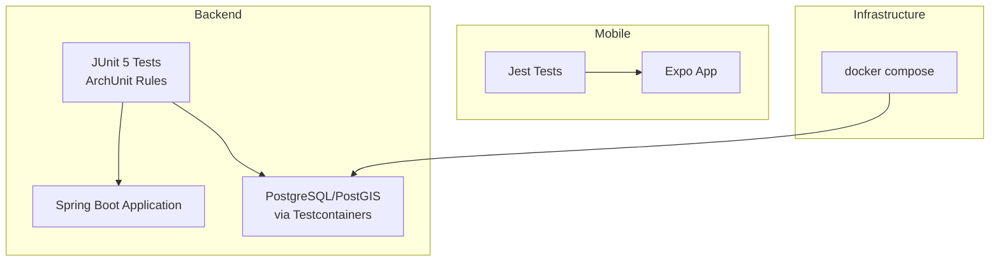
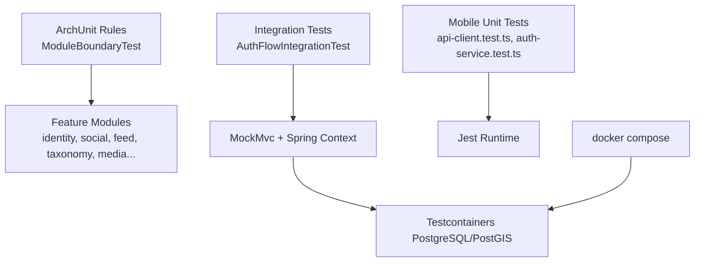
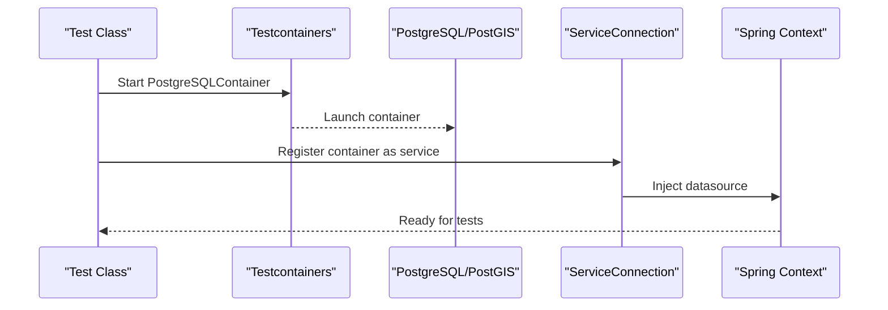
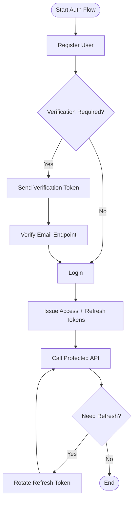
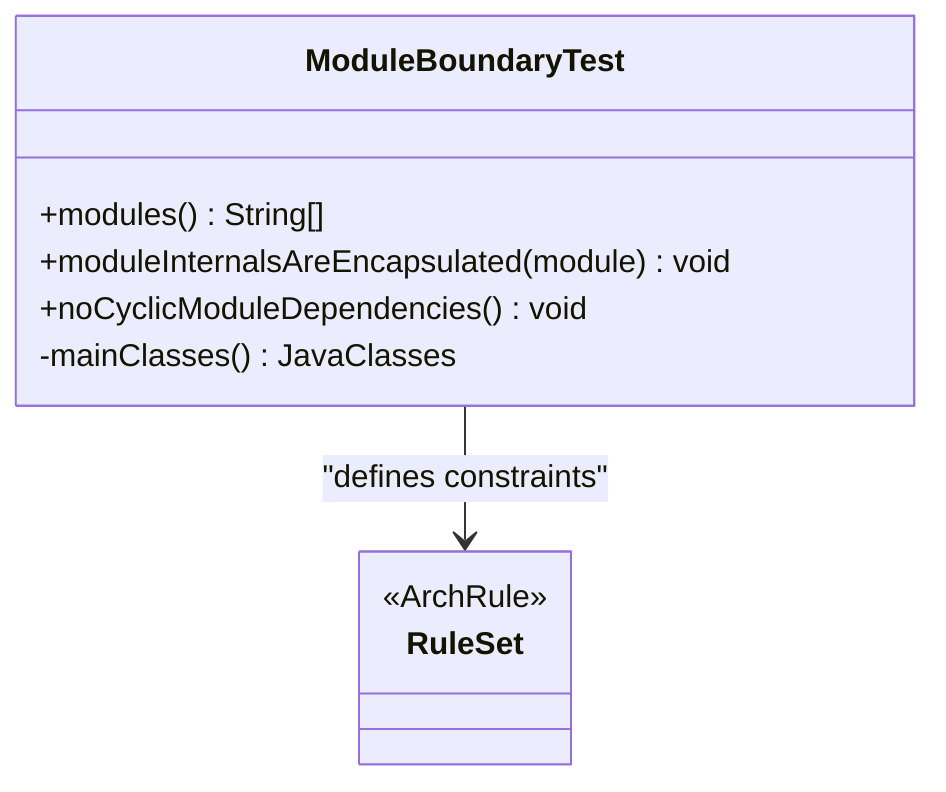
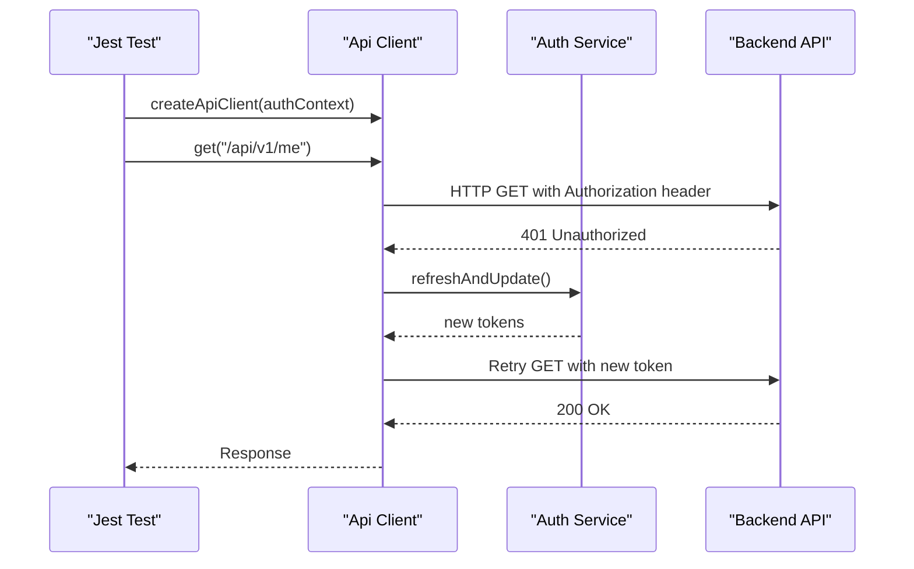
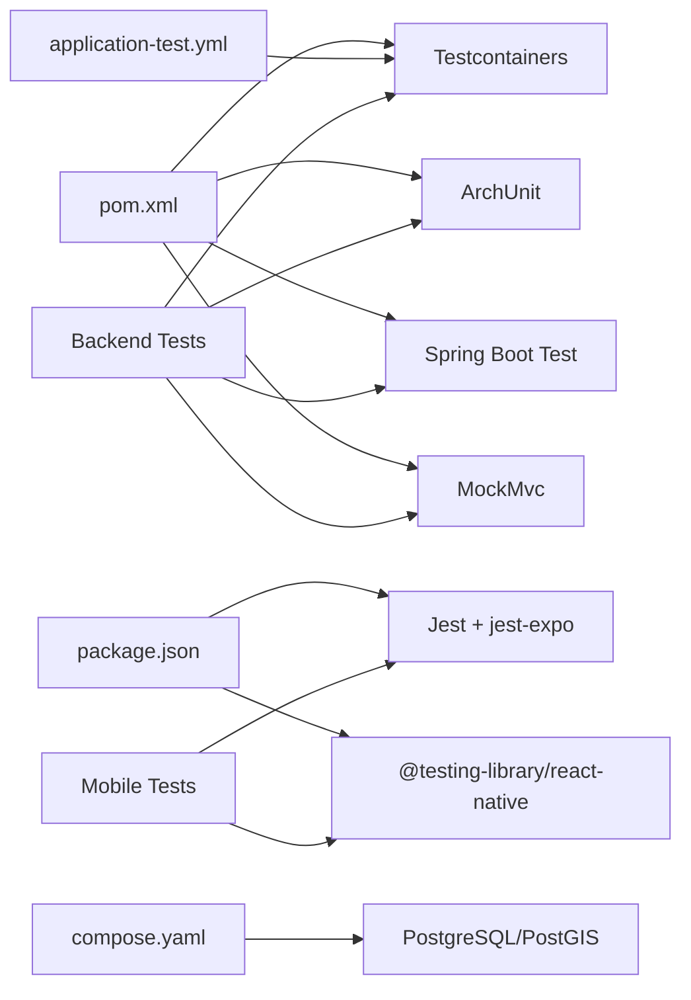

# Testing Strategy

<cite>
**Referenced Files in This Document**
- [pom.xml](file://diasporum-backend/pom.xml)
- [compose.yaml](file://compose.yaml)
- [application-test.yml](file://diasporum-backend/src/test/resources/application-test.yml)
- [DiasporumBackendApplicationTests.java](file://diasporum-backend/src/test/java/com/diasporum/backend/DiasporumBackendApplicationTests.java)
- [ModuleBoundaryTest.java](file://diasporum-backend/src/test/java/com/diasporum/backend/architecture/ModuleBoundaryTest.java)
- [AuthFlowIntegrationTest.java](file://diasporum-backend/src/test/java/com/diasporum/backend/identity/AuthFlowIntegrationTest.java)
- [api-client.test.ts](file://diasporum-mobile/src/__tests__/core/api/api-client.test.ts)
- [auth-service.test.ts](file://diasporum-mobile/src/__tests__/core/auth/auth-service.test.ts)
- [package.json](file://diasporum-mobile/package.json)
</cite>

## Table of Contents
1. [Introduction](#introduction)
2. [Project Structure](#project-structure)
3. [Core Components](#core-components)
4. [Architecture Overview](#architecture-overview)
5. [Detailed Component Analysis](#detailed-component-analysis)
6. [Dependency Analysis](#dependency-analysis)
7. [Performance Considerations](#performance-considerations)
8. [Troubleshooting Guide](#troubleshooting-guide)
9. [Conclusion](#conclusion)

## Introduction
This document defines the testing strategy for the DIASPORUM platform across backend and mobile applications. It describes a layered testing pyramid: unit tests, integration tests, end-to-end tests, and architecture tests. The backend uses Spring Boot with Testcontainers for PostgreSQL/PostGIS and ArchUnit to enforce module boundaries. The mobile app uses Jest with jest-expo for unit and component tests. Guidance is provided for authentication flows, API endpoints, UI components, mock strategies, test data management, and continuous integration quality gates.

## Project Structure
The repository contains three primary application areas relevant to testing:
- Backend (Spring Boot): Java-based services under diasporum-backend with JUnit 5 tests and Testcontainers.
- Mobile (Expo/React Native): TypeScript-based app under diasporum-mobile with Jest tests under src/__tests__.
- Infrastructure: Docker Compose configuration for local development services.

**Diagram sources**
- [pom.xml:131-150](file://diasporum-backend/pom.xml#L131-L150)
- [DiasporumBackendApplicationTests.java:11-18](file://diasporum-backend/src/test/java/com/diasporum/backend/DiasporumBackendApplicationTests.java#L11-L18)
- [package.json:40-68](file://diasporum-mobile/package.json#L40-L68)
- [compose.yaml:21-41](file://compose.yaml#L21-L41)

**Section sources**
- [pom.xml:1-164](file://diasporum-backend/pom.xml#L1-L164)
- [package.json:1-72](file://diasporum-mobile/package.json#L1-L72)
- [compose.yaml:1-50](file://compose.yaml#L1-L50)

## Core Components
This section outlines the core testing infrastructure and patterns used across the platform.

- Backend test stack
  - JUnit 5 and Spring Boot Test for unit and integration tests.
  - Testcontainers with PostgreSQL/PostGIS image for realistic database behavior.
  - ArchUnit for enforcing modular boundaries and preventing cycles.
  - MockMvc for HTTP endpoint assertions in integration tests.

- Mobile test stack
  - Jest with jest-expo preset for React Native/Expo code.
  - @testing-library/react-native for component testing.
  - Module mocking via jest.mock for environment config and auth services.

- Shared principles
  - Prefer real dependencies where feasible (e.g., Postgres via Testcontainers).
  - Isolate external calls with mocks or stubs.
  - Keep tests deterministic and fast at lower layers; use slower integration tests sparingly.

**Section sources**
- [pom.xml:131-150](file://diasporum-backend/pom.xml#L131-L150)
- [DiasporumBackendApplicationTests.java:11-18](file://diasporum-backend/src/test/java/com/diasporum/backend/DiasporumBackendApplicationTests.java#L11-L18)
- [ModuleBoundaryTest.java:14-59](file://diasporum-backend/src/test/java/com/diasporum/backend/architecture/ModuleBoundaryTest.java#L14-L59)
- [package.json:40-68](file://diasporum-mobile/package.json#L40-L68)

## Architecture Overview
The testing architecture follows a clear separation between layers:

**Diagram sources**
- [ModuleBoundaryTest.java:22-59](file://diasporum-backend/src/test/java/com/diasporum/backend/architecture/ModuleBoundaryTest.java#L22-L59)
- [AuthFlowIntegrationTest.java:41-50](file://diasporum-backend/src/test/java/com/diasporum/backend/identity/AuthFlowIntegrationTest.java#L41-L50)
- [DiasporumBackendApplicationTests.java:11-18](file://diasporum-backend/src/test/java/com/diasporum/backend/DiasporumBackendApplicationTests.java#L11-L18)
- [api-client.test.ts:1-23](file://diasporum-mobile/src/__tests__/core/api/api-client.test.ts#L1-L23)
- [auth-service.test.ts:19-39](file://diasporum-mobile/src/__tests__/core/auth/auth-service.test.ts#L19-L39)
- [compose.yaml:21-41](file://compose.yaml#L21-L41)

## Detailed Component Analysis

### Backend Test Infrastructure
- Testcontainers setup
  - Uses PostgreSQLContainer with PostGIS image as a compatible substitute for postgres.
  - ServiceConnection wires the container into the Spring context automatically.
- Configuration
  - application-test.yml documents that integration tests must use Testcontainers PostgreSQL/PostGIS rather than H2.
- Example baseline test
  - DiasporumBackendApplicationTests demonstrates minimal containerized context loading.

**Diagram sources**
- [DiasporumBackendApplicationTests.java:11-18](file://diasporum-backend/src/test/java/com/diasporum/backend/DiasporumBackendApplicationTests.java#L11-L18)
- [application-test.yml:1-5](file://diasporum-backend/src/test/resources/application-test.yml#L1-L5)

**Section sources**
- [DiasporumBackendApplicationTests.java:1-24](file://diasporum-backend/src/test/java/com/diasporum/backend/DiasporumBackendApplicationTests.java#L1-L24)
- [application-test.yml:1-5](file://diasporum-backend/src/test/resources/application-test.yml#L1-L5)

### Authentication Integration Tests
AuthFlowIntegrationTest exercises full first-party authentication flows against a real migrated v10.12 database using Testcontainers. It validates registration, verification, login, JWT issuance, refresh rotation/replay, session management, password reset/change, suspension, and auth-only users.

Key behaviors validated:
- Registration and email verification lifecycle.
- Login returns access and refresh tokens with correct claims.
- JWKS endpoint publishes RSA key; protected endpoints require Bearer tokens.
- Refresh token rotation and replay protection; concurrency safety ensures single winner.
- Session revocation on logout and logout-all.
- Password reset rotates credentials and invalidates sessions.
- Suspended accounts lose immediate API access.

**Diagram sources**
- [AuthFlowIntegrationTest.java:90-119](file://diasporum-backend/src/test/java/com/diasporum/backend/identity/AuthFlowIntegrationTest.java#L90-L119)
- [AuthFlowIntegrationTest.java:225-239](file://diasporum-backend/src/test/java/com/diasporum/backend/identity/AuthFlowIntegrationTest.java#L225-L239)
- [AuthFlowIntegrationTest.java:268-326](file://diasporum-backend/src/test/java/com/diasporum/backend/identity/AuthFlowIntegrationTest.java#L268-L326)
- [AuthFlowIntegrationTest.java:337-410](file://diasporum-backend/src/test/java/com/diasporum/backend/identity/AuthFlowIntegrationTest.java#L337-L410)
- [AuthFlowIntegrationTest.java:414-471](file://diasporum-backend/src/test/java/com/diasporum/backend/identity/AuthFlowIntegrationTest.java#L414-L471)
- [AuthFlowIntegrationTest.java:475-516](file://diasporum-backend/src/test/java/com/diasporum/backend/identity/AuthFlowIntegrationTest.java#L475-L516)

**Section sources**
- [AuthFlowIntegrationTest.java:36-518](file://diasporum-backend/src/test/java/com/diasporum/backend/identity/AuthFlowIntegrationTest.java#L36-L518)

### Architecture Testing with ArchUnit
ModuleBoundaryTest enforces the modular-monolith design:
- Each module’s internal packages are encapsulated and not accessible from outside the module.
- Feature modules must not form cyclic dependencies.
- Analysis covers main classes only, excluding tests.

**Diagram sources**
- [ModuleBoundaryTest.java:22-59](file://diasporum-backend/src/test/java/com/diasporum/backend/architecture/ModuleBoundaryTest.java#L22-L59)

**Section sources**
- [ModuleBoundaryTest.java:1-61](file://diasporum-backend/src/test/java/com/diasporum/backend/architecture/ModuleBoundaryTest.java#L1-L61)

### Mobile Testing with Jest
The mobile app uses Jest configured via jest-expo. Tests cover:
- API client behavior: Bearer token injection, host validation, error mapping, retry after 401.
- Auth service behavior: token expiration checks, JWT payload decoding, refresh flow, session restore, logout, and concurrent refresh prevention.

**Diagram sources**
- [api-client.test.ts:62-108](file://diasporum-mobile/src/__tests__/core/api/api-client.test.ts#L62-L108)
- [api-client.test.ts:110-179](file://diasporum-mobile/src/__tests__/core/api/api-client.test.ts#L110-L179)
- [auth-service.test.ts:131-189](file://diasporum-mobile/src/__tests__/core/auth/auth-service.test.ts#L131-L189)

**Section sources**
- [api-client.test.ts:1-202](file://diasporum-mobile/src/__tests__/core/api/api-client.test.ts#L1-L202)
- [auth-service.test.ts:1-264](file://diasporum-mobile/src/__tests__/core/auth/auth-service.test.ts#L1-L264)
- [package.json:40-68](file://diasporum-mobile/package.json#L40-L68)

## Dependency Analysis
The following diagram maps test-related dependencies across the project.

**Diagram sources**
- [pom.xml:131-150](file://diasporum-backend/pom.xml#L131-L150)
- [package.json:40-68](file://diasporum-mobile/package.json#L40-L68)
- [application-test.yml:1-5](file://diasporum-backend/src/test/resources/application-test.yml#L1-L5)
- [compose.yaml:21-41](file://compose.yaml#L21-L41)

**Section sources**
- [pom.xml:131-150](file://diasporum-backend/pom.xml#L131-L150)
- [package.json:40-68](file://diasporum-mobile/package.json#L40-L68)
- [application-test.yml:1-5](file://diasporum-backend/src/test/resources/application-test.yml#L1-L5)
- [compose.yaml:21-41](file://compose.yaml#L21-L41)

## Performance Considerations
- Prefer unit tests for pure logic; they should be fast and isolated.
- Use Testcontainers for integration tests that require database features like triggers and spatial types; avoid substituting with H2.
- Minimize network calls in mobile tests by mocking fetch and environment configuration.
- Reuse shared test utilities and fixtures to reduce duplication and improve maintainability.
- For concurrency-sensitive flows (e.g., refresh rotation), include targeted tests but keep them scoped to critical paths.

[No sources needed since this section provides general guidance]

## Troubleshooting Guide
Common issues and resolutions:
- Testcontainers cannot start
  - Ensure Docker is running and available.
  - Confirm the PostGIS image is pulled successfully.
  - Validate port availability if using compose for local dev.
- Spring context fails to load with missing datasource
  - Verify Testcontainers is enabled via annotations and ServiceConnection wiring.
  - Check application-test.yml profile and any overrides.
- Mobile tests fail due to native modules
  - Ensure jest-expo preset is configured and transformIgnorePatterns allow required Expo modules.
  - Mock environment variables and storage appropriately.

**Section sources**
- [DiasporumBackendApplicationTests.java:11-18](file://diasporum-backend/src/test/java/com/diasporum/backend/DiasporumBackendApplicationTests.java#L11-L18)
- [application-test.yml:1-5](file://diasporum-backend/src/test/resources/application-test.yml#L1-L5)
- [package.json:60-68](file://diasporum-mobile/package.json#L60-L68)

## Conclusion
DIASPORUM’s testing strategy combines robust backend integration tests with Testcontainers and ArchUnit, alongside comprehensive mobile unit tests using Jest. This layered approach ensures correctness, architectural integrity, and reliable CI pipelines. By adhering to the practices outlined here—realistic databases for integration tests, strict module boundaries, and thorough mocking for external dependencies—the platform can maintain high quality and velocity.

[No sources needed since this section summarizes without analyzing specific files]