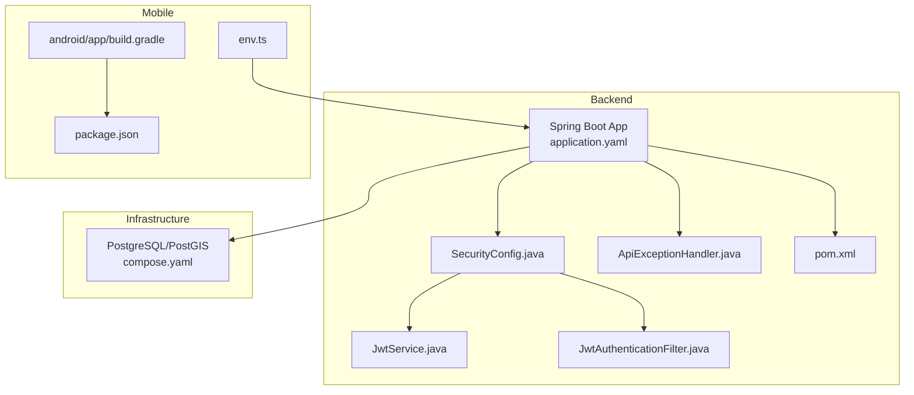
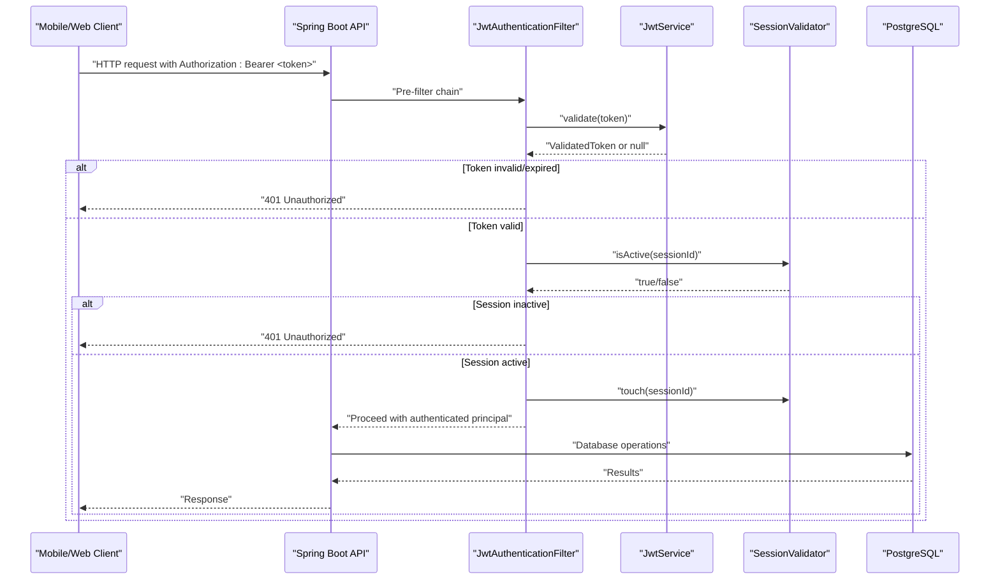
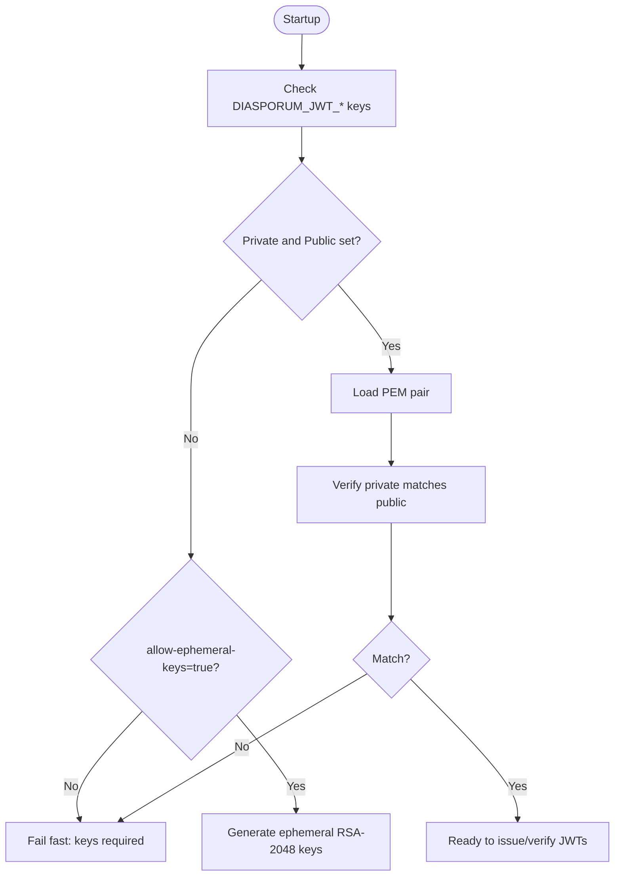
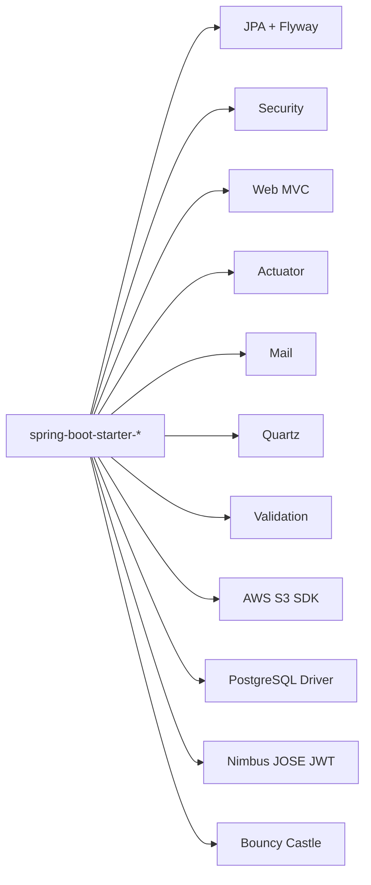

# Troubleshooting and FAQ

<cite>
**Referenced Files in This Document**
- [pom.xml](file://diasporum-backend/pom.xml)
- [application.yaml](file://diasporum-backend/src/main/resources/application.yaml)
- [application-local.yml](file://diasporum-backend/src/main/resources/application-local.yml)
- [compose.yaml](file://compose.yaml)
- [SecurityConfig.java](file://diasporum-backend/src/main/java/com/diasporum/backend/security/internal/config/SecurityConfig.java)
- [JwtService.java](file://diasporum-backend/src/main/java/com/diasporum/backend/security/JwtService.java)
- [JwtAuthenticationFilter.java](file://diasporum-backend/src/main/java/com/diasporum/backend/security/internal/authentication/JwtAuthenticationFilter.java)
- [ApiExceptionHandler.java](file://diasporum-backend/src/main/java/com/diasporum/backend/platform/api/error/ApiExceptionHandler.java)
- [env.ts](file://diasporum-mobile/src/core/config/env.ts)
- [package.json](file://diasporum-mobile/package.json)
- [android/build.gradle](file://diasporum-mobile/android/app/build.gradle)
- [LOCAL_DATABASE_SETUP.md](file://LOCAL_DATABASE_SETUP.md)
- [DIASPORUM_DB_BASELINE_HEALTH_REVIEW.md](file://DIASPORUM_DB_BASELINE_HEALTH_REVIEW.md)
- [DIASPORUM_DATABASE_VALIDATION_REPORT.md](file://DIASPORUM_DATABASE_VALIDATION_REPORT.md)
- [AuthFlowIntegrationTest.java](file://diasporum-backend/src/test/java/com/diasporum/backend/identity/AuthFlowIntegrationTest.java)
</cite>

## Table of Contents
1. [Introduction](#introduction)
2. [Project Structure](#project-structure)
3. [Core Components](#core-components)
4. [Architecture Overview](#architecture-overview)
5. [Detailed Component Analysis](#detailed-component-analysis)
6. [Dependency Analysis](#dependency-analysis)
7. [Performance Considerations](#performance-considerations)
8. [Troubleshooting Guide](#troubleshooting-guide)
9. [Conclusion](#conclusion)
10. [Appendices](#appendices)

## Introduction
This document is a practical troubleshooting and FAQ guide for the DIASPORUM platform. It focuses on frequent development and deployment problems across the Spring Boot backend, PostgreSQL database, Keycloak-related authentication configuration, mobile app build and environment issues, performance bottlenecks, memory concerns, distributed debugging, API integration failures, and cross-platform compatibility. Each section provides diagnostic steps, log analysis techniques, resolution procedures, and references to the exact files involved.

## Project Structure
The repository contains:
- A Spring Boot backend under `diasporum-backend` with modular domain packages, security, JPA/Flyway, mail, Quartz, S3 client, and Actuator.
- A local infrastructure stack defined by `compose.yaml` that runs PostgreSQL/PostGIS.
- An Expo-based mobile app under `diasporum-mobile` with TypeScript, React Native, and Android Gradle configuration.
- Documentation and reports describing schema health, baseline validation, and setup.

**Diagram sources**
- [application.yaml:1-74](file://diasporum-backend/src/main/resources/application.yaml#L1-L74)
- [SecurityConfig.java:27-116](file://diasporum-backend/src/main/java/com/diasporum/backend/security/internal/config/SecurityConfig.java#L27-L116)
- [JwtService.java:20-163](file://diasporum-backend/src/main/java/com/diasporum/backend/security/JwtService.java#L20-L163)
- [JwtAuthenticationFilter.java:18-61](file://diasporum-backend/src/main/java/com/diasporum/backend/security/internal/authentication/JwtAuthenticationFilter.java#L18-L61)
- [ApiExceptionHandler.java:16-64](file://diasporum-backend/src/main/java/com/diasporum/backend/platform/api/error/ApiExceptionHandler.java#L16-L64)
- [compose.yaml:1-50](file://compose.yaml#L1-L50)
- [env.ts:1-88](file://diasporum-mobile/src/core/config/env.ts#L1-L88)
- [android/build.gradle:17-166](file://diasporum-mobile/android/app/build.gradle#L17-L166)
- [package.json:1-72](file://diasporum-mobile/package.json#L1-L72)

**Section sources**
- [application.yaml:1-74](file://diasporum-backend/src/main/resources/application.yaml#L1-L74)
- [compose.yaml:1-50](file://compose.yaml#L1-L50)
- [env.ts:1-88](file://diasporum-mobile/src/core/config/env.ts#L1-L88)

## Core Components
- Backend application configuration and profiles control datasource, Flyway, mail provider, CORS, media storage, and JWT behavior.
- Security layer uses first-party RS256 JWTs issued by `JwtService`, validated by `JwtAuthenticationFilter`, and exposed via `/actuator` and `/api/v1/**`.
- Mobile app centralizes environment variables through `env.ts`, which validates required keys at module load time.
- Local infrastructure is provided by Docker Compose running PostgreSQL/PostGIS.

Key responsibilities:
- Configuration: `application.yaml`, `application-local.yml`, `compose.yaml`.
- Authentication: `SecurityConfig.java`, `JwtService.java`, `JwtAuthenticationFilter.java`.
- Error handling: `ApiExceptionHandler.java`.
- Mobile environment: `env.ts`, `package.json`, `android/app/build.gradle`.

**Section sources**
- [application.yaml:1-74](file://diasporum-backend/src/main/resources/application.yaml#L1-L74)
- [application-local.yml:1-45](file://diasporum-backend/src/main/resources/application-local.yml#L1-L45)
- [SecurityConfig.java:27-116](file://diasporum-backend/src/main/java/com/diasporum/backend/security/internal/config/SecurityConfig.java#L27-L116)
- [JwtService.java:20-163](file://diasporum-backend/src/main/java/com/diasporum/backend/security/JwtService.java#L20-L163)
- [JwtAuthenticationFilter.java:18-61](file://diasporum-backend/src/main/java/com/diasporum/backend/security/internal/authentication/JwtAuthenticationFilter.java#L18-L61)
- [ApiExceptionHandler.java:16-64](file://diasporum-backend/src/main/java/com/diasporum/backend/platform/api/error/ApiExceptionHandler.java#L16-L64)
- [env.ts:1-88](file://diasporum-mobile/src/core/config/env.ts#L1-L88)

## Architecture Overview
The backend exposes a stateless REST API secured by RS256 JWTs. Clients send Bearer tokens; the filter validates them and checks session activity before invoking controllers. The mobile app reads environment variables at build time and calls the backend over HTTP(S).

**Diagram sources**
- [SecurityConfig.java:46-67](file://diasporum-backend/src/main/java/com/diasporum/backend/security/internal/config/SecurityConfig.java#L46-L67)
- [JwtAuthenticationFilter.java:33-59](file://diasporum-backend/src/main/java/com/diasporum/backend/security/internal/authentication/JwtAuthenticationFilter.java#L33-L59)
- [JwtService.java:131-161](file://diasporum-backend/src/main/java/com/diasporum/backend/security/JwtService.java#L131-L161)

## Detailed Component Analysis

### Database Connection Issues
Symptoms:
- Application fails to start due to missing datasource URL or driver class.
- Flyway cannot connect or validate schema.
- Health endpoint shows database DOWN.

Diagnostic steps:
- Verify `spring.datasource.url`, `username`, and `password` are set via environment variables in the local profile.
- Confirm the PostgreSQL container is healthy and reachable on the expected host/port.
- Ensure Flyway migrations are enabled and baseline settings match your schema history.
- Check test context loading when running tests without an explicit profile.

Resolution procedures:
- Set `DIASPORUM_DB_URL`, `DIASPORUM_DB_USERNAME`, and `DIASPORUM_DB_PASSWORD` in the backend `.env` file used by Docker Compose.
- Start the database using Compose and confirm readiness.
- If running tests, activate the correct profile so datasource properties are present.
- For clean installs, ensure Flyway baseline/version settings align with existing schema history.

Log analysis tips:
- Look for “Failed to determine a suitable driver class” during test context load — this indicates missing datasource configuration in the default profile.
- Inspect Flyway logs for migration errors or baseline mismatches.
- Use Actuator health details to verify database connectivity.

**Section sources**
- [application-local.yml:6-23](file://diasporum-backend/src/main/resources/application-local.yml#L6-L23)
- [compose.yaml:21-41](file://compose.yaml#L21-L41)
- [LOCAL_DATABASE_SETUP.md:27-55](file://LOCAL_DATABASE_SETUP.md#L27-L55)
- [DIASPORUM_DATABASE_VALIDATION_REPORT.md:123-127](file://DIASPORUM_DATABASE_VALIDATION_REPORT.md#L123-L127)

### Authentication Configuration Errors
Symptoms:
- All protected endpoints return 401 even with a token.
- JWKS endpoint unavailable or malformed.
- Startup fails due to missing or mismatched JWT keys.
- Tokens work locally but fail after restart.

Diagnostic steps:
- Confirm `/api/v1/auth/**` public endpoints are configured correctly.
- Validate `/ .well-known/jwks.json` returns RSA keys with a `kid`.
- Check whether ephemeral keys are allowed only in local dev/tests.
- Ensure private/public PEM keys are both set and matched.

Resolution procedures:
- Provide persistent RS256 keys via `DIASPORUM_JWT_PRIVATE_KEY` and `DIASPORUM_JWT_PUBLIC_KEY` in production/staging.
- Enable `allow-ephemeral-keys` only for local development and tests.
- Verify issuer, audience, and TTL values match client expectations.
- Test unauthenticated access returns 401 rather than 500.

Log analysis tips:
- Startup logs should indicate whether persistent keys were loaded or ephemeral keys generated.
- Mismatched key pairs cause startup failure with a clear error message.
- Integration tests assert JWKS structure and protected endpoint protection.

**Diagram sources**
- [JwtService.java:41-80](file://diasporum-backend/src/main/java/com/diasporum/backend/security/JwtService.java#L41-L80)
- [JwtService.java:82-104](file://diasporum-backend/src/main/java/com/diasporum/backend/security/JwtService.java#L82-L104)

**Section sources**
- [application.yaml:26-41](file://diasporum-backend/src/main/resources/application.yaml#L26-L41)
- [application-local.yml:33-38](file://diasporum-backend/src/main/resources/application-local.yml#L33-L38)
- [SecurityConfig.java:46-67](file://diasporum-backend/src/main/java/com/diasporum/backend/security/internal/config/SecurityConfig.java#L46-L67)
- [JwtService.java:20-163](file://diasporum-backend/src/main/java/com/diasporum/backend/security/JwtService.java#L20-L163)
- [AuthFlowIntegrationTest.java:223-239](file://diasporum-backend/src/test/java/com/diasporum/backend/identity/AuthFlowIntegrationTest.java#L223-L239)

### Mobile App Build Failures
Symptoms:
- Android build fails due to bundling or NDK/toolchain issues.
- Metro bundler cannot resolve CLI or bundle command.
- Missing or invalid environment variables crash the app at startup.

Diagnostic steps:
- Confirm Node.js and Expo CLI versions are compatible with the project dependencies.
- Verify `android/app/build.gradle` references the Expo CLI path and bundle command.
- Check `package.json` scripts and dependencies for consistency.
- Validate all required `EXPO_PUBLIC_*` variables are present in the mobile `.env`.

Resolution procedures:
- Install dependencies and ensure Expo CLI is resolvable.
- Align `jscFlavor` and NDK/build tool versions with the project’s Gradle configuration.
- Populate `.env` with required variables such as `EXPO_PUBLIC_APP_ENV`, `EXPO_PUBLIC_API_BASE_URL`, and OAuth client IDs where applicable.
- Rebuild using `expo run:android` or `./gradlew assembleDebug` as appropriate.

Log analysis tips:
- Watch for Metro bundler errors indicating missing CLI or bundle command.
- Inspect Gradle output for NDK/toolchain version mismatches.
- Review runtime crashes caused by `ConfigValidationError` from `env.ts`.

**Section sources**
- [android/build.gradle:17-82](file://diasporum-mobile/android/app/build.gradle#L17-L82)
- [package.json:1-72](file://diasporum-mobile/package.json#L1-L72)
- [env.ts:1-88](file://diasporum-mobile/src/core/config/env.ts#L1-L88)

### Performance Bottlenecks
Symptoms:
- Slow API responses under load.
- High CPU usage during token signing/validation.
- Excessive GC pressure or memory growth.

Diagnostic steps:
- Profile request latency and identify slow endpoints.
- Monitor JVM heap and GC logs for frequent full GCs.
- Check database query performance and connection pool saturation.
- Evaluate media upload/download TTLs and sizes.

Resolution procedures:
- Tune JWT TTLs and session TTLs according to security policy and UX needs.
- Optimize database queries and indexes; avoid N+1 patterns.
- Limit large uploads via R2 max upload bytes and adjust TTLs appropriately.
- Consider caching read-heavy data if safe and consistent.

Log analysis tips:
- Use Actuator metrics and logs to correlate spikes with specific endpoints.
- Inspect GC logs and thread dumps during high-load scenarios.
- Track R2 upload/download durations and failures.

[No sources needed since this section provides general guidance]

### Memory Issues
Symptoms:
- OutOfMemoryError or frequent GC pauses.
- Large object retention in heap.
- Slow startup due to excessive initialization.

Diagnostic steps:
- Capture heap dumps and analyze retained objects.
- Identify large payloads (e.g., media, feeds) and streaming options.
- Review JWT key generation and any heavy cryptographic operations.

Resolution procedures:
- Reduce payload sizes and paginate responses.
- Avoid generating unnecessary large objects per request.
- Ensure ephemeral keys are not used in production to prevent repeated key churn.

[No sources needed since this section provides general guidance]

### Deployment Problems
Symptoms:
- Health endpoint reports services DOWN.
- CORS blocks browser requests.
- Email verification/reset links not delivered.

Diagnostic steps:
- Inspect Actuator health indicators for failing components.
- Validate CORS origins for web clients.
- Confirm mail provider configuration and SMTP connectivity.

Resolution procedures:
- Remove unused infrastructure dependencies that trigger false health failures.
- Configure `allowed-origins` for browser clients.
- Set `diasporum.mail.provider=smtp` and provide SMTP credentials in production.

**Section sources**
- [DIASPORUM_DB_BASELINE_HEALTH_REVIEW.md:26-44](file://DIASPORUM_DB_BASELINE_HEALTH_REVIEW.md#L26-L44)
- [application.yaml:54-74](file://diasporum-backend/src/main/resources/application.yaml#L54-L74)

### Distributed Components Debugging
Symptoms:
- Intermittent 401/403 errors across services.
- Inconsistent session states.
- Cross-origin browser restrictions.

Diagnostic steps:
- Verify JWT signature, issuer, audience, and expiry.
- Confirm session validity and touch behavior.
- Check CORS configuration for web clients.

Resolution procedures:
- Ensure consistent JWT configuration across services.
- Keep session store synchronized and accessible.
- Restrict CORS to known origins and allow native mobile clients unaffected by CORS.

**Section sources**
- [JwtAuthenticationFilter.java:33-59](file://diasporum-backend/src/main/java/com/diasporum/backend/security/internal/authentication/JwtAuthenticationFilter.java#L33-L59)
- [application.yaml:54-58](file://diasporum-backend/src/main/resources/application.yaml#L54-L58)

### API Integration Issues
Symptoms:
- Malformed request bodies.
- Validation failures.
- Unexpected server errors.

Diagnostic steps:
- Inspect global exception handler mappings.
- Validate request payloads against API contracts.
- Check status codes returned by controllers and service layers.

Resolution procedures:
- Correct request body formats and headers.
- Handle validation errors gracefully in clients.
- Improve error messages and logging in APIs.

**Section sources**
- [ApiExceptionHandler.java:28-62](file://diasporum-backend/src/main/java/com/diasporum/backend/platform/api/error/ApiExceptionHandler.java#L28-L62)

### Cross-Platform Compatibility Problems
Symptoms:
- Web vs. mobile differences in auth flows.
- Deep link schemes not matching redirect URIs.
- Environment variable prefixes differ between platforms.

Diagnostic steps:
- Verify `authRedirectUri` and deep link scheme alignment.
- Ensure `EXPO_PUBLIC_*` variables are set consistently.
- Test OAuth flows on Android, iOS, and web.

Resolution procedures:
- Align app scheme and redirect URIs across platforms.
- Use platform-specific client IDs for Google/Apple where required.
- Validate URLs and protocols in environment configuration.

**Section sources**
- [env.ts:11-24](file://diasporum-mobile/src/core/config/env.ts#L11-L24)
- [env.ts:74-88](file://diasporum-mobile/src/core/config/env.ts#L74-L88)

## Dependency Analysis
Key runtime dependencies include Spring Boot starters for JPA, Flyway, Security, Mail, Web MVC, Actuator, Quartz, and validation; PostgreSQL driver; Nimbus JOSE JWT; Bouncy Castle; and AWS S3 SDK.

**Diagram sources**
- [pom.xml:32-152](file://diasporum-backend/pom.xml#L32-L152)

**Section sources**
- [pom.xml:32-152](file://diasporum-backend/pom.xml#L32-L152)

## Performance Considerations
- Prefer persistent JWT keys in production to avoid repeated key generation overhead and token invalidation on restart.
- Tune JWT TTLs and session TTLs based on security requirements and user experience.
- Limit media upload sizes and adjust TTLs to balance performance and storage costs.
- Monitor Actuator health and metrics to detect degraded components early.
- Avoid unused infrastructure dependencies that can skew health checks and add startup cost.

[No sources needed since this section provides general guidance]

## Troubleshooting Guide

### Database Connectivity Checklist
- Confirm PostgreSQL container is healthy and reachable.
- Verify datasource URL, username, password in local profile.
- Ensure Flyway baseline/version settings match schema history.
- Activate correct Spring profile for tests.

**Section sources**
- [compose.yaml:21-41](file://compose.yaml#L21-L41)
- [application-local.yml:6-23](file://diasporum-backend/src/main/resources/application-local.yml#L6-L23)
- [LOCAL_DATABASE_SETUP.md:27-55](file://LOCAL_DATABASE_SETUP.md#L27-L55)
- [DIASPORUM_DATABASE_VALIDATION_REPORT.md:123-127](file://DIASPORUM_DATABASE_VALIDATION_REPORT.md#L123-L127)

### Authentication Checklist
- Ensure `/api/v1/auth/**` endpoints are permitted.
- Validate JWKS endpoint returns RSA keys.
- Provide persistent RS256 keys in non-local environments.
- Confirm token signature, issuer, audience, and expiry.

**Section sources**
- [SecurityConfig.java:46-67](file://diasporum-backend/src/main/java/com/diasporum/backend/security/internal/config/SecurityConfig.java#L46-L67)
- [JwtService.java:41-80](file://diasporum-backend/src/main/java/com/diasporum/backend/security/JwtService.java#L41-L80)
- [AuthFlowIntegrationTest.java:223-239](file://diasporum-backend/src/test/java/com/diasporum/backend/identity/AuthFlowIntegrationTest.java#L223-L239)

### Mobile Environment Checklist
- Set `EXPO_PUBLIC_APP_ENV`, `EXPO_PUBLIC_API_BASE_URL`, and OAuth client IDs.
- Validate URLs and protocols.
- Ensure deep link scheme matches redirect URI.
- Rebuild app after updating `.env`.

**Section sources**
- [env.ts:33-57](file://diasporum-mobile/src/core/config/env.ts#L33-L57)
- [env.ts:74-88](file://diasporum-mobile/src/core/config/env.ts#L74-L88)

### Health Endpoint Diagnostics
- Inspect component breakdown for failing services.
- Remove unused dependencies causing false failures.
- Enable detailed health output for deeper insight.

**Section sources**
- [DIASPORUM_DB_BASELINE_HEALTH_REVIEW.md:26-44](file://DIASPORUM_DB_BASELINE_HEALTH_REVIEW.md#L26-L44)

### Error Handling Patterns
- Validation failures map to 400 with field-level messages.
- Unreadable bodies map to 400 with generic message.
- Unexpected exceptions map to 500 with internal error code.

**Section sources**
- [ApiExceptionHandler.java:28-62](file://diasporum-backend/src/main/java/com/diasporum/backend/platform/api/error/ApiExceptionHandler.java#L28-L62)

## Conclusion
Use this guide to systematically diagnose and resolve common DIASPORUM issues. Focus on configuration correctness (database, JWT, CORS, mail), environment validation in the mobile app, and health indicator accuracy. When in doubt, consult the referenced files and reports for precise implementation details and proven fixes.

## Appendices

### Frequently Asked Questions

- Why does the health endpoint report Redis DOWN?
  - Because an unused Redis starter dependency registers a health indicator that cannot connect. Remove the dependency to eliminate the false failure.

- Why do I get 401 on protected endpoints even with a token?
  - Verify the token is signed by the same key pair, has correct issuer/audience, is not expired, and the associated session is active.

- Why does my mobile app crash at startup?
  - Missing or invalid `EXPO_PUBLIC_*` environment variables cause immediate validation errors.

- How do I configure CORS for web clients?
  - Set `diasporum.cors.allowed-origins` to comma-separated browser origins. Native mobile clients are unaffected by CORS.

- What is the recommended way to handle email delivery in production?
  - Set `diasporum.mail.provider=smtp` and provide SMTP credentials. Local development uses a log-only provider.

**Section sources**
- [DIASPORUM_DB_BASELINE_HEALTH_REVIEW.md:26-44](file://DIASPORUM_DB_BASELINE_HEALTH_REVIEW.md#L26-L44)
- [JwtService.java:41-80](file://diasporum-backend/src/main/java/com/diasporum/backend/security/JwtService.java#L41-L80)
- [env.ts:33-57](file://diasporum-mobile/src/core/config/env.ts#L33-L57)
- [application.yaml:54-58](file://diasporum-backend/src/main/resources/application.yaml#L54-L58)
- [application.yaml:46-53](file://diasporum-backend/src/main/resources/application.yaml#L46-L53)