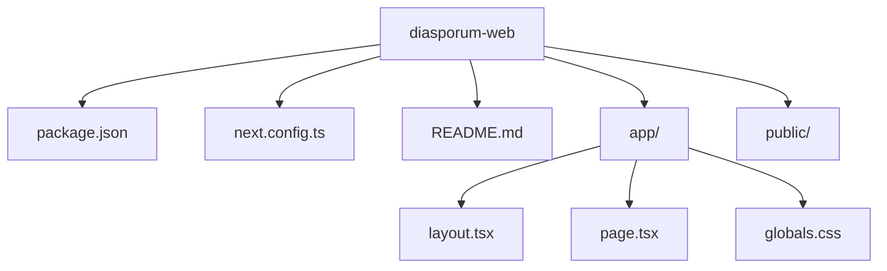
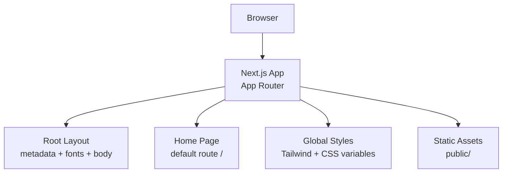
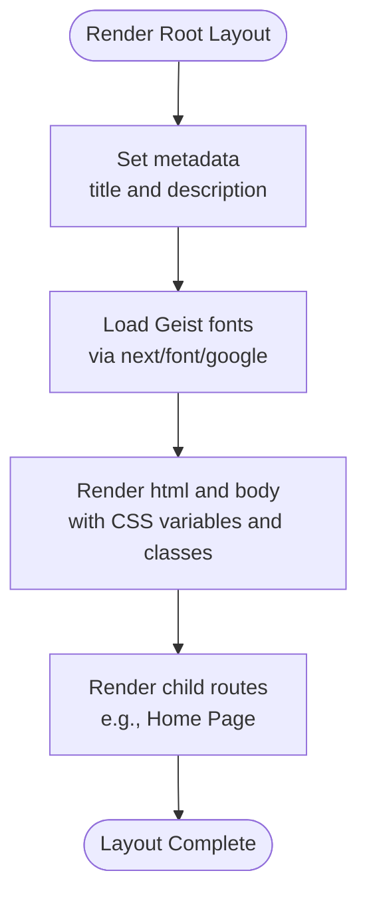
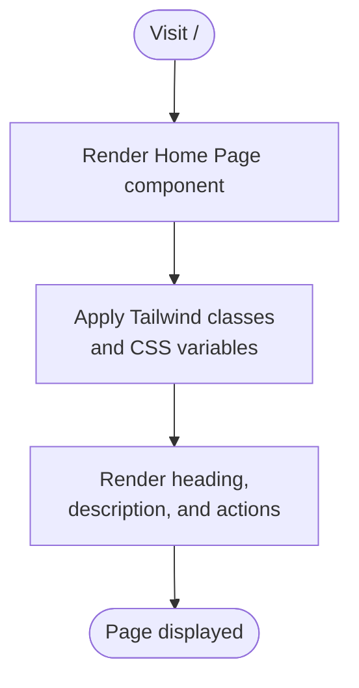
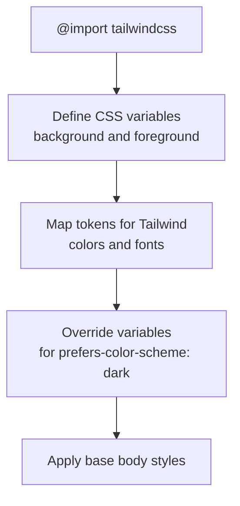
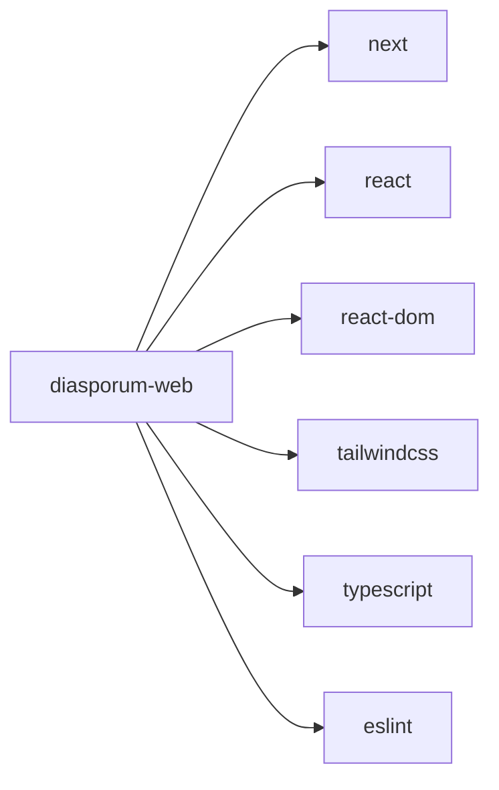

# Web Application

<cite>
**Referenced Files in This Document**
- [package.json](file://diasporum-web/package.json)
- [next.config.ts](file://diasporum-web/next.config.ts)
- [app/layout.tsx](file://diasporum-web/app/layout.tsx)
- [app/page.tsx](file://diasporum-web/app/page.tsx)
- [app/globals.css](file://diasporum-web/app/globals.css)
- [README.md](file://diasporum-web/README.md)
- [DIASPORUM_PHASE_1_SETUP_REPORT.md](file://DIASPORUM_PHASE_1_SETUP_REPORT.md)
- [Diasporum_Project_Context_v10_12.md](file://Diasporum_v10.12/Diasporum_Project_Context_v10_12.md)
</cite>

## Table of Contents
1. [Introduction](#introduction)
2. [Project Structure](#project-structure)
3. [Core Components](#core-components)
4. [Architecture Overview](#architecture-overview)
5. [Detailed Component Analysis](#detailed-component-analysis)
6. [Dependency Analysis](#dependency-analysis)
7. [Performance Considerations](#performance-considerations)
8. [Troubleshooting Guide](#troubleshooting-guide)
9. [Conclusion](#conclusion)
10. [Appendices](#appendices)

## Introduction
This document describes the DIASPORUM web application located under `diasporum-web`. At present, it is a minimal Next.js 16 application with Tailwind CSS v4 and TypeScript. It provides a root layout, a default home page, and a basic styling setup. The repository’s broader project context states that the mobile application remains the primary product surface, while the Next.js web layer is intended to complement it as an administrative console and informational public website.

The goal of this documentation is to:
- Explain the current minimal implementation structure.
- Describe the basic page layout and Tailwind CSS setup.
- Provide setup, build, and deployment guidance for the web platform.
- Outline future development plans aligned with the project context.
- Offer practical guidance for extending the structure and integrating with the backend API.

## Project Structure
The web application follows the Next.js App Router convention with a small set of files:

**Diagram sources**
- [package.json:1-27](file://diasporum-web/package.json#L1-L27)
- [next.config.ts:1-21](file://diasporum-web/next.config.ts#L1-L21)
- [app/layout.tsx:1-30](file://diasporum-web/app/layout.tsx#L1-L30)
- [app/page.tsx:1-70](file://diasporum-web/app/page.tsx#L1-L70)
- [app/globals.css:1-27](file://diasporum-web/app/globals.css#L1-L27)

Key observations:
- The app uses the Next.js App Router (`app/` directory).
- There is only one route at `/`, implemented by `app/page.tsx`.
- Global styles are imported from `app/globals.css`.
- Fonts are loaded via Next.js font integration.
- Tailwind CSS v4 is configured through the Turbopack loader rule.

**Section sources**
- [DIASPORUM_PHASE_1_SETUP_REPORT.md:106-112](file://DIASPORUM_PHASE_1_SETUP_REPORT.md#L106-L112)

## Core Components
The web application currently consists of three core components:

| Component | Purpose | Current State |
|---|---|---|
| Root layout | Defines metadata, global fonts, HTML shell, and body container | Minimal template layout with dark mode variables and full-height body |
| Home page | Renders the initial landing UI | Default Next.js template page with links and branding elements |
| Global styles | Imports Tailwind and defines theme tokens | Tailwind import, CSS variables for background/foreground, and dark mode support |

These components together provide a working but empty foundation ready for expansion into admin and public pages.

**Section sources**
- [app/layout.tsx:1-30](file://diasporum-web/app/layout.tsx#L1-L30)
- [app/page.tsx:1-70](file://diasporum-web/app/page.tsx#L1-L70)
- [app/globals.css:1-27](file://diasporum-web/app/globals.css#L1-L27)

## Architecture Overview
At this stage, the web application does not include routing beyond `/`, authentication, or direct API calls. Its architecture is intentionally minimal:

This diagram represents the current runtime flow: the browser loads the Next.js application, which renders the root layout and the home page using global styles and static assets.

**Diagram sources**
- [app/layout.tsx:1-30](file://diasporum-web/app/layout.tsx#L1-L30)
- [app/page.tsx:1-70](file://diasporum-web/app/page.tsx#L1-L70)
- [app/globals.css:1-27](file://diasporum-web/app/globals.css#L1-L27)

## Detailed Component Analysis

### Root Layout
The root layout sets up:
- Metadata such as title and description.
- Google fonts via Next.js font integration.
- CSS custom properties for background and foreground colors.
- A full-height body container suitable for expanding into a multi-section interface.

Future extensions should keep the layout minimal and add shared navigation, headers, footers, and theme providers as needed.

**Diagram sources**
- [app/layout.tsx:1-30](file://diasporum-web/app/layout.tsx#L1-L30)

**Section sources**
- [app/layout.tsx:1-30](file://diasporum-web/app/layout.tsx#L1-L30)

### Home Page
The home page is the default Next.js template page. It demonstrates:
- Tailwind utility classes for layout and typography.
- Dark mode color handling.
- Links to external resources.

For DIASPORUM, this page can evolve into either:
- An informational landing page for the public site.
- A redirect or entry point to the admin console.

**Diagram sources**
- [app/page.tsx:1-70](file://diasporum-web/app/page.tsx#L1-L70)

**Section sources**
- [app/page.tsx:1-70](file://diasporum-web/app/page.tsx#L1-L70)

### Global Styles and Tailwind Setup
The global stylesheet:
- Imports Tailwind CSS v4.
- Declares CSS variables for background and foreground.
- Provides dark mode overrides.
- Sets base body styles.

The Next.js configuration enables:
- Experimental agent feedback.
- Component caching.
- Partial prefetching.
- A Turbopack rule for CSS processing with Tailwind.

**Diagram sources**
- [app/globals.css:1-27](file://diasporum-web/app/globals.css#L1-L27)
- [next.config.ts:1-21](file://diasporum-web/next.config.ts#L1-L21)

**Section sources**
- [app/globals.css:1-27](file://diasporum-web/app/globals.css#L1-L27)
- [next.config.ts:1-21](file://diasporum-web/next.config.ts#L1-L21)

## Dependency Analysis
The web application depends on:
- Next.js 16.4.3 for framework features and routing.
- React 19.3.0 and react-dom for rendering.
- Tailwind CSS v4 for styling.
- TypeScript for type safety.
- ESLint for linting.

**Diagram sources**
- [package.json:1-27](file://diasporum-web/package.json#L1-L27)

**Section sources**
- [package.json:1-27](file://diasporum-web/package.json#L1-L27)

## Performance Considerations
Current performance-related settings include:
- `cacheComponents: true`: Enables component caching to improve rendering performance.
- `partialPrefetching: true`: Allows partial data prefetching for faster navigation.
- Turbopack CSS loader rule for Tailwind CSS.
- Next.js font optimization through `next/font/google`.

Recommendations:
- Keep the number of top-level routes small until the admin and public interfaces are defined.
- Avoid heavy client-side state in the default page; prefer server-side rendering or static generation where appropriate.
- Use Next.js image optimization for any new images added to `public/`.
- Monitor bundle size as you introduce additional dependencies.

[No sources needed since this section provides general guidance]

## Troubleshooting Guide
Common issues and resolutions:

| Issue | Likely Cause | Resolution |
|---|---|---|
| Development server does not start | Missing dependencies or Node version mismatch | Run dependency installation and verify Node compatibility |
| Tailwind styles do not apply | Incorrect Tailwind import or missing CSS variable mapping | Ensure `@import "tailwindcss"` exists and CSS variables are mapped in `globals.css` |
| Build fails due to experimental flags | Unintended or incompatible experimental options | Review `next.config.ts` experimental settings and align with Next.js version |
| Linting errors | ESLint rules violated | Run the lint script and fix reported issues |

Operational commands:
- Development: run the development server.
- Build: create a production build.
- Start: run the production server.
- Lint: check code quality.

**Section sources**
- [README.md:1-37](file://diasporum-web/README.md#L1-L37)
- [package.json:1-27](file://diasporum-web/package.json#L1-L27)

## Conclusion
The DIASPORUM web application is a clean, minimal Next.js starter aligned with the project’s mobile-first strategy. It provides a solid foundation for building an administrative console and informational public website. Future work should focus on defining clear routes for admin and public content, establishing consistent layout patterns, and integrating with the Spring Boot backend API when those surfaces are ready.

[No sources needed since this section summarizes without analyzing specific files]

## Appendices

### Setup Instructions
1. Install dependencies using your preferred package manager.
2. Start the development server.
3. Open the local development URL in a browser.
4. Edit `app/page.tsx` to begin implementing the web interface.

**Section sources**
- [README.md:1-37](file://diasporum-web/README.md#L1-L37)

### Build Process
- Use the build script to generate a production-ready output.
- Verify that linting passes before building.
- Confirm that the build succeeds with the current experimental flags.

**Section sources**
- [package.json:1-27](file://diasporum-web/package.json#L1-L27)

### Deployment Considerations
- Deploy to Vercel using the recommended workflow.
- Configure environment variables for backend API URLs if the web app begins making requests.
- Ensure CORS is enabled on the backend for the deployed web origin.
- Keep the Next.js configuration stable unless new requirements justify changes.

**Section sources**
- [README.md:32-37](file://diasporum-web/README.md#L32-L37)

### Future Development Plans
According to the project context, the mobile application remains the primary product surface. The Next.js web layer should be limited to:
- An administrative console.
- An informational public website.

As the web interface expands:
- Introduce dedicated routes for admin and public sections.
- Add authentication flows for admin access.
- Create reusable layout components for dashboards and public pages.
- Integrate with the backend API for community, feed, identity, media, and other domain features.

**Section sources**
- [Diasporum_Project_Context_v10_12.md:407-411](file://Diasporum_v10.12/Diasporum_Project_Context_v10_12.md#L407-L411)

### Extending the Existing Structure
Recommended steps:
1. Create feature-based directories under `app/` for admin and public areas.
2. Extract shared layout components for headers, sidebars, and footers.
3. Centralize theme tokens and design tokens in `globals.css` or a dedicated theme module.
4. Add an API client layer to communicate with the Spring Boot backend.
5. Implement authentication guards for protected admin routes.
6. Add tests for critical user flows once the interface stabilizes.

[No sources needed since this section provides general guidance]